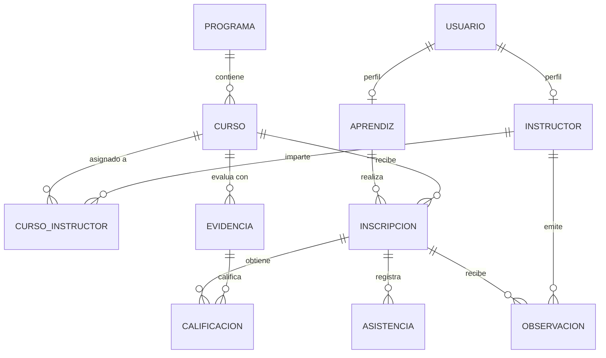

# EDUNOVA · Academic Management System 🎓✨
> **"Transformando la gestión académica en una experiencia inteligente."**

[](#)
[](#)
[](#)
[](#)
[](#)
[](#)
[](#)

---

## 📌 Información Institucional del Proyecto
- **Nombre Oficial:** EDUNOVA – Plataforma Inteligente de Gestión Académica
- **Desarrolladora:** Anyely Valeria
- **Programa de Formación:** Tecnólogo en Análisis y Desarrollo de Software (ADSO)
- **Centro de Formación:** Centro de Formación Industrial – SENA Regional Huila
- **Ubicación:** Neiva, Huila, Colombia
- **Versión:** 1.0.0
- **Duración Estimada:** 4 Semanas (Metodología Ágil / Sprints)

---

## 💡 Propósito y Visión
**EDUNOVA** es una plataforma web integral diseñada para sustituir el manejo manual y fragmentado de la información académica (hojas de cálculo, libretas y documentos dispersos). Centraliza el registro de aprendices, instructores, programas de formación, cursos, calificaciones y asistencia en tiempo real, integrando un **módulo asistente con inteligencia artificial (EDUNOVA AI)** para ofrecer recomendaciones preventivas y formativas.

---

## 🎨 Identidad Visual y Paleta de Colores

El diseño visual ha sido construido para reflejar una estética tecnológica, sobria, educativa y profesional:

| Color | Código HEX | Rol en la Interfaz | Ejemplo Visual |
| :--- | :--- | :--- | :--- |
| **Azul oscuro** | `#102A43` | Barra lateral (Sidebar), Navbar y títulos principales | `rgb(16, 42, 67)` |
| **Azul principal** | `#2563EB` | Botones de acción, enlaces activos, elementos primarios | `rgb(37, 99, 235)` |
| **Turquesa** | `#14B8A6` | Gráficos, métricas destacadas y badges de EDUNOVA AI | `rgb(20, 184, 166)` |
| **Blanco** | `#FFFFFF` | Fondos de tarjetas, tablas, modales y formularios | `rgb(255, 255, 255)` |
| **Gris claro** | `#F1F5F9` | Fondo general de la plataforma (`bg-slate-100`) | `rgb(241, 245, 249)` |
| **Gris oscuro** | `#334155` | Textos secundarios y párrafos de contenido | `rgb(51, 65, 85)` |
| **Verde** | `#22C55E` | Calificaciones aprobadas, estado "PRESENTE", éxito | `rgb(34, 197, 94)` |
| **Naranja** | `#F59E0B` | Evidencias pendientes, alertas preventivas, tardanzas | `rgb(245, 158, 11)` |
| **Rojo** | `#EF4444` | Inasistencias, reprobaciones y estados críticos | `rgb(239, 68, 68)` |

---

## 🏗️ Arquitectura de Software (Tres Capas)

EDUNOVA implementa una arquitectura modular de tres capas que garantiza la separación de responsabilidades:

```
[ FRONTEND - React 18 + Tailwind CSS + Recharts ]
                     ▲
                     │ (HTTP / REST API + JWT)
                     ▼
[ BACKEND - Node.js + Express.js + Prisma ORM ] ──► [ EDUNOVA AI Module ]
                     ▲
                     │ (TCP / MySQL Protocol)
                     ▼
[ BASE DE DATOS - MySQL 8.0 (edunova_db) ]
```

1. **Capa de Presentación (Frontend):** React 18, Vite, Tailwind CSS, Lucide Icons, Axios y Recharts.
2. **Capa Lógica de Negocio (Backend):** Node.js, Express.js, JWT, Bcrypt y Prisma ORM.
3. **Capa de Datos:** MySQL 8 con claves foráneas, restricciones de integridad e índices optimizados.

---

## 📊 Modelo Entidad-Relación (`edunova_db`)

La base de datos cuenta con 11 tablas interconectadas con normalización hasta 3FN:



El script SQL ejecutable para importar en **MySQL Workbench** se encuentra en:  
👉 [`docs/database/edunova_db.sql`](docs/database/edunova_db.sql)  
El esquema para **Prisma ORM** se encuentra en:  
👉 [`server/prisma/schema.prisma`](server/prisma/schema.prisma)

---

## 🌿 Estrategia de Ramas en Git

El proyecto sigue una estrategia basada en Git Flow simplificado:

- **`Main`**: Rama de producción y versiones estables para sustentación.
- **`DEV`**: Rama principal de desarrollo donde se integran las nuevas características.
- **`QA`**: Rama de pruebas de integración, validación de historias de usuario y control de calidad.

---

## 📁 Estructura del Repositorio

```text
PLATAFORMA-DE-GESTI-N-ACAD-MICA/
├── client/                      # Frontend (React 18 + Vite + Tailwind CSS)
│   ├── src/
│   │   ├── components/          # Componentes visuales (Dashboard, Tablas, Forms)
│   │   ├── App.jsx              # Enrutador y vista principal
│   │   ├── main.jsx             # Punto de entrada de React
│   │   └── index.css            # Estilos y configuración Tailwind
│   ├── index.html               # Plantilla HTML
│   ├── tailwind.config.js       # Paleta y fuentes institucionales
│   └── vite.config.js           # Configuración de Vite & Proxy API
├── server/                      # Backend (Node.js + Express + Prisma)
│   ├── prisma/
│   │   └── schema.prisma        # Modelo de datos Prisma para MySQL
│   ├── src/
│   │   ├── controllers/         # Controladores de negocio
│   │   ├── middlewares/         # Validación JWT y roles (RBAC)
│   │   ├── routes/              # Endpoints REST (/api/auth, /api/dashboard, etc.)
│   │   └── index.js             # Servidor Express principal
│   ├── .env.example             # Plantilla de variables de entorno
│   └── package.json             # Dependencias del backend
├── docs/                        # Documentación Técnica Formal
│   ├── especificaciones-tecnicas.md  # RF, RNF, Historias de Usuario HU01-HU12
│   └── database/
│       └── edunova_db.sql       # DDL y DML (Seeders) para MySQL Workbench
├── .gitignore                   # Exclusión de node_modules, .env, dist
└── README.md                    # Identidad y manual general del proyecto
```

---

## 🚀 Guía de Instalación y Ejecución Local

### 1. Clonar el repositorio y ubicarse en la rama de desarrollo
```bash
git clone https://github.com/bautistanyely809-creator/PLATAFORMA-DE-GESTI-N-ACAD-MICA.git
cd PLATAFORMA-DE-GESTI-N-ACAD-MICA
git checkout DEV
```

### 2. Configurar la Base de Datos (MySQL)
1. Abrir **MySQL Workbench**.
2. Cargar y ejecutar el script [`docs/database/edunova_db.sql`](docs/database/edunova_db.sql).
3. Esto creará la base de datos `edunova_db` con sus tablas e insertará los registros de prueba para la sustentación.

### 3. Configurar y Ejecutar el Backend
```bash
cd server
npm install
cp .env.example .env
# Ajustar DATABASE_URL en .env con tus credenciales locales de MySQL
npm run dev
```
*El servidor iniciará en `http://localhost:4000` con monitoreo activo.*

### 4. Configurar y Ejecutar el Frontend
```bash
cd ../client
npm install
npm run dev
```
*La interfaz estará disponible en `http://localhost:3000`.*

---

## 🗓️ Cronograma de Desarrollo (4 Semanas)

| Semana | Enfoque | Entregables Principales |
| :---: | :--- | :--- |
| **1** | **Cimientos y Diseño** | Requisitos técnicos, historias de usuario, script SQL, Prisma schema, prototipo UI. |
| **2** | **Backend Core & BD** | API Express, autenticación JWT, middleware RBAC, CRUD de aprendices, instructores y cursos. |
| **3** | **Frontend & Flujo Académico** | Pantallas de notas, asistencia interactiva, portal del aprendiz, dashboard consolidado. |
| **4** | **EDUNOVA AI & Sustentación** | Recomendaciones inteligentes, gráficos estadísticos Recharts, pruebas QA y deploy. |

---

## 👩‍💻 Créditos y Autora
- **Anyely Valeria** – Desarrolladora Principal
- **Programa:** Análisis y Desarrollo de Software (ADSO) · Ficha 2026
- **SENA:** Centro de Formación Industrial – Regional Huila