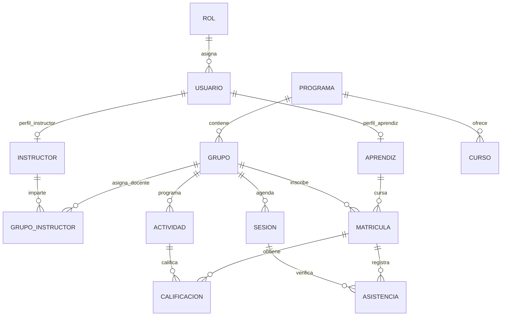

# EDUNOVA · Academic Management System 🎓⚡
> **"Transformando la gestión académica en una experiencia inteligente, tecnológica y centralizada."**

[](#)
[](#)
[](#)
[](#)
[](#)
[](#)
[](#)
[](#)
[](#)

---

## 📑 Documentación Oficial del Proyecto (SRS en GitHub)

Toda la especificación técnica formal y viva de este proyecto se encuentra documentada en la carpeta [`/documentos`](documentos/):

👉 **[Acceder al Documento SRS de EDUNOVA (IEEE 830 / ISO/IEC/IEEE 29148)](documentos/SRS_EDUNOVA.md)**

> **⚡ Política de Trazabilidad Continua:** Cada modificación, nuevo componente, endpoint o actualización visual en el código fuente de EDUNOVA se refleja directamente en el documento **`SRS_EDUNOVA.md`**, garantizando que el repositorio conserve coherencia técnica entre los requisitos y la implementación.

---

## 📌 Información Institucional del Proyecto
- **Nombre Oficial:** EDUNOVA – Academic Management System
- **Aprendiz / Desarrolladora:** Anyely Valeria Bautista
- **Programa de Formación:** Tecnólogo en Análisis y Desarrollo de Software (ADSO) – Ficha 2874102
- **Centro de Formación:** Centro de Formación Industrial – SENA Regional Huila
- **Ubicación:** Neiva, Huila, Colombia
- **Versión del Sistema:** v2.2 (Factory Design System & High Performance Architecture)
- **Duración Estimada:** 4 Semanas (1 Mes · Metodología Ágil Scrum)
- **Modalidad:** Desarrollo individual asistido por Inteligencia Artificial

---

## 💡 Propósito y Visión
**EDUNOVA** es una plataforma web integral diseñada para sustituir el manejo manual y fragmentado de la información académica (hojas de cálculo, libretas y documentos dispersos). Centraliza el registro de aprendices, instructores, programas de formación, cursos, calificaciones y asistencia en tiempo real, integrando un **módulo asistente con inteligencia artificial (EDUNOVA AI)** para ofrecer recomendaciones preventivas y formativas adaptadas al ritmo de cada aprendiz.

---

## ⚙️ Identidad Visual Oficial: Factory Design System (Dark Terminal War Room)

La interfaz de EDUNOVA aplica el sistema de diseño **Factory**, un estándar estético de alta precisión concebido como una superficie de control de medianoche con alto contraste, bordes hairline nítidos y cero sombras difusas:

| Token / Color | Código HEX | Rol en la Interfaz | Aplicación Visual |
| :--- | :--- | :--- | :--- |
| **Obsidian** | `#101010` | Superficie de control base y canvas de medianoche | Fondo de pantalla, Auth Ground y cabeceras de tablas |
| **Carbon Lift** | `#1d1a18` | Paneles y elevación de componentes | Contenedores de métricas, fichas, catálogo y consola IA |
| **Ash Stroke** | `#3d3a39` | Bordes hairline de separación | Divisores de tarjetas, marcos de inputs y celdas |
| **Bone Card** | `#eeeeee` | Tarjeta flashlit de máximo impacto | Hero Banner de despacho para aprendices y dirección |
| **Chalk** | `#fafafa` | Botones principales y acciones primarias | Botones de envío, despacho de IA y login primario |
| **Signal Orange** | `#ee6018` | Telemetría viva y estados en tiempo real | Pulsos de red activa, insignias de rol y cursores |
| **Metric Green** | `#a0ca92` | Datos positivos y aprobaciones | Notas aprobatorias (A), asistencia $\ge 90\%$ y checks |
| **Granite / Slate** | `#8c8682` | Metadatos y etiquetas secundarias | Fechas, identificadores de ficha y etiquetas de campo |

### Principios Fundamentales del Sistema Factory:
* **Tipografía Geist y Geist Mono:** Tipografía moderna con tracking negativo ajustado (`tracking-tight`) y pesos balanceados (Geist 400/500).
* **Radio Estricto de 3px:** Aplicado en todos los botones, badges e inputs para una sensación táctil y precisa de consola de control.
* **Tarjetas a 10px con Borde Hairline:** Estructura geométrica clara y plana con bordes Ash `#3d3a39`.
* **Elevación Plana:** Eliminación de sombras difusas o desenfoques cromáticos; la jerarquía se establece mediante el contraste absoluto Obsidian vs. Bone.

---

## 🏗️ Arquitectura de Software (Tres Capas)

EDUNOVA implementa una arquitectura modular de tres capas que garantiza la separación estricta de responsabilidades:

```
[ FRONTEND - React 18 + Tailwind CSS + Recharts ]
                     ▲
                     │ (HTTP / REST API + JWT)
                     ▼
[ BACKEND - Node.js + Express.js + Prisma ORM ] ──► [ Módulo EDUNOVA AI ]
                     ▲
                     │ (TCP / MySQL Protocol)
                     ▼
[ BASE DE DATOS - MySQL 8.0 (13 Entidades Relacionales) ]
```

1. **Capa de Presentación (Frontend):** React 18, Vite, Tailwind CSS, Lucide Icons y Recharts (Donut Chart de rendimiento).
2. **Capa Lógica de Negocio (Backend):** Node.js, Express.js, JWT, Bcrypt y Prisma ORM.
3. **Capa de Datos:** MySQL 8 con 13 entidades normalizadas en 3FN e integridad referencial.

---

## 📊 Modelo Entidad-Relación (MER)

La base de datos cuenta con **13 entidades interconectadas**:



* Script SQL ejecutable en **MySQL Workbench**:  
  👉 [`docs/database/edunova_db.sql`](docs/database/edunova_db.sql)  
* Esquema para **Prisma ORM**:  
  👉 [`server/prisma/schema.prisma`](server/prisma/schema.prisma)

---

## 🌿 Estrategia de Ramas en Git

El proyecto sigue una estrategia basada en Git Flow simplificado:

- **`Main`**: Rama de producción y versiones estables para sustentación.
- **`DEV`**: Rama principal de desarrollo donde se integran las nuevas características.
- **`QA`**: Rama de pruebas de integración, validación de historias de usuario y control de calidad.

---

## 📁 Estructura del Repositorio

```text
PLATAFORMA-DE-GESTI-N-ACAD-MICA/
├── client/                      # Frontend (React 18 + Vite + Tailwind CSS)
│   ├── src/
│   │   ├── components/          # Sidebar, Header, ApprenticeDashboard, Auth, etc.
│   │   ├── App.jsx              # Enrutador y control de sesión
│   │   ├── main.jsx             # Punto de entrada de React
│   │   └── index.css            # Tokens Ocean Tech y estilos Glassmorphism
│   ├── index.html               # Plantilla HTML con fuente Plus Jakarta Sans
│   ├── tailwind.config.js       # Tokens de color y sombras Ocean Tech
│   └── vite.config.js           # Configuración de Vite & Hot Module Reload (HMR)
├── server/                      # Backend (Node.js + Express + Prisma)
│   ├── prisma/
│   │   └── schema.prisma        # Modelo de datos Prisma para MySQL
│   ├── src/
│   │   ├── controllers/         # Controladores de lógica de negocio
│   │   ├── middlewares/         # Validación JWT y control de roles (RBAC)
│   │   ├── routes/              # Endpoints REST (/api/auth, /api/usuarios, etc.)
│   │   └── index.js             # Servidor Express principal
│   ├── .env.example             # Plantilla de variables de entorno
│   └── package.json             # Dependencias del backend
├── documentos/                  # Documentación Técnica Formal Viva
│   └── SRS_EDUNOVA.md           # Especificación de Requisitos de Software (IEEE 830)
├── docs/                        # Recursos de Base de Datos y Diagramas
│   └── database/
│       └── edunova_db.sql       # Script DDL y DML (Seeders) para MySQL 8
├── .gitignore                   # Exclusión de node_modules, .env, dist
└── README.md                    # Identidad y manual general del proyecto
```

---

## 🚀 Guía de Instalación y Ejecución Local

### 1. Clonar el repositorio y ubicarse en la rama de desarrollo
```bash
git clone https://github.com/bautistanyely809-creator/PLATAFORMA-DE-GESTI-N-ACAD-MICA.git
cd PLATAFORMA-DE-GESTI-N-ACAD-MICA
git checkout DEV
```

### 2. Configurar la Base de Datos (MySQL)
1. Abrir **MySQL Workbench**.
2. Cargar y ejecutar el script [`docs/database/edunova_db.sql`](docs/database/edunova_db.sql).
3. Esto creará la base de datos `edunova_db` con sus 13 tablas e insertará los registros de prueba para la sustentación.

### 3. Configurar y Ejecutar el Backend
```bash
cd server
npm install
cp .env.example .env
# Ajustar DATABASE_URL en .env con tus credenciales locales de MySQL
npm run dev
```
*El servidor iniciará en `http://localhost:4000`.*

### 4. Configurar y Ejecutar el Frontend
```bash
cd ../client
npm install
npm run dev
```
*La interfaz estará disponible en `http://localhost:3000`.*

---

## 🗓️ Cronograma de Desarrollo (4 Semanas – Scrum)

| Semana | Enfoque | Entregables Principales |
| :---: | :--- | :--- |
| **Semana 1** | **Análisis, Requisitos y MER** | SRS IEEE 830, historias de usuario HU01-HU16, script SQL de 13 tablas, arquitectura en capas. |
| **Semana 2** | **Backend Core & Base de Datos** | API REST en Express, Prisma ORM, autenticación JWT, RBAC, CRUD de aprendices e instructores. |
| **Semana 3** | **Frontend & Experiencia de Usuario** | Interfaces React Ocean Tech, autenticación por 3 roles, Hero Banner, Donut Chart y tutor EDUNOVA AI. |
| **Semana 4** | **QA, Pruebas y Sustentación** | Casos de prueba CP01-CP12, validaciones de seguridad, sincronización del SRS y sustentación final. |

---

## 👩‍💻 Créditos y Autora
- **Anyely Valeria Bautista** – Desarrolladora Líder Full Stack
- **Programa:** Análisis y Desarrollo de Software (ADSO) · Ficha 2874102
- **Centro:** Centro de Formación Industrial – SENA Regional Huila (Neiva)
