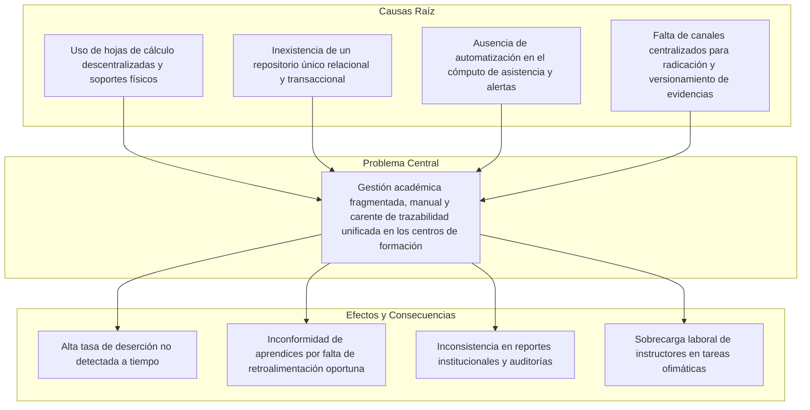

# 02. PLANTEAMIENTO DEL PROBLEMA

## 2.1 Descripción de la Situación Actual
En múltiples instituciones de educación para el trabajo y el desarrollo humano, así como en diversos centros de formación técnica y tecnológica, la administración cotidiana de los procesos académicos presenta serias dificultades operativas derivadas de la **dispersión y fragmentación de la información**.

Tradicionalmente, los instructores y coordinadores académicos gestionan los registros de aprendices, las calificaciones de actividades, las listas de asistencia y los planes de refuerzo utilizando herramientas ofimáticas descentralizadas (como libros de cálculo de Microsoft Excel o Google Sheets), libretas físicas de apuntes, correos electrónicos personales y carpetas compartidas en servicios de almacenamiento en la nube sin control transaccional.

Esta metodología analógica o semi-digital presenta las siguientes deficiencias críticas:

1. **Pérdida y Corrupción de Datos:** La ausencia de una base de datos centralizada provoca pérdidas accidentales de archivos, sobrescritura de notas y divergencias entre las copias que maneja cada instructor y las que reposan en coordinación.
2. **Duplicidad y Redundancia:** Los datos de un mismo aprendiz (número de documento, nombres, contacto) se replican manualmente en múltiples planillas, propiciando discrepancias de información.
3. **Falta de Trazabilidad en Calificaciones:** Al no existir un histórico formal de cambios, resulta complejo auditar cuándo un aprendiz corrigió una evidencia, quién la evaluó y cuáles fueron los motivos de modificación de la nota.
4. **Detección Tardía del Riesgo Académico:** El cálculo manual de inasistencias o de competencias no aprobadas impide identificar oportunamente a los aprendices en peligro de deserción o cancelación de matrícula, reduciendo el impacto de los comités de evaluación.
5. **Sobrecarga Administrativa en Instructores:** Los docentes invierten una proporción excesiva de su tiempo laboral consolidando reportes y sumando porcentajes en vez de dedicarse a la retroalimentación pedagógica y al acompañamiento formativo.

---

## 2.2 Formulación del Problema (Pregunta Problema)
Partiendo de las debilidades descritas en el ecosistema formativo, se formula la siguiente pregunta de investigación y desarrollo de software:

> **¿Cómo diseñar e implementar una plataforma web de gestión académica integral, que centralice la información de aprendices, instructores, programas de formación, competencias, evidencias, recuperaciones y asistencia en tiempo real, optimizando los tiempos de respuesta y proporcionando soporte predictivo mediante inteligencia artificial?**

---

## 2.3 Árbol de Problemas

