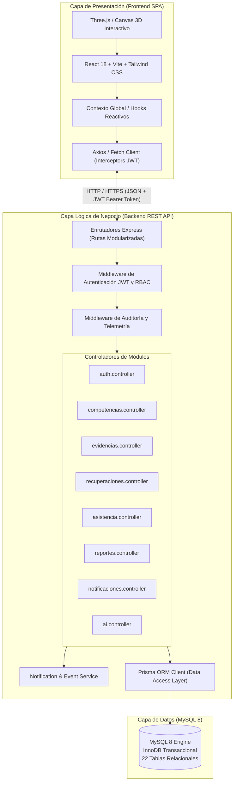

# 06. ARQUITECTURA DEL SISTEMA

## 6.1 Patrón Arquitectónico General
EDUNOVA se estructura bajo el patrón de **Arquitectura Modular de Tres Capas** (Capa de Presentación, Capa Lógica de Negocio y Capa de Persistencia de Datos), articulada a través de servicios desacoplados bajo el estándar arquitectónico **REST (Representational State Transfer)**.



---

## 6.2 Diagrama de Despliegue Físico

```mermaid
deploymentDiagram
    node "Navegador Web del Cliente" {
        artifact "Bundle SPA (HTML5, JS, CSS, WebGL)"
    }

    node "Servidor de Aplicaciones (Node.js Environment)" {
        artifact "Express API Gateway"
        artifact "Prisma Client Engine"
        artifact "In-Memory Session & Telemetry Cache"
    }

    node "Servidor de Base de Datos" {
        database "MySQL 8.0 Server (edunova_db)"
    }

    "Navegador Web del Cliente" -- "TCP/IP Port 5173 / HTTPS" --> "Servidor de Aplicaciones (Node.js Environment)"
    "Servidor de Aplicaciones (Node.js Environment)" -- "TCP/IP Port 3306" --> "Servidor de Base de Datos"
```

---

## 6.3 Descripción de Componentes Principales

1. **Frontend (SPA - Single Page Application):**
   * **React 18:** Motor de renderizado reactivo basado en componentes funcionales y Hooks.
   * **Vite:** Herramienta de compilación ultrarrápida con Hot Module Replacement (HMR).
   * **Tailwind CSS & Factory System:** Estilización utilitaria para Glassmorphism, paleta Ocean Tech y modo oscuro de alta precisión.
   * **Three.js WebGL Canvas:** Núcleo geométrico interactivo en el Hero del dashboard que reacciona al cursor del usuario.

2. **Backend (API RESTful):**
   * **Node.js (v24):** Entorno de ejecución JavaScript del lado del servidor de alto desempeño.
   * **Express.js:** Framework minimalista para la estructuración de rutas, middlewares y controladores.
   * **Prisma ORM:** Capa de mapeo objeto-relacional tipada y segura contra inyecciones SQL que administra las 22 entidades de la base de datos.
   * **JWT & Bcrypt:** Criptografía para autenticación sin estado y hash irreversible de credenciales.
   * **OpenTelemetry & Cache:** Monitoreo de latencia de endpoints y almacenamiento en memoria de métricas frecuentes.

3. **Capa de Persistencia:**
   * **MySQL 8:** Motor relacional con almacenamiento InnoDB, soporte de claves foráneas con restricciones `CASCADE` / `SET NULL` y transacciones ACID.
