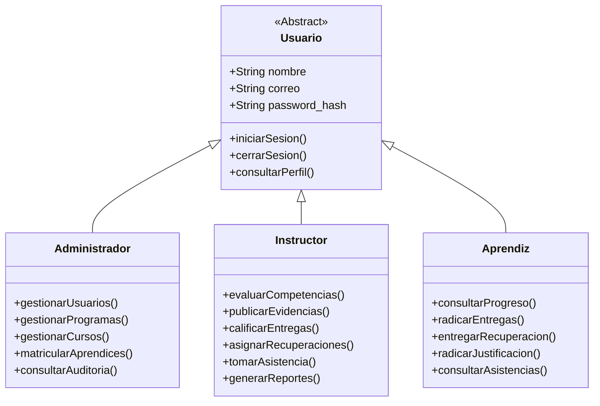

# 09. ACTORES Y PERFILES DEL SISTEMA

## 9.1 Definición de Actores
En el ecosistema de EDUNOVA convergen tanto **actores humanos** como **actores de software / procesos automatizados**:

### 1. Actores Humanos
* **Administrador (`ADMIN`):**
  Personal directivo, coordinador académico o administrador técnico del centro de formación. Posee privilegios globales para crear usuarios, asignar roles, gestionar programas de formación, aperturar fichas de caracterización, matricular aprendices, auditar registros y consultar la telemetría general.
* **Instructor (`INSTRUCTOR`):**
  Docente o instructor técnico responsable de la orientación formativa de una o más fichas. Gestiona las competencias de sus cursos, evalúa los Resultados de Aprendizaje, publica evidencias, califica entregas versionadas, asigna planes de mejoramiento/recuperación, toma asistencia por sesión y emite reportes académicos.
* **Aprendiz (`APRENDIZ`):**
  Estudiante matriculado en uno o más programas de formación. Consulta su estado de competencias, entrega evidencias de aprendizaje en versiones sucesivas, radica actividades de refuerzo, consulta sus asistencias acumuladas, registra justificaciones médicas con soporte y dialoga con el asistente pedagógico EDUNOVA AI.

### 2. Actores de Software / Procesos del Sistema
* **EDUNOVA AI Agent:**
  Servicio cognitivo contextual que procesa el estado académico real del aprendiz para sintetizar diagnósticos personalizados y sugerir acciones pedagógicas.
* **Servicio de Notificaciones y Event Bus:**
  Subsistema automatizado que detecta eventos de mutación de datos (por ejemplo, una nueva calificación, una falta de asistencia o una evidencia publicada) y despacha notificaciones internas a los destinatarios.
* **Motor de Auditoría (`HistorialAuditoria`):**
  Interceptor que captura las acciones críticas ejecutadas en el sistema junto con la dirección IP, fecha y usuario responsable.

---

## 9.2 Diagrama de Jerarquía de Actores (Mermaid)

---

## 9.3 Matriz de Permisos por Rol (CRUD)

| Módulo / Recurso | Administrador | Instructor | Aprendiz |
| :--- | :---: | :---: | :---: |
| **Usuarios y Roles** | CRUD Completo | Lectura Perfil Propio | Lectura Perfil Propio |
| **Programas de Formación** | CRUD Completo | Solo Lectura | Solo Lectura |
| **Cursos / Fichas** | CRUD Completo | Lectura Asignados | Lectura Inscritos |
| **Competencias y RAPs** | CRUD Completo | Lectura y Evaluación | Solo Lectura |
| **Evidencias de Aprendizaje**| Lectura | Crear / Editar / Calificar | Radicar Entrega |
| **Planes de Recuperación** | Lectura | Asignar / Evaluar | Entregar Actividad |
| **Sesiones y Asistencia** | Lectura | Programar / Calificar / Resolver | Justificar / Consultar |
| **Expedientes y Dossiers** | Generar / Imprimir | Generar / Imprimir | Consultar Propio |
| **Notificaciones** | Recibir / Marcar | Recibir / Marcar | Recibir / Marcar |
| **EDUNOVA AI** | Consultas Globales | Consultas Ficha | Consultas Propias |
