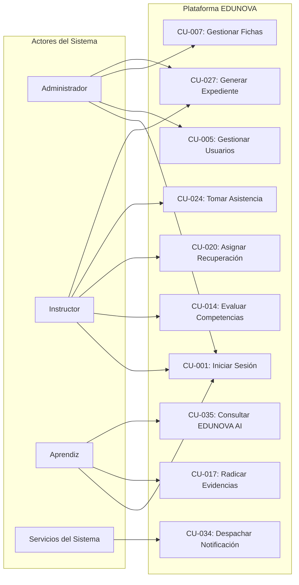
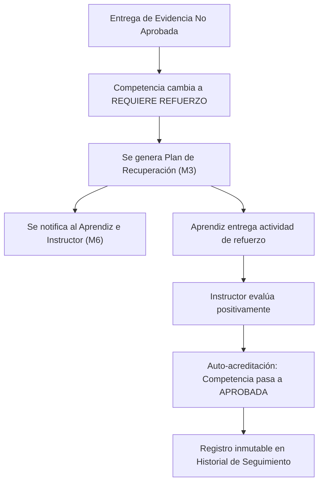

# 11. ESPECIFICACIÓN GENERAL DE CASOS DE USO Y DIAGRAMAS UML

## 11.1 Introducción
Los Casos de Uso de EDUNOVA modelan las interacciones formales entre los actores (humanos y automatizados) y el sistema de información. Cada caso de uso representa una unidad completa de trabajo de negocio que genera un resultado de valor observable.

A continuación se presentan el **Diagrama Global del Sistema** y **10 Diagramas Detallados por Módulo**, elaborados bajo el estándar gráfico UML mediante sintaxis Mermaid.

---

## 11.2 Diagrama General de Casos de Uso del Sistema EDUNOVA



---

## 11.3 Diagramas de Casos de Uso por Módulo

### 1. Módulo: Autenticación y Perfil
```mermaid
flowchart LR
    actor Usuario
    subgraph MOD_AUTH["Módulo: Autenticación y Perfil"]
        CU1["CU-001: Iniciar Sesión"]
        CU2["CU-002: Cerrar Sesión"]
        CU3["CU-003: Recuperar Contraseña (Mock)"]
        CU4["CU-004: Consultar / Actualizar Perfil"]
        VAL["<<include>> Validar Credenciales Bcrypt"]
        JWT["<<include>> Emitir Token JWT"]
    end
    Usuario --> CU1
    Usuario --> CU2
    Usuario --> CU3
    Usuario --> CU4
    CU1 -.-> VAL
    CU1 -.-> JWT
```

### 2. Módulo: Administración Base y Fichas
```mermaid
flowchart LR
    actor Admin["Administrador"]
    subgraph MOD_ADM["Módulo: Administración Base"]
        CU5["CU-005: Gestionar Usuarios"]
        CU6["CU-006: Gestionar Programas"]
        CU7["CU-007: Gestionar Cursos/Fichas"]
        CU8["CU-008: Asignar Instructores"]
        CU9["CU-009: Matricular Aprendices"]
        CU10["CU-010: Estadísticas Globales"]
    end
    Admin --> CU5
    Admin --> CU6
    Admin --> CU7
    Admin --> CU8
    Admin --> CU9
    Admin --> CU10
```

### 3. Módulo 1: Seguimiento por Competencias y RAPs
```mermaid
flowchart LR
    actor Instructor
    actor Aprendiz
    subgraph MOD_M1["Módulo 1: Competencias"]
        CU11["CU-011: Consultar Competencias del Programa"]
        CU12["CU-012: Consultar Avance por Aprendiz"]
        CU13["CU-013: Monitoreo Grupal por Ficha"]
        CU14["CU-014: Evaluar Competencia y Registrar Historial"]
        HIST["<<include>> Registrar Historial Inmutable"]
    end
    Aprendiz --> CU11
    Aprendiz --> CU12
    Instructor --> CU11
    Instructor --> CU13
    Instructor --> CU14
    CU14 -.-> HIST
```

### 4. Módulo 2: Gestión de Evidencias y Entregas
```mermaid
flowchart LR
    actor Instructor
    actor Aprendiz
    subgraph MOD_M2["Módulo 2: Evidencias"]
        CU15["CU-015: Publicar Evidencia"]
        CU16["CU-016: Consultar Evidencias y Fechas"]
        CU17["CU-017: Radicar Entrega Versionada"]
        CU18["CU-018: Calificar y Retroalimentar"]
        VER["<<include>> Incrementar Versión (v1, v2...)"]
    end
    Instructor --> CU15
    Instructor --> CU16
    Instructor --> CU18
    Aprendiz --> CU16
    Aprendiz --> CU17
    CU17 -.-> VER
```

### 5. Módulo 3: Recuperación de Competencias
```mermaid
flowchart LR
    actor Instructor
    actor Aprendiz
    subgraph MOD_M3["Módulo 3: Recuperaciones"]
        CU19["CU-019: Identificar Aprendices en Refuerzo"]
        CU20["CU-020: Asignar Plan de Mejoramiento"]
        CU21["CU-021: Entregar Actividad de Refuerzo"]
        CU22["CU-022: Evaluar y Auto-Acreditar"]
        ACRED["<<extend>> Auto-Acreditar Competencia a Aprobada"]
    end
    Instructor --> CU19
    Instructor --> CU20
    Instructor --> CU22
    Aprendiz --> CU21
    CU22 -.-> ACRED
```

### 6. Módulo 4: Control de Asistencia y Justificaciones
```mermaid
flowchart LR
    actor Instructor
    actor Aprendiz
    actor Sistema["Servicio de Alertas"]
    subgraph MOD_M4["Módulo 4: Asistencia"]
        CU23["CU-023: Programar Sesión de Clase"]
        CU24["CU-024: Tomar Asistencia en Vivo"]
        CU25["CU-025: Radicar/Resolver Justificación"]
        CU26["CU-026: Monitorear Umbral < 85% y Faltas"]
    end
    Instructor --> CU23
    Instructor --> CU24
    Instructor --> CU25
    Aprendiz --> CU25
    Sistema --> CU26
```

### 7. Módulo 5: Centro de Reportes y Dossiers
```mermaid
flowchart LR
    actor Instructor
    actor Admin["Administrador"]
    subgraph MOD_M5["Módulo 5: Reportes"]
        CU27["CU-027: Expediente Individual Aprendiz"]
        CU28["CU-028: Dossier Consolidado de Ficha"]
        CU29["CU-029: Exportar Datos a Excel (CSV)"]
        CU30["CU-030: Formato de Impresión Oficial"]
    end
    Instructor --> CU27
    Instructor --> CU28
    Instructor --> CU29
    Admin --> CU28
    Admin --> CU30
```

### 8. Módulo 6: Centro de Notificaciones y Eventos
```mermaid
flowchart LR
    actor Usuario
    actor Sistema["Bus de Eventos"]
    subgraph MOD_M6["Módulo 6: Notificaciones"]
        CU31["CU-031: Consultar Notificaciones"]
        CU32["CU-032: Marcar Notificación Leída"]
        CU33["CU-033: Marcar Todo como Leído"]
        CU34["CU-034: Despachar Notificación por Evento"]
    end
    Usuario --> CU31
    Usuario --> CU32
    Usuario --> CU33
    Sistema --> CU34
```

### 9. Módulo 7: Asistente EDUNOVA AI
```mermaid
flowchart LR
    actor Aprendiz
    actor Instructor
    subgraph MOD_M7["Módulo 7: Asistente IA"]
        CU35["CU-035: Consulta Contextual Asistente"]
        CU36["CU-036: Streaming en Vivo de Diagnóstico"]
        CTX["<<include>> Inyectar Métricas Reales MySQL"]
    end
    Aprendiz --> CU35
    Instructor --> CU35
    CU35 -.-> CTX
    CU35 -.-> CU36
```

### 10. Diagrama de Procesos Transversales e Integración

