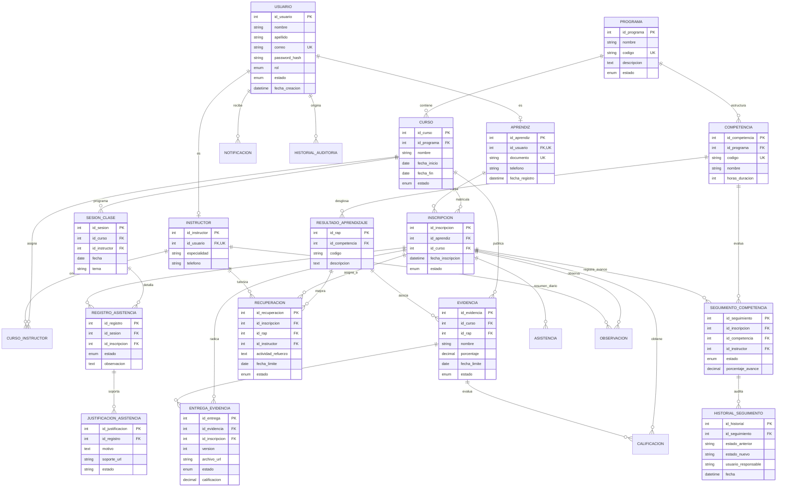
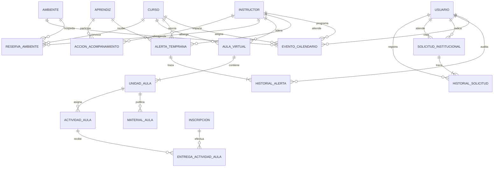

# 12. MODELO ENTIDAD-RELACIÓN (MER)

## 12.1 Descripción General
La base de datos de EDUNOVA (`edunova_db`) está modelada en **Tercera Forma Normal (3FN)** sobre el motor transaccional **InnoDB** de **MySQL 8**. El esquema se compone de **22 tablas relacionales** rigurosamente acopladas mediante claves foráneas con reglas de integridad referencial (`ON DELETE CASCADE` y `ON DELETE SET NULL`).

---

## 12.2 Diagrama Entidad-Relación Completo (Mermaid)

### 12.3 Extensiones del Modelo Relacional — Expansión Integral (13 Nuevas Entidades)
A continuación se especifican las 13 entidades incorporadas en MySQL 8 para soportar los 6 nuevos módulos:

