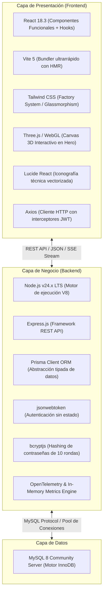

# 14. TECNOLOGÍAS Y STACK TÉCNICO

EDUNOVA integra un ecosistema tecnológico contemporáneo, optimizado para ofrecer tiempos de respuesta ultrarrápidos, alta interactividad visual y estabilidad transaccional.

---

## 14.1 Arquitectura del Stack Tecnológico

---

## 14.2 Detalle de Tecnologías y Versiones

### 1. Frontend
* **React (`v18.3.1`):** Biblioteca estándar para interfaces basadas en componentes reactivos y gestión de ciclo de vida con Hooks (`useState`, `useEffect`, `useMemo`, `useCallback`).
* **Vite (`v5.4.2`):** Entorno de compilación moderno que utiliza Rollup y esbuild para ofrecer recarga de módulos en milisegundos.
* **Three.js (`v0.160+`):** Motor de gráficos WebGL que renderiza el Hero 3D con geometría poligonal y cálculo de sombras en tiempo real.
* **Tailwind CSS (`v3.4.10`):** Framework de utilidades CSS configurado con el tema de diseño **Ocean Tech Premium** y tokens del **Factory Design System** (paleta oscura Obsidian/Carbon y bordes hairline).
* **Lucide React (`v0.441.0`):** Set estandarizado de más de 200 iconos SVG ligeros.

### 2. Backend
* **Node.js (`v24.16.0`):** Plataforma de ejecución asíncrona basada en eventos, con soporte nativo de características modernas de ECMAScript.
* **Express (`v4.19.2`):** Enrutador HTTP robusto que maneja middlewares de autenticación, control de errores y controladores de dominio.
* **Prisma ORM (`v5.19.1`):** Mapeador objeto-relacional de siguiente generación que provee autocompletado tipado en consultas, migraciones automáticas y previene inyecciones SQL.
* **JSON Web Token (`v9.0.2`):** Estándar RFC 7519 para tokens portátiles y seguros de autenticación con firma HMAC-SHA256.
* **Bcryptjs (`v2.4.3`):** Función de derivación de claves basada en el cifrado Blowfish para el almacenamiento irreversible de credenciales.
* **CORS (`v2.8.5`):** Middleware de seguridad para autorización de peticiones entre orígenes cruzados.

### 3. Base de Datos
* **MySQL 8.0:** Motor relacional con soporte nativo de tipos JSON, transacciones ACID bajo InnoDB, índices B-Tree de alta eficiencia y optimizador de consultas basado en costo.
