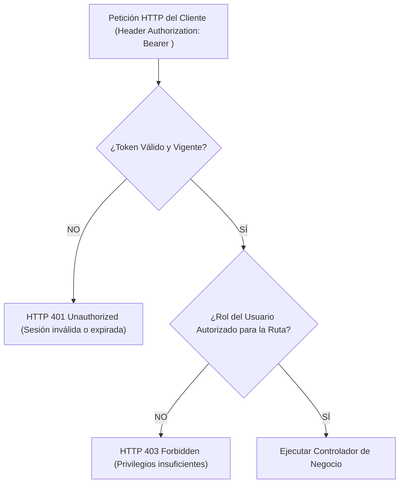

# 15. SEGURIDAD, AUTENTICACIÓN Y PERMISOS (RBAC)

## 15.1 Modelo de Control de Acceso Basado en Roles (RBAC)
EDUNOVA aplica un esquema estricto de **Role-Based Access Control (RBAC)** que restringe la ejecución de operaciones y el acceso a endpoints según el rol validado en el token de autenticación.



---

## 15.2 Estructura del Token JWT
Los tokens emitidos en el inicio de sesión exitoso cumplen con el estándar RFC 7519 y contienen el siguiente payload criptográfico firmado:

```json
{
  "id_usuario": 14,
  "nombre": "Anyely Valeria",
  "apellido": "Bautista",
  "correo": "anyely.bautista@soy.sena.edu.co",
  "rol": "INSTRUCTOR",
  "iat": 1731840000,
  "exp": 1731926400
}
```

* **Algoritmo de Firma:** `HS256` (HMAC con SHA-256).
* **Vigencia del Token:** 24 horas continuas desde la emisión (`exp = iat + 86400s`).
* **Secreto Criptográfico:** Almacenado en la variable de entorno `JWT_SECRET` en el archivo `server/.env` del servidor (nunca expuesto al cliente).

---

## 15.3 Almacenamiento Seguro de Contraseñas (Bcrypt)
Las contraseñas nunca se guardan en texto claro en la base de datos:
1. Al crear o modificar una clave, se genera una sal criptográfica pseudoaleatoria (`salt`).
2. Se ejecuta la función hash con **10 rondas de costo computacional** (`bcrypt.hash(password, 10)`).
3. En el login, se verifica el intento mediante comparación de tiempo constante (`bcrypt.compare(candidate, hash)`), evitando ataques de temporización (*timing attacks*).

---

## 15.4 Matriz de Permisos por Endpoint de la API

| Ruta de la API | Método | Roles Autorizados | Acción / Propósito |
| :--- | :---: | :---: | :--- |
| `/api/auth/login` | POST | Público | Autenticar credenciales y emitir JWT. |
| `/api/auth/perfil` | GET | Todos (Token válido) | Consultar información de la cuenta propia. |
| `/api/usuarios` | GET/POST | `ADMIN` | Listar y crear usuarios en el sistema. |
| `/api/programas` | GET | Todos | Consultar catálogo de programas activos. |
| `/api/programas` | POST/PUT | `ADMIN` | Crear y modificar diseños curriculares. |
| `/api/cursos` | GET/POST | `ADMIN`, `INSTRUCTOR` | Administrar y listar fichas de formación. |
| `/api/competencias/evaluar`| POST | `INSTRUCTOR` | Calificar y asentar juicio de competencia. |
| `/api/evidencias` | POST | `INSTRUCTOR` | Publicar nueva evidencia o taller. |
| `/api/evidencias/entregar`| POST | `APRENDIZ` | Radicar entrega de evidencia versionada. |
| `/api/evidencias/calificar`| POST| `INSTRUCTOR` | Asignar nota y retroalimentación pedagógica.|
| `/api/recuperaciones/asignar`| POST| `INSTRUCTOR`| Asignar plan de mejoramiento académico. |
| `/api/asistencia/sesiones`| POST| `INSTRUCTOR` | Aperturar sesión de clase y planilla. |
| `/api/asistencia/tomar` | POST | `INSTRUCTOR` | Registrar estados de asistencia en sesión. |
| `/api/asistencia/justificar`| POST| `APRENDIZ` | Radicar justificación médica con soporte. |
| `/api/reportes/expediente/:id`| GET| `ADMIN`, `INSTRUCTOR` | Generar expediente completo de aprendiz. |
| `/api/ai/consulta` | POST | Todos (Contextual) | Interactuar con el asistente pedagógico IA. |
