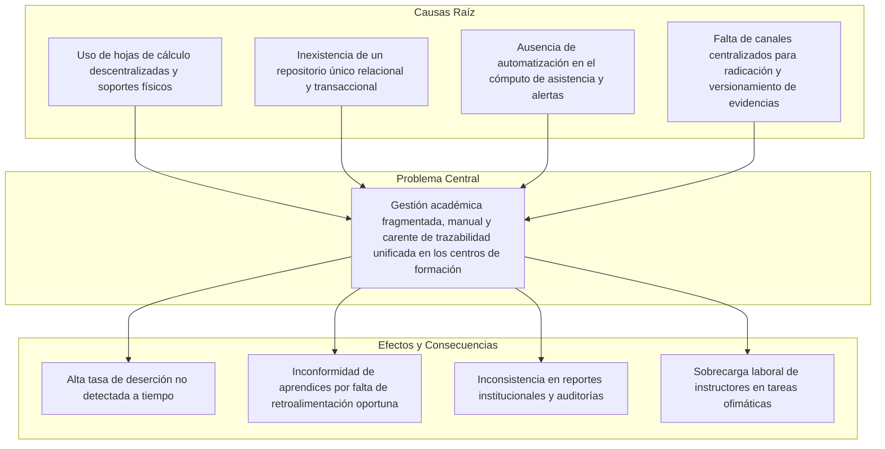
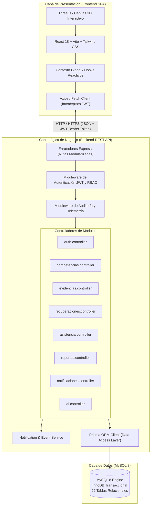
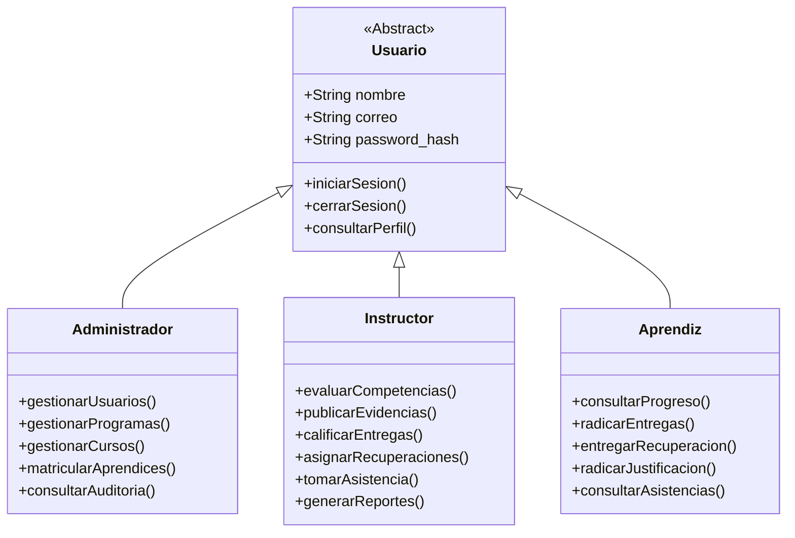
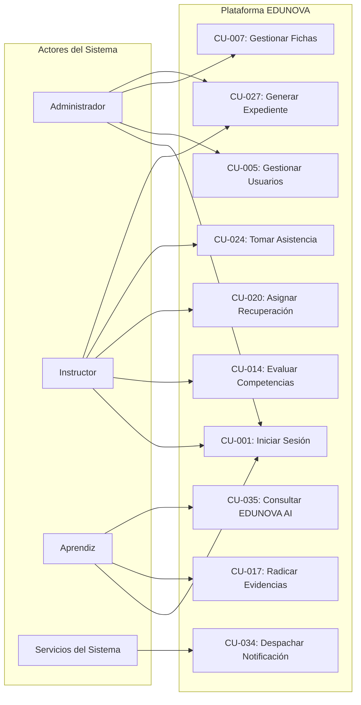
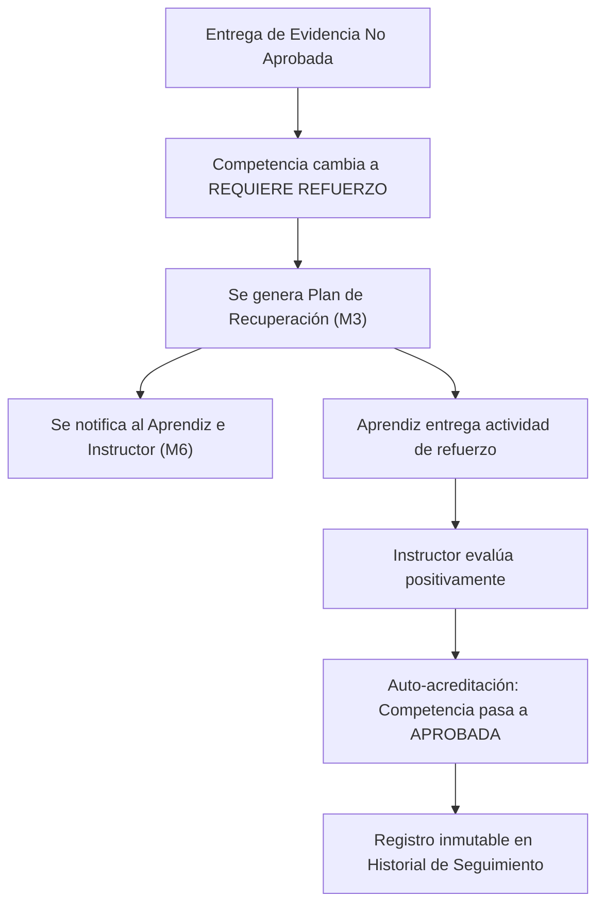
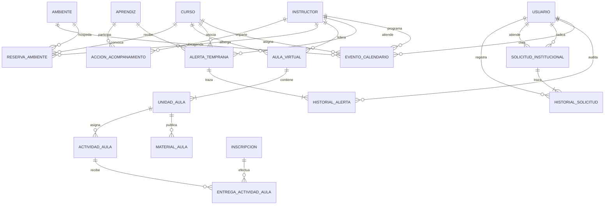
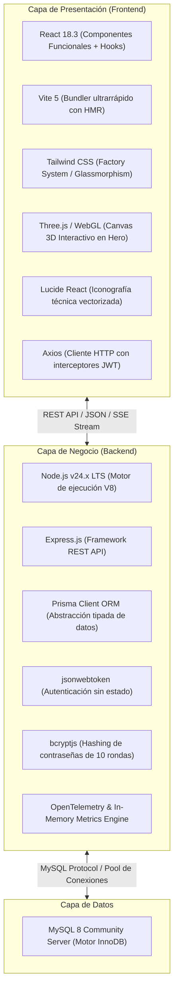
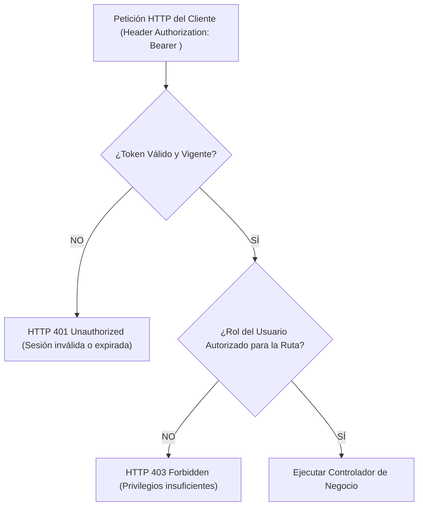

# ESPECIFICACIÓN DE REQUISITOS DE SOFTWARE (SRS / ERS)
# EDUNOVA – ACADEMIC MANAGEMENT SYSTEM
## Estándar Internacional IEEE 830 / ISO/IEC/IEEE 29148 · Documento Maestro Integral

---

| **Información General del Proyecto** | **Detalle Institucional** |
| :--- | :--- |
| **Nombre Oficial del Software:** | EDUNOVA – Academic Management System |
| **Aprendiz Desarrolladora:** | Anyely Valeria Bautista |
| **Programa de Formación:** | Tecnólogo en Análisis y Desarrollo de Software (ADSO) |
| **Número de Ficha de Caracterización:** | 3413988 |
| **Centro de Formación:** | Centro de Formación Industrial – SENA Regional Huila (Neiva) |
| **Modalidad de Desarrollo:** | Desarrollo individual con asistencia de Inteligencia Artificial y metodologías ágiles (Scrum) |
| **Duración Estimada:** | 4 semanas (1 mes de ejecución lectiva) |
| **Versión del Documento:** | 4.0 (SRS Monolítico Maestro Integral — Expansión de 6 Nuevos Módulos Académicos · Rama DEV) |
| **Estado del Documento:** | Aprobado · Conectado con MySQL 8 y 7 Módulos Avanzados Operativos |

---

## CONTROL DE VERSIONES DEL DOCUMENTO

| Versión | Fecha | Autor(a) | Descripción del Cambio |
| :---: | :---: | :--- | :--- |
| **v1.0** | 11/11/2026 | Anyely Valeria | Creación inicial del SRS, planteamiento del problema, requisitos RF/RNF, historias de usuario y cronograma. |
| **v1.1** | 12/11/2026 | Anyely Valeria | Incorporación de autenticación obligatoria dividida en 3 roles (Aprendiz, Instructor, Admin) y maquetación Glassmorphism. |
| **v1.2** | 13/11/2026 | Anyely Valeria | Actualización estética Ocean Tech Premium: paleta petróleo, turquesa, cian y ámbar; modelo MER de 13 entidades iniciales. |
| **v2.0** | 13/11/2026 | Anyely Valeria | Estandarización de historias de usuario (HU-01 a HU-26) y casos de uso básicos. |
| **v2.1** | 13/11/2026 | Anyely Valeria | Sprint de alto rendimiento: Skeletons, debounce en búsqueda, paginación, streaming de IA y caché. |
| **v2.2** | 13/11/2026 | Anyely Valeria | Integración de Three.js con WebGL en el Hero Banner y refinamiento de la paleta Factory / Ocean Tech. |
| **v3.0** | 13/11/2026 | Anyely Valeria | Despliegue de los 7 Módulos Académicos Avanzados conectados a MySQL 8 con 22 tablas relacionales. |
| **v3.1** | 17/11/2026 | Anyely Valeria | Especificación modular de 16 documentos y 36 Casos de Uso individuales bajo IEEE 830. |
| **v4.0** | 18/11/2026 | Anyely Valeria | **Expansión Integral de EDUNOVA**: Incorporación de los 6 nuevos módulos requeridos (Calendario Académico, Perfil Académico 360°, Sistema de Alertas Tempranas, Aula Virtual LMS, Gestión de Ambientes y Centro de Solicitudes), ampliando la base de datos a 35 entidades relacionales, catálogo a 48 Casos de Uso (CU-001 a CU-048) y 48 Requisitos Funcionales (RF-001 a RF-048) bajo estándar IEEE 830 / ISO 29148.
| **v3.2** | 17/11/2026 | Anyely Valeria | **Consolidación Monolítica Maestra**: Integración total de la introducción, árbol de problemas, vigilancia tecnológica, arquitectura, requisitos funcionales/no funcionales, matriz de trazabilidad, actores, 10 diagramas UML Mermaid, los 36 casos de uso detallados en extenso, MER de 22 tablas, diccionario de datos exhaustivo, stack de tecnologías, seguridad RBAC y glosario en un único documento maestro. |

---

## TABLA DE CONTENIDO GENERAL DEL DOCUMENTO MAESTRO

1. [SECCIÓN 1: INTRODUCCIÓN GENERAL](#sección-1-introducción-general)
   - 1.1 Resumen Ejecutivo
   - 1.2 Contexto Institucional SENA (ADSO 3413988)
   - 1.3 Propósito del Sistema
2. [SECCIÓN 2: PLANTEAMIENTO DEL PROBLEMA](#sección-2-planteamiento-del-problema)
   - 2.1 Descripción de la Situación Actual
   - 2.2 Formulación del Problema (Pregunta Problema)
   - 2.3 Árbol de Problemas (Causas y Efectos)
3. [SECCIÓN 3: JUSTIFICACIÓN Y VIGILANCIA TECNOLÓGICA](#sección-3-justificación-y-vigilancia-tecnológica)
   - 3.1 Justificación Institucional y Académica
   - 3.2 Justificación Técnica
   - 3.3 Vigilancia Tecnológica (Benchmarking vs. Moodle, Canvas, Zajuna)
4. [SECCIÓN 4: OBJETIVOS DEL SISTEMA](#sección-4-objetivos-del-sistema)
   - 4.1 Objetivo General
   - 4.2 Objetivos Específicos por Módulo
5. [SECCIÓN 5: ALCANCE Y LÍMITES](#sección-5-alcance-y-límites)
   - 5.1 Delimitación Contextual
   - 5.2 Funcionalidades Implementadas en Rama DEV (100% Operativas)
   - 5.3 Funcionalidades Pendientes y Propuestas Futuras
   - 5.4 Criterios de Aceptación Globales
6. [SECCIÓN 6: ARQUITECTURA DEL SISTEMA](#sección-6-arquitectura-del-sistema)
   - 6.1 Patrón Arquitectónico de Tres Capas (Mermaid)
   - 6.2 Diagrama de Despliegue Físico
   - 6.3 Descripción de Componentes Principales
7. [SECCIÓN 7: REQUISITOS FUNCIONALES Y MATRIZ DE TRAZABILIDAD](#sección-7-requisitos-funcionales-y-matriz-de-trazabilidad)
   - 7.1 Catálogo Exhaustivo de Requisitos Funcionales (RF-001 a RF-036)
   - 7.2 Matriz de Trazabilidad Completa (RF ↔ CU ↔ Módulo ↔ Tablas ↔ Actor)
8. [SECCIÓN 8: REQUISITOS NO FUNCIONALES (RNF)](#sección-8-requisitos-no-funcionales-rnf)
   - 8.1 Catálogo RNF-001 a RNF-015 (Rendimiento, Seguridad, Usabilidad, Fiabilidad)
9. [SECCIÓN 9: ACTORES Y PERFILES DEL SISTEMA](#sección-9-actores-y-perfiles-del-sistema)
   - 9.1 Definición de Actores Humanos y Automatizados
   - 9.2 Diagrama de Jerarquía de Actores (Mermaid Class Diagram)
   - 9.3 Matriz de Permisos por Rol (CRUD)
10. [SECCIÓN 10: CASOS DE USO Y DIAGRAMAS UML](#sección-10-casos-de-uso-y-diagramas-uml)
    - 10.1 Introducción
    - 10.2 Diagrama General del Sistema EDUNOVA
    - 10.3 Diez (10) Diagramas UML de Casos de Uso por Módulo Funcional
11. [SECCIÓN 11: ESPECIFICACIÓN DETALLADA DE LOS 48 CASOS DE USO (CU-001 a CU-048)](#sección-11-especificación-detallada-de-los-36-casos-de-uso)
    - CU-001 al CU-036 con sus 14 secciones completas por caso de uso
12. [SECCIÓN 12: MODELO ENTIDAD-RELACIÓN (MER)](#sección-12-modelo-entidad-relación-mer)
    - 12.1 Descripción General y Normalización 3FN
    - 12.2 Diagrama Entidad-Relación Completo en Mermaid (22 Tablas)
13. [SECCIÓN 13: DICCIONARIO DE DATOS DE LA BASE DE DATOS](#sección-13-diccionario-de-datos-de-la-base-de-datos)
    - Especificación campo a campo de las 22 tablas de MySQL 8
14. [SECCIÓN 14: TECNOLOGÍAS Y STACK TÉCNICO](#sección-14-tecnologías-y-stack-técnico)
    - Frontend, Backend, Base de Datos, Criptografía y DevOps
15. [SECCIÓN 15: SEGURIDAD, AUTENTICACIÓN Y PERMISOS (RBAC)](#sección-15-seguridad-autenticación-y-permisos-rbac)
    - Flujo RBAC, Token JWT, Hashing Bcrypt, Middlewares y Auditoría
16. [SECCIÓN 16: GLOSARIO DE TÉRMINOS](#sección-16-glosario-de-términos)
    - Términos Pedagógicos SENA e Informáticos

---

## SECCIÓN 1: INTRODUCCIÓN GENERAL


## 1.1 Resumen Ejecutivo
**EDUNOVA – Academic Management System** es una solución integral de software diseñada para la modernización, centralización y automatización de la gestión académica y formativa en el contexto del **Servicio Nacional de Aprendizaje (SENA)**. Desarrollada bajo la metodología de formación por competencias laborales, la plataforma articula en un entorno unificado el seguimiento pedagógico de los aprendices, la gestión de evidencias versionadas, la planeación y ejecución de planes de mejoramiento, el control automatizado de asistencia y un asistente contextual impulsado por inteligencia artificial.

La plataforma responde a la necesidad de superar la fragmentación operativa provocada por el uso de herramientas ofimáticas aisladas, formatos impresos y sistemas heterogéneos, garantizando trazabilidad total, integridad referencial y disponibilidad en tiempo real tanto para el cuerpo directivo y de coordinación (Administradores) como para los Instructores y Aprendices.

---

## 1.2 Contexto Institucional y Académico
El desarrollo del proyecto se enmarca dentro de las actividades formativas del programa **Tecnólogo en Análisis y Desarrollo de Software (ADSO)**:

* **Institución:** Servicio Nacional de Aprendizaje (SENA)
* **Regional:** Huila
* **Centro de Formación:** Centro de la Industria, la Empresa y los Servicios (CIES) / Centro de Formación Industrial
* **Programa de Formación:** Tecnólogo en Análisis y Desarrollo de Software (ADSO)
* **Código de Ficha:** 3413988
* **Desarrolladora / Autora:** Anyely Valeria Bautista
* **Modalidad de Desarrollo:** Desarrollo individual asistido por Inteligencia Artificial y metodologías ágiles (Scrum)
* **Versión del Sistema:** v3.0 (Rama `DEV`)

---

## 1.3 Propósito del Sistema
El propósito primordial de EDUNOVA es transformar la administración académica en una experiencia ágil, transparente y predictiva mediante:

1. **Centralización de Datos:** Consolidar en una base de datos relacional de alto rendimiento (MySQL 8) toda la información de aprendices, instructores, programas, fichas de caracterización, competencias y novedades.
2. **Trazabilidad Pedagógica:** Registrar el historial inmutable de las evaluaciones de competencias y resultados de aprendizaje (RAPs), permitiendo conocer quién evaluó, en qué fecha y bajo qué criterio.
3. **Optimización del Flujo de Evidencias:** Facilitar la radicación digital de actividades con versionamiento iterativo (v1, v2, ...), permitiendo retroalimentaciones cualitativas y cuantitativas directas.
4. **Prevención de la Deserción:** Detectar automáticamente inasistencias críticas (consecutivas $\ge 3$ o acumuladas por debajo del 85%), alertando oportunamente a los instructores y administradores.
5. **Asistencia Inteligente:** Proveer un asistente virtual contextual (`EDUNOVA AI`) que analiza datos reales de rendimiento, calificaciones y asistencia para orientar tanto al aprendiz en sus hábitos de estudio como al instructor en la formulación de planes de mejoramiento.

---

## 1.4 Estructura Documental del Repositorio
La documentación técnica del sistema se organiza de manera modular bajo estándares internacionales de ingeniería de software (IEEE 830 / ISO/IEC/IEEE 29148). A continuación se describe el mapa de documentos disponibles en este repositorio:

* [01. Introducción General](01-introduccion.md)
* [02. Planteamiento del Problema](02-planteamiento-del-problema.md)
* [03. Justificación y Vigilancia Tecnológica](03-justificacion.md)
* [04. Objetivos del Sistema](04-objetivos.md)
* [05. Alcance y Límites](05-alcance.md)
* [06. Arquitectura del Sistema](06-arquitectura-del-sistema.md)
* [07. Requisitos Funcionales y Matriz de Trazabilidad](07-requisitos-funcionales.md)
* [08. Requisitos No Funcionales](08-requisitos-no-funcionales.md)
* [09. Actores y Perfiles del Sistema](09-actores-del-sistema.md)
* [10. Tabla de Contenido General](10-tabla-de-contenido.md)
* [11. Especificación General de Casos de Uso](11-casos-de-uso.md)
* [12. Modelo Entidad-Relación](12-modelo-entidad-relacion.md)
* [13. Diccionario de Datos](13-diccionario-de-datos.md)
* [14. Tecnologías y Stack Técnico](14-tecnologias.md)
* [15. Seguridad, Autenticación y Permisos](15-seguridad-y-permisos.md)
* [16. Glosario de Términos](16-glosario.md)
* [Carpeta de Casos de Uso Detallados (CU-001 a CU-036)](04-casos-de-uso/README.md)


---

## SECCIÓN 2: PLANTEAMIENTO DEL PROBLEMA


## 2.1 Descripción de la Situación Actual
En múltiples instituciones de educación para el trabajo y el desarrollo humano, así como en diversos centros de formación técnica y tecnológica, la administración cotidiana de los procesos académicos presenta serias dificultades operativas derivadas de la **dispersión y fragmentación de la información**.

Tradicionalmente, los instructores y coordinadores académicos gestionan los registros de aprendices, las calificaciones de actividades, las listas de asistencia y los planes de refuerzo utilizando herramientas ofimáticas descentralizadas (como libros de cálculo de Microsoft Excel o Google Sheets), libretas físicas de apuntes, correos electrónicos personales y carpetas compartidas en servicios de almacenamiento en la nube sin control transaccional.

Esta metodología analógica o semi-digital presenta las siguientes deficiencias críticas:

1. **Pérdida y Corrupción de Datos:** La ausencia de una base de datos centralizada provoca pérdidas accidentales de archivos, sobrescritura de notas y divergencias entre las copias que maneja cada instructor y las que reposan en coordinación.
2. **Duplicidad y Redundancia:** Los datos de un mismo aprendiz (número de documento, nombres, contacto) se replican manualmente en múltiples planillas, propiciando discrepancias de información.
3. **Falta de Trazabilidad en Calificaciones:** Al no existir un histórico formal de cambios, resulta complejo auditar cuándo un aprendiz corrigió una evidencia, quién la evaluó y cuáles fueron los motivos de modificación de la nota.
4. **Detección Tardía del Riesgo Académico:** El cálculo manual de inasistencias o de competencias no aprobadas impide identificar oportunamente a los aprendices en peligro de deserción o cancelación de matrícula, reduciendo el impacto de los comités de evaluación.
5. **Sobrecarga Administrativa en Instructores:** Los docentes invierten una proporción excesiva de su tiempo laboral consolidando reportes y sumando porcentajes en vez de dedicarse a la retroalimentación pedagógica y al acompañamiento formativo.

---

## 2.2 Formulación del Problema (Pregunta Problema)
Partiendo de las debilidades descritas en el ecosistema formativo, se formula la siguiente pregunta de investigación y desarrollo de software:

> **¿Cómo diseñar e implementar una plataforma web de gestión académica integral, que centralice la información de aprendices, instructores, programas de formación, competencias, evidencias, recuperaciones y asistencia en tiempo real, optimizando los tiempos de respuesta y proporcionando soporte predictivo mediante inteligencia artificial?**

---

## 2.3 Árbol de Problemas




---

## SECCIÓN 3: JUSTIFICACIÓN Y VIGILANCIA TECNOLÓGICA


## 3.1 Justificación Institucional y Académica
La implementación de **EDUNOVA** es crucial para robustecer los procesos de aseguramiento de la calidad educativa en la formación profesional integral. Al automatizar la captura de evidencias, el cómputo de asistencias y la evaluación por competencias, el sistema democratiza el acceso a la información para los aprendices, quienes disponen de visibilidad inmediata de su progreso, garantizando el principio de debido proceso y transparencia evaluativa.

Asimismo, alinea las directrices pedagógicas del modelo SENA (basado en Resultados de Aprendizaje - RAPs y Juicios Evaluativos) con una herramienta moderna que minimiza el error humano en la generación de comités y actas de seguimiento.

---

## 3.2 Justificación Técnica
Desde la perspectiva de la ingeniería de software, EDUNOVA implementa un stack tecnológico contemporáneo y de alto rendimiento:

1. **Arquitectura Desacoplada y Modular:** Frontend reactivo construido en **React 18** y **Vite**, separado de una API RESTful en **Node.js (v24)** y **Express**, permitiendo escalabilidad horizontal y mantenimiento independiente.
2. **Modelo Relacional Transaccional:** Base de datos **MySQL 8** modelada bajo la Tercera Forma Normal (3FN), garantizando integridad referencial, transacciones ACID mediante **Prisma ORM** y optimización con índices compuestos para consultas de alto tráfico.
3. **Seguridad y Control de Acceso (RBAC):** Cifrado robusto de contraseñas con **Bcrypt (10 salt rounds)** y autenticación sin estado mediante tokens **JWT (JSON Web Token)** con discriminación de roles (`ADMIN`, `INSTRUCTOR`, `APRENDIZ`).
4. **Innovación Visual y Telemetría:** Integración de un Hero Canvas 3D interactivo en **Three.js**, diseño con paleta tecnológica **Ocean Tech Premium / Factory System** con efecto Glassmorphism optimizado, y endpoints de inteligencia artificial con streaming reactivo de respuestas token a token.

---

## 3.3 Vigilancia Tecnológica y Comparativa de Mercado

| Criterio / Plataforma | Moodle LMS | Canvas LMS | Territorio / Zajuna (SENA) | EDUNOVA (Propuesta) |
| :--- | :--- | :--- | :--- | :--- |
| **Enfoque Pedagógico** | Modular genérico | Cursos universitarios | Formación técnica SENA | Competencias SENA + RAPs + Evidencias |
| **Curva de Aprendizaje** | Alta (Interfaz densa) | Media | Media-Alta | Baja (UX moderna, Glassmorphism) |
| **Control de Asistencia** | Plugin de terceros | Básico | Módulo externo | Automatizado (alertas 85% y faltas) |
| **Versionamiento de Entregas**| No nativo (sobreescritura)| Historial básico | Historial básico | Versionamiento automático (v1, v2...) |
| **Planes de Refuerzo** | Tarea manual adicional | Manual | Manual en acta externa | Integrado con auto-acreditación |
| **Asistente de IA Académica** | No nativo | Complemento de pago | No disponible | Asistente contextual con datos reales |
| **Consumo de Recursos** | Alto (PHP/Apache) | Muy Alto (Ruby/Cloud) | Alto | Muy Bajo (Node.js/React/MySQL 8) |


---

## SECCIÓN 4: OBJETIVOS DEL SISTEMA


## 4.1 Objetivo General
Desarrollar, implementar y documentar la plataforma web **EDUNOVA – Academic Management System**, con el fin de centralizar, automatizar y auditar la administración académica de aprendices, instructores, programas de formación, competencias, evidencias, recuperaciones y control de asistencia en centros de formación técnica y tecnológica, incorporando herramientas de análisis de datos y asistencia pedagógica mediante Inteligencia Artificial.

---

## 4.2 Objetivos Específicos

1. **Diseñar e Implementar la Capa de Seguridad y Autenticación:**
   Establecer un esquema de control de acceso basado en roles (RBAC) para perfiles `ADMIN`, `INSTRUCTOR` y `APRENDIZ`, empleando tokens criptográficos JWT y hashing de contraseñas con Bcrypt.

2. **Desarrollar el Módulo de Seguimiento por Competencias (Módulo 1):**
   Gestionar la estructura de competencias laborales y Resultados de Aprendizaje (RAPs) por programa, permitiendo la asignación a fichas y aprendices con cálculo automático de avance porcentual y registro inmutable en el historial de seguimiento.

3. **Construir el Módulo de Gestión Completa de Evidencias (Módulo 2):**
   Implementar el ciclo de vida de evidencias de aprendizaje (publicación por instructor, radicación con versionamiento progresivo por aprendiz y calificación cuantitativa/cualitativa con retroalimentación).

4. **Implementar el Sistema de Recuperación de Competencias (Módulo 3):**
   Facilitar la identificación de aprendices con competencias en estado "Requiere Refuerzo", asignando planes de mejoramiento con entrega digital y habilitando la auto-acreditación de la competencia al aprobar la actividad de refuerzo.

5. **Automatizar el Control de Asistencia y Novedades (Módulo 4):**
   Registrar la asistencia por sesiones de clase, calculando de forma acumulativa el porcentaje por aprendiz, emitiendo alertas por ausencias consecutivas ($ge 3$) y alertando el umbral crítico de inasistencia ($< 85\%$), con radicación digital de justificaciones médicas.

6. **Generar Reportes Académicos Oficiales y Dossiers (Módulo 5):**
   Proveer la generación dinámica de expedientes individuales de aprendices y dossiers consolidados de fichas en formatos imprimibles PDF y hojas de cálculo Excel (.csv UTF-8 con delimitación estándar).

7. **Crear el Centro de Notificaciones en Tiempo Real (Módulo 6):**
   Diseñar un bus de eventos y notificaciones internas categorizadas (Evidencias, Calificaciones, Asistencia, Recuperaciones, Alertas) con opciones de lectura individual y masiva.

8. **Integrar el Asistente Contextual EDUNOVA AI (Módulo 7):**
   Conectar un agente inteligente que consume la telemetría y datos reales de la base de datos MySQL 8 para emitir recomendaciones académicas personalizadas mediante streaming de texto en tiempo real.

9. **Garantizar la Calidad, Rendimiento y Usabilidad:**
   Asegurar tiempos de respuesta inferiores a 500 ms mediante indexación en MySQL 8, diseño responsivo adaptativo bajo el sistema de diseño Factory / Ocean Tech Premium y cobertura técnica documentada bajo IEEE 830.


---

## SECCIÓN 5: ALCANCE Y LÍMITES


## 5.1 Delimitación Espacial y Contextual
El sistema EDUNOVA está concebido para operar en entornos educativos del Servicio Nacional de Aprendizaje (SENA) a nivel regional (Regional Huila, Centro de Formación Industrial) y es extensible a instituciones de educación técnica y superior que operen bajo el enfoque de formación basada en competencias.

---

## 5.2 Funcionalidades Implementadas (Rama DEV - 100% Operativas)

Las siguientes funcionalidades se encuentran plenamente codificadas, conectadas a la base de datos MySQL 8 y verificadas en la rama `DEV`:

| Módulo / Componente | Funcionalidad Específica | Estado en Código |
| :--- | :--- | :--- |
| **Seguridad y Perfiles** | Login con JWT, logout seguro, edición de perfil y control de rutas RBAC | Implementado |
| **Administración Base** | Gestión CRUD de Usuarios, Programas de Formación y Fichas/Cursos | Implementado |
| **Inscripciones** | Matrícula de aprendices en cursos y asignación de instructores | Implementado |
| **M1: Competencias** | Catálogo de competencias y RAPs, avance porcentual, historial inmutable | Implementado |
| **M2: Evidencias** | Creación de evidencias, entregas versionadas (`v1, v2...`), calificación y feedback | Implementado |
| **M3: Recuperaciones**| Identificación de refuerzos, asignación de planes, entrega y auto-acreditación | Implementado |
| **M4: Asistencia** | Sesiones de clase, planilla en vivo, cálculo < 85%, justificaciones con soporte | Implementado |
| **M5: Reportes** | Expediente individual PDF, Dossier grupal PDF, exportación Excel CSV UTF-8 | Implementado |
| **M6: Notificaciones** | Disparador de eventos, bandeja filtrable por categoría, marcado de leídas | Implementado |
| **M7: EDUNOVA AI** | Consultas contextuales conectadas a MySQL 8 y streaming reactivo token a token | Implementado |
| **Frontend 3D** | Hero Banner animado e interactivo con WebGL / Three.js | Implementado |

---

## 5.3 Funcionalidades Pendientes y Propuestas Futuras
Para mantener absoluta transparencia con respecto al estado real del desarrollo, las siguientes características no están en el código y se catalogan como **Propuestas / Pendientes**:

| Característica Propuesta | Justificación del Estado Pendiente | Clasificación |
| :--- | :--- | :--- |
| **Integración con SOFIA Plus / Zajuna** | Requiere APIs oficiales gubernamentales o web scraping con credenciales institucionales no provistas. | Propuesta Externa |
| **Firma Digital Biométrica** | Depende de hardware capturador de huellas o certificados digitales de entidades de certificación cerrada. | Propuesta Futura |
| **Aplicación Móvil Nativa (Android/iOS)** | El diseño actual es una SPA Web Responsive altamente adaptable; la app compilada en Flutter queda como fase posterior. | Pendiente Fase 2 |
| **Recuperación de Contraseña por Correo SMTP**| Actualmente se simula vía consola/mock en desarrollo; el envío real requiere configurar pasarela SMTP corporativa (SendGrid/AWS SES). | Pendiente Configuración |

---

## 5.4 Criterios de Aceptación Globales
1. Toda transacción de modificación de estado pedagógico queda registrada en auditoría.
2. Los aprendices solo tienen acceso de lectura a sus propios datos e historial.
3. El cálculo de porcentajes de inasistencia es consistente y automático sin intervención manual del usuario.
4. Las contraseñas de los usuarios nunca se transmiten en texto plano ni se guardan sin hash Bcrypt.


### 5.2.8 Módulo 8: Calendario Académico Centralizado
- Matriz interactiva mensual, semanal y de agenda.
- Agendamiento de clases, evaluaciones, entregas de aula y comités.
- Cancelación con motivo justificado y notificación a fichas.

### 5.2.9 Módulo 9: Perfil Académico 360° del Aprendiz
- Expediente digital formativo integral sin duplicidad de fuentes de datos.
- Cálculo de 6 indicadores en tiempo real (% avance competencias, % asistencia, evidencias aprobadas, recuperaciones, alertas y solicitudes).
- 7 Pestañas de detalle académico y registro de tutorías/acompañamiento.

### 5.2.10 Módulo 10: Sistema de Alertas Tempranas
- Motor automático de reglas preventivas para detección de inasistencias (> 2 ausencias) y evidencias vencidas.
- Clasificación por 5 niveles de criticidad e historial inmutable de trazabilidad.
- Gestión de estado con obligatoriedad de justificación de cierre.

### 5.2.11 Módulo 11: Aula Virtual LMS Integrada
- Creación de unidades didácticas ordenadas por curso.
- Publicación de recursos educativos (PDF, documentos, enlaces).
- Asignación de actividades evaluables con proyección automática al Calendario Académico.
- Recepción de entregas y calificación docente de 0.0 a 5.0 con retroalimentación.

### 5.2.12 Módulo 12: Programación y Gestión de Ambientes
- Catálogo de laboratorios, talleres y auditorios con aforo y equipamiento.
- Detección estricta de conflictos de programación y reservas concurrentes (HTTP 409).
- Generación automática de eventos en el calendario institucional.

### 5.2.13 Módulo 13: Centro de Solicitudes Institucionales
- Radicación digital con consecutivo único anual oficial (`SOL-2026-XXXX`).
- Clasificación temática (Académica, Certificados, Asistencia, Soporte).
- Asignación de funcionarios responsables, emisión de respuestas oficiales e historial inmutable.


---

## SECCIÓN 6: ARQUITECTURA DEL SISTEMA


## 6.1 Patrón Arquitectónico General
EDUNOVA se estructura bajo el patrón de **Arquitectura Modular de Tres Capas** (Capa de Presentación, Capa Lógica de Negocio y Capa de Persistencia de Datos), articulada a través de servicios desacoplados bajo el estándar arquitectónico **REST (Representational State Transfer)**.



---

## 6.2 Diagrama de Despliegue Físico

```mermaid
deploymentDiagram
    node "Navegador Web del Cliente" {
        artifact "Bundle SPA (HTML5, JS, CSS, WebGL)"
    }

    node "Servidor de Aplicaciones (Node.js Environment)" {
        artifact "Express API Gateway"
        artifact "Prisma Client Engine"
        artifact "In-Memory Session & Telemetry Cache"
    }

    node "Servidor de Base de Datos" {
        database "MySQL 8.0 Server (edunova_db)"
    }

    "Navegador Web del Cliente" -- "TCP/IP Port 5173 / HTTPS" --> "Servidor de Aplicaciones (Node.js Environment)"
    "Servidor de Aplicaciones (Node.js Environment)" -- "TCP/IP Port 3306" --> "Servidor de Base de Datos"
```

---

## 6.3 Descripción de Componentes Principales

1. **Frontend (SPA - Single Page Application):**
   * **React 18:** Motor de renderizado reactivo basado en componentes funcionales y Hooks.
   * **Vite:** Herramienta de compilación ultrarrápida con Hot Module Replacement (HMR).
   * **Tailwind CSS & Factory System:** Estilización utilitaria para Glassmorphism, paleta Ocean Tech y modo oscuro de alta precisión.
   * **Three.js WebGL Canvas:** Núcleo geométrico interactivo en el Hero del dashboard que reacciona al cursor del usuario.

2. **Backend (API RESTful):**
   * **Node.js (v24):** Entorno de ejecución JavaScript del lado del servidor de alto desempeño.
   * **Express.js:** Framework minimalista para la estructuración de rutas, middlewares y controladores.
   * **Prisma ORM:** Capa de mapeo objeto-relacional tipada y segura contra inyecciones SQL que administra las 22 entidades de la base de datos.
   * **JWT & Bcrypt:** Criptografía para autenticación sin estado y hash irreversible de credenciales.
   * **OpenTelemetry & Cache:** Monitoreo de latencia de endpoints y almacenamiento en memoria de métricas frecuentes.

3. **Capa de Persistencia:**
   * **MySQL 8:** Motor relacional con almacenamiento InnoDB, soporte de claves foráneas con restricciones `CASCADE` / `SET NULL` y transacciones ACID.


---

## SECCIÓN 7: REQUISITOS FUNCIONALES Y MATRIZ DE TRAZABILIDAD


## 7.1 Catálogo de Requisitos Funcionales (RF-001 a RF-036)

| Código | Requisito Funcional | Módulo | Prioridad | Actor Principal |
| :--- | :--- | :--- | :--- | :--- |
| **RF-001** | Autenticación de usuarios mediante correo y contraseña con generación de token JWT. | Seguridad / Auth | Crítica | Todos los Roles |
| **RF-002** | Cierre de sesión e invalidación de token de acceso en el cliente. | Seguridad / Auth | Alta | Todos los Roles |
| **RF-003** | Solicitud de restablecimiento de contraseña mediante token seguro [Propuesto]. | Seguridad / Auth | Media | Aprendiz / Instructor |
| **RF-004** | Consulta y actualización de datos de perfil del usuario logueado. | Usuarios / Perfil | Alta | Todos los Roles |
| **RF-005** | Gestión administrativa de usuarios (crear, listar, actualizar estado ACTIVO/INACTIVO).| Administración | Alta | Administrador |
| **RF-006** | Registro y actualización de Programas de Formación y códigos curriculares. | Administración | Alta | Administrador |
| **RF-007** | Creación y mantenimiento de Fichas de Caracterización / Cursos. | Administración | Alta | Administrador |
| **RF-008** | Asignación de instructores a fichas de formación activas. | Administración | Alta | Administrador |
| **RF-009** | Matrícula e inscripción formal de aprendices en fichas específicas. | Administración | Alta | Administrador |
| **RF-010** | Consulta de métricas estadísticas globales en el Dashboard Administrativo. | Dashboard | Alta | Administrador |
| **RF-011** | Consulta de competencias laborales y Resultados de Aprendizaje (RAPs) por programa.| M1: Competencias | Alta | Instructor / Aprendiz |
| **RF-012** | Consulta del avance porcentual y estado de competencias por aprendiz. | M1: Competencias | Alta | Aprendiz / Instructor |
| **RF-013** | Visualización consolidada de avance de competencias a nivel de ficha. | M1: Competencias | Alta | Instructor / Admin |
| **RF-014** | Evaluación de competencias con registro inmutable en el historial de trazabilidad. | M1: Competencias | Crítica | Instructor |
| **RF-015** | Publicación de evidencias de aprendizaje vinculadas a RAPs y cursos. | M2: Evidencias | Alta | Instructor |
| **RF-016** | Consulta y filtrado de evidencias pendientes y vencidas por ficha. | M2: Evidencias | Alta | Aprendiz / Instructor |
| **RF-017** | Radicación de entrega de evidencia con versionamiento automático (`v1, v2...`). | M2: Evidencias | Crítica | Aprendiz |
| **RF-018** | Calificación cuantitativa/cualitativa y retroalimentación de entregas de evidencias. | M2: Evidencias | Crítica | Instructor |
| **RF-019** | Detección y listado de aprendices con competencias en estado "Requiere Refuerzo". | M3: Recuperaciones | Alta | Instructor |
| **RF-020** | Asignación de planes de recuperación académica con fechas límite y actividades. | M3: Recuperaciones | Crítica | Instructor |
| **RF-021** | Envío de actividad de recuperación por parte del aprendiz asignado. | M3: Recuperaciones | Crítica | Aprendiz |
| **RF-022** | Evaluación de actividad de refuerzo y auto-acreditación de la competencia a APROBADA. | M3: Recuperaciones | Crítica | Instructor |
| **RF-023** | Creación y programación de sesiones de clase con fecha, tema y horario. | M4: Asistencia | Alta | Instructor |
| **RF-024** | Registro de asistencia por sesión con estados detallados (Asistió, Ausente, Retardo).| M4: Asistencia | Crítica | Instructor |
| **RF-025** | Radicación y resolución de justificaciones de inasistencia con soporte documental. | M4: Asistencia | Alta | Aprendiz / Instructor |
| **RF-026** | Monitoreo automatizado de alertas por ausencias consecutivas ($ge 3$) y umbral $< 85\%$.| M4: Asistencia | Alta | Sistema / Instructor |
| **RF-027** | Emisión del Expediente Académico Individual del Aprendiz para impresión/PDF. | M5: Reportes | Alta | Instructor / Admin |
| **RF-028** | Generación del Dossier Académico Consolidado de Ficha para comités de evaluación. | M5: Reportes | Alta | Instructor / Admin |
| **RF-029** | Exportación de datos tabulares a formato Excel (.csv compatible UTF-8). | M5: Reportes | Media | Instructor / Admin |
| **RF-030** | Impresión directa formateada en alta resolución con membrete institucional SENA. | M5: Reportes | Media | Todos los Roles |
| **RF-031** | Consulta y categorización de notificaciones del sistema (Evidencias, Asistencia...).| M6: Notificaciones| Alta | Todos los Roles |
| **RF-032** | Marcado individual de notificación como leída. | M6: Notificaciones| Media | Todos los Roles |
| **RF-033** | Marcado masivo de todas las notificaciones pendientes como leídas. | M6: Notificaciones| Media | Todos los Roles |
| **RF-034** | Disparo automatizado de notificaciones al ocurrir eventos académicos críticos. | M6: Notificaciones| Alta | Sistema / Eventos |
| **RF-035** | Consulta interactiva al Asistente Inteligente EDUNOVA AI con datos contextuales. | M7: EDUNOVA AI | Alta | Aprendiz / Instructor |
| **RF-036** | Streaming en tiempo real de recomendaciones y diagnósticos token a token. | M7: EDUNOVA AI | Media | Aprendiz / Instructor |

---

## 7.2 Catálogo Formal de Historias de Usuario (HU-01 a HU-26)

Las Historias de Usuario representan los requerimientos funcionales y de interacción formulados desde la perspectiva de los diferentes actores del ecosistema institucional de **EDUNOVA** (Administradores, Instructores, Aprendices y Agentes Automatizados del Sistema). Cada historia de usuario está articulada bajo el formato ágil estándar (*"Como [rol], quiero [acción], para [beneficio]"*) y validada mediante criterios de aceptación estructurados en lenguaje **Gherkin** (*Given-When-Then* / *Dado-Cuando-Entonces*), garantizando su verificación en las etapas de control de calidad (QA).

| Código | Rol / Actor | Enunciado de la Historia de Usuario | Criterios de Aceptación (Given-When-Then) | Requisito Funcional | Caso de Uso Vinculado |
| :---: | :---: | :--- | :--- | :---: | :---: |
| **HU-01** | Todos | Como usuario, quiero iniciar sesión con mi correo institucional y contraseña, para acceder a mi dashboard según mi rol. | **Dado** un usuario registrado y activo, **cuando** ingresa credenciales válidas, **entonces** el sistema genera un token JWT firmado y redirige a la vista principal correspondiente. | **RF-001** | [CU-001](#caso-de-uso-cu-001-autenticación-de-usuario-en-la-plataforma) |
| **HU-02** | Aprendiz | Como aprendiz nuevo, quiero registrar mi cuenta en la plataforma con mis datos personales, para integrarme a los cursos de formación. | **Dados** datos personales válidos y un correo no registrado, **cuando** el aprendiz envía el formulario de registro, **entonces** se crea su usuario con rol `APRENDIZ` y registro en la tabla `APRENDIZ`. | **RF-001** | [CU-001](#caso-de-uso-cu-001-autenticación-de-usuario-en-la-plataforma) |
| **HU-03** | Todos | Como usuario, quiero recuperar el acceso a mi cuenta si olvido mi clave, para restablecer mi contraseña mediante un método seguro. | **Dado** un correo institucional válido, **cuando** el usuario solicita recuperación, **entonces** se genera un token temporal de restablecimiento seguro. | **RF-003** | [CU-001](#caso-de-uso-cu-001-autenticación-de-usuario-en-la-plataforma) |
| **HU-04** | Todos | Como usuario, quiero consultar y actualizar mis datos de perfil y teléfono de contacto, para mantener mi información institucional al día. | **Dado** un usuario con sesión iniciada, **cuando** modifica su teléfono y confirma, **entonces** se actualiza de inmediato el registro en la base de datos con notificación de confirmación. | **RF-004** | [CU-004](#caso-de-uso-cu-004-actualización-de-datos-de-perfil-del-usuario) |
| **HU-05** | Todos | Como usuario, quiero cerrar mi sesión de forma explícita y segura, para evitar accesos no autorizados en terminales compartidas. | **Dado** un usuario con sesión activa, **cuando** pulsa el botón 'Cerrar Sesión', **entonces** se destruye el token en memoria/almacenamiento local y se redirige a la pantalla de login. | **RF-002** | [CU-002](#caso-de-uso-cu-002-cierre-de-sesión-y-destrucción-de-token-jwt) |
| **HU-06** | Administrador | Como administrador, quiero crear cuentas institucionales para instructores y aprendices, para habilitar su acceso a la plataforma. | **Dado** un administrador autenticado, **cuando** diligencia el formulario de nuevo usuario con rol asignado, **entonces** el sistema cifra la contraseña en Bcrypt y persiste la cuenta. | **RF-005** | [CU-005](#caso-de-uso-cu-005-creación-y-mantenimiento-de-usuarios-institucionales) |
| **HU-07** | Administrador | Como administrador, quiero activar o suspender el acceso de usuarios al sistema, para gestionar la permanencia institucional. | **Dado** un usuario seleccionado, **cuando** el administrador conmuta su estado a `INACTIVO`, **entonces** el sistema deniega peticiones posteriores con error HTTP 403. | **RF-005** | [CU-005](#caso-de-uso-cu-005-creación-y-mantenimiento-de-usuarios-institucionales) |
| **HU-08** | Administrador | Como administrador, quiero registrar programas de formación técnica y tecnológica con sus códigos oficiales, para estructurar la oferta académica. | **Dado** un diseño curricular avalado por el SENA, **cuando** el administrador registra código, nombre y versión, **entonces** se crea la entidad en la tabla `PROGRAMA`. | **RF-006** | [CU-006](#caso-de-uso-cu-006-administración-de-programas-de-formación) |
| **HU-09** | Administrador | Como administrador, quiero aperturar fichas de caracterización vinculadas a programas formativos, para gestionar cohortes académicas. | **Dado** un programa formativo activo, **cuando** el administrador asigna código numérico (ej. 3413988) y fechas de inicio/fin, **entonces** se genera la ficha con estado `ACTIVO`. | **RF-007** | [CU-007](#caso-de-uso-cu-007-apertura-y-gestión-de-fichas-de-caracterización) |
| **HU-10** | Administrador | Como administrador, quiero asignar instructores técnicos y transversales a fichas formativas, para delegar la gestión pedagógica. | **Dada** una ficha activa y un instructor disponible, **cuando** se formaliza la vinculación, **entonces** se registra la relación en `CURSO_INSTRUCTOR` y se notifican las partes. | **RF-008** | [CU-008](#caso-de-uso-cu-008-asignación-de-instructores-a-fichas-de-formación) |
| **HU-11** | Administrador | Como administrador, quiero matricular aprendices en fichas de caracterización específicas, para habilitar su seguimiento curricular. | **Dado** un aprendiz registrado y una ficha con cupos, **cuando** se procesa la matrícula, **entonces** se crea el registro en `INSCRIPCION` validando que no existan duplicados. | **RF-009** | [CU-009](#caso-de-uso-cu-009-matrícula-formal-de-aprendices-en-fichas) |
| **HU-12** | Instructor | Como instructor, quiero consultar el catálogo de competencias laborales y Resultados de Aprendizaje (RAPs) del programa, para planear mi ruta de formación. | **Dado** un instructor con fichas asignadas, **cuando** ingresa al módulo de competencias, **entonces** el sistema lista la totalidad de normas de competencia y sus RAPs asociados. | **RF-011** | [CU-011](#caso-de-uso-cu-011-consulta-de-competencias-laborales-y-raps-por-programa) |
| **HU-13** | Instructor | Como instructor, quiero evaluar el progreso de competencias de mis aprendices con juicio formativo (`APROBADO` o `NO_APROBADO`), para registrar su avance oficial. | **Dado** un aprendiz matriculado, **cuando** el instructor emite la evaluación con observación pedagógica, **entonces** se actualiza `SEGUIMIENTO_COMPETENCIA` y se audita en `HISTORIAL_COMPETENCIA`. | **RF-014** | [CU-014](#caso-de-uso-cu-014-evaluación-de-competencias-y-asentamiento-de-juicio-formativo) |
| **HU-14** | Aprendiz | Como aprendiz, quiero consultar el avance porcentual de mis competencias y juicios emitidos, para conocer mi estado formativo en tiempo real. | **Dado** un aprendiz logueado en la ficha 3413988, **cuando** navega a la sección de competencias, **entonces** visualiza la barra de progreso general y el semáforo de estado de cada RAP. | **RF-012** | [CU-012](#caso-de-uso-cu-012-consulta-del-avance-académico-individual-del-aprendiz) |
| **HU-15** | Instructor | Como instructor, quiero publicar evidencias formativas con fecha límite, ponderación y criterios de entrega, para evaluar el desempeño práctico. | **Dada** una ficha formativa, **cuando** el instructor crea la evidencia asociada a un RAP, **entonces** se registra en `EVIDENCIA` y se envía notificación masiva a los aprendices matriculados. | **RF-015** | [CU-015](#caso-de-uso-cu-015-publicación-de-evidencias-de-aprendizaje-por-el-instructor) |
| **HU-16** | Aprendiz | Como aprendiz, quiero subir entregas de evidencias con versionamiento automático (`v1`, `v2`...), para remitir correcciones sin perder el historial. | **Dada** una evidencia publicada, **cuando** el aprendiz adjunta su archivo o enlace, **entonces** se almacena en `ENTREGA_EVIDENCIA` incrementando el número de versión y sellando la fecha de entrega. | **RF-017** | [CU-017](#caso-de-uso-cu-017-radicación-de-entrega-de-evidencia-con-versionamiento-progresivo) |
| **HU-17** | Instructor | Como instructor, quiero calificar entregas de evidencias en escala de 0.0 a 5.0 con retroalimentación cualitativa, para orientar la mejora continua del aprendiz. | **Dada** una entrega de evidencia radicada, **cuando** el instructor asienta la calificación y observaciones, **entonces** se registra en `CALIFICACION` y se alerta de inmediato al aprendiz. | **RF-018** | [CU-018](#caso-de-uso-cu-018-calificación-y-retroalimentación-pedagógica-de-entregas) |
| **HU-18** | Instructor | Como instructor, quiero identificar aprendices con competencias en estado "Requiere Refuerzo", para focalizar actividades de nivelación oportunas. | **Dado** el módulo de recuperaciones, **cuando** el instructor filtra por la ficha 3413988, **entonces** el sistema lista a los aprendices con RAPs pendientes o juicios no alcanzados. | **RF-019** | [CU-019](#caso-de-uso-cu-019-identificación-de-aprendices-en-refuerzo-académico) |
| **HU-19** | Instructor | Como instructor, quiero asignar un plan de mejoramiento con actividad de refuerzo y fecha estricta, para brindar la oportunidad de nivelación al aprendiz. | **Dado** un aprendiz en refuerzo, **cuando** el instructor define la actividad y el plazo, **entonces** se crea el registro en `RECUPERACION` con estado `ASIGNADA`. | **RF-020** | [CU-020](#caso-de-uso-cu-020-asignación-de-plan-de-recuperación-académica) |
| **HU-20** | Instructor | Como instructor, quiero que al dictaminar favorablemente un plan de mejoramiento se acredite automáticamente la competencia, para agilizar el cierre evaluativo. | **Dado** un plan de refuerzo completado y calificado con nota $\ge 3.5$, **cuando** se emite el dictamen, **entonces** el sistema actualiza la competencia vinculada a estado `APROBADA`. | **RF-022** | [CU-022](#caso-de-uso-cu-022-evaluación-de-refuerzo-y-auto-acreditación-de-la-competencia) |
| **HU-21** | Instructor | Como instructor, quiero crear sesiones de formación y tomar asistencia en vivo con discriminación de estados, para controlar la presencialidad. | **Dada** una sesión programada, **cuando** el instructor asienta la planilla marcando asistió, ausencia o retardo, **entonces** se insertan los registros en `REGISTRO_ASISTENCIA`. | **RF-024** | [CU-024](#caso-de-uso-cu-024-registro-de-asistencia-por-sesión-de-formación) |
| **HU-22** | Aprendiz | Como aprendiz, quiero justificar inasistencias adjuntando soportes válidos (incapacidades médicas), para evitar sanciones institucionales. | **Dada** una inasistencia registrada, **cuando** el aprendiz remite el motivo y soporte documental, **entonces** se crea la solicitud con estado `PENDIENTE` para revisión del instructor. | **RF-025** | [CU-025](#caso-de-uso-cu-025-radicación-y-resolución-de-justificaciones-de-inasistencia) |
| **HU-23** | Sistema | Como sistema automatizado, quiero disparar alertas tempranas si un aprendiz supera 3 faltas consecutivas o su asistencia cae por debajo del 85%, para prevenir la deserción. | **Tras** guardar una planilla de asistencia, **cuando** el motor detecta que un aprendiz cruza el umbral crítico, **entonces** genera una `ALERTA_TEMPRANA` y notifica a coordinación. | **RF-026** | [CU-026](#caso-de-uso-cu-026-monitoreo-y-disparo-de-alertas-de-asistencia--85) |
| **HU-24** | Inst/Admin | Como instructor o directivo, quiero generar el expediente académico individual del aprendiz y el dossier consolidado de ficha, para sustentar comités de evaluación. | **Dado** un aprendiz o ficha seleccionada, **cuando** se solicita el informe, **entonces** el sistema consolida asistencias, competencias y notas en un documento con membrete oficial SENA. | **RF-027** | [CU-027](#caso-de-uso-cu-027-generación-de-expediente-académico-individual-de-aprendiz) |
| **HU-25** | Inst/Admin | Como docente o directivo, quiero exportar la sábana académica a formato Excel (CSV con codificación UTF-8), para realizar análisis cuantitativos externos. | **Dada** una vista tabular de calificaciones o asistencia, **cuando** el usuario pulsa 'Exportar CSV', **entonces** el navegador descarga el archivo estructurado con soporte de caracteres especiales. | **RF-029** | [CU-029](#caso-de-uso-cu-029-exportación-de-datos-académicos-a-formato-excel-csv-utf-8) |
| **HU-26** | Aprendiz | Como aprendiz, quiero consultar al asistente interactivo EDUNOVA AI, para recibir diagnósticos pedagógicos y recomendaciones de estudio en tiempo real. | **Dado** el panel del aprendiz, **cuando** formula una pregunta académica al chat de IA, **entonces** el backend consulta sus métricas reales en MySQL y devuelve un análisis en streaming token a token. | **RF-035** | [CU-035](#caso-de-uso-cu-035-consulta-contextual-al-asistente-académico-edunova-ai) |

---

## 7.3 Matriz de Trazabilidad Completa (Requisitos vs. Casos de Uso vs. Tablas vs. Actores)

| RF | Caso de Uso Asociado | Módulo | Tablas de BD Involucradas | Actor Responsable |
| :--- | :--- | :--- | :--- | :--- |
| **RF-001** | [CU-001](04-casos-de-uso/CU-001.md) | Seguridad / Auth | `USUARIO`, `APRENDIZ`, `INSTRUCTOR` | Todos los Usuarios |
| **RF-002** | [CU-002](04-casos-de-uso/CU-002.md) | Seguridad / Auth | `HISTORIAL_AUDITORIA` | Todos los Usuarios |
| **RF-003** | [CU-003](04-casos-de-uso/CU-003.md) | Seguridad / Auth | `USUARIO` | Todos los Usuarios |
| **RF-004** | [CU-004](04-casos-de-uso/CU-004.md) | Perfil | `USUARIO`, `APRENDIZ`, `INSTRUCTOR` | Todos los Usuarios |
| **RF-005** | [CU-005](04-casos-de-uso/CU-005.md) | Administración | `USUARIO`, `APRENDIZ`, `INSTRUCTOR` | Administrador |
| **RF-006** | [CU-006](04-casos-de-uso/CU-006.md) | Administración | `PROGRAMA` | Administrador |
| **RF-007** | [CU-007](04-casos-de-uso/CU-007.md) | Administración | `CURSO`, `PROGRAMA` | Administrador |
| **RF-008** | [CU-008](04-casos-de-uso/CU-008.md) | Administración | `CURSO_INSTRUCTOR`, `INSTRUCTOR` | Administrador |
| **RF-009** | [CU-009](04-casos-de-uso/CU-009.md) | Administración | `INSCRIPCION`, `APRENDIZ`, `CURSO` | Administrador |
| **RF-010** | [CU-010](04-casos-de-uso/CU-010.md) | Dashboard | Múltiples Tablas (Agregación) | Administrador |
| **RF-011** | [CU-011](04-casos-de-uso/CU-011.md) | M1: Competencias | `COMPETENCIA`, `RESULTADO_APRENDIZAJE`| Instructor / Aprendiz |
| **RF-012** | [CU-012](04-casos-de-uso/CU-012.md) | M1: Competencias | `SEGUIMIENTO_COMPETENCIA`, `INSCRIPCION`| Aprendiz / Instructor |
| **RF-013** | [CU-013](04-casos-de-uso/CU-013.md) | M1: Competencias | `SEGUIMIENTO_COMPETENCIA`, `CURSO` | Instructor / Admin |
| **RF-014** | [CU-014](04-casos-de-uso/CU-014.md) | M1: Competencias | `SEGUIMIENTO_COMPETENCIA`, `HISTORIAL_SEGUIMIENTO`| Instructor |
| **RF-015** | [CU-015](04-casos-de-uso/CU-015.md) | M2: Evidencias | `EVIDENCIA`, `CURSO`, `RESULTADO_APRENDIZAJE`| Instructor |
| **RF-016** | [CU-016](04-casos-de-uso/CU-016.md) | M2: Evidencias | `EVIDENCIA`, `ENTREGA_EVIDENCIA` | Aprendiz / Instructor |
| **RF-017** | [CU-017](04-casos-de-uso/CU-017.md) | M2: Evidencias | `ENTREGA_EVIDENCIA`, `INSCRIPCION`| Aprendiz |
| **RF-018** | [CU-018](04-casos-de-uso/CU-018.md) | M2: Evidencias | `ENTREGA_EVIDENCIA`, `CALIFICACION`| Instructor |
| **RF-019** | [CU-019](04-casos-de-uso/CU-019.md) | M3: Recuperaciones | `SEGUIMIENTO_COMPETENCIA`, `INSCRIPCION`| Instructor |
| **RF-020** | [CU-020](04-casos-de-uso/CU-020.md) | M3: Recuperaciones | `RECUPERACION`, `RESULTADO_APRENDIZAJE`| Instructor |
| **RF-021** | [CU-021](04-casos-de-uso/CU-021.md) | M3: Recuperaciones | `RECUPERACION` | Aprendiz |
| **RF-022** | [CU-022](04-casos-de-uso/CU-022.md) | M3: Recuperaciones | `RECUPERACION`, `SEGUIMIENTO_COMPETENCIA`| Instructor |
| **RF-023** | [CU-023](04-casos-de-uso/CU-023.md) | M4: Asistencia | `SESION_CLASE`, `CURSO` | Instructor |
| **RF-024** | [CU-024](04-casos-de-uso/CU-024.md) | M4: Asistencia | `REGISTRO_ASISTENCIA`, `SESION_CLASE`| Instructor |
| **RF-025** | [CU-025](04-casos-de-uso/CU-025.md) | M4: Asistencia | `JUSTIFICACION_ASISTENCIA` | Aprendiz / Instructor |
| **RF-026** | [CU-026](04-casos-de-uso/CU-026.md) | M4: Asistencia | `REGISTRO_ASISTENCIA`, `NOTIFICACION`| Sistema / Instructor |
| **RF-027** | [CU-027](04-casos-de-uso/CU-027.md) | M5: Reportes | Consolidado Multi-tabla | Instructor / Admin |
| **RF-028** | [CU-028](04-casos-de-uso/CU-028.md) | M5: Reportes | Consolidado Ficha Multi-tabla | Instructor / Admin |
| **RF-029** | [CU-029](04-casos-de-uso/CU-029.md) | M5: Reportes | Consolidado CSV Export | Instructor / Admin |
| **RF-030** | [CU-030](04-casos-de-uso/CU-030.md) | M5: Reportes | Render CSS Print Engine | Todos los Roles |
| **RF-031** | [CU-031](04-casos-de-uso/CU-031.md) | M6: Notificaciones| `NOTIFICACION` | Todos los Usuarios |
| **RF-032** | [CU-032](04-casos-de-uso/CU-032.md) | M6: Notificaciones| `NOTIFICACION` | Todos los Usuarios |
| **RF-033** | [CU-033](04-casos-de-uso/CU-033.md) | M6: Notificaciones| `NOTIFICACION` | Todos los Usuarios |
| **RF-034** | [CU-034](04-casos-de-uso/CU-034.md) | M6: Notificaciones| `NOTIFICACION`, Event Bus | Sistema Automatizado |
| **RF-035** | [CU-035](04-casos-de-uso/CU-035.md) | M7: EDUNOVA AI | `USUARIO`, Contexto MySQL | Aprendiz / Instructor |
| **RF-036** | [CU-036](04-casos-de-uso/CU-036.md) | M7: EDUNOVA AI | Stream SSE / Telemetría | Aprendiz / Instructor |


### 7.1.8 Requisitos del Módulo de Calendario Académico
* **RF-037:** El sistema debe permitir a instructores y administradores programar eventos con fecha, franja horaria y ubicación.
* **RF-038:** El sistema debe permitir navegar entre meses y filtrar eventos por categoría de forma reactiva.
* **RF-039:** El sistema debe permitir cancelar eventos registrando obligatoriamente el motivo y notificando a los aprendices.

### 7.1.9 Requisitos del Módulo de Perfil Académico 360°
* **RF-040:** El sistema debe compilar el expediente digital 360° calculando en tiempo real los indicadores de avance y asistencia.
* **RF-041:** El sistema debe permitir al instructor registrar sesiones de tutoría y compromisos pedagógicos formativos.

### 7.1.10 Requisitos del Módulo de Alertas Tempranas
* **RF-042:** El sistema debe evaluar de forma automatizada las inasistencias y evidencias vencidas para generar alertas de prioridad Alta/Crítica.
* **RF-043:** El sistema debe registrar un historial inmutable de cambios de estado y requerir justificación para cerrar alertas.

### 7.1.11 Requisitos del Módulo de Aula Virtual LMS
* **RF-044:** El sistema debe permitir estructurar contenidos en unidades temáticas ordenadas.
* **RF-045:** El sistema debe sincronizar automáticamente la fecha límite de las actividades creadas en el Calendario Académico.
* **RF-046:** El sistema debe permitir la entrega de archivos por parte de los aprendices y su evaluación docente con nota de 0.0 a 5.0.

### 7.1.12 Requisitos del Módulo de Gestión de Ambientes
* **RF-047:** El sistema debe validar la disponibilidad del aula física y bloquear reservas simultáneas incompatibles mediante HTTP 409.

### 7.1.13 Requisitos del Módulo de Solicitudes Institucionales
* **RF-048:** El sistema debe generar un radicado único anual (`SOL-2026-XXXX`) y permitir emitir respuestas oficiales con trazabilidad completa.


---

## SECCIÓN 8: REQUISITOS NO FUNCIONALES (RNF)


## 8.1 Catálogo de Requisitos No Funcionales (RNF-001 a RNF-015)

| Código | Categoría | Nombre del Requisito | Métrica / Criterio de Medición |
| :--- | :--- | :--- | :--- |
| **RNF-001** | Rendimiento | Tiempo de Respuesta de la API | El 95% de las consultas debe responder en $< 500\text{ ms}$ en condiciones normales. |
| **RNF-002** | Rendimiento | Optimización de Base de Datos | Todas las claves foráneas y campos de búsqueda frecuente cuentan con índices compuestos B-Tree en MySQL 8. |
| **RNF-003** | Rendimiento | Optimización del Frontend | Implementación de debounce en inputs de búsqueda (300 ms), lazy loading y compresión Brotli/Gzip en servidor. |
| **RNF-004** | Rendimiento | Telemetría Token a Token | El asistente IA entrega flujo continuo de tokens por Server-Sent Events con primer byte $< 800\text{ ms}$. |
| **RNF-005** | Seguridad | Cifrado y Hashing de Credenciales | Contraseñas protegidas mediante algoritmo Bcrypt con factor de costo 10 (`salt rounds`). |
| **RNF-006** | Seguridad | Autenticación Stateless JWT | Sesiones administradas por JSON Web Tokens firmados criptográficamente mediante clave privada en variable de entorno. |
| **RNF-007** | Seguridad | Prevención de Inyecciones | Sanitización absoluta de consultas SQL mediante el cliente parametrizado de Prisma ORM. |
| **RNF-008** | Seguridad | Control de Acceso por Rol (RBAC) | Middlewares dedicados en backend verifican permisos por endpoint impidiendo escalamiento de privilegios. |
| **RNF-009** | Usabilidad | Sistema de Diseño Factory / Glassmorphism | Estética moderna de alto contraste, tipografía Geist, bordes hairline y paleta Ocean Tech Premium sin saturaciones. |
| **RNF-010** | Usabilidad | Diseño Web Adaptativo (Responsive) | Visualización fluida garantizada en pantallas de escritorio ($> 1280\text{px}$), tablets ($768\text{px}$) y móviles ($< 480\text{px}$). |
| **RNF-011** | Confiabilidad | Integridad Referencial | Restricciones de integridad `CASCADE` y `SET NULL` que previenen registros huérfanos ante eliminaciones. |
| **RNF-012** | Confiabilidad | Trazabilidad e Inmutabilidad | Los cambios de estado de competencias se respaldan en `HISTORIAL_SEGUIMIENTO` sin posibilidad de borrado directo. |
| **RNF-013** | Disponibilidad | Tolerancia a Fallos | Mecanismos de recuperación automática y control global de excepciones en el servidor Express. |
| **RNF-014** | Mantenibilidad | Arquitectura Modular Desacoplada | Código organizado en capas independientes (Rutas, Middlewares, Controladores, Servicios, Esquemas). |
| **RNF-015** | Portabilidad | Compatibilidad Multi-navegador | Funcionamiento verificado en Google Chrome ($ge 110$), Mozilla Firefox ($ge 115$), Microsoft Edge y Safari ($ge 16$). |


---

## SECCIÓN 9: ACTORES Y PERFILES DEL SISTEMA


## 9.1 Definición de Actores
En el ecosistema de EDUNOVA convergen tanto **actores humanos** como **actores de software / procesos automatizados**:

### 1. Actores Humanos
* **Administrador (`ADMIN`):**
  Personal directivo, coordinador académico o administrador técnico del centro de formación. Posee privilegios globales para crear usuarios, asignar roles, gestionar programas de formación, aperturar fichas de caracterización, matricular aprendices, auditar registros y consultar la telemetría general.
* **Instructor (`INSTRUCTOR`):**
  Docente o instructor técnico responsable de la orientación formativa de una o más fichas. Gestiona las competencias de sus cursos, evalúa los Resultados de Aprendizaje, publica evidencias, califica entregas versionadas, asigna planes de mejoramiento/recuperación, toma asistencia por sesión y emite reportes académicos.
* **Aprendiz (`APRENDIZ`):**
  Estudiante matriculado en uno o más programas de formación. Consulta su estado de competencias, entrega evidencias de aprendizaje en versiones sucesivas, radica actividades de refuerzo, consulta sus asistencias acumuladas, registra justificaciones médicas con soporte y dialoga con el asistente pedagógico EDUNOVA AI.

### 2. Actores de Software / Procesos del Sistema
* **EDUNOVA AI Agent:**
  Servicio cognitivo contextual que procesa el estado académico real del aprendiz para sintetizar diagnósticos personalizados y sugerir acciones pedagógicas.
* **Servicio de Notificaciones y Event Bus:**
  Subsistema automatizado que detecta eventos de mutación de datos (por ejemplo, una nueva calificación, una falta de asistencia o una evidencia publicada) y despacha notificaciones internas a los destinatarios.
* **Motor de Auditoría (`HistorialAuditoria`):**
  Interceptor que captura las acciones críticas ejecutadas en el sistema junto con la dirección IP, fecha y usuario responsable.

---

## 9.2 Diagrama de Jerarquía de Actores (Mermaid)



---

## 9.3 Matriz de Permisos por Rol (CRUD)

| Módulo / Recurso | Administrador | Instructor | Aprendiz |
| :--- | :---: | :---: | :---: |
| **Usuarios y Roles** | CRUD Completo | Lectura Perfil Propio | Lectura Perfil Propio |
| **Programas de Formación** | CRUD Completo | Solo Lectura | Solo Lectura |
| **Cursos / Fichas** | CRUD Completo | Lectura Asignados | Lectura Inscritos |
| **Competencias y RAPs** | CRUD Completo | Lectura y Evaluación | Solo Lectura |
| **Evidencias de Aprendizaje**| Lectura | Crear / Editar / Calificar | Radicar Entrega |
| **Planes de Recuperación** | Lectura | Asignar / Evaluar | Entregar Actividad |
| **Sesiones y Asistencia** | Lectura | Programar / Calificar / Resolver | Justificar / Consultar |
| **Expedientes y Dossiers** | Generar / Imprimir | Generar / Imprimir | Consultar Propio |
| **Notificaciones** | Recibir / Marcar | Recibir / Marcar | Recibir / Marcar |
| **EDUNOVA AI** | Consultas Globales | Consultas Ficha | Consultas Propias |


---

## SECCIÓN 10: CASOS DE USO Y DIAGRAMAS UML


## 11.1 Introducción
Los Casos de Uso de EDUNOVA modelan las interacciones formales entre los actores (humanos y automatizados) y el sistema de información. Cada caso de uso representa una unidad completa de trabajo de negocio que genera un resultado de valor observable.

A continuación se presentan el **Diagrama Global del Sistema** y **10 Diagramas Detallados por Módulo**, elaborados bajo el estándar gráfico UML mediante sintaxis Mermaid.

---

## 11.2 Diagrama General de Casos de Uso del Sistema EDUNOVA



---

## 11.3 Diagramas de Casos de Uso por Módulo

### 1. Módulo: Autenticación y Perfil
```mermaid
flowchart LR
    actor Usuario
    subgraph MOD_AUTH["Módulo: Autenticación y Perfil"]
        CU1["CU-001: Iniciar Sesión"]
        CU2["CU-002: Cerrar Sesión"]
        CU3["CU-003: Recuperar Contraseña (Mock)"]
        CU4["CU-004: Consultar / Actualizar Perfil"]
        VAL["<<include>> Validar Credenciales Bcrypt"]
        JWT["<<include>> Emitir Token JWT"]
    end
    Usuario --> CU1
    Usuario --> CU2
    Usuario --> CU3
    Usuario --> CU4
    CU1 -.-> VAL
    CU1 -.-> JWT
```

### 2. Módulo: Administración Base y Fichas
```mermaid
flowchart LR
    actor Admin["Administrador"]
    subgraph MOD_ADM["Módulo: Administración Base"]
        CU5["CU-005: Gestionar Usuarios"]
        CU6["CU-006: Gestionar Programas"]
        CU7["CU-007: Gestionar Cursos/Fichas"]
        CU8["CU-008: Asignar Instructores"]
        CU9["CU-009: Matricular Aprendices"]
        CU10["CU-010: Estadísticas Globales"]
    end
    Admin --> CU5
    Admin --> CU6
    Admin --> CU7
    Admin --> CU8
    Admin --> CU9
    Admin --> CU10
```

### 3. Módulo 1: Seguimiento por Competencias y RAPs
```mermaid
flowchart LR
    actor Instructor
    actor Aprendiz
    subgraph MOD_M1["Módulo 1: Competencias"]
        CU11["CU-011: Consultar Competencias del Programa"]
        CU12["CU-012: Consultar Avance por Aprendiz"]
        CU13["CU-013: Monitoreo Grupal por Ficha"]
        CU14["CU-014: Evaluar Competencia y Registrar Historial"]
        HIST["<<include>> Registrar Historial Inmutable"]
    end
    Aprendiz --> CU11
    Aprendiz --> CU12
    Instructor --> CU11
    Instructor --> CU13
    Instructor --> CU14
    CU14 -.-> HIST
```

### 4. Módulo 2: Gestión de Evidencias y Entregas
```mermaid
flowchart LR
    actor Instructor
    actor Aprendiz
    subgraph MOD_M2["Módulo 2: Evidencias"]
        CU15["CU-015: Publicar Evidencia"]
        CU16["CU-016: Consultar Evidencias y Fechas"]
        CU17["CU-017: Radicar Entrega Versionada"]
        CU18["CU-018: Calificar y Retroalimentar"]
        VER["<<include>> Incrementar Versión (v1, v2...)"]
    end
    Instructor --> CU15
    Instructor --> CU16
    Instructor --> CU18
    Aprendiz --> CU16
    Aprendiz --> CU17
    CU17 -.-> VER
```

### 5. Módulo 3: Recuperación de Competencias
```mermaid
flowchart LR
    actor Instructor
    actor Aprendiz
    subgraph MOD_M3["Módulo 3: Recuperaciones"]
        CU19["CU-019: Identificar Aprendices en Refuerzo"]
        CU20["CU-020: Asignar Plan de Mejoramiento"]
        CU21["CU-021: Entregar Actividad de Refuerzo"]
        CU22["CU-022: Evaluar y Auto-Acreditar"]
        ACRED["<<extend>> Auto-Acreditar Competencia a Aprobada"]
    end
    Instructor --> CU19
    Instructor --> CU20
    Instructor --> CU22
    Aprendiz --> CU21
    CU22 -.-> ACRED
```

### 6. Módulo 4: Control de Asistencia y Justificaciones
```mermaid
flowchart LR
    actor Instructor
    actor Aprendiz
    actor Sistema["Servicio de Alertas"]
    subgraph MOD_M4["Módulo 4: Asistencia"]
        CU23["CU-023: Programar Sesión de Clase"]
        CU24["CU-024: Tomar Asistencia en Vivo"]
        CU25["CU-025: Radicar/Resolver Justificación"]
        CU26["CU-026: Monitorear Umbral < 85% y Faltas"]
    end
    Instructor --> CU23
    Instructor --> CU24
    Instructor --> CU25
    Aprendiz --> CU25
    Sistema --> CU26
```

### 7. Módulo 5: Centro de Reportes y Dossiers
```mermaid
flowchart LR
    actor Instructor
    actor Admin["Administrador"]
    subgraph MOD_M5["Módulo 5: Reportes"]
        CU27["CU-027: Expediente Individual Aprendiz"]
        CU28["CU-028: Dossier Consolidado de Ficha"]
        CU29["CU-029: Exportar Datos a Excel (CSV)"]
        CU30["CU-030: Formato de Impresión Oficial"]
    end
    Instructor --> CU27
    Instructor --> CU28
    Instructor --> CU29
    Admin --> CU28
    Admin --> CU30
```

### 8. Módulo 6: Centro de Notificaciones y Eventos
```mermaid
flowchart LR
    actor Usuario
    actor Sistema["Bus de Eventos"]
    subgraph MOD_M6["Módulo 6: Notificaciones"]
        CU31["CU-031: Consultar Notificaciones"]
        CU32["CU-032: Marcar Notificación Leída"]
        CU33["CU-033: Marcar Todo como Leído"]
        CU34["CU-034: Despachar Notificación por Evento"]
    end
    Usuario --> CU31
    Usuario --> CU32
    Usuario --> CU33
    Sistema --> CU34
```

### 9. Módulo 7: Asistente EDUNOVA AI
```mermaid
flowchart LR
    actor Aprendiz
    actor Instructor
    subgraph MOD_M7["Módulo 7: Asistente IA"]
        CU35["CU-035: Consulta Contextual Asistente"]
        CU36["CU-036: Streaming en Vivo de Diagnóstico"]
        CTX["<<include>> Inyectar Métricas Reales MySQL"]
    end
    Aprendiz --> CU35
    Instructor --> CU35
    CU35 -.-> CTX
    CU35 -.-> CU36
```

### 10. Diagrama de Procesos Transversales e Integración



---

## SECCIÓN 11: ESPECIFICACIÓN DETALLADA DE LOS 48 CASOS DE USO

Esta sección compendia la especificación individual y exhaustiva de cada uno de los 48 casos de uso del sistema EDUNOVA (incluyendo los módulos de expansión CU-037 a CU-048), estructurados con 14 apartados formales:

### CASO DE USO CU-001: AUTENTICACIÓN DE USUARIO EN LA PLATAFORMA

* **Identificador:** `CU-001`
* **Nombre:** Autenticación de Usuario en la Plataforma
* **Módulo:** Seguridad y Autenticación
* **Estado en Código:** 🟢 Implementado y Verificado en Rama DEV

#### 1. Descripción
Permite a un usuario autenticarse en EDUNOVA mediante sus credenciales institucionales (correo y contraseña) para acceder al dashboard y módulos según su rol RBAC.

#### 2. Actores Involucrados
* **Principal:** Usuario (Cualquier Rol: Administrador, Instructor, Aprendiz)
* **Secundario / Soporte:** Servicio de Autenticación JWT / Base de Datos

#### 3. Precondiciones
* El usuario debe estar previamente registrado en la tabla USUARIO.
* El estado del usuario debe ser ACTIVO.
* El cliente debe contar con conexión HTTP a la API REST.

#### 4. Disparador (Trigger)
El usuario ingresa al formulario de inicio de sesión (/login) e introduce sus credenciales.

#### 5. Flujo Principal de Eventos (Paso a Paso)
El usuario accede a la pantalla de autenticación de EDUNOVA.
El usuario ingresa su correo electrónico institucional y su contraseña.
El usuario hace clic en el botón 'Iniciar Sesión'.
El cliente frontend valida la presencia y formato de los campos.
El cliente envía una solicitud HTTP POST a /api/auth/login con el payload { correo, password }.
El controlador auth.controller consulta el registro del usuario en la tabla USUARIO mediante Prisma ORM.
El sistema verifica que el usuario exista y tenga estado ACTIVO.
El sistema compara la contraseña recibida contra el password_hash almacenado mediante bcrypt.compare().
Al ser válida, el sistema genera un token JWT firmado con el algoritmo HS256 conteniendo id_usuario, correo, rol y fecha de expiración (24h).
El sistema registra el inicio de sesión en HISTORIAL_AUDITORIA.
El servidor responde con estado HTTP 200 y el objeto { token, usuario }.
El frontend almacena el token en localStorage/memoria y redirige al dashboard correspondiente al rol.

#### 6. Flujos Alternativos
* **4a. El usuario utiliza credenciales de cuenta demo preconfigurada: El sistema carga instantáneamente el usuario correspondiente y navega al entorno correspondiente.**

#### 7. Flujos de Excepción / Errores
* **6a. El correo electrónico no existe en la base de datos: El servidor responde HTTP 401 Unauthorized ('Credenciales inválidas').**

* **7a. El usuario existe pero su estado es INACTIVO: El servidor responde HTTP 403 Forbidden ('Usuario inactivo, contacte al administrador').**

* **8a. La contraseña no coincide con el hash: El servidor responde HTTP 401 Unauthorized ('Credenciales inválidas'). El frontend muestra notificación de error.**

#### 8. Postcondiciones
* **Condición de Éxito:** Sesión iniciada, token JWT almacenado en cliente, usuario en dashboard.
* **Condición de Fallo:** Acceso denegado, permanece en vista de login con mensaje descriptivo de error.

#### 9. Reglas de Negocio Asociadas
* **RN-001: La contraseña nunca se transmite ni compara en texto plano; se usa bcrypt con 10 rondas.**
* **RN-002: El token JWT expira en 24 horas y debe incluir el rol explícito.**
* **RN-003: Solo usuarios con estado ACTIVO pueden acceder al sistema.**

#### 10. Datos Involucrados / Parámetros
* **Entradas:** `correo (String, requerido), password (String, requerido)`
* **Salidas:** `token (JWT String), usuario: { id_usuario, nombre, apellido, correo, rol }`

#### 11. Permisos y Control de Acceso (RBAC)
* **Nivel Requerido:** `Público (no requiere token previo).`
* **Mecanismo:** Token JWT y middleware `authMiddleware`.

#### 12. Criterios de Aceptación
> **Verificación Técnica:** El usuario debe quedar autenticado en menos de 500 ms; las contraseñas erróneas deben ser rechazadas sin dar detalles de si falló el correo o la contraseña.

#### 13. Relaciones UML
* **Relaciones:** <<include>> Validar Credenciales Bcrypt, <<include>> Emitir Token JWT, <<include>> Registrar Auditoría.

---

### CASO DE USO CU-002: CIERRE DE SESIÓN SEGURO (LOGOUT)

* **Identificador:** `CU-002`
* **Nombre:** Cierre de Sesión Seguro (Logout)
* **Módulo:** Seguridad y Autenticación
* **Estado en Código:** 🟢 Implementado y Verificado en Rama DEV

#### 1. Descripción
Permite al usuario finalizar su sesión activa de forma segura, eliminando los tokens de persistencia en el cliente y notificando al servidor para auditoría.

#### 2. Actores Involucrados
* **Principal:** Usuario Autenticado
* **Secundario / Soporte:** Manejador de Estado del Frontend

#### 3. Precondiciones
* El usuario debe tener una sesión activa con token JWT válido.

#### 4. Disparador (Trigger)
El usuario hace clic en el botón 'Cerrar Sesión' en la barra de navegación o menú de perfil.

#### 5. Flujo Principal de Eventos (Paso a Paso)
El usuario selecciona la opción 'Cerrar Sesión'.
El cliente muestra confirmación o procede al cierre inmediato.
El cliente elimina el token JWT y los datos de usuario de localStorage y del estado global.
El cliente envía solicitud opcional de desautenticación para registro en HISTORIAL_AUDITORIA.
El cliente redirige automáticamente a la pantalla de /login con mensaje de confirmación.

#### 6. Flujos Alternativos
* No aplican flujos alternativos directos; el flujo se ejecuta de manera secuencial estándar.

#### 7. Flujos de Excepción / Errores
* **3a. Error de red durante la notificación al servidor: El frontend purga de todos modos los tokens locales y fuerza la redirección a /login garantizando la seguridad en el dispositivo.**

#### 8. Postcondiciones
* **Condición de Éxito:** Token eliminado, contexto de sesión reiniciado, vista redirigida a login.
* **Condición de Fallo:** Ninguno (la purga local es infalible).

#### 9. Reglas de Negocio Asociadas
* **RN-004: Ningún dato sensible de la sesión anterior debe quedar en memoria tras el logout.**

#### 10. Datos Involucrados / Parámetros
* **Entradas:** `Ninguna`
* **Salidas:** `Mensaje de confirmación`

#### 11. Permisos y Control de Acceso (RBAC)
* **Nivel Requerido:** `Todos los roles autenticados.`
* **Mecanismo:** Token JWT y middleware `authMiddleware`.

#### 12. Criterios de Aceptación
> **Verificación Técnica:** El usuario no puede acceder a rutas privadas pulsando el botón 'Atrás' del navegador tras cerrar sesión.

#### 13. Relaciones UML
* **Relaciones:** Generalización del comportamiento de salida del sistema.

---

### CASO DE USO CU-003: SOLICITUD DE RESTABLECIMIENTO DE CONTRASEÑA [PROPUESTO / MOCK]

* **Identificador:** `CU-003`
* **Nombre:** Solicitud de Restablecimiento de Contraseña [Propuesto / Mock]
* **Módulo:** Seguridad y Autenticación
* **Estado en Código:** 🟡 Propuesto / Mock

#### 1. Descripción
Permite al usuario que ha olvidado su clave solicitar un enlace seguro de recuperación por correo electrónico.

#### 2. Actores Involucrados
* **Principal:** Usuario
* **Secundario / Soporte:** Servicio de Correo Electrónico (Mock en DEV)

#### 3. Precondiciones
* El usuario debe tener una cuenta registrada con correo institucional.

#### 4. Disparador (Trigger)
El usuario pulsa el enlace '¿Olvidaste tu contraseña?' en la pantalla de login.

#### 5. Flujo Principal de Eventos (Paso a Paso)
El usuario ingresa su correo electrónico en el formulario de recuperación.
El usuario hace clic en 'Enviar Enlace'.
El servidor valida si el correo existe en la base de datos.
El sistema genera un token criptográfico temporal de un solo uso con caducidad de 1 hora.
El servidor registra la solicitud y simula el despacho por consola en entorno DEV (o envía correo en producción).
El sistema muestra al usuario un mensaje confirmando el envío de instrucciones.

#### 6. Flujos Alternativos
* No aplican flujos alternativos directos; el flujo se ejecuta de manera secuencial estándar.

#### 7. Flujos de Excepción / Errores
* **3a. El correo no existe: El sistema muestra el mismo mensaje de confirmación para evitar enumeración de correos por agentes maliciosos.**

#### 8. Postcondiciones
* **Condición de Éxito:** Token temporal generado y correo despachado.
* **Condición de Fallo:** Notificación de error de conexión.

#### 9. Reglas de Negocio Asociadas
* **RN-005: El token de recuperación tiene validez máxima de 60 minutos.**
* **RN-006: No se debe revelar la existencia o no de una cuenta en el formulario de recuperación.**

#### 10. Datos Involucrados / Parámetros
* **Entradas:** `correo (String)`
* **Salidas:** `mensaje de confirmación`

#### 11. Permisos y Control de Acceso (RBAC)
* **Nivel Requerido:** `Público.`
* **Mecanismo:** Token JWT y middleware `authMiddleware`.

#### 12. Criterios de Aceptación
> **Verificación Técnica:** El sistema genera un token seguro sin exponer datos confidenciales.

#### 13. Relaciones UML
* **Relaciones:** <<extend>> CU-001 (Iniciar Sesión)

---

### CASO DE USO CU-004: CONSULTA Y ACTUALIZACIÓN DE PERFIL DE USUARIO

* **Identificador:** `CU-004`
* **Nombre:** Consulta y Actualización de Perfil de Usuario
* **Módulo:** Usuarios y Perfiles
* **Estado en Código:** 🟢 Implementado y Verificado en Rama DEV

#### 1. Descripción
Permite a los usuarios consultar sus datos personales y actualizar su información de contacto (teléfono) o cambiar su contraseña.

#### 2. Actores Involucrados
* **Principal:** Usuario Autenticado
* **Secundario / Soporte:** Base de Datos (USUARIO, APRENDIZ, INSTRUCTOR)

#### 3. Precondiciones
* Usuario con sesión activa y token JWT válido.

#### 4. Disparador (Trigger)
El usuario accede a la sección 'Mi Perfil' o ajustes de cuenta.

#### 5. Flujo Principal de Eventos (Paso a Paso)
El usuario navega a la vista de perfil.
El frontend solicita los datos del usuario logueado mediante GET /api/auth/perfil.
El servidor consulta las tablas USUARIO y el perfil específico según el rol.
El frontend presenta los datos: nombre, correo, rol, documento, teléfono y especialidad.
El usuario modifica su número telefónico y pulsa 'Guardar Cambios'.
El servidor actualiza el registro correspondiente y responde HTTP 200.
El frontend actualiza el estado local y muestra mensaje de éxito.

#### 6. Flujos Alternativos
* **5a. El usuario decide cambiar su contraseña: Ingresa contraseña actual y nueva; el servidor valida la anterior y almacena el nuevo hash Bcrypt.**

#### 7. Flujos de Excepción / Errores
* **5a.1 La contraseña actual es incorrecta: El servidor responde HTTP 400 ('La contraseña actual no coincide').**

#### 8. Postcondiciones
* **Condición de Éxito:** Datos de contacto o contraseña actualizados en BD.
* **Condición de Fallo:** Datos conservan su estado original.

#### 9. Reglas de Negocio Asociadas
* **RN-007: El correo electrónico y documento no son editables por el propio usuario sin autorización administrativa.**

#### 10. Datos Involucrados / Parámetros
* **Entradas:** `telefono, password_actual, password_nueva`
* **Salidas:** `objeto de usuario actualizado`

#### 11. Permisos y Control de Acceso (RBAC)
* **Nivel Requerido:** `Todos los roles autenticados (acceso restringido a sus propios datos).`
* **Mecanismo:** Token JWT y middleware `authMiddleware`.

#### 12. Criterios de Aceptación
> **Verificación Técnica:** Las modificaciones se reflejan en tiempo real en la interfaz.

#### 13. Relaciones UML
* **Relaciones:** Asociación directa con USUARIO y entidades de perfil.

---

### CASO DE USO CU-005: GESTIÓN ADMINISTRATIVA DE USUARIOS

* **Identificador:** `CU-005`
* **Nombre:** Gestión Administrativa de Usuarios
* **Módulo:** Administración Base
* **Estado en Código:** 🟢 Implementado y Verificado en Rama DEV

#### 1. Descripción
Permite al Administrador registrar nuevos usuarios, listar las cuentas existentes con filtros por rol y estado, y activar o suspender usuarios.

#### 2. Actores Involucrados
* **Principal:** Administrador
* **Secundario / Soporte:** Base de Datos

#### 3. Precondiciones
* Usuario autenticado con rol ADMIN.

#### 4. Disparador (Trigger)
El Administrador ingresa al módulo de 'Usuarios' en el panel lateral.

#### 5. Flujo Principal de Eventos (Paso a Paso)
El Administrador ingresa a la vista de gestión de usuarios.
El frontend carga la lista de usuarios desde GET /api/usuarios.
El Administrador visualiza la tabla con nombre, correo, rol, estado y fecha de registro.
El Administrador pulsa 'Nuevo Usuario' y diligencia: nombre, apellido, correo, contraseña, rol y datos de perfil.
El frontend valida los campos y envía POST /api/usuarios.
El servidor valida que el correo no esté duplicado, hashea la clave con bcrypt y crea el registro con su extensión (APRENDIZ o INSTRUCTOR) en una transacción.
El servidor responde HTTP 201 y el frontend añade el usuario a la lista visualmente.

#### 6. Flujos Alternativos
* **3a. El Administrador cambia el estado de un usuario de ACTIVO a INACTIVO con un solo clic: El servidor actualiza el estado en USUARIO.**

#### 7. Flujos de Excepción / Errores
* **6a. El correo ya se encuentra registrado: El servidor responde HTTP 409 Conflict ('El correo ya está en uso').**

#### 8. Postcondiciones
* **Condición de Éxito:** Nuevo usuario persistido en MySQL e indexado.
* **Condición de Fallo:** No se crea el usuario; se informa el error.

#### 9. Reglas de Negocio Asociadas
* **RN-008: Cada correo electrónico debe ser único en la tabla USUARIO.**
* **RN-009: Un aprendiz debe tener documento de identidad único.**

#### 10. Datos Involucrados / Parámetros
* **Entradas:** `nombre, apellido, correo, password, rol, documento/especialidad`
* **Salidas:** `lista de usuarios o usuario creado`

#### 11. Permisos y Control de Acceso (RBAC)
* **Nivel Requerido:** `Exclusivo para rol ADMIN.`
* **Mecanismo:** Token JWT y middleware `authMiddleware`.

#### 12. Criterios de Aceptación
> **Verificación Técnica:** Paginación y filtrado reactivo de usuarios en menos de 300 ms.

#### 13. Relaciones UML
* **Relaciones:** <<include>> Validar Unicidad de Correo.

---

### CASO DE USO CU-006: ADMINISTRACIÓN DE PROGRAMAS DE FORMACIÓN

* **Identificador:** `CU-006`
* **Nombre:** Administración de Programas de Formación
* **Módulo:** Administración Base
* **Estado en Código:** 🟢 Implementado y Verificado en Rama DEV

#### 1. Descripción
Permite al Administrador crear, actualizar y consultar los programas de formación técnica y tecnológica del SENA.

#### 2. Actores Involucrados
* **Principal:** Administrador
* **Secundario / Soporte:** Base de Datos (PROGRAMA)

#### 3. Precondiciones
* Usuario autenticado con rol ADMIN.

#### 4. Disparador (Trigger)
El Administrador navega a la pestaña 'Programas' en la barra de gestión.

#### 5. Flujo Principal de Eventos (Paso a Paso)
El Administrador accede al panel de programas.
El sistema consulta GET /api/programas y renderiza el catálogo.
El Administrador pulsa 'Crear Programa' e ingresa código (ej: '228106'), nombre y descripción.
El servidor verifica la unicidad del código y persiste el registro en PROGRAMA.
El sistema muestra el programa en estado ACTIVO y disponible para asociarle cursos y competencias.

#### 6. Flujos Alternativos
* No aplican flujos alternativos directos; el flujo se ejecuta de manera secuencial estándar.

#### 7. Flujos de Excepción / Errores
* **4a. Código de programa duplicado: HTTP 409 ('El código de programa ya existe').**

#### 8. Postcondiciones
* **Condición de Éxito:** Programa registrado y disponible en el catálogo.
* **Condición de Fallo:** Error visual y persistencia abortada.

#### 9. Reglas de Negocio Asociadas
* **RN-010: El código de programa debe ser único nacionalmente.**

#### 10. Datos Involucrados / Parámetros
* **Entradas:** `codigo, nombre, descripcion`
* **Salidas:** `id_programa, fecha_creacion`

#### 11. Permisos y Control de Acceso (RBAC)
* **Nivel Requerido:** `Creación/Edición: ADMIN. Consulta: Todos los roles.`
* **Mecanismo:** Token JWT y middleware `authMiddleware`.

#### 12. Criterios de Aceptación
> **Verificación Técnica:** El programa se lista instantáneamente en los selectores de creación de fichas.

#### 13. Relaciones UML
* **Relaciones:** Composición con CURSO y COMPETENCIA.

---

### CASO DE USO CU-007: ADMINISTRACIÓN DE CURSOS / FICHAS DE CARACTERIZACIÓN

* **Identificador:** `CU-007`
* **Nombre:** Administración de Cursos / Fichas de Caracterización
* **Módulo:** Administración Base
* **Estado en Código:** 🟢 Implementado y Verificado en Rama DEV

#### 1. Descripción
Permite al Administrador aperturar y configurar fichas de caracterización vinculadas a un programa formativo.

#### 2. Actores Involucrados
* **Principal:** Administrador
* **Secundario / Soporte:** Base de Datos (CURSO, PROGRAMA)

#### 3. Precondiciones
* Debe existir al menos un programa de formación ACTIVO.
* Rol ADMIN autenticado.

#### 4. Disparador (Trigger)
El Administrador selecciona 'Crear Ficha / Curso'.

#### 5. Flujo Principal de Eventos (Paso a Paso)
El Administrador abre el formulario de registro de curso.
Selecciona el programa de formación de un menú desplegable.
Diligencia el nombre/código de ficha (ej: 'ADSO 3413988'), descripción, fecha de inicio y fecha de finalización.
Hace clic en 'Guardar Ficha'.
El servidor valida las fechas (fecha_fin > fecha_inicio) y registra el curso en la tabla CURSO.
El frontend actualiza la cuadrícula de fichas activas.

#### 6. Flujos Alternativos
* No aplican flujos alternativos directos; el flujo se ejecuta de manera secuencial estándar.

#### 7. Flujos de Excepción / Errores
* **5a. Fecha de finalización anterior a la fecha de inicio: HTTP 400 ('La fecha de fin no puede ser previa al inicio').**

#### 8. Postcondiciones
* **Condición de Éxito:** Ficha creada en estado ACTIVO.
* **Condición de Fallo:** Formulario retiene datos para corrección.

#### 9. Reglas de Negocio Asociadas
* **RN-011: Toda ficha debe estar indefectiblemente asociada a un programa de formación.**

#### 10. Datos Involucrados / Parámetros
* **Entradas:** `id_programa, nombre, descripcion, fecha_inicio, fecha_fin`
* **Salidas:** `id_curso, estado`

#### 11. Permisos y Control de Acceso (RBAC)
* **Nivel Requerido:** `ADMIN.`
* **Mecanismo:** Token JWT y middleware `authMiddleware`.

#### 12. Criterios de Aceptación
> **Verificación Técnica:** La ficha se crea y permite inmediatamente la inscripción de aprendices.

#### 13. Relaciones UML
* **Relaciones:** <<include>> Validar Rango de Fechas.

---

### CASO DE USO CU-008: ASIGNACIÓN DE INSTRUCTORES A FICHAS DE FORMACIÓN

* **Identificador:** `CU-008`
* **Nombre:** Asignación de Instructores a Fichas de Formación
* **Módulo:** Administración Base
* **Estado en Código:** 🟢 Implementado y Verificado en Rama DEV

#### 1. Descripción
Permite al Administrador vincular uno o varios instructores a una ficha de formación para que puedan orientar competencias y calificar.

#### 2. Actores Involucrados
* **Principal:** Administrador
* **Secundario / Soporte:** Base de Datos (CURSO_INSTRUCTOR)

#### 3. Precondiciones
* Ficha existente en estado ACTIVO.
* Instructor registrado en la plataforma.

#### 4. Disparador (Trigger)
El Administrador hace clic en 'Asignar Instructor' dentro del detalle de una ficha.

#### 5. Flujo Principal de Eventos (Paso a Paso)
El Administrador visualiza la lista de instructores disponibles.
Selecciona el instructor deseado para la ficha activa.
Confirma la asignación.
El servidor crea la tupla en CURSO_INSTRUCTOR verificando que no exista duplicidad previa.
El instructor queda vinculado y recibe acceso a la gestión pedagógica de la ficha.

#### 6. Flujos Alternativos
* No aplican flujos alternativos directos; el flujo se ejecuta de manera secuencial estándar.

#### 7. Flujos de Excepción / Errores
* **4a. El instructor ya estaba asignado a dicha ficha: El sistema responde sin error pero no duplica el registro (restricción UNIQUE uk_curso_instructor).**

#### 8. Postcondiciones
* **Condición de Éxito:** Relación instructor-ficha creada en MySQL.
* **Condición de Fallo:** No se altera la asignación.

#### 9. Reglas de Negocio Asociadas
* **RN-012: Una ficha puede tener múltiples instructores; un instructor puede estar asignado a múltiples fichas.**

#### 10. Datos Involucrados / Parámetros
* **Entradas:** `id_curso, id_instructor`
* **Salidas:** `id_curso_instructor, fecha_asignacion`

#### 11. Permisos y Control de Acceso (RBAC)
* **Nivel Requerido:** `ADMIN.`
* **Mecanismo:** Token JWT y middleware `authMiddleware`.

#### 12. Criterios de Aceptación
> **Verificación Técnica:** El instructor visualiza la ficha en su panel inmediatamente después de la asignación.

#### 13. Relaciones UML
* **Relaciones:** Asociación N:M entre CURSO e INSTRUCTOR.

---

### CASO DE USO CU-009: MATRÍCULA E INSCRIPCIÓN DE APRENDICES EN CURSOS

* **Identificador:** `CU-009`
* **Nombre:** Matrícula e Inscripción de Aprendices en Cursos
* **Módulo:** Administración Base
* **Estado en Código:** 🟢 Implementado y Verificado en Rama DEV

#### 1. Descripción
Permite vincular a un aprendiz en una ficha formativa, habilitando su participación en evidencias, asistencias y competencias.

#### 2. Actores Involucrados
* **Principal:** Administrador
* **Secundario / Soporte:** Base de Datos (INSCRIPCION)

#### 3. Precondiciones
* El aprendiz debe existir en la tabla APRENDIZ.
* La ficha debe estar ACTIVA.

#### 4. Disparador (Trigger)
El Administrador registra la inscripción del aprendiz en un curso.

#### 5. Flujo Principal de Eventos (Paso a Paso)
El Administrador ingresa al módulo de inscripciones de la ficha.
Busca al aprendiz por número de documento o nombre.
Confirma la acción 'Matricular Aprendiz'.
El servidor inserta el registro en INSCRIPCION con estado ACTIVO.
El servidor inicializa automáticamente los registros base de competencias en SEGUIMIENTO_COMPETENCIA para el aprendiz.
El aprendiz queda formalmente matriculado y visible en las planillas de asistencia y listas del instructor.

#### 6. Flujos Alternativos
* No aplican flujos alternativos directos; el flujo se ejecuta de manera secuencial estándar.

#### 7. Flujos de Excepción / Errores
* **4a. El aprendiz ya se encuentra matriculado en esa misma ficha: HTTP 409 ('El aprendiz ya está inscrito en este curso').**

#### 8. Postcondiciones
* **Condición de Éxito:** Matrícula asentada y registros de seguimiento inicializados.
* **Condición de Fallo:** No se asienta la matrícula.

#### 9. Reglas de Negocio Asociadas
* **RN-013: Un aprendiz no puede tener dos inscripciones activas simultáneas en la misma ficha (uk_aprendiz_curso).**

#### 10. Datos Involucrados / Parámetros
* **Entradas:** `id_aprendiz, id_curso`
* **Salidas:** `id_inscripcion, fecha_inscripcion`

#### 11. Permisos y Control de Acceso (RBAC)
* **Nivel Requerido:** `ADMIN.`
* **Mecanismo:** Token JWT y middleware `authMiddleware`.

#### 12. Criterios de Aceptación
> **Verificación Técnica:** El aprendiz puede ingresar a ver la ficha inmediatamente.

#### 13. Relaciones UML
* **Relaciones:** <<include>> Inicializar Seguimiento de Competencias.

---

### CASO DE USO CU-010: CONSULTA DE ESTADÍSTICAS GLOBALES DEL DASHBOARD

* **Identificador:** `CU-010`
* **Nombre:** Consulta de Estadísticas Globales del Dashboard
* **Módulo:** Dashboard y Métricas
* **Estado en Código:** 🟢 Implementado y Verificado en Rama DEV

#### 1. Descripción
Proporciona una vista consolidada en tiempo real de los indicadores clave del centro: total de aprendices, instructores, fichas, tasa de aprobación y alertas activas.

#### 2. Actores Involucrados
* **Principal:** Administrador / Directivo
* **Secundario / Soporte:** Servicio de Cache y Métricas

#### 3. Precondiciones
* Usuario con rol ADMIN autenticado.

#### 4. Disparador (Trigger)
El usuario carga la pantalla principal del Dashboard.

#### 5. Flujo Principal de Eventos (Paso a Paso)
El usuario ingresa al Dashboard principal.
El frontend solicita las métricas agregadas al backend.
El backend ejecuta consultas optimizadas con índices (o lee de memoria si está cacheado).
Se calculan los totales: total_aprendices, total_instructores, fichas_activas, asistencias_promedio y competencias_aprobadas.
El frontend renderiza las tarjetas estadísticas Glassmorphism y gráficos de rendimiento.

#### 6. Flujos Alternativos
* No aplican flujos alternativos directos; el flujo se ejecuta de manera secuencial estándar.

#### 7. Flujos de Excepción / Errores
* No se identifican excepciones críticas no controladas por el middleware global.

#### 8. Postcondiciones
* **Condición de Éxito:** Indicadores desplegados con latencia < 300 ms.
* **Condición de Fallo:** Mensaje de reintento de conexión.

#### 9. Reglas de Negocio Asociadas
* **RN-014: Las métricas deben reflejar el estado vivo de la base de datos MySQL 8.**

#### 10. Datos Involucrados / Parámetros
* **Entradas:** `Ninguna`
* **Salidas:** `kpis: { aprendices, instructores, fichas, promedioAsistencia, tasaAprobacion }`

#### 11. Permisos y Control de Acceso (RBAC)
* **Nivel Requerido:** `ADMIN (métricas globales); INSTRUCTOR (métricas de sus fichas).`
* **Mecanismo:** Token JWT y middleware `authMiddleware`.

#### 12. Criterios de Aceptación
> **Verificación Técnica:** Tiempo de carga de métricas inferior a 400 ms.

#### 13. Relaciones UML
* **Relaciones:** Agregación de datos transversales.

---

### CASO DE USO CU-011: CONSULTA DE COMPETENCIAS Y RESULTADOS DE APRENDIZAJE POR PROGRAMA

* **Identificador:** `CU-011`
* **Nombre:** Consulta de Competencias y Resultados de Aprendizaje por Programa
* **Módulo:** Módulo 1: Seguimiento por Competencias
* **Estado en Código:** 🟢 Implementado y Verificado en Rama DEV

#### 1. Descripción
Permite listar las competencias laborales y sus RAPs asociados pertenecientes a un programa formativo.

#### 2. Actores Involucrados
* **Principal:** Instructor / Aprendiz / Administrador
* **Secundario / Soporte:** Base de Datos (COMPETENCIA, RESULTADO_APRENDIZAJE)

#### 3. Precondiciones
* Programa de formación existente con competencias creadas.

#### 4. Disparador (Trigger)
El usuario selecciona un programa o ficha en el módulo de Competencias.

#### 5. Flujo Principal de Eventos (Paso a Paso)
El usuario selecciona la ficha o programa a consultar.
El cliente invoca GET /api/competencias/programa/:id_programa.
El backend consulta las competencias y anida sus Resultados de Aprendizaje mediante include de Prisma.
El frontend presenta la jerarquía de competencias con su código, nombre, horas y listado de RAPs.

#### 6. Flujos Alternativos
* No aplican flujos alternativos directos; el flujo se ejecuta de manera secuencial estándar.

#### 7. Flujos de Excepción / Errores
* No se identifican excepciones críticas no controladas por el middleware global.

#### 8. Postcondiciones
* **Condición de Éxito:** Catálogo curricular renderizado en pantalla.
* **Condición de Fallo:** Aviso de lista vacía.

#### 9. Reglas de Negocio Asociadas
* **RN-015: Cada competencia debe tener al menos un RAP asociado para ser evaluable.**

#### 10. Datos Involucrados / Parámetros
* **Entradas:** `id_programa`
* **Salidas:** `Array de competencias con sus RAPs`

#### 11. Permisos y Control de Acceso (RBAC)
* **Nivel Requerido:** `Todos los roles autenticados.`
* **Mecanismo:** Token JWT y middleware `authMiddleware`.

#### 12. Criterios de Aceptación
> **Verificación Técnica:** Presentación clara de código y nombre formal de la competencia.

#### 13. Relaciones UML
* **Relaciones:** Composición entre COMPETENCIA y RESULTADO_APRENDIZAJE.

---

### CASO DE USO CU-012: CONSULTA DE ESTADO DE COMPETENCIAS POR APRENDIZ

* **Identificador:** `CU-012`
* **Nombre:** Consulta de Estado de Competencias por Aprendiz
* **Módulo:** Módulo 1: Seguimiento por Competencias
* **Estado en Código:** 🟢 Implementado y Verificado en Rama DEV

#### 1. Descripción
Permite visualizar el avance detallado, porcentaje de logro y juicio evaluativo de cada competencia para un aprendiz específico.

#### 2. Actores Involucrados
* **Principal:** Aprendiz / Instructor
* **Secundario / Soporte:** Base de Datos (SEGUIMIENTO_COMPETENCIA)

#### 3. Precondiciones
* Aprendiz matriculado en la ficha activa.

#### 4. Disparador (Trigger)
El aprendiz hace clic en 'Mis Competencias' o el instructor inspecciona a un aprendiz.

#### 5. Flujo Principal de Eventos (Paso a Paso)
El usuario accede a la vista de seguimiento individual.
El cliente solicita GET /api/competencias/seguimiento/:id_inscripcion.
El servidor recopila los registros de SEGUIMIENTO_COMPETENCIA.
El frontend calcula la barra de progreso global y lista cada competencia con su badge de estado (PENDIENTE, EN_DESARROLLO, EN_EVALUACION, APROBADA, REQUIERE_REFUERZO).
El usuario puede hacer clic en una competencia para ver el instructor evaluador, fecha y observaciones.

#### 6. Flujos Alternativos
* No aplican flujos alternativos directos; el flujo se ejecuta de manera secuencial estándar.

#### 7. Flujos de Excepción / Errores
* No se identifican excepciones críticas no controladas por el middleware global.

#### 8. Postcondiciones
* **Condición de Éxito:** Expediente de competencias desplegado.
* **Condición de Fallo:** Error de consulta informado.

#### 9. Reglas de Negocio Asociadas
* **RN-016: Los aprendices únicamente pueden consultar sus propios seguimientos; los instructores pueden consultar a cualquier aprendiz de sus fichas.**

#### 10. Datos Involucrados / Parámetros
* **Entradas:** `id_inscripcion`
* **Salidas:** `competencias con porcentajes y estados`

#### 11. Permisos y Control de Acceso (RBAC)
* **Nivel Requerido:** `APRENDIZ (propio), INSTRUCTOR, ADMIN.`
* **Mecanismo:** Token JWT y middleware `authMiddleware`.

#### 12. Criterios de Aceptación
> **Verificación Técnica:** Visualización de badges de color exactos según el estado.

#### 13. Relaciones UML
* **Relaciones:** Asociación con INSCRIPCION y COMPETENCIA.

---

### CASO DE USO CU-013: MONITOREO GRUPAL DE PROGRESO POR FICHA DE CARACTERIZACIÓN

* **Identificador:** `CU-013`
* **Nombre:** Monitoreo Grupal de Progreso por Ficha de Caracterización
* **Módulo:** Módulo 1: Seguimiento por Competencias
* **Estado en Código:** 🟢 Implementado y Verificado en Rama DEV

#### 1. Descripción
Permite al instructor o directivo obtener una vista de matriz o resumen del porcentaje de aprobación de competencias de todo el grupo.

#### 2. Actores Involucrados
* **Principal:** Instructor / Administrador
* **Secundario / Soporte:** Base de Datos

#### 3. Precondiciones
* Ficha con aprendices matriculados.

#### 4. Disparador (Trigger)
El instructor pulsa 'Monitoreo Grupal de Ficha' en el módulo de competencias.

#### 5. Flujo Principal de Eventos (Paso a Paso)
El instructor selecciona la ficha de caracterización.
El sistema agrupa los seguimientos de todos los aprendices inscritos.
Se calcula el promedio de avance grupal y el porcentaje de aprendices con competencias aprobadas vs. en refuerzo.
Se despliega la tabla comparativa con indicadores visuales de semáforo.

#### 6. Flujos Alternativos
* No aplican flujos alternativos directos; el flujo se ejecuta de manera secuencial estándar.

#### 7. Flujos de Excepción / Errores
* No se identifican excepciones críticas no controladas por el middleware global.

#### 8. Postcondiciones
* **Condición de Éxito:** Métricas grupales desplegadas.
* **Condición de Fallo:** Aviso de ficha sin inscripciones.

#### 9. Reglas de Negocio Asociadas
* **RN-017: Permite identificar de inmediato la necesidad de convocar a comités de evaluación.**

#### 10. Datos Involucrados / Parámetros
* **Entradas:** `id_curso`
* **Salidas:** `resumen_grupal: { total, promedio_avance, aprendices_en_refuerzo }`

#### 11. Permisos y Control de Acceso (RBAC)
* **Nivel Requerido:** `INSTRUCTOR, ADMIN.`
* **Mecanismo:** Token JWT y middleware `authMiddleware`.

#### 12. Criterios de Aceptación
> **Verificación Técnica:** Cálculo instantáneo sin recargar la página.

#### 13. Relaciones UML
* **Relaciones:** Agregación de datos grupales.

---

### CASO DE USO CU-014: EVALUACIÓN DE COMPETENCIA Y REGISTRO DE TRAZABILIDAD EN HISTORIAL

* **Identificador:** `CU-014`
* **Nombre:** Evaluación de Competencia y Registro de Trazabilidad en Historial
* **Módulo:** Módulo 1: Seguimiento por Competencias
* **Estado en Código:** 🟢 Implementado y Verificado en Rama DEV

#### 1. Descripción
Permite al instructor asentar un juicio evaluativo sobre una competencia para un aprendiz, actualizando el estado y guardando un registro histórico inmutable.

#### 2. Actores Involucrados
* **Principal:** Instructor
* **Secundario / Soporte:** Base de Datos (SEGUIMIENTO_COMPETENCIA, HISTORIAL_SEGUIMIENTO)

#### 3. Precondiciones
* Instructor asignado a la ficha del aprendiz.
* Competencia previamente vinculada al programa.

#### 4. Disparador (Trigger)
El instructor hace clic en 'Evaluar Competencia' dentro de la ficha del aprendiz.

#### 5. Flujo Principal de Eventos (Paso a Paso)
El instructor abre el modal de evaluación para una competencia de un aprendiz.
Selecciona el nuevo estado: PENDIENTE, EN_DESARROLLO, EN_EVALUACION, APROBADA o REQUIERE_REFUERZO.
Ingresa el porcentaje de avance (0 a 100%) y las observaciones pedagógicas.
Pulsa 'Registrar Juicio Evaluativo'.
El backend ejecuta una transacción en Prisma que: actualiza SEGUIMIENTO_COMPETENCIA con fecha y nota, e inserta una tupla en HISTORIAL_SEGUIMIENTO guardando estado_anterior, estado_nuevo, motivo y usuario_responsable.
Si el estado asignado es REQUIERE_REFUERZO, el sistema dispara automáticamente una notificación interna al aprendiz (CU-034).
El servidor responde HTTP 200 y el frontend refresca el estado en la interfaz.

#### 6. Flujos Alternativos
* No aplican flujos alternativos directos; el flujo se ejecuta de manera secuencial estándar.

#### 7. Flujos de Excepción / Errores
* **5a. Porcentaje fuera de rango (< 0 o > 100): HTTP 400 ('El porcentaje debe estar entre 0 y 100').**

#### 8. Postcondiciones
* **Condición de Éxito:** Competencia evaluada y trazabilidad histórica auditada en MySQL.
* **Condición de Fallo:** Transacción abortada sin alterar el estado previo.

#### 9. Reglas de Negocio Asociadas
* **RN-018: Ningún cambio de estado puede omitir la inserción en HISTORIAL_SEGUIMIENTO.**
* **RN-019: La aprobación exige un avance igual o superior al 70.0% según criterio pedagógico.**

#### 10. Datos Involucrados / Parámetros
* **Entradas:** `id_seguimiento, estado, porcentaje_avance, observaciones`
* **Salidas:** `seguimiento actualizado`

#### 11. Permisos y Control de Acceso (RBAC)
* **Nivel Requerido:** `Exclusivo para rol INSTRUCTOR y ADMIN.`
* **Mecanismo:** Token JWT y middleware `authMiddleware`.

#### 12. Criterios de Aceptación
> **Verificación Técnica:** El historial muestra el autor, fecha y hora exacta del juicio de inmediato.

#### 13. Relaciones UML
* **Relaciones:** <<include>> Guardar en Historial Inmutable, <<extend>> Disparar Alerta de Refuerzo.

---

### CASO DE USO CU-015: CREACIÓN Y PUBLICACIÓN DE EVIDENCIA DE APRENDIZAJE

* **Identificador:** `CU-015`
* **Nombre:** Creación y Publicación de Evidencia de Aprendizaje
* **Módulo:** Módulo 2: Gestión de Evidencias
* **Estado en Código:** 🟢 Implementado y Verificado en Rama DEV

#### 1. Descripción
Permite al instructor crear una nueva evidencia o taller asociada a un curso y un RAP, definiendo instrucciones, ponderación y fecha límite de entrega.

#### 2. Actores Involucrados
* **Principal:** Instructor
* **Secundario / Soporte:** Base de Datos (EVIDENCIA)

#### 3. Precondiciones
* Curso activo asignado al instructor.

#### 4. Disparador (Trigger)
El instructor hace clic en 'Publicar Evidencia' en el módulo de evidencias.

#### 5. Flujo Principal de Eventos (Paso a Paso)
El instructor accede al formulario de creación de evidencias.
Ingresa título de la evidencia (ej: 'Taller 02: Diagrama de Clases UML').
Selecciona el Resultado de Aprendizaje (RAP) que evalúa.
Escribe la descripción, instrucciones detalladas y define el porcentaje de ponderación.
Establece la fecha límite de entrega.
Hace clic en 'Publicar Evidencia'.
El servidor valida los datos e inserta la tupla en EVIDENCIA con estado PUBLICADA.
El servicio de notificaciones genera avisos a todos los aprendices inscritos en la ficha.
La evidencia aparece disponible en la lista de actividades del curso.

#### 6. Flujos Alternativos
* **6a. El instructor marca la evidencia como BORRADOR para publicarla más tarde: Queda guardada pero oculta para los aprendices.**

#### 7. Flujos de Excepción / Errores
* **7a. Fecha límite anterior a la fecha actual: El sistema advierte o permite definirla con indicación de vencida.**

#### 8. Postcondiciones
* **Condición de Éxito:** Evidencia registrada y visible para los aprendices.
* **Condición de Fallo:** Evidencia no guardada.

#### 9. Reglas de Negocio Asociadas
* **RN-020: La ponderación porcentual debe ser un número positivo mayor a 0.**

#### 10. Datos Involucrados / Parámetros
* **Entradas:** `id_curso, id_rap, nombre, descripcion, instrucciones, porcentaje, fecha_limite`
* **Salidas:** `id_evidencia`

#### 11. Permisos y Control de Acceso (RBAC)
* **Nivel Requerido:** `INSTRUCTOR.`
* **Mecanismo:** Token JWT y middleware `authMiddleware`.

#### 12. Criterios de Aceptación
> **Verificación Técnica:** La evidencia se notifica y se lista en el tablero de los aprendices de la ficha.

#### 13. Relaciones UML
* **Relaciones:** <<include>> Notificar a Aprendices de la Ficha.

---

### CASO DE USO CU-016: CONSULTA DE EVIDENCIAS DISPONIBLES Y VENCIMIENTOS POR FICHA

* **Identificador:** `CU-016`
* **Nombre:** Consulta de Evidencias Disponibles y Vencimientos por Ficha
* **Módulo:** Módulo 2: Gestión de Evidencias
* **Estado en Código:** 🟢 Implementado y Verificado en Rama DEV

#### 1. Descripción
Permite a los aprendices e instructores listar las evidencias asignadas, visualizando su estado de entrega, ponderación y días restantes para la fecha límite.

#### 2. Actores Involucrados
* **Principal:** Aprendiz / Instructor
* **Secundario / Soporte:** Base de Datos

#### 3. Precondiciones
* Usuario con sesión activa y ficha seleccionada.

#### 4. Disparador (Trigger)
El usuario navega a la pestaña 'Evidencias'.

#### 5. Flujo Principal de Eventos (Paso a Paso)
El usuario selecciona el curso o ficha.
El cliente solicita GET /api/evidencias/curso/:id_curso.
El backend retorna las evidencias, y para el aprendiz autenticado, incluye el estado de su entrega más reciente (ENTREGADA, CALIFICADA, PENDIENTE).
El frontend categoriza las actividades en: Pendientes, Entregadas y Vencidas con indicadores de tiempo.

#### 6. Flujos Alternativos
* No aplican flujos alternativos directos; el flujo se ejecuta de manera secuencial estándar.

#### 7. Flujos de Excepción / Errores
* No se identifican excepciones críticas no controladas por el middleware global.

#### 8. Postcondiciones
* **Condición de Éxito:** Listado de evidencias renderizado con estados actualizados.
* **Condición de Fallo:** Mensaje informativo de no evidencias.

#### 9. Reglas de Negocio Asociadas
* **RN-021: El sistema debe resaltar visualmente en color ámbar/rojo las evidencias próximas a vencer en menos de 48 horas.**

#### 10. Datos Involucrados / Parámetros
* **Entradas:** `id_curso`
* **Salidas:** `colección de evidencias con metadatos`

#### 11. Permisos y Control de Acceso (RBAC)
* **Nivel Requerido:** `Todos los roles asignados a la ficha.`
* **Mecanismo:** Token JWT y middleware `authMiddleware`.

#### 12. Criterios de Aceptación
> **Verificación Técnica:** Cálculo preciso del badge de vencimiento.

#### 13. Relaciones UML
* **Relaciones:** Asociación con CURSO y ENTREGA_EVIDENCIA.

---

### CASO DE USO CU-017: RADICACIÓN DE ENTREGA DE EVIDENCIA CON VERSIONAMIENTO PROGRESIVO

* **Identificador:** `CU-017`
* **Nombre:** Radicación de Entrega de Evidencia con Versionamiento Progresivo
* **Módulo:** Módulo 2: Gestión de Evidencias
* **Estado en Código:** 🟢 Implementado y Verificado en Rama DEV

#### 1. Descripción
Permite a un aprendiz radicar su solución o documento a una evidencia. Si ya existía una entrega previa rechazada o con observaciones, el sistema incrementa automáticamente la versión (v1 -> v2 -> v3).

#### 2. Actores Involucrados
* **Principal:** Aprendiz
* **Secundario / Soporte:** Base de Datos (ENTREGA_EVIDENCIA)

#### 3. Precondiciones
* Aprendiz matriculado en la ficha.
* Evidencia en estado PUBLICADA.

#### 4. Disparador (Trigger)
El aprendiz hace clic en 'Subir Solución' en una evidencia.

#### 5. Flujo Principal de Eventos (Paso a Paso)
El aprendiz abre el modal de radicación de evidencia.
Diligencia el enlace o archivo de su solución (archivo_url, archivo_nombre).
Añade un comentario explicativo para el instructor.
Hace clic en 'Enviar Entrega'.
El backend consulta si existen entregas previas para id_evidencia e id_inscripcion.
Si no existen entregas, se asigna version = 1; si existen, se toma el valor máximo y se asigna version = max + 1.
Se inserta la nueva tupla en ENTREGA_EVIDENCIA con estado ENTREGADA y fecha_entrega actual.
Se despacha una notificación al instructor informando la nueva entrega.
El frontend muestra confirmación exitosa con la etiqueta 'Entregado (Versión X)'.

#### 6. Flujos Alternativos
* No aplican flujos alternativos directos; el flujo se ejecuta de manera secuencial estándar.

#### 7. Flujos de Excepción / Errores
* **5a. URL o nombre de archivo vacío: HTTP 400 ('Debe proporcionar el archivo o enlace de la evidencia').**

#### 8. Postcondiciones
* **Condición de Éxito:** Nueva versión de entrega persistida en MySQL sin sobreescribir el historial previo.
* **Condición de Fallo:** No se radican cambios.

#### 9. Reglas de Negocio Asociadas
* **RN-022: Las entregas previas nunca se borran; quedan almacenadas para fines de trazabilidad y auditoría pedagógica.**
* **RN-023: El versionamiento es estrictamente secuencial ascendente.**

#### 10. Datos Involucrados / Parámetros
* **Entradas:** `id_evidencia, archivo_nombre, archivo_url, comentario_aprendiz`
* **Salidas:** `id_entrega, version, fecha_entrega`

#### 11. Permisos y Control de Acceso (RBAC)
* **Nivel Requerido:** `APRENDIZ.`
* **Mecanismo:** Token JWT y middleware `authMiddleware`.

#### 12. Criterios de Aceptación
> **Verificación Técnica:** El historial de versiones se despliega con su fecha respectiva.

#### 13. Relaciones UML
* **Relaciones:** <<include>> Computar Siguiente Versión, <<include>> Notificar al Instructor.

---

### CASO DE USO CU-018: CALIFICACIÓN Y RETROALIMENTACIÓN PEDAGÓGICA DE ENTREGAS

* **Identificador:** `CU-018`
* **Nombre:** Calificación y Retroalimentación Pedagógica de Entregas
* **Módulo:** Módulo 2: Gestión de Evidencias
* **Estado en Código:** 🟢 Implementado y Verificado en Rama DEV

#### 1. Descripción
Permite al instructor revisar la última versión radicada por un aprendiz, asignar una calificación numérica (0.0 a 5.0) y registrar comentarios de retroalimentación pedagógica.

#### 2. Actores Involucrados
* **Principal:** Instructor
* **Secundario / Soporte:** Base de Datos (ENTREGA_EVIDENCIA, CALIFICACION)

#### 3. Precondiciones
* Existe al menos una entrega radicada por el aprendiz.

#### 4. Disparador (Trigger)
El instructor hace clic en 'Calificar' en la bandeja de entregas de la evidencia.

#### 5. Flujo Principal de Eventos (Paso a Paso)
El instructor visualiza la entrega radicada, la versión, el archivo adjunto y el comentario del aprendiz.
Ingresa la nota cuantitativa (ej: 4.5).
Escribe la retroalimentación cualitativa detallando fortalezas y aspectos a mejorar.
Selecciona el dictamen: APROBADA o REQUIERE_CORRECCION.
Hace clic en 'Guardar Calificación'.
El servidor actualiza ENTREGA_EVIDENCIA con la nota, feedback, fecha_evaluacion y evaluador_nombre.
El servidor actualiza o crea el registro correspondiente en la tabla CALIFICACION.
El sistema despacha una notificación inmediata al aprendiz con su resultado.
El frontend actualiza la lista reflejando la nota y badge verde o ámbar.

#### 6. Flujos Alternativos
* No aplican flujos alternativos directos; el flujo se ejecuta de manera secuencial estándar.

#### 7. Flujos de Excepción / Errores
* **5a. Nota fuera del rango permitido (< 0.0 o > 5.0): HTTP 400 ('La calificación debe estar entre 0.0 y 5.0').**

#### 8. Postcondiciones
* **Condición de Éxito:** Nota y retroalimentación guardadas en MySQL; aprendiz notificado.
* **Condición de Fallo:** Calificación no asentada.

#### 9. Reglas de Negocio Asociadas
* **RN-024: La escala oficial de calificación es de 0.0 a 5.0 con hasta dos decimales.**
* **RN-025: Toda calificación menor a 3.5 requiere obligatoriamente retroalimentación escrita.**

#### 10. Datos Involucrados / Parámetros
* **Entradas:** `id_entrega, calificacion, retroalimentacion, estado`
* **Salidas:** `entrega actualizada`

#### 11. Permisos y Control de Acceso (RBAC)
* **Nivel Requerido:** `INSTRUCTOR.`
* **Mecanismo:** Token JWT y middleware `authMiddleware`.

#### 12. Criterios de Aceptación
> **Verificación Técnica:** El aprendiz puede consultar la retroalimentación de forma instantánea.

#### 13. Relaciones UML
* **Relaciones:** <<include>> Actualizar CALIFICACION, <<include>> Notificar al Aprendiz.

---

### CASO DE USO CU-019: IDENTIFICACIÓN DE APRENDICES EN REFUERZO ACADÉMICO

* **Identificador:** `CU-019`
* **Nombre:** Identificación de Aprendices en Refuerzo Académico
* **Módulo:** Módulo 3: Recuperación de Competencias
* **Estado en Código:** 🟢 Implementado y Verificado en Rama DEV

#### 1. Descripción
Permite al instructor consultar de forma filtrada y priorizada a todos los aprendices que tienen competencias en estado 'REQUIERE_REFUERZO' para la formulación de planes de mejoramiento.

#### 2. Actores Involucrados
* **Principal:** Instructor / Coordinador
* **Secundario / Soporte:** Base de Datos

#### 3. Precondiciones
* Existen aprendices con seguimientos en estado REQUIERE_REFUERZO.

#### 4. Disparador (Trigger)
El instructor ingresa al módulo de 'Recuperaciones'.

#### 5. Flujo Principal de Eventos (Paso a Paso)
El instructor accede a la vista de Recuperaciones.
El sistema ejecuta consulta filtrando SEGUIMIENTO_COMPETENCIA donde estado = 'REQUIERE_REFUERZO'.
Se despliega la lista con: nombre del aprendiz, documento, competencia deficitaria, RAP involucrado y fecha del juicio.
El instructor puede filtrar por ficha de formación específica.

#### 6. Flujos Alternativos
* No aplican flujos alternativos directos; el flujo se ejecuta de manera secuencial estándar.

#### 7. Flujos de Excepción / Errores
* No se identifican excepciones críticas no controladas por el middleware global.

#### 8. Postcondiciones
* **Condición de Éxito:** Bandeja de refuerzos desplegada.
* **Condición de Fallo:** Mensaje: 'No hay aprendices pendientes de recuperación'.

#### 9. Reglas de Negocio Asociadas
* **RN-026: Todo aprendiz con competencia en REQUIERE_REFUERZO tiene derecho reglamentario a plan de mejoramiento previo a comité.**

#### 10. Datos Involucrados / Parámetros
* **Entradas:** `id_curso (opcional)`
* **Salidas:** `lista de aprendices en refuerzo`

#### 11. Permisos y Control de Acceso (RBAC)
* **Nivel Requerido:** `INSTRUCTOR, ADMIN.`
* **Mecanismo:** Token JWT y middleware `authMiddleware`.

#### 12. Criterios de Aceptación
> **Verificación Técnica:** Identificación inmediata de los casos críticos del grupo.

#### 13. Relaciones UML
* **Relaciones:** Lectura especializada de SEGUIMIENTO_COMPETENCIA.

---

### CASO DE USO CU-020: ASIGNACIÓN DE PLAN DE RECUPERACIÓN ACADÉMICA

* **Identificador:** `CU-020`
* **Nombre:** Asignación de Plan de Recuperación Académica
* **Módulo:** Módulo 3: Recuperación de Competencias
* **Estado en Código:** 🟢 Implementado y Verificado en Rama DEV

#### 1. Descripción
Permite al instructor formular y asignar un plan de mejoramiento a un aprendiz, especificando la actividad o producto a entregar, fecha límite y criterios.

#### 2. Actores Involucrados
* **Principal:** Instructor
* **Secundario / Soporte:** Base de Datos (RECUPERACION)

#### 3. Precondiciones
* El aprendiz presenta una deficiencia en un RAP/competencia.

#### 4. Disparador (Trigger)
El instructor pulsa 'Asignar Plan de Refuerzo' en la ficha del aprendiz.

#### 5. Flujo Principal de Eventos (Paso a Paso)
El instructor abre el formulario de asignación de recuperación.
Selecciona el RAP y la inscripción del aprendiz.
Escribe la descripción de la actividad de refuerzo pedagógico solicitada.
Define la fecha de inicio y la fecha límite de entrega.
Hace clic en 'Asignar Plan'.
El servidor crea la tupla en RECUPERACION con estado ASIGNADA.
Se dispara una notificación de alta prioridad al aprendiz informando su plan de mejoramiento.
El plan queda registrado y contabilizado en el expediente del aprendiz.

#### 6. Flujos Alternativos
* No aplican flujos alternativos directos; el flujo se ejecuta de manera secuencial estándar.

#### 7. Flujos de Excepción / Errores
* **5a. Fecha límite menor a fecha de inicio: HTTP 400 ('La fecha límite debe ser posterior al inicio').**

#### 8. Postcondiciones
* **Condición de Éxito:** Plan de recuperación formalmente asentado y notificado.
* **Condición de Fallo:** No se crea el plan.

#### 9. Reglas de Negocio Asociadas
* **RN-027: El plazo del plan de mejoramiento se acuerda según el reglamento del aprendiz SENA.**

#### 10. Datos Involucrados / Parámetros
* **Entradas:** `id_inscripcion, id_rap, actividad_refuerzo, fecha_inicio, fecha_limite`
* **Salidas:** `id_recuperacion`

#### 11. Permisos y Control de Acceso (RBAC)
* **Nivel Requerido:** `INSTRUCTOR.`
* **Mecanismo:** Token JWT y middleware `authMiddleware`.

#### 12. Criterios de Aceptación
> **Verificación Técnica:** El plan es visible en el dashboard del aprendiz en la sección de refuerzos.

#### 13. Relaciones UML
* **Relaciones:** <<include>> Notificar Asignación de Plan de Mejoramiento.

---

### CASO DE USO CU-021: ENTREGA DE ACTIVIDAD DE REFUERZO POR EL APRENDIZ

* **Identificador:** `CU-021`
* **Nombre:** Entrega de Actividad de Refuerzo por el Aprendiz
* **Módulo:** Módulo 3: Recuperación de Competencias
* **Estado en Código:** 🟢 Implementado y Verificado en Rama DEV

#### 1. Descripción
Permite al aprendiz radicar el entregable de su plan de recuperación dentro de los plazos establecidos.

#### 2. Actores Involucrados
* **Principal:** Aprendiz
* **Secundario / Soporte:** Base de Datos (RECUPERACION)

#### 3. Precondiciones
* Plan de recuperación en estado ASIGNADA o EN_PROCESO.

#### 4. Disparador (Trigger)
El aprendiz hace clic en 'Radicar Refuerzo' en su plan de recuperación.

#### 5. Flujo Principal de Eventos (Paso a Paso)
El aprendiz ingresa a su módulo de recuperaciones.
Selecciona el plan asignado y visualiza las instrucciones.
Ingresa el enlace al documento o repositorio con la solución (archivo_entrega) y un comentario.
Pulsa 'Enviar Actividad de Refuerzo'.
El servidor valida que la fecha actual sea menor o igual a fecha_limite.
Actualiza el estado a ENTREGADA y registra fecha_entrega = NOW().
Se emite notificación al instructor responsable.

#### 6. Flujos Alternativos
* **5a. La fecha límite ya venció: El sistema puede permitir entrega extemporánea marcándola como tal según configuración pedagógica.**

#### 7. Flujos de Excepción / Errores
* **4a. Enlace vacío: HTTP 400 ('Debe adjuntar el soporte de su trabajo').**

#### 8. Postcondiciones
* **Condición de Éxito:** Plan en estado ENTREGADA listo para revisión docente.
* **Condición de Fallo:** No se radican cambios.

#### 9. Reglas de Negocio Asociadas
* **RN-028: Solo el aprendiz asignado puede radicar la entrega correspondiente.**

#### 10. Datos Involucrados / Parámetros
* **Entradas:** `id_recuperacion, archivo_entrega, comentario_entrega`
* **Salidas:** `estado = ENTREGADA`

#### 11. Permisos y Control de Acceso (RBAC)
* **Nivel Requerido:** `APRENDIZ asignado.`
* **Mecanismo:** Token JWT y middleware `authMiddleware`.

#### 12. Criterios de Aceptación
> **Verificación Técnica:** Confirmación visual inmediata de entrega radicada.

#### 13. Relaciones UML
* **Relaciones:** Mutación de estado en RECUPERACION.

---

### CASO DE USO CU-022: EVALUACIÓN DE RECUPERACIÓN Y AUTO-ACREDITACIÓN DE COMPETENCIA

* **Identificador:** `CU-022`
* **Nombre:** Evaluación de Recuperación y Auto-Acreditación de Competencia
* **Módulo:** Módulo 3: Recuperación de Competencias
* **Estado en Código:** 🟢 Implementado y Verificado en Rama DEV

#### 1. Descripción
Permite al instructor calificar la actividad de refuerzo. Si la calificación es aprobatoria (>= 3.5), el sistema auto-acredita automáticamente la competencia asociada, cambiando su estado a APROBADA en SEGUIMIENTO_COMPETENCIA y auditando el cambio.

#### 2. Actores Involucrados
* **Principal:** Instructor
* **Secundario / Soporte:** Base de Datos (RECUPERACION, SEGUIMIENTO_COMPETENCIA, HISTORIAL_SEGUIMIENTO)

#### 3. Precondiciones
* El aprendiz radicó la actividad (estado ENTREGADA).

#### 4. Disparador (Trigger)
El instructor hace clic en 'Evaluar Plan de Refuerzo'.

#### 5. Flujo Principal de Eventos (Paso a Paso)
El instructor revisa la solución presentada por el aprendiz.
Ingresa la calificación obtenida (0.0 a 5.0) y la retroalimentación.
Hace clic en 'Registrar Dictamen de Refuerzo'.
El servidor evalúa la nota:
Si nota >= 3.5: El estado de RECUPERACION pasa a 'SUPERADA'. En la misma transacción, el sistema busca la competencia vinculada al RAP y actualiza SEGUIMIENTO_COMPETENCIA a estado 'APROBADA' con avance = 100.0%.
Se registra el cambio en HISTORIAL_SEGUIMIENTO con motivo 'Superación de Plan de Mejoramiento'.
Si nota < 3.5: El estado de RECUPERACION pasa a 'PENDIENTE_NUEVA_ACTIVIDAD' y la competencia permanece en 'REQUIERE_REFUERZO'.
Se despacha notificación de resolución al aprendiz.
El frontend refleja el cambio inmediatamente en el expediente del aprendiz.

#### 6. Flujos Alternativos
* No aplican flujos alternativos directos; el flujo se ejecuta de manera secuencial estándar.

#### 7. Flujos de Excepción / Errores
* **4a. Error transaccional en base de datos: Prisma ejecuta rollback completo preservando la coherencia.**

#### 8. Postcondiciones
* **Condición de Éxito:** Recuperación evaluada y competencia auto-acreditada en caso aprobatorio.
* **Condición de Fallo:** Transacción revertida.

#### 9. Reglas de Negocio Asociadas
* **RN-029: La superación satisfactoria del plan de mejoramiento genera la aprobación inmediata de la competencia sin pasos manuales redundantes.**

#### 10. Datos Involucrados / Parámetros
* **Entradas:** `id_recuperacion, calificacion, observacion`
* **Salidas:** `recuperacion: { estado: 'SUPERADA' }, competencia_actualizada`

#### 11. Permisos y Control de Acceso (RBAC)
* **Nivel Requerido:** `INSTRUCTOR titular.`
* **Mecanismo:** Token JWT y middleware `authMiddleware`.

#### 12. Criterios de Aceptación
> **Verificación Técnica:** El aprendiz pasa automáticamente a figurar con la competencia aprobada en sus reportes.

#### 13. Relaciones UML
* **Relaciones:** <<extend>> Auto-Acreditar Competencia, <<include>> Registrar en Historial Inmutable.

---

### CASO DE USO CU-023: PROGRAMACIÓN Y APERTURA DE SESIÓN DE CLASE

* **Identificador:** `CU-023`
* **Nombre:** Programación y Apertura de Sesión de Clase
* **Módulo:** Módulo 4: Control de Asistencia
* **Estado en Código:** 🟢 Implementado y Verificado en Rama DEV

#### 1. Descripción
Permite al instructor crear una sesión formativa con fecha, horario y tema a desarrollar, aperturando la planilla digital para el llamado a lista.

#### 2. Actores Involucrados
* **Principal:** Instructor
* **Secundario / Soporte:** Base de Datos (SESION_CLASE)

#### 3. Precondiciones
* Instructor asignado a la ficha formativa.

#### 4. Disparador (Trigger)
El instructor hace clic en 'Nueva Sesión de Clase'.

#### 5. Flujo Principal de Eventos (Paso a Paso)
El instructor selecciona la ficha y pulsa 'Aperturar Sesión'.
Ingresa: fecha (por defecto hoy), hora_inicio, hora_fin y tema de la clase.
Pulsa 'Crear Sesión'.
El servidor inserta el registro en SESION_CLASE.
El servidor pre-genera automáticamente los registros en REGISTRO_ASISTENCIA para todos los aprendices activos de la ficha con estado inicial ASISTIO.
Se despliega la planilla interactiva de asistencia lista para el instructor.

#### 6. Flujos Alternativos
* No aplican flujos alternativos directos; el flujo se ejecuta de manera secuencial estándar.

#### 7. Flujos de Excepción / Errores
* **3a. Sesión duplicada para la misma fecha y ficha: El sistema permite crearla o advierte según configuración.**

#### 8. Postcondiciones
* **Condición de Éxito:** Sesión creada y planilla pre-cargada.
* **Condición de Fallo:** Sesión no creada.

#### 9. Reglas de Negocio Asociadas
* **RN-030: Toda sesión debe tener fecha y tema curricular explícito.**

#### 10. Datos Involucrados / Parámetros
* **Entradas:** `id_curso, fecha, hora_inicio, hora_fin, tema`
* **Salidas:** `id_sesion`

#### 11. Permisos y Control de Acceso (RBAC)
* **Nivel Requerido:** `INSTRUCTOR.`
* **Mecanismo:** Token JWT y middleware `authMiddleware`.

#### 12. Criterios de Aceptación
> **Verificación Técnica:** La planilla carga con todos los aprendices de la ficha en un solo paso.

#### 13. Relaciones UML
* **Relaciones:** <<include>> Pre-cargar Aprendices en Planilla.

---

### CASO DE USO CU-024: TOMA DE ASISTENCIA Y REGISTRO DE NOVEDADES EN VIVO

* **Identificador:** `CU-024`
* **Nombre:** Toma de Asistencia y Registro de Novedades en Vivo
* **Módulo:** Módulo 4: Control de Asistencia
* **Estado en Código:** 🟢 Implementado y Verificado en Rama DEV

#### 1. Descripción
Permite al instructor cambiar de manera rápida y táctil los estados de asistencia de los aprendices (ASISTIO, AUSENTE, RETARDO, EXCUSA_PENDIENTE) y guardar observaciones.

#### 2. Actores Involucrados
* **Principal:** Instructor
* **Secundario / Soporte:** Base de Datos (REGISTRO_ASISTENCIA, ASISTENCIA)

#### 3. Precondiciones
* Sesión de clase aperturada.

#### 4. Disparador (Trigger)
El instructor pulsa sobre los botones de estado en la planilla de asistencia.

#### 5. Flujo Principal de Eventos (Paso a Paso)
El instructor revisa la lista de aprendices en la sesión.
Para cada aprendiz, conmuta el estado deseado haciendo clic en los botones estilizados: 'Asistió' (verde), 'Ausente' (rojo), 'Retardo' (ámbar).
Opcionalmente añade una observación textual en el campo adyacente.
Hace clic en 'Guardar Planilla de Asistencia'.
El servidor procesa en batch la actualización de REGISTRO_ASISTENCIA.
El sistema recomputa el porcentaje acumulado de inasistencias de cada aprendiz.
El frontend confirma el guardado exitoso de la sesión.

#### 6. Flujos Alternativos
* No aplican flujos alternativos directos; el flujo se ejecuta de manera secuencial estándar.

#### 7. Flujos de Excepción / Errores
* No se identifican excepciones críticas no controladas por el middleware global.

#### 8. Postcondiciones
* **Condición de Éxito:** Asistencias asentadas y estadísticas recalculadas.
* **Condición de Fallo:** Error informado en interfaz.

#### 9. Reglas de Negocio Asociadas
* **RN-031: Cada falta no justificada incrementa el conteo de inasistencia del aprendiz.**

#### 10. Datos Involucrados / Parámetros
* **Entradas:** `id_sesion, registros: [ { id_inscripcion, estado, observacion } ]`
* **Salidas:** `confirmación y resumen`

#### 11. Permisos y Control de Acceso (RBAC)
* **Nivel Requerido:** `INSTRUCTOR.`
* **Mecanismo:** Token JWT y middleware `authMiddleware`.

#### 12. Criterios de Aceptación
> **Verificación Técnica:** Permite registrar la asistencia de un grupo de 30 aprendices en menos de 1 minuto.

#### 13. Relaciones UML
* **Relaciones:** <<include>> Recalcular Porcentaje de Asistencia.

---

### CASO DE USO CU-025: RADICACIÓN Y RESOLUCIÓN DE JUSTIFICACIÓN DE INASISTENCIA

* **Identificador:** `CU-025`
* **Nombre:** Radicación y Resolución de Justificación de Inasistencia
* **Módulo:** Módulo 4: Control de Asistencia
* **Estado en Código:** 🟢 Implementado y Verificado en Rama DEV

#### 1. Descripción
Permite a un aprendiz con estado AUSENTE o RETARDO adjuntar una excusa médica o laboral con su soporte digital. Posteriormente, el instructor revisa la solicitud y la aprueba (cambiando el estado a JUSTIFICADA) o la rechaza.

#### 2. Actores Involucrados
* **Principal:** Aprendiz (Radicación) / Instructor (Resolución)
* **Secundario / Soporte:** Base de Datos (JUSTIFICACION_ASISTENCIA)

#### 3. Precondiciones
* Existe un registro de inasistencia para el aprendiz.

#### 4. Disparador (Trigger)
El aprendiz hace clic en 'Justificar Falta' en su módulo de asistencias.

#### 5. Flujo Principal de Eventos (Paso a Paso)
El aprendiz selecciona la inasistencia a justificar.
Ingresa el motivo detallado y el enlace/archivo del soporte médico o constancia laboral.
Pulsa 'Radicar Justificación'.
El servidor crea la tupla en JUSTIFICACION_ASISTENCIA con estado 'PENDIENTE'.
El instructor recibe una notificación en su panel.
El instructor accede a la bandeja de justificaciones, revisa el soporte y pulsa 'Aprobar'.
El servidor actualiza el registro de asistencia a 'JUSTIFICADA' y la justificación a 'APROBADA'.
El sistema descuenta la falta del cómputo crítico del aprendiz y le notifica.

#### 6. Flujos Alternativos
* **6a. El instructor rechaza la justificación por soporte inválido: El estado queda en RECHAZADA y la falta persiste.**

#### 7. Flujos de Excepción / Errores
* No se identifican excepciones críticas no controladas por el middleware global.

#### 8. Postcondiciones
* **Condición de Éxito:** Falta formalmente justificada o denegada con debida justificación.
* **Condición de Fallo:** Permanece en estado previo.

#### 9. Reglas de Negocio Asociadas
* **RN-032: El plazo reglamentario para radicar excusas es de máximo 3 días hábiles posteriores a la falta.**

#### 10. Datos Involucrados / Parámetros
* **Entradas:** `id_registro, motivo, soporte_url`
* **Salidas:** `id_justificacion, estado`

#### 11. Permisos y Control de Acceso (RBAC)
* **Nivel Requerido:** `Radicación: APRENDIZ. Resolución: INSTRUCTOR.`
* **Mecanismo:** Token JWT y middleware `authMiddleware`.

#### 12. Criterios de Aceptación
> **Verificación Técnica:** El porcentaje de asistencia se recalcula al ser aprobada la justificación.

#### 13. Relaciones UML
* **Relaciones:** <<include>> Recalcular Porcentaje de Asistencia.

---

### CASO DE USO CU-026: MONITOREO Y DISPARO DE ALERTAS DE ASISTENCIA (< 85%)

* **Identificador:** `CU-026`
* **Nombre:** Monitoreo y Disparo de Alertas de Asistencia (< 85%)
* **Módulo:** Módulo 4: Control de Asistencia
* **Estado en Código:** 🟢 Implementado y Verificado en Rama DEV

#### 1. Descripción
Proceso automatizado del sistema que analiza los registros de asistencia tras cada sesión para detectar aprendices con 3 o más inasistencias consecutivas o con asistencia acumulada inferior al 85%, generando alertas automáticas.

#### 2. Actores Involucrados
* **Principal:** Servicio de Monitoreo del Sistema
* **Secundario / Soporte:** Instructor / Coordinador

#### 3. Precondiciones
* Guardado de una planilla de asistencia.

#### 4. Disparador (Trigger)
Evento post-guardado de asistencia en la API.

#### 5. Flujo Principal de Eventos (Paso a Paso)
El servicio calcula el porcentaje de asistencia: (sesiones_asistidas / total_sesiones) * 100.
Verifica si el aprendiz acumula 3 o más faltas seguidas sin justificar.
Verifica si el porcentaje acumulado es inferior al 85.0%.
Si se cumple alguna condición de riesgo, el sistema crea automáticamente una tupla en NOTIFICACION de categoría 'ASISTENCIA' dirigida al instructor y al aprendiz.
La tarjeta del aprendiz en el dashboard se resalta con el indicador crítico en color rojo.

#### 6. Flujos Alternativos
* No aplican flujos alternativos directos; el flujo se ejecuta de manera secuencial estándar.

#### 7. Flujos de Excepción / Errores
* No se identifican excepciones críticas no controladas por el middleware global.

#### 8. Postcondiciones
* **Condición de Éxito:** Alertas tempranas generadas y notificadas.
* **Condición de Fallo:** Ninguno.

#### 9. Reglas de Negocio Asociadas
* **RN-033: El umbral del 85% de asistencia es causal reglamentaria SENA para llamado de atención o deserción.**

#### 10. Datos Involucrados / Parámetros
* **Entradas:** `id_inscripcion`
* **Salidas:** `notificaciones de alerta`

#### 11. Permisos y Control de Acceso (RBAC)
* **Nivel Requerido:** `Proceso del Sistema.`
* **Mecanismo:** Token JWT y middleware `authMiddleware`.

#### 12. Criterios de Aceptación
> **Verificación Técnica:** Alerta generada inmediatamente tras registrar la tercera inasistencia.

#### 13. Relaciones UML
* **Relaciones:** <<include>> Despachar Notificación Crítica.

---

### CASO DE USO CU-027: GENERACIÓN DE EXPEDIENTE ACADÉMICO INDIVIDUAL DE APRENDIZ

* **Identificador:** `CU-027`
* **Nombre:** Generación de Expediente Académico Individual de Aprendiz
* **Módulo:** Módulo 5: Reportes Académicos
* **Estado en Código:** 🟢 Implementado y Verificado en Rama DEV

#### 1. Descripción
Permite generar un documento oficial consolidado con el historial completo de un aprendiz: datos personales, programa, ficha, estado de competencias, notas de evidencias y récord de asistencia.

#### 2. Actores Involucrados
* **Principal:** Instructor / Administrador
* **Secundario / Soporte:** Motor de Reportes de EDUNOVA

#### 3. Precondiciones
* Aprendiz matriculado en la base de datos.

#### 4. Disparador (Trigger)
El usuario pulsa 'Expediente Académico' en el perfil del aprendiz o módulo de reportes.

#### 5. Flujo Principal de Eventos (Paso a Paso)
El usuario selecciona al aprendiz a auditar.
El sistema ejecuta consulta agregada en MySQL 8 trayendo: perfil, inscripciones, competencias evaluadas, calificaciones de evidencias y porcentaje de asistencia.
El frontend renderiza la vista oficial formateada con membrete del SENA, marcas institucionales y tablas limpias.
El usuario puede revisar la información en pantalla o enviarla a imprimir en PDF.

#### 6. Flujos Alternativos
* No aplican flujos alternativos directos; el flujo se ejecuta de manera secuencial estándar.

#### 7. Flujos de Excepción / Errores
* No se identifican excepciones críticas no controladas por el middleware global.

#### 8. Postcondiciones
* **Condición de Éxito:** Expediente formal listo para consulta o impresión.
* **Condición de Fallo:** Error de consulta informado.

#### 9. Reglas de Negocio Asociadas
* **RN-034: El expediente debe reflejar datos 100% consistentes con las tablas de evaluación viva.**

#### 10. Datos Involucrados / Parámetros
* **Entradas:** `id_aprendiz o id_inscripcion`
* **Salidas:** `expediente_completo (JSON / Vista Renderizada)`

#### 11. Permisos y Control de Acceso (RBAC)
* **Nivel Requerido:** `INSTRUCTOR, ADMIN (y APRENDIZ para su propio expediente).`
* **Mecanismo:** Token JWT y middleware `authMiddleware`.

#### 12. Criterios de Aceptación
> **Verificación Técnica:** Carga completa del expediente en menos de 600 ms.

#### 13. Relaciones UML
* **Relaciones:** Consolidación multi-tabla.

---

### CASO DE USO CU-028: GENERACIÓN DE DOSSIER CONSOLIDADO DE FICHA / CURSO

* **Identificador:** `CU-028`
* **Nombre:** Generación de Dossier Consolidado de Ficha / Curso
* **Módulo:** Módulo 5: Reportes Académicos
* **Estado en Código:** 🟢 Implementado y Verificado en Rama DEV

#### 1. Descripción
Genera el informe grupal consolidado de toda una ficha de caracterización para su presentación en comités de evaluación y seguimiento formativo.

#### 2. Actores Involucrados
* **Principal:** Instructor / Coordinador Académico
* **Secundario / Soporte:** Motor de Reportes

#### 3. Precondiciones
* Ficha con aprendices evaluados.

#### 4. Disparador (Trigger)
El usuario pulsa 'Dossier de Ficha' en el módulo de reportes.

#### 5. Flujo Principal de Eventos (Paso a Paso)
El usuario selecciona la ficha de formación.
El sistema calcula las métricas globales del grupo: porcentaje de aprobación, número de aprendices en refuerzo, asistencia promedio de la cohorte.
Genera la sábana de notas agrupada por aprendiz y competencia.
Despliega la vista ejecutiva estructurada para actas de comité.

#### 6. Flujos Alternativos
* No aplican flujos alternativos directos; el flujo se ejecuta de manera secuencial estándar.

#### 7. Flujos de Excepción / Errores
* No se identifican excepciones críticas no controladas por el middleware global.

#### 8. Postcondiciones
* **Condición de Éxito:** Dossier consolidado disponible en pantalla.
* **Condición de Fallo:** Aviso de datos insuficientes.

#### 9. Reglas de Negocio Asociadas
* **RN-035: El dossier es el documento oficial base para la toma de decisiones en comités de seguimiento.**

#### 10. Datos Involucrados / Parámetros
* **Entradas:** `id_curso`
* **Salidas:** `dossier_grupal`

#### 11. Permisos y Control de Acceso (RBAC)
* **Nivel Requerido:** `INSTRUCTOR, ADMIN.`
* **Mecanismo:** Token JWT y middleware `authMiddleware`.

#### 12. Criterios de Aceptación
> **Verificación Técnica:** Estructura formal con campos para firmas de los instructores miembros del comité.

#### 13. Relaciones UML
* **Relaciones:** Agregación y cálculo estadístico.

---

### CASO DE USO CU-029: EXPORTACIÓN DE DATOS ACADÉMICOS A FORMATO EXCEL (CSV UTF-8)

* **Identificador:** `CU-029`
* **Nombre:** Exportación de Datos Académicos a Formato Excel (CSV UTF-8)
* **Módulo:** Módulo 5: Reportes Académicos
* **Estado en Código:** 🟢 Implementado y Verificado en Rama DEV

#### 1. Descripción
Permite exportar tablas de calificaciones, asistencias o aprendices a archivos planos CSV con codificación UTF-8 y delimitadores estándar, garantizando compatibilidad con Microsoft Excel y LibreOffice.

#### 2. Actores Involucrados
* **Principal:** Instructor / Administrador
* **Secundario / Soporte:** Navegador del Cliente

#### 3. Precondiciones
* Existen registros en la vista activa.

#### 4. Disparador (Trigger)
El usuario hace clic en el botón 'Exportar a Excel (CSV)'.

#### 5. Flujo Principal de Eventos (Paso a Paso)
El usuario pulsa el botón de exportación en cualquier módulo tabular.
El frontend o backend estructura los datos en formato CSV incorporando el BOM UTF-8 (\uFEFF) para preservar tildes y caracteres especiales en español.
Se dispara la descarga automática del archivo con nombre descriptivo (ej: 'EDUNOVA_Dossier_Ficha_3413988.csv').
El usuario abre el archivo directamente en Excel sin problemas de codificación.

#### 6. Flujos Alternativos
* No aplican flujos alternativos directos; el flujo se ejecuta de manera secuencial estándar.

#### 7. Flujos de Excepción / Errores
* No se identifican excepciones críticas no controladas por el middleware global.

#### 8. Postcondiciones
* **Condición de Éxito:** Archivo descargado en el dispositivo del usuario.
* **Condición de Fallo:** Alerta de exportación vacía.

#### 9. Reglas de Negocio Asociadas
* **RN-036: Los encabezados deben ser claros y descriptivos en español.**

#### 10. Datos Involucrados / Parámetros
* **Entradas:** `conjunto de datos visible`
* **Salidas:** `archivo .csv descargable`

#### 11. Permisos y Control de Acceso (RBAC)
* **Nivel Requerido:** `INSTRUCTOR, ADMIN.`
* **Mecanismo:** Token JWT y middleware `authMiddleware`.

#### 12. Criterios de Aceptación
> **Verificación Técnica:** Apertura en Excel sin distorsión de caracteres (ñ, tildes).

#### 13. Relaciones UML
* **Relaciones:** Transformación de formato y descarga cliente.

---

### CASO DE USO CU-030: IMPRESIÓN DE REPORTE ACADÉMICO EN FORMATO OFICIAL PDF

* **Identificador:** `CU-030`
* **Nombre:** Impresión de Reporte Académico en Formato Oficial PDF
* **Módulo:** Módulo 5: Reportes Académicos
* **Estado en Código:** 🟢 Implementado y Verificado en Rama DEV

#### 1. Descripción
Permite enviar cualquier reporte o expediente directamente al motor de impresión del navegador con estilos optimizados CSS print, ocultando barras de navegación y agregando membrete SENA.

#### 2. Actores Involucrados
* **Principal:** Todos los Usuarios
* **Secundario / Soporte:** Motor de Impresión del Sistema Operativo

#### 3. Precondiciones
* Reporte abierto en pantalla.

#### 4. Disparador (Trigger)
El usuario pulsa 'Imprimir Reporte / PDF'.

#### 5. Flujo Principal de Eventos (Paso a Paso)
El usuario hace clic en el botón con icono de impresora.
Se aplica la hoja de estilos @media print que oculta la barra lateral, botones y fondos oscuros.
Se formatea el documento a fondo blanco con tipografía de alto contraste y saltos de página inteligentes.
Se abre el diálogo nativo de impresión del navegador permitiendo guardar como PDF o imprimir en papel.

#### 6. Flujos Alternativos
* No aplican flujos alternativos directos; el flujo se ejecuta de manera secuencial estándar.

#### 7. Flujos de Excepción / Errores
* No se identifican excepciones críticas no controladas por el middleware global.

#### 8. Postcondiciones
* **Condición de Éxito:** Diálogo de impresión activado.
* **Condición de Fallo:** Ninguno.

#### 9. Reglas de Negocio Asociadas
* **RN-037: Los documentos impresos deben contener la fecha y hora de emisión para fines legales.**

#### 10. Datos Involucrados / Parámetros
* **Entradas:** `DOM del reporte`
* **Salidas:** `documento impreso / PDF`

#### 11. Permisos y Control de Acceso (RBAC)
* **Nivel Requerido:** `Todos los roles autenticados.`
* **Mecanismo:** Token JWT y middleware `authMiddleware`.

#### 12. Criterios de Aceptación
> **Verificación Técnica:** Documento perfectamente legible y paginado sin elementos residuales de la interfaz web.

#### 13. Relaciones UML
* **Relaciones:** Adaptación de capa de presentación.

---

### CASO DE USO CU-031: CONSULTA Y FILTRADO DE NOTIFICACIONES DEL SISTEMA

* **Identificador:** `CU-031`
* **Nombre:** Consulta y Filtrado de Notificaciones del Sistema
* **Módulo:** Módulo 6: Notificaciones y Eventos
* **Estado en Código:** 🟢 Implementado y Verificado en Rama DEV

#### 1. Descripción
Permite al usuario visualizar sus notificaciones personales categorizadas por tipo (EVIDENCIA, CALIFICACION, ASISTENCIA, RECUPERACION, ALERTA), con badge de no leídas.

#### 2. Actores Involucrados
* **Principal:** Usuario Autenticado
* **Secundario / Soporte:** Base de Datos (NOTIFICACION)

#### 3. Precondiciones
* Sesión activa.

#### 4. Disparador (Trigger)
El usuario hace clic en el icono de campana en la barra superior.

#### 5. Flujo Principal de Eventos (Paso a Paso)
El usuario pulsa el icono de campana.
El frontend solicita GET /api/notificaciones al servidor.
El backend retorna las notificaciones del usuario ordenadas cronológicamente descendente.
El frontend muestra el panel desplegable con contador de no leídas y pestañas de filtro por categoría.

#### 6. Flujos Alternativos
* No aplican flujos alternativos directos; el flujo se ejecuta de manera secuencial estándar.

#### 7. Flujos de Excepción / Errores
* No se identifican excepciones críticas no controladas por el middleware global.

#### 8. Postcondiciones
* **Condición de Éxito:** Bandeja desplegada con notificaciones.
* **Condición de Fallo:** Aviso de no notificaciones.

#### 9. Reglas de Negocio Asociadas
* **RN-038: Cada usuario únicamente puede leer sus propias notificaciones.**

#### 10. Datos Involucrados / Parámetros
* **Entradas:** `id_usuario (extraído del token JWT)`
* **Salidas:** `lista de notificaciones`

#### 11. Permisos y Control de Acceso (RBAC)
* **Nivel Requerido:** `Todos los roles autenticados.`
* **Mecanismo:** Token JWT y middleware `authMiddleware`.

#### 12. Criterios de Aceptación
> **Verificación Técnica:** El contador de la campana se actualiza en tiempo real.

#### 13. Relaciones UML
* **Relaciones:** Lectura de NOTIFICACION.

---

### CASO DE USO CU-032: MARCADO DE NOTIFICACIÓN INDIVIDUAL COMO LEÍDA

* **Identificador:** `CU-032`
* **Nombre:** Marcado de Notificación Individual como Leída
* **Módulo:** Módulo 6: Notificaciones y Eventos
* **Estado en Código:** 🟢 Implementado y Verificado en Rama DEV

#### 1. Descripción
Permite al usuario marcar una notificación específica como leída, o hacerlo automáticamente al hacer clic en su enlace de acción rápida.

#### 2. Actores Involucrados
* **Principal:** Usuario
* **Secundario / Soporte:** Base de Datos

#### 3. Precondiciones
* Notificación en estado leida = false.

#### 4. Disparador (Trigger)
El usuario hace clic sobre una notificación.

#### 5. Flujo Principal de Eventos (Paso a Paso)
El usuario pulsa una notificación en la lista.
El cliente invoca PUT /api/notificaciones/:id/leida.
El servidor actualiza el campo leida = true en la base de datos.
El frontend decrementa el contador de la campana y navega a la sección indicada en el enlace de la notificación.

#### 6. Flujos Alternativos
* No aplican flujos alternativos directos; el flujo se ejecuta de manera secuencial estándar.

#### 7. Flujos de Excepción / Errores
* No se identifican excepciones críticas no controladas por el middleware global.

#### 8. Postcondiciones
* **Condición de Éxito:** Notificación marcada como leída.
* **Condición de Fallo:** Estado sin cambios.

#### 9. Reglas de Negocio Asociadas
* **RN-039: Al navegar al enlace, la notificación se marca automáticamente.**

#### 10. Datos Involucrados / Parámetros
* **Entradas:** `id_notificacion`
* **Salidas:** `notificación actualizada`

#### 11. Permisos y Control de Acceso (RBAC)
* **Nivel Requerido:** `Dueño de la notificación.`
* **Mecanismo:** Token JWT y middleware `authMiddleware`.

#### 12. Criterios de Aceptación
> **Verificación Técnica:** La notificación pierde el realce visual de no leída al instante.

#### 13. Relaciones UML
* **Relaciones:** Actualización de NOTIFICACION.

---

### CASO DE USO CU-033: MARCADO MASIVO DE NOTIFICACIONES COMO LEÍDAS

* **Identificador:** `CU-033`
* **Nombre:** Marcado Masivo de Notificaciones como Leídas
* **Módulo:** Módulo 6: Notificaciones y Eventos
* **Estado en Código:** 🟢 Implementado y Verificado en Rama DEV

#### 1. Descripción
Permite al usuario limpiar su bandeja marcando todas las notificaciones pendientes como leídas con un solo clic.

#### 2. Actores Involucrados
* **Principal:** Usuario
* **Secundario / Soporte:** Base de Datos

#### 3. Precondiciones
* Existen notificaciones sin leer.

#### 4. Disparador (Trigger)
El usuario hace clic en 'Marcar todas como leídas'.

#### 5. Flujo Principal de Eventos (Paso a Paso)
El usuario pulsa el botón de lectura masiva.
El cliente envía PUT /api/notificaciones/marcar-todas.
El servidor ejecuta updateMany en Prisma estableciendo leida = true para todas las notificaciones del id_usuario.
El contador de la campana pasa a 0 y la lista actualiza su apariencia.

#### 6. Flujos Alternativos
* No aplican flujos alternativos directos; el flujo se ejecuta de manera secuencial estándar.

#### 7. Flujos de Excepción / Errores
* No se identifican excepciones críticas no controladas por el middleware global.

#### 8. Postcondiciones
* **Condición de Éxito:** Todas las notificaciones marcadas como leídas.
* **Condición de Fallo:** Error de actualización.

#### 9. Reglas de Negocio Asociadas
* **RN-040: La operación solo afecta a las notificaciones del usuario en sesión.**

#### 10. Datos Involucrados / Parámetros
* **Entradas:** `id_usuario`
* **Salidas:** `conteo de actualizadas`

#### 11. Permisos y Control de Acceso (RBAC)
* **Nivel Requerido:** `Todos los roles autenticados.`
* **Mecanismo:** Token JWT y middleware `authMiddleware`.

#### 12. Criterios de Aceptación
> **Verificación Técnica:** El badge numérico desaparece de inmediato.

#### 13. Relaciones UML
* **Relaciones:** Mutación en lote de NOTIFICACION.

---

### CASO DE USO CU-034: DESPACHO AUTOMATIZADO DE NOTIFICACIONES POR DISPARADOR DE EVENTO

* **Identificador:** `CU-034`
* **Nombre:** Despacho Automatizado de Notificaciones por Disparador de Evento
* **Módulo:** Módulo 6: Notificaciones y Eventos
* **Estado en Código:** 🟢 Implementado y Verificado en Rama DEV

#### 1. Descripción
Servicio transversal del backend (notification.service.js) que intercepta eventos formativos (calificaciones, faltas, nuevas evidencias, planes de refuerzo) e inserta automáticamente notificaciones para los destinatarios correspondientes.

#### 2. Actores Involucrados
* **Principal:** Servicio de Notificaciones y Eventos
* **Secundario / Soporte:** Usuarios Destinatarios

#### 3. Precondiciones
* Ocurrencia de un evento calificado en cualquier módulo.

#### 4. Disparador (Trigger)
Llamada a notificationService.crearNotificacion() desde cualquier controlador.

#### 5. Flujo Principal de Eventos (Paso a Paso)
Un controlador completa una transacción de negocio (ej: calificar evidencia o registrar inasistencia).
Invoca el servicio pasando: id_usuario, titulo, mensaje, categoria y enlace.
El servicio inserta la tupla en NOTIFICACION con leida = false y fecha_creacion = NOW().
Si el usuario tiene la aplicación abierta, su cliente detecta la nueva alerta y actualiza el contador.

#### 6. Flujos Alternativos
* No aplican flujos alternativos directos; el flujo se ejecuta de manera secuencial estándar.

#### 7. Flujos de Excepción / Errores
* No se identifican excepciones críticas no controladas por el middleware global.

#### 8. Postcondiciones
* **Condición de Éxito:** Notificación persistida y enrutada.
* **Condición de Fallo:** Registro en log de error sin interrumpir la transacción principal.

#### 9. Reglas de Negocio Asociadas
* **RN-041: Una falla en el envío de notificación nunca debe abortar la transacción de datos principal.**

#### 10. Datos Involucrados / Parámetros
* **Entradas:** `id_usuario, titulo, mensaje, categoria, enlace`
* **Salidas:** `id_notificacion`

#### 11. Permisos y Control de Acceso (RBAC)
* **Nivel Requerido:** `Servicio interno del Backend.`
* **Mecanismo:** Token JWT y middleware `authMiddleware`.

#### 12. Criterios de Aceptación
> **Verificación Técnica:** Notificación disponible en base de datos en menos de 50 ms.

#### 13. Relaciones UML
* **Relaciones:** <<include>> Creación de Notificación en Módulos 1, 2, 3 y 4.

---

### CASO DE USO CU-035: CONSULTA CONTEXTUAL AL ASISTENTE ACADÉMICO EDUNOVA AI

* **Identificador:** `CU-035`
* **Nombre:** Consulta Contextual al Asistente Académico EDUNOVA AI
* **Módulo:** Módulo 7: Asistente Inteligente EDUNOVA AI
* **Estado en Código:** 🟢 Implementado y Verificado en Rama DEV

#### 1. Descripción
Permite al aprendiz o instructor interactuar con el asistente virtual inteligente, el cual analiza en tiempo real el contexto de datos vivos de MySQL 8 (promedios, faltas, competencias en refuerzo) para formular recomendaciones personalizadas.

#### 2. Actores Involucrados
* **Principal:** Aprendiz / Instructor
* **Secundario / Soporte:** Motor EDUNOVA AI / Base de Datos MySQL 8

#### 3. Precondiciones
* Usuario con sesión activa.

#### 4. Disparador (Trigger)
El usuario abre la consola del asistente AI y escribe una pregunta o selecciona una sugerencia rápida.

#### 5. Flujo Principal de Eventos (Paso a Paso)
El usuario accede a la consola de EDUNOVA AI.
Elige un comando sugerido (ej: '¿Cuál es mi diagnóstico de riesgo?', '¿Qué competencias tengo pendientes?') o escribe una consulta libre.
El cliente envía POST /api/ai/consulta con el prompt y el token JWT.
El controlador ai.controller consulta el historial real del usuario en MySQL 8: notas promedio, competencias aprobadas vs. en refuerzo y récord de asistencia.
El motor sintetiza el contexto pedagógico y genera una respuesta adaptada, empática y constructiva.
El frontend renderiza el mensaje formateado en markdown en la consola interactiva.

#### 6. Flujos Alternativos
* **2a. Un instructor consulta sobre su ficha: El asistente provee un resumen del estado del grupo y sugiere planes de mejoramiento.**

#### 7. Flujos de Excepción / Errores
* **4a. Error de conexión con el motor cognitivo: Se entrega un diagnóstico analítico directo basado en reglas de contingencia.**

#### 8. Postcondiciones
* **Condición de Éxito:** Recomendación pedagógica generada y visible en pantalla.
* **Condición de Fallo:** Mensaje de reintento.

#### 9. Reglas de Negocio Asociadas
* **RN-042: El asistente jamás revela información privada de otros aprendices.**
* **RN-043: Las recomendaciones deben ser estrictamente pedagógicas y motivacionales.**

#### 10. Datos Involucrados / Parámetros
* **Entradas:** `prompt (String), contexto_usuario`
* **Salidas:** `respuesta_ia (String Markdown)`

#### 11. Permisos y Control de Acceso (RBAC)
* **Nivel Requerido:** `Todos los roles autenticados (contexto restringido a su ámbito).`
* **Mecanismo:** Token JWT y middleware `authMiddleware`.

#### 12. Criterios de Aceptación
> **Verificación Técnica:** La respuesta cita datos precisos del avance del aprendiz.

#### 13. Relaciones UML
* **Relaciones:** <<include>> Inyectar Telemetría Real de MySQL 8.

---

### CASO DE USO CU-036: STREAMING EN TIEMPO REAL DE DIAGNÓSTICO ACADÉMICO (TOKEN A TOKEN)

* **Identificador:** `CU-036`
* **Nombre:** Streaming en Tiempo Real de Diagnóstico Académico (Token a Token)
* **Módulo:** Módulo 7: Asistente Inteligente EDUNOVA AI
* **Estado en Código:** 🟢 Implementado y Verificado en Rama DEV

#### 1. Descripción
Permite la transmisión fluida y progresiva de las respuestas del asistente de IA mediante Server-Sent Events (SSE) o lectura de stream HTTP, mejorando la experiencia del usuario al eliminar tiempos de espera perceptibles.

#### 2. Actores Involucrados
* **Principal:** Usuario Autenticado
* **Secundario / Soporte:** Stream de Salida de la API

#### 3. Precondiciones
* Petición al asistente enviada.

#### 4. Disparador (Trigger)
Respuesta en curso desde el backend.

#### 5. Flujo Principal de Eventos (Paso a Paso)
El backend inicia la generación del texto de diagnóstico.
A medida que los fragmentos de texto (tokens) se generan, el servidor los transmite por el canal HTTP sin cerrar la conexión.
El cliente lee el stream y actualiza progresivamente el texto en pantalla con efecto de escritura en vivo.
Al finalizar la respuesta, el servidor cierra el stream y el frontend finaliza la animación del cursor.

#### 6. Flujos Alternativos
* No aplican flujos alternativos directos; el flujo se ejecuta de manera secuencial estándar.

#### 7. Flujos de Excepción / Errores
* **2a. Conexión interrumpida a mitad de transmisión: El cliente conserva el texto recibido hasta ese momento y notifica el corte.**

#### 8. Postcondiciones
* **Condición de Éxito:** Texto renderizado de forma continua y fluida.
* **Condición de Fallo:** Texto truncado con botón de reintentar.

#### 9. Reglas de Negocio Asociadas
* **RN-044: El primer token debe aparecer en pantalla en menos de 800 ms.**

#### 10. Datos Involucrados / Parámetros
* **Entradas:** `Stream HTTP de tokens`
* **Salidas:** `Texto visual reactivo`

#### 11. Permisos y Control de Acceso (RBAC)
* **Nivel Requerido:** `Todos los roles autenticados.`
* **Mecanismo:** Token JWT y middleware `authMiddleware`.

#### 12. Criterios de Aceptación
> **Verificación Técnica:** Efecto de máquina de escribir fluido sin bloqueos de la interfaz gráfica.

#### 13. Relaciones UML
* **Relaciones:** Optimización de canal de comunicación en CU-035.

---

### CASO DE USO CU-037: PROGRAMAR EVENTO EN CALENDARIO ACADÉMICO

* **Identificador:** `CU-037`
* **Nombre:** Programar Evento en Calendario Académico
* **Módulo:** Módulo 8: Calendario Académico
* **Estado en Código:** 🟢 Implementado y Verificado en Rama DEV

#### 1. Descripción
Permite al Administrador o Instructor crear y agendar eventos institucionales, sesiones presenciales, fechas límites de entrega y evaluaciones, validando rangos horarios y notificando a la ficha correspondiente.

#### 2. Actores Involucrados
* **Principal:** Instructor / Administrador
* **Secundario / Soporte:** Servicio de Notificaciones y Aprendices de la Ficha

#### 3. Precondiciones
* Usuario autenticado con rol INSTRUCTOR o ADMIN.
* Ficha o grupo académico activo en el sistema.

#### 4. Disparador (Trigger)
El usuario presiona 'Programar Evento' en el Calendario Académico.

#### 5. Flujo Principal de Eventos (Paso a Paso)
El actor ingresa al módulo de Calendario Académico.
El sistema valida los permisos y despliega el formulario de creación.
El actor ingresa título, categoría (CLASE, EVALUACION, ENTREGA, INSTITUCIONAL), fechas, horarios y ambiente.
El sistema valida que la fecha y hora final sean posteriores a las de inicio.
El sistema registra el evento en la tabla EVENTO_CALENDARIO vinculando el usuario creador.
El sistema invoca a NotificationService para alertar a los aprendices asignados.
El sistema confirma la programación y actualiza la matriz del calendario en pantalla.

#### 6. Flujos Alternativos
* **3a. El evento está asociado a una reserva de ambiente: el sistema comprueba la disponibilidad del aula física antes de guardar.**

#### 7. Flujos de Excepción / Errores
* **4a. Fecha fin anterior a fecha inicio: el sistema bloquea el guardado con código HTTP 400 y mensaje de error descriptivo.**

#### 8. Postcondiciones
* **Condición de Éxito:** Evento persistido en base de datos y visible en vistas mensual y de agenda.
* **Condición de Fallo:** No se guardan cambios y se muestra mensaje de error al usuario.

#### 9. Reglas de Negocio Asociadas
* **RN-045: Ningún evento puede tener fecha_fin anterior a fecha_inicio.**
* **RN-046: Los instructores solo pueden programar eventos en fichas donde figuren como asignados.**

#### 10. Datos Involucrados / Parámetros
* **Entradas:** `titulo, descripcion, categoria, fecha_inicio, fecha_fin, hora_inicio, hora_fin, id_ambiente, id_curso`
* **Salidas:** `Objeto evento con ID autoincremental y confirmación JSON`

#### 11. Permisos y Control de Acceso (RBAC)
* **Nivel Requerido:** `ADMIN, INSTRUCTOR (Token JWT requerido).`
* **Mecanismo:** Token JWT y middleware `authMiddleware`.

#### 12. Criterios de Aceptación
> **Verificación Técnica:** El evento debe aparecer inmediatamente en la cuadrícula del mes y generar alerta en la campana de notificaciones.

#### 13. Relaciones UML
* **Relaciones:** include NotificationService; extend Gestión de Ambientes.

---

### CASO DE USO CU-038: NAVEGAR Y FILTRAR EL CALENDARIO ACADÉMICO

* **Identificador:** `CU-038`
* **Nombre:** Navegar y Filtrar el Calendario Académico
* **Módulo:** Módulo 8: Calendario Académico
* **Estado en Código:** 🟢 Implementado y Verificado en Rama DEV

#### 1. Descripción
Permite a cualquier usuario autenticado navegar entre meses, conmutar entre vista mensual y agenda, y filtrar actividades por categoría institucional.

#### 2. Actores Involucrados
* **Principal:** Aprendiz / Instructor / Administrador
* **Secundario / Soporte:** Servidor API REST

#### 3. Precondiciones
* Usuario autenticado en la plataforma.

#### 4. Disparador (Trigger)
El usuario navega entre meses o hace clic en un filtro de categoría.

#### 5. Flujo Principal de Eventos (Paso a Paso)
El usuario selecciona el mes o pulsa los botones de anterior/siguiente.
El usuario selecciona una categoría (CLASE, EVALUACION, ENTREGA, etc.).
El frontend envía petición GET /api/calendario con query params de mes, año y categoría.
El backend filtra los registros en MySQL y retorna la colección de eventos.
El frontend recalcula la cuadrícula mensual y renderiza los badges coloreados según la categoría.

#### 6. Flujos Alternativos
* **2a. Conmutar a vista Agenda: el sistema renderiza una línea de tiempo vertical con badges numéricos del día.**

#### 7. Flujos de Excepción / Errores
* **3a. Error de red o servidor no disponible: se despliega banner de reintento.**

#### 8. Postcondiciones
* **Condición de Éxito:** Cuadrícula y listado sincronizados con los filtros aplicados.
* **Condición de Fallo:** Se mantiene el estado previo del calendario.

#### 9. Reglas de Negocio Asociadas
* **RN-047: Los aprendices solo visualizan eventos públicos institucionales o asignados a su ficha 3413988.**

#### 10. Datos Involucrados / Parámetros
* **Entradas:** `mes, anio, categoria, id_curso`
* **Salidas:** `Array de eventos ordenados cronológicamente`

#### 11. Permisos y Control de Acceso (RBAC)
* **Nivel Requerido:** `Todos los roles autenticados.`
* **Mecanismo:** Token JWT y middleware `authMiddleware`.

#### 12. Criterios de Aceptación
> **Verificación Técnica:** Tiempo de filtrado reactivo menor a 150 ms en navegador.

#### 13. Relaciones UML
* **Relaciones:** Asociación directa con componente CalendarioModule.

---

### CASO DE USO CU-039: CANCELAR EVENTO DE CALENDARIO CON TRAZABILIDAD

* **Identificador:** `CU-039`
* **Nombre:** Cancelar Evento de Calendario con Trazabilidad
* **Módulo:** Módulo 8: Calendario Académico
* **Estado en Código:** 🟢 Implementado y Verificado en Rama DEV

#### 1. Descripción
Permite al organizador cancelar un evento programado, registrando obligatoriamente el motivo de cancelación y notificando la novedad a los participantes.

#### 2. Actores Involucrados
* **Principal:** Instructor / Administrador
* **Secundario / Soporte:** Aprendices Destinatarios

#### 3. Precondiciones
* Evento existente con estado ACTIVO.
* Usuario creador o administrador.

#### 4. Disparador (Trigger)
El usuario presiona 'Cancelar Evento' en el modal de detalle.

#### 5. Flujo Principal de Eventos (Paso a Paso)
El actor abre el modal de detalle del evento.
Presiona 'Cancelar Evento'.
El sistema solicita el motivo justificado de la cancelación.
El actor ingresa el motivo y confirma.
El sistema ejecuta PATCH /api/calendario/:id/cancelar actualizando estado a CANCELADO.
Se dispara notificación preventiva a los aprendices de la ficha.
El evento se conserva visible con etiqueta de cancelación (no se elimina físicamente).

#### 6. Flujos Alternativos
* No aplican flujos alternativos directos; el flujo se ejecuta de manera secuencial estándar.

#### 7. Flujos de Excepción / Errores
* **4a. Motivo vacío: el sistema cancela la operación y exige justificación.**

#### 8. Postcondiciones
* **Condición de Éxito:** Registro marcado como CANCELADO con motivo preservado en auditoría.
* **Condición de Fallo:** El evento permanece ACTIVO.

#### 9. Reglas de Negocio Asociadas
* **RN-048: Los eventos cancelados no se purgan de la base de datos para preservar trazabilidad.**

#### 10. Datos Involucrados / Parámetros
* **Entradas:** `id_evento, motivo`
* **Salidas:** `Objeto evento con estado CANCELADO`

#### 11. Permisos y Control de Acceso (RBAC)
* **Nivel Requerido:** `ADMIN, INSTRUCTOR.`
* **Mecanismo:** Token JWT y middleware `authMiddleware`.

#### 12. Criterios de Aceptación
> **Verificación Técnica:** El evento muestra badge rojo de CANCELADO y se notifica a la ficha.

#### 13. Relaciones UML
* **Relaciones:** include NotificationService.

---

### CASO DE USO CU-040: CONSULTAR EXPEDIENTE ACADÉMICO DIGITAL 360°

* **Identificador:** `CU-040`
* **Nombre:** Consultar Expediente Académico Digital 360°
* **Módulo:** Módulo 9: Perfil Académico 360°
* **Estado en Código:** 🟢 Implementado y Verificado en Rama DEV

#### 1. Descripción
Permite al aprendiz consultar su propio expediente formativo integral, y al instructor/admin auditar el progreso de cualquier aprendiz con indicadores de avance, asistencia, recuperaciones y alertas.

#### 2. Actores Involucrados
* **Principal:** Aprendiz / Instructor / Administrador
* **Secundario / Soporte:** Base de Datos Relacional MySQL 8

#### 3. Precondiciones
* Usuario autenticado en la plataforma.
* Aprendiz registrado con matrícula activa en ficha 3413988.

#### 4. Disparador (Trigger)
El usuario ingresa a la pestaña 'Perfil Académico 360°'.

#### 5. Flujo Principal de Eventos (Paso a Paso)
El usuario selecciona la opción Perfil 360° en la barra de navegación.
Si es aprendiz, invoca GET /api/perfil-360/me; si es docente/admin, invoca GET /api/perfil-360/:id con selector de aprendiz.
El backend compila en una sola consulta estructurada los datos del usuario, inscripciones, competencias, evidencias, asistencia, recuperaciones, alertas y solicitudes.
Calcula en tiempo real los 6 KPIs matemáticos.
El frontend renderiza el banner de información general, las tarjetas métricas y las 7 pestañas temáticas.

#### 6. Flujos Alternativos
* **3a. Aprendiz sin registros de asistencia: el indicador muestra 100% por defecto sin arrojar errores nulos.**

#### 7. Flujos de Excepción / Errores
* **2a. Aprendiz no encontrado: código HTTP 404 con mensaje 'Aprendiz no registrado'.**

#### 8. Postcondiciones
* **Condición de Éxito:** Expediente digital renderizado de forma coherente y completa.
* **Condición de Fallo:** Mensaje de error y retorno al dashboard general.

#### 9. Reglas de Negocio Asociadas
* **RN-049: El aprendiz únicamente tiene acceso de lectura sobre su propio expediente.**
* **RN-050: Los porcentajes se calculan con datos vivos de la BD, prohibiendo valores estáticos simulados.**

#### 10. Datos Involucrados / Parámetros
* **Entradas:** `id_aprendiz (o token de sesión)`
* **Salidas:** `Objeto JSON multidimensional con perfil, indicadores y 7 colecciones temáticas`

#### 11. Permisos y Control de Acceso (RBAC)
* **Nivel Requerido:** `APRENDIZ (propio perfil), INSTRUCTOR (fichas asignadas), ADMIN (todos).`
* **Mecanismo:** Token JWT y middleware `authMiddleware`.

#### 12. Criterios de Aceptación
> **Verificación Técnica:** Cálculo preciso de porcentajes de aprobación conforme a la fórmula (aprobadas/total)*100.

#### 13. Relaciones UML
* **Relaciones:** Agregación de Competencias, Evidencias, Asistencia y Alertas.

---

### CASO DE USO CU-041: REGISTRAR ACCIÓN DE ACOMPAÑAMIENTO FORMATIVO Y TUTORÍA

* **Identificador:** `CU-041`
* **Nombre:** Registrar Acción de Acompañamiento Formativo y Tutoría
* **Módulo:** Módulo 9: Perfil Académico 360°
* **Estado en Código:** 🟢 Implementado y Verificado en Rama DEV

#### 1. Descripción
Permite a un instructor registrar una sesión de tutoría, citación preventiva o compromiso pedagógico en el expediente 360° del aprendiz.

#### 2. Actores Involucrados
* **Principal:** Instructor / Administrador
* **Secundario / Soporte:** Aprendiz Destinatario

#### 3. Precondiciones
* Usuario con rol INSTRUCTOR o ADMIN.
* Aprendiz seleccionado en el Perfil 360°.

#### 4. Disparador (Trigger)
El docente presiona '+ Registrar Acompañamiento'.

#### 5. Flujo Principal de Eventos (Paso a Paso)
El docente pulsa el botón de registro de acompañamiento.
Selecciona el tipo de acción: TUTORIA, CITACION, COMPROMISO o REMISION_BIENESTAR.
Ingresa la descripción de la sesión y el compromiso adquirido por el estudiante.
Presiona 'Guardar Acompañamiento'.
El backend inserta el registro en ACCION_ACOMPANAMIENTO vinculando aprendiz e instructor.
El expediente se actualiza en vivo en la pestaña de acompañamiento.

#### 6. Flujos Alternativos
* No aplican flujos alternativos directos; el flujo se ejecuta de manera secuencial estándar.

#### 7. Flujos de Excepción / Errores
* **3a. Campos vacíos: validación de obligatoriedad en cliente y servidor.**

#### 8. Postcondiciones
* **Condición de Éxito:** Acción persistida en el expediente digital con fecha y firma docente.
* **Condición de Fallo:** No se registran compromisos.

#### 9. Reglas de Negocio Asociadas
* **RN-051: Toda acción de acompañamiento debe dejar constancia del compromiso adquirido.**

#### 10. Datos Involucrados / Parámetros
* **Entradas:** `id_aprendiz, tipo_accion, descripcion, compromiso`
* **Salidas:** `Registro de acción con timestamp y clave foránea docente`

#### 11. Permisos y Control de Acceso (RBAC)
* **Nivel Requerido:** `INSTRUCTOR, ADMIN.`
* **Mecanismo:** Token JWT y middleware `authMiddleware`.

#### 12. Criterios de Aceptación
> **Verificación Técnica:** Visibilidad inmediata en la pestaña de Acompañamiento Formativo.

#### 13. Relaciones UML
* **Relaciones:** Composición en Perfil 360°.

---

### CASO DE USO CU-042: DETECCIÓN AUTOMATIZADA DE RIESGOS FORMATIVOS (MOTOR DE REGLAS)

* **Identificador:** `CU-042`
* **Nombre:** Detección Automatizada de Riesgos Formativos (Motor de Reglas)
* **Módulo:** Módulo 10: Sistema de Alertas Tempranas
* **Estado en Código:** 🟢 Implementado y Verificado en Rama DEV

#### 1. Descripción
Ejecuta el motor de reglas en segundo plano o a demanda para identificar inasistencias reiteradas (> 2 ausencias) o evidencias vencidas, generando alertas preventivas automáticas.

#### 2. Actores Involucrados
* **Principal:** Motor de Reglas del Sistema (CRON / Background Worker)
* **Secundario / Soporte:** Coordinador Académico / Instructor

#### 3. Precondiciones
* Base de datos operativa con registros de asistencia y evidencias.
* Disparador programado o invocación manual desde consola.

#### 4. Disparador (Trigger)
Ejecución periódica automática o clic en 'Evaluar Reglas'.

#### 5. Flujo Principal de Eventos (Paso a Paso)
El servicio consulta los registros de asistencia agrupados por aprendiz con estado AUSENTE.
Si un aprendiz acumula 2 o más ausencias sin justificar, verifica si ya existe una alerta activa para evitar duplicados.
Si no existe, crea una ALERTA_TEMPRANA con prioridad ALTA o CRÍTICA y origen AUTOMATICA.
El servicio consulta las evidencias con fecha límite superada y sin entregas completas.
Genera alertas de tipo EVIDENCIA_VENCIDA con prioridad MEDIA.
Registra el hito en HISTORIAL_ALERTA con el usuario del sistema.
Retorna el conteo total de nuevas alertas generadas.

#### 6. Flujos Alternativos
* **2a. No se detectan anomalías: el sistema retorna 0 alertas nuevas sin alterar el estado actual.**

#### 7. Flujos de Excepción / Errores
* **1a. Falla de conexión a base de datos: error 500 registrado en logs de OpenTelemetry.**

#### 8. Postcondiciones
* **Condición de Éxito:** Alertas tempranas disponibles en la consola preventiva y badges actualizados.
* **Condición de Fallo:** No se crean alertas erróneas.

#### 9. Reglas de Negocio Asociadas
* **RN-052: Prevención de spam: no se genera una nueva alerta idéntica si ya existe una en estado NUEVA o EN_SEGUIMIENTO.**
* **RN-053: Las alertas automáticas jamás sancionan ni cambian el estado de matrícula sin intervención humana.**

#### 10. Datos Involucrados / Parámetros
* **Entradas:** `Registros de ASISTENCIA y fechas de EVIDENCIA`
* **Salidas:** `Registros insertados en ALERTA_TEMPRANA e HISTORIAL_ALERTA`

#### 11. Permisos y Control de Acceso (RBAC)
* **Nivel Requerido:** `ADMIN, INSTRUCTOR (invocación manual), Sistema (background).`
* **Mecanismo:** Token JWT y middleware `authMiddleware`.

#### 12. Criterios de Aceptación
> **Verificación Técnica:** Detección exacta de aprendices que superan el umbral de inasistencia.

#### 13. Relaciones UML
* **Relaciones:** include HistorialAlerta; lectura de Asistencia y Evidencias.

---

### CASO DE USO CU-043: GESTIONAR Y CERRAR ALERTA TEMPRANA CON JUSTIFICACIÓN

* **Identificador:** `CU-043`
* **Nombre:** Gestionar y Cerrar Alerta Temprana con Justificación
* **Módulo:** Módulo 10: Sistema de Alertas Tempranas
* **Estado en Código:** 🟢 Implementado y Verificado en Rama DEV

#### 1. Descripción
Permite al personal docente cambiar el estado de una alerta (a En Seguimiento, Atendida o Cerrada), registrando obligatoriamente la justificación del cierre.

#### 2. Actores Involucrados
* **Principal:** Instructor / Administrador
* **Secundario / Soporte:** Historial de Auditoría

#### 3. Precondiciones
* Alerta existente registrada en el sistema.
* Usuario con permisos docentes o administrativos.

#### 4. Disparador (Trigger)
El usuario presiona 'Gestionar' en la tarjeta de alerta.

#### 5. Flujo Principal de Eventos (Paso a Paso)
El actor abre el modal de gestión de la alerta.
Selecciona el nuevo estado (EN_SEGUIMIENTO, ATENDIDA, CERRADA).
Redacta el comentario de la sesión o justificación de cierre.
Presiona 'Confirmar Cambio'.
El backend actualiza ALERTA_TEMPRANA registrando fecha_atencion o fecha_cierre según corresponda.
Inserta un registro inmutable en HISTORIAL_ALERTA con el estado anterior y el nuevo.
La consola refresca la lista y actualiza los contadores de criticidad.

#### 6. Flujos Alternativos
* No aplican flujos alternativos directos; el flujo se ejecuta de manera secuencial estándar.

#### 7. Flujos de Excepción / Errores
* **3a. Intento de cerrar alerta sin justificación: el sistema rechaza la solicitud con HTTP 400.**

#### 8. Postcondiciones
* **Condición de Éxito:** Estado actualizado y trazabilidad registrada en el historial cronológico.
* **Condición de Fallo:** La alerta conserva su estado anterior.

#### 9. Reglas de Negocio Asociadas
* **RN-054: Para cerrar definitivamente una alerta se exige una justificación detallada.**

#### 10. Datos Involucrados / Parámetros
* **Entradas:** `id_alerta, nuevo_estado, comentario, justificacion_cierre`
* **Salidas:** `Alerta actualizada con registro en HISTORIAL_ALERTA`

#### 11. Permisos y Control de Acceso (RBAC)
* **Nivel Requerido:** `ADMIN, INSTRUCTOR.`
* **Mecanismo:** Token JWT y middleware `authMiddleware`.

#### 12. Criterios de Aceptación
> **Verificación Técnica:** Auditoría visible en la línea de tiempo del caso con nombre del funcionario.

#### 13. Relaciones UML
* **Relaciones:** Composición con HistorialAlerta.

---

### CASO DE USO CU-044: ADMINISTRAR AULA VIRTUAL Y UNIDADES DIDÁCTICAS

* **Identificador:** `CU-044`
* **Nombre:** Administrar Aula Virtual y Unidades Didácticas
* **Módulo:** Módulo 11: Aula Virtual LMS
* **Estado en Código:** 🟢 Implementado y Verificado en Rama DEV

#### 1. Descripción
Permite al instructor o administrador crear y organizar aulas virtuales asociadas a fichas, dividiendo los contenidos en unidades temáticas ordenadas.

#### 2. Actores Involucrados
* **Principal:** Instructor / Administrador
* **Secundario / Soporte:** Ficha ADSO 3413988

#### 3. Precondiciones
* Ficha académica creada.
* Usuario docente asignado.

#### 4. Disparador (Trigger)
El usuario presiona 'Agregar Unidad Temática' en el Aula Virtual.

#### 5. Flujo Principal de Eventos (Paso a Paso)
El actor ingresa al módulo de Aula Virtual.
Presiona 'Agregar Unidad Temática'.
Ingresa el título de la unidad y su descripción pedagógica.
El sistema calcula el orden consecutivo y crea la UNIDAD_AULA.
La nueva sección aparece en el aula virtual lista para recibir materiales y actividades.

#### 6. Flujos Alternativos
* No aplican flujos alternativos directos; el flujo se ejecuta de manera secuencial estándar.

#### 7. Flujos de Excepción / Errores
* **3a. Título vacío: validación de obligatoriedad.**

#### 8. Postcondiciones
* **Condición de Éxito:** Unidad temática creada y vinculada al aula.
* **Condición de Fallo:** No se crean registros.

#### 9. Reglas de Negocio Asociadas
* **RN-055: Las unidades se organizan con un índice ordinal ascendente para guiar la secuencia de aprendizaje.**

#### 10. Datos Involucrados / Parámetros
* **Entradas:** `id_aula, titulo, descripcion, orden`
* **Salidas:** `Objeto UNIDAD_AULA persistido`

#### 11. Permisos y Control de Acceso (RBAC)
* **Nivel Requerido:** `ADMIN, INSTRUCTOR.`
* **Mecanismo:** Token JWT y middleware `authMiddleware`.

#### 12. Criterios de Aceptación
> **Verificación Técnica:** Despliegue inmediato de la sección en la vista del aula.

#### 13. Relaciones UML
* **Relaciones:** Composición de AulaVirtual con UnidadAula.

---

### CASO DE USO CU-045: PUBLICAR RECURSOS Y ACTIVIDADES CON PROYECCIÓN AL CALENDARIO

* **Identificador:** `CU-045`
* **Nombre:** Publicar Recursos y Actividades con Proyección al Calendario
* **Módulo:** Módulo 11: Aula Virtual LMS
* **Estado en Código:** 🟢 Implementado y Verificado en Rama DEV

#### 1. Descripción
Permite al instructor subir recursos (guías PDF, diapositivas, enlaces) y crear actividades evaluables; cuando se asigna fecha límite, se proyecta automáticamente al Calendario Académico y se notifica a la ficha.

#### 2. Actores Involucrados
* **Principal:** Instructor
* **Secundario / Soporte:** Calendario Académico y Servicio de Notificaciones

#### 3. Precondiciones
* Unidad temática existente en el aula.
* Instructor titular del curso.

#### 4. Disparador (Trigger)
El instructor presiona 'Subir Material' o 'Crear Actividad'.

#### 5. Flujo Principal de Eventos (Paso a Paso)
El instructor selecciona la unidad y pulsa 'Crear Actividad'.
Ingresa título, descripción, instrucciones y fecha límite de entrega.
Presiona 'Publicar Actividad'.
El backend registra la ACTIVIDAD_AULA.
Si tiene fecha límite, inserta automáticamente un EVENTO_CALENDARIO de categoría ENTREGA.
Invoca a NotificationService para alertar a todos los aprendices inscritos.
La actividad queda disponible para recepción de entregas.

#### 6. Flujos Alternativos
* **1a. Publicar Material didáctico: el docente ingresa tipo (PDF, ENLACE, VIDEO) y URL del recurso, guardando en MATERIAL_AULA.**

#### 7. Flujos de Excepción / Errores
* **2a. Fecha límite inválida o anterior a la fecha actual: rechazo de la solicitud.**

#### 8. Postcondiciones
* **Condición de Éxito:** Actividad publicada, evento reflejado en Calendario y notificación emitida.
* **Condición de Fallo:** No se publican actividades.

#### 9. Reglas de Negocio Asociadas
* **RN-056: Toda actividad con fecha límite debe sincronizarse de manera atómica con el Calendario Académico.**

#### 10. Datos Involucrados / Parámetros
* **Entradas:** `id_unidad, titulo, descripcion, instrucciones, fecha_limite, archivo_adjunto`
* **Salidas:** `Registros en ACTIVIDAD_AULA y EVENTO_CALENDARIO`

#### 11. Permisos y Control de Acceso (RBAC)
* **Nivel Requerido:** `INSTRUCTOR, ADMIN.`
* **Mecanismo:** Token JWT y middleware `authMiddleware`.

#### 12. Criterios de Aceptación
> **Verificación Técnica:** Visualización de la fecha límite tanto en la tarjeta de la actividad como en la matriz mensual del calendario.

#### 13. Relaciones UML
* **Relaciones:** include Calendario; include NotificationService.

---

### CASO DE USO CU-046: ENTREGAR Y CALIFICAR ACTIVIDADES EN AULA VIRTUAL

* **Identificador:** `CU-046`
* **Nombre:** Entregar y Calificar Actividades en Aula Virtual
* **Módulo:** Módulo 11: Aula Virtual LMS
* **Estado en Código:** 🟢 Implementado y Verificado en Rama DEV

#### 1. Descripción
Permite al aprendiz subir su solución a una actividad formativa, y al instructor evaluar el trabajo asignando una calificación de 0.0 a 5.0 y comentarios de retroalimentación.

#### 2. Actores Involucrados
* **Principal:** Aprendiz (Entrega) / Instructor (Evaluación)
* **Secundario / Soporte:** Expediente Perfil 360°

#### 3. Precondiciones
* Actividad publicada en el aula virtual.
* Aprendiz con matrícula activa.

#### 4. Disparador (Trigger)
El aprendiz presiona 'Entregar Solución' o el docente presiona 'Calificar'.

#### 5. Flujo Principal de Eventos (Paso a Paso)
El aprendiz ingresa la URL o archivo de su solución y redacta sus observaciones.
El sistema registra ENTREGA_ACTIVIDAD_AULA con estado ENTREGADA.
El instructor visualiza la entrega en su panel de aula.
Presiona 'Calificar / Retroalimentar'.
Ingresa la calificación numérica (ej. 4.8), el estado (APROBADA) y la retroalimentación cualitativa.
El backend actualiza la entrega y despacha una notificación al aprendiz.
El resultado se refleja de inmediato en el Perfil Académico 360° del aprendiz.

#### 6. Flujos Alternativos
* **5a. El instructor solicita corrección: estado pasa a REQUIERE_CORRECCION permitiendo un nuevo envío al estudiante.**

#### 7. Flujos de Excepción / Errores
* **5b. Calificación fuera del rango 0.0 a 5.0: error de validación en backend.**

#### 8. Postcondiciones
* **Condición de Éxito:** Entrega evaluada, nota visible para el estudiante y actualizada en el expediente 360°.
* **Condición de Fallo:** Entrega permanece en revisión.

#### 9. Reglas de Negocio Asociadas
* **RN-057: La calificación formativa debe ser un número decimal entre 0.0 y 5.0.**
* **RN-058: Toda evaluación requiere retroalimentación explicativa obligatoria.**

#### 10. Datos Involucrados / Parámetros
* **Entradas:** `id_actividad, archivo_url, comentario, calificacion, retroalimentacion, estado`
* **Salidas:** `Registro en ENTREGA_ACTIVIDAD_AULA con nota y fecha de evaluación`

#### 11. Permisos y Control de Acceso (RBAC)
* **Nivel Requerido:** `APRENDIZ (entregar), INSTRUCTOR (calificar).`
* **Mecanismo:** Token JWT y middleware `authMiddleware`.

#### 12. Criterios de Aceptación
> **Verificación Técnica:** Retroalimentación legible y calificación reflejada en tiempo real en la ficha del estudiante.

#### 13. Relaciones UML
* **Relaciones:** Asociación con Perfil 360° y Notificaciones.

---

### CASO DE USO CU-047: PROGRAMAR RESERVA DE AMBIENTES CON DETECCIÓN DE CONFLICTOS

* **Identificador:** `CU-047`
* **Nombre:** Programar Reserva de Ambientes con Detección de Conflictos
* **Módulo:** Módulo 12: Programación y Gestión de Ambientes
* **Estado en Código:** 🟢 Implementado y Verificado en Rama DEV

#### 1. Descripción
Permite agendar reservas en laboratorios o auditorios verificando la disponibilidad en tiempo real, bloqueando colisiones horarias concurrentes y creando el evento correspondiente en el calendario.

#### 2. Actores Involucrados
* **Principal:** Instructor / Administrador
* **Secundario / Soporte:** Calendario Institucional

#### 3. Precondiciones
* Ambiente registrado en estado DISPONIBLE.
* Usuario docente o administrativo.

#### 4. Disparador (Trigger)
El usuario presiona 'Reservar Ambiente'.

#### 5. Flujo Principal de Eventos (Paso a Paso)
El actor selecciona el ambiente (ej. Laboratorio 101), fecha y franja horaria (08:00 a 12:00).
Ingresa el motivo pedagógico de la reserva y selecciona la ficha.
Presiona 'Confirmar Reserva'.
El backend evalúa en MySQL si existe alguna reserva confirmada en ese mismo ambiente y fecha que solape con el horario.
Si no hay colisiones, inserta RESERVA_AMBIENTE con estado CONFIRMADA.
Crea automáticamente el EVENTO_CALENDARIO de categoría RESERVA_AMBIENTE.
Notifica a la ficha si está asignada y libera la vista de disponibilidad.

#### 6. Flujos Alternativos
* No aplican flujos alternativos directos; el flujo se ejecuta de manera secuencial estándar.

#### 7. Flujos de Excepción / Errores
* **4a. Conflicto de horario detectado: el backend responde con código HTTP 409 y mensaje 'Conflicto de programación: El ambiente ya tiene una reserva que coincide con ese horario'. La reserva es rechazada.**

#### 8. Postcondiciones
* **Condición de Éxito:** Ambiente reservado, horario bloqueado y evento programado en el Calendario.
* **Condición de Fallo:** Reserva rechazada por conflicto horario.

#### 9. Reglas de Negocio Asociadas
* **RN-059: Detección estricta de colisiones: no se permiten reservas simultáneas en el mismo espacio físico.**
* **RN-060: No se admiten reservas en ambientes en estado EN_MANTENIMIENTO o INACTIVO.**

#### 10. Datos Involucrados / Parámetros
* **Entradas:** `id_ambiente, id_curso, fecha, hora_inicio, hora_fin, motivo, observaciones`
* **Salidas:** `Registro de RESERVA_AMBIENTE y sincronización en EVENTO_CALENDARIO`

#### 11. Permisos y Control de Acceso (RBAC)
* **Nivel Requerido:** `ADMIN, INSTRUCTOR.`
* **Mecanismo:** Token JWT y middleware `authMiddleware`.

#### 12. Criterios de Aceptación
> **Verificación Técnica:** Bloqueo efectivo de solapamientos con retorno HTTP 409 verificado en pruebas.

#### 13. Relaciones UML
* **Relaciones:** include Calendario; consulta de Ambiente.

---

### CASO DE USO CU-048: RADICAR Y ATENDER SOLICITUD INSTITUCIONAL CON RADICADO ÚNICO

* **Identificador:** `CU-048`
* **Nombre:** Radicar y Atender Solicitud Institucional con Radicado Único
* **Módulo:** Módulo 13: Centro de Solicitudes Institucionales
* **Estado en Código:** 🟢 Implementado y Verificado en Rama DEV

#### 1. Descripción
Permite radicar peticiones académicas, novedades de asistencia o certificados generando un radicado oficial único (SOL-2026-XXXX), y permite al funcionario asignado emitir respuesta oficial con trazabilidad inmutable.

#### 2. Actores Involucrados
* **Principal:** Aprendiz (Solicitante) / Instructor o Admin (Atención)
* **Secundario / Soporte:** Historial de Solicitud y Notificaciones

#### 3. Precondiciones
* Usuario autenticado en el sistema.

#### 4. Disparador (Trigger)
El usuario presiona 'Radicar Nueva Solicitud' o el funcionario presiona 'Responder'.

#### 5. Flujo Principal de Eventos (Paso a Paso)
El solicitante diligencia el formulario: categoría, asunto, descripción y prioridad.
Presiona 'Radicar Trámite'.
El backend calcula el número consecutivo anual y genera el radicado (ej. SOL-2026-0004).
Inserta SOLICITUD_INSTITUCIONAL con estado RECIBIDA y registra el hito en HISTORIAL_SOLICITUD.
El funcionario asignado o administrador ingresa a la solicitud y pulsa 'Responder'.
Ingresa la resolución oficial y actualiza el estado a RESPONDIDA o CERRADA.
El sistema notifica al aprendiz y guarda el historial auditable.

#### 6. Flujos Alternativos
* **5a. Asignar responsable: el Administrador asigna un instructor específico; el estado pasa a ASIGNADA y se notifica al docente.**

#### 7. Flujos de Excepción / Errores
* **1a. Campos obligatorios incompletos: validación HTTP 400.**

#### 8. Postcondiciones
* **Condición de Éxito:** Solicitud radicada con número único inmutable y respuesta oficial consignada.
* **Condición de Fallo:** No se genera radicado.

#### 9. Reglas de Negocio Asociadas
* **RN-061: Todo radicado es único, secuencial y contiene el año de vigencia.**
* **RN-062: El historial de trazabilidad de una solicitud jamás puede ser editado ni borrado.**
* **RN-063: Los aprendices solo pueden consultar sus propias solicitudes radicadas.**

#### 10. Datos Involucrados / Parámetros
* **Entradas:** `categoria, asunto, descripcion, prioridad, archivo_adjunto, respuesta, nuevo_estado`
* **Salidas:** `Número de radicado SOL-2026-XXXX e historial de estados`

#### 11. Permisos y Control de Acceso (RBAC)
* **Nivel Requerido:** `Todos autenticados (radicar), INSTRUCTOR y ADMIN (atender).`
* **Mecanismo:** Token JWT y middleware `authMiddleware`.

#### 12. Criterios de Aceptación
> **Verificación Técnica:** Generación comprobada del radicado y entrega de notificación al solicitante.

#### 13. Relaciones UML
* **Relaciones:** Composición con HistorialSolicitud; include NotificationService.

---

## SECCIÓN 12: MODELO ENTIDAD-RELACIÓN (MER)


## 12.1 Descripción General
La base de datos de EDUNOVA (`edunova_db`) está modelada en **Tercera Forma Normal (3FN)** sobre el motor transaccional **InnoDB** de **MySQL 8**. El esquema se compone de **22 tablas relacionales** rigurosamente acopladas mediante claves foráneas con reglas de integridad referencial (`ON DELETE CASCADE` y `ON DELETE SET NULL`).

---

## 12.2 Diagrama Entidad-Relación Completo (Mermaid)


### 12.3 Extensiones del Modelo Relacional — Expansión Integral (13 Nuevas Entidades)
A continuación se especifican las 13 entidades incorporadas en MySQL 8 para soportar los 6 nuevos módulos:




---

## SECCIÓN 13: DICCIONARIO DE DATOS DE LA BASE DE DATOS


Este documento detalla las especificaciones de campo, tipos, restricciones y propósito semántico de las **22 tablas** que conforman la base de datos `edunova_db` gestionadas mediante Prisma ORM.

---

## 1. Tabla: `USUARIO`
Almacena las cuentas de acceso al sistema para todos los roles con sus credenciales cifradas.

| Campo | Tipo MySQL | Nulo | Clave | Default | Descripción |
| :--- | :--- | :---: | :---: | :--- | :--- |
| `id_usuario` | INT | NO | PK | Auto-increment | Identificador único del usuario. |
| `nombre` | VARCHAR(100) | NO | | | Nombre(s) del usuario. |
| `apellido` | VARCHAR(100) | NO | | | Apellido(s) del usuario. |
| `correo` | VARCHAR(150) | NO | UK, INDEX | | Correo institucional único de acceso. |
| `password_hash`| VARCHAR(255) | NO | | | Hash criptográfico Bcrypt de la contraseña. |
| `rol` | ENUM | NO | INDEX | 'APRENDIZ' | Rol RBAC: `ADMIN`, `INSTRUCTOR`, `APRENDIZ`. |
| `estado` | ENUM | NO | INDEX | 'ACTIVO' | Estado: `ACTIVO`, `INACTIVO`. |
| `fecha_creacion`| DATETIME | NO | | CURRENT_TIMESTAMP | Fecha de registro de la cuenta. |
| `fecha_actualizacion`| DATETIME | NO | | AUTO UPDATE | Fecha de la última modificación. |

---

## 2. Tabla: `APRENDIZ`
Extensión de perfil para usuarios con rol de aprendiz, conteniendo datos documentales.

| Campo | Tipo MySQL | Nulo | Clave | Default | Descripción |
| :--- | :--- | :---: | :---: | :--- | :--- |
| `id_aprendiz` | INT | NO | PK | Auto-increment | Identificador único del aprendiz. |
| `id_usuario` | INT | NO | FK, UK | | Referencia a `USUARIO.id_usuario` (Cascade). |
| `documento` | VARCHAR(20) | NO | UK, INDEX | | Cédula o documento de identidad oficial. |
| `telefono` | VARCHAR(20) | SÍ | | NULL | Teléfono móvil de contacto. |
| `fecha_registro`| DATETIME | NO | | CURRENT_TIMESTAMP | Fecha de matrícula en el centro. |

---

## 3. Tabla: `INSTRUCTOR`
Extensión de perfil para instructores técnicos y transversales.

| Campo | Tipo MySQL | Nulo | Clave | Default | Descripción |
| :--- | :--- | :---: | :---: | :--- | :--- |
| `id_instructor`| INT | NO | PK | Auto-increment | Identificador único del instructor. |
| `id_usuario` | INT | NO | FK, UK | | Referencia a `USUARIO.id_usuario` (Cascade). |
| `especialidad` | VARCHAR(100) | NO | INDEX | | Área técnica (ej: "Desarrollo de Software"). |
| `telefono` | VARCHAR(20) | SÍ | | NULL | Teléfono de contacto institucional. |

---

## 4. Tabla: `PROGRAMA`
Programas de formación profesional titulados o complementarios ofertados por el SENA.

| Campo | Tipo MySQL | Nulo | Clave | Default | Descripción |
| :--- | :--- | :---: | :---: | :--- | :--- |
| `id_programa` | INT | NO | PK | Auto-increment | Identificador único del programa. |
| `nombre` | VARCHAR(150) | NO | | | Denominación del programa formativo. |
| `codigo` | VARCHAR(50) | NO | UK, INDEX | | Código oficial del diseño curricular SENA. |
| `descripcion` | TEXT | SÍ | | NULL | Justificación y perfil de egreso. |
| `estado` | ENUM | NO | INDEX | 'ACTIVO' | Estado: `ACTIVO`, `INACTIVO`. |
| `fecha_creacion`| DATETIME | NO | | CURRENT_TIMESTAMP | Fecha de creación del registro. |

---

## 5. Tabla: `CURSO` (Ficha de Caracterización)
Cursos o fichas formativas específicas vinculadas a un programa.

| Campo | Tipo MySQL | Nulo | Clave | Default | Descripción |
| :--- | :--- | :---: | :---: | :--- | :--- |
| `id_curso` | INT | NO | PK | Auto-increment | Identificador único de la ficha. |
| `id_programa` | INT | NO | FK, INDEX | | Referencia a `PROGRAMA.id_programa`. |
| `nombre` | VARCHAR(150) | NO | | | Denominación de la ficha (ej: "ADSO 3413988"). |
| `descripcion` | TEXT | SÍ | | NULL | Modalidad, jornada o detalles del grupo. |
| `fecha_inicio` | DATE | NO | | | Fecha de inicio de la etapa lectiva. |
| `fecha_fin` | DATE | NO | | | Fecha estimada de finalización. |
| `estado` | ENUM | NO | INDEX | 'ACTIVO' | Estado: `ACTIVO`, `FINALIZADO`, `CANCELADO`. |
| `fecha_creacion`| DATETIME | NO | | CURRENT_TIMESTAMP | Fecha de creación de la ficha. |

---

## 6. Tabla: `CURSO_INSTRUCTOR`
Relación muchos a muchos entre instructores y cursos/fichas.

| Campo | Tipo MySQL | Nulo | Clave | Default | Descripción |
| :--- | :--- | :---: | :---: | :--- | :--- |
| `id_curso_instructor`| INT | NO | PK | Auto-increment | Identificador de la asignación. |
| `id_curso` | INT | NO | FK | | Referencia a `CURSO.id_curso` (Cascade). |
| `id_instructor` | INT | NO | FK, INDEX | | Referencia a `INSTRUCTOR.id_instructor` (Cascade). |
| `fecha_asignacion` | DATETIME | NO | | CURRENT_TIMESTAMP | Fecha en que fue asignado el instructor. |
*(Restricción Única Compuesta: `id_curso + id_instructor`)*

---

## 7. Tabla: `INSCRIPCION`
Matrícula oficial de un aprendiz en una ficha de formación.

| Campo | Tipo MySQL | Nulo | Clave | Default | Descripción |
| :--- | :--- | :---: | :---: | :--- | :--- |
| `id_inscripcion` | INT | NO | PK | Auto-increment | Identificador único de la matrícula. |
| `id_aprendiz` | INT | NO | FK, INDEX | | Referencia a `APRENDIZ.id_aprendiz` (Cascade). |
| `id_curso` | INT | NO | FK, INDEX | | Referencia a `CURSO.id_curso` (Cascade). |
| `fecha_inscripcion`| DATETIME | NO | | CURRENT_TIMESTAMP | Fecha de matrícula en el grupo. |
| `estado` | ENUM | NO | INDEX | 'ACTIVO' | `ACTIVO`, `RETIRADO`, `APROBADO`, `NO_APROBADO`.|
*(Restricción Única Compuesta: `id_aprendiz + id_curso`)*

---

## 8. Tabla: `COMPETENCIA`
Competencias laborales de la norma sectorial asociadas al programa.

| Campo | Tipo MySQL | Nulo | Clave | Default | Descripción |
| :--- | :--- | :---: | :---: | :--- | :--- |
| `id_competencia` | INT | NO | PK | Auto-increment | Identificador único de la competencia. |
| `id_programa` | INT | NO | FK, INDEX | | Referencia a `PROGRAMA.id_programa` (Cascade). |
| `codigo` | VARCHAR(50) | NO | UK, INDEX | | Código de la norma sectorial de competencia. |
| `nombre` | VARCHAR(255) | NO | | | Denominación formal de la competencia. |
| `descripcion` | TEXT | SÍ | | NULL | Alcance y normas de desempeño. |
| `horas_duracion`| INT | NO | | 120 | Horas pedagógicas estimadas. |
| `fecha_creacion`| DATETIME | NO | | CURRENT_TIMESTAMP | Fecha de registro. |

---

## 9. Tabla: `RESULTADO_APRENDIZAJE` (RAP)
Resultados de aprendizaje específicos derivados de cada competencia.

| Campo | Tipo MySQL | Nulo | Clave | Default | Descripción |
| :--- | :--- | :---: | :---: | :--- | :--- |
| `id_rap` | INT | NO | PK | Auto-increment | Identificador del resultado de aprendizaje. |
| `id_competencia` | INT | NO | FK, INDEX | | Referencia a `COMPETENCIA.id_competencia` (Cascade).|
| `codigo` | VARCHAR(50) | NO | | | Código RAP (ej: "RAP-01"). |
| `descripcion` | TEXT | NO | | | Criterios y enunciado del resultado formativo.|
| `fecha_creacion`| DATETIME | NO | | CURRENT_TIMESTAMP | Fecha de creación del RAP. |
*(Restricción Única Compuesta: `id_competencia + codigo`)*

---

## 10. Tabla: `SEGUIMIENTO_COMPETENCIA`
Registro del avance y juicio evaluativo de un aprendiz en una competencia.

| Campo | Tipo MySQL | Nulo | Clave | Default | Descripción |
| :--- | :--- | :---: | :---: | :--- | :--- |
| `id_seguimiento` | INT | NO | PK | Auto-increment | Identificador único de seguimiento. |
| `id_inscripcion` | INT | NO | FK, INDEX | | Referencia a `INSCRIPCION.id_inscripcion` (Cascade).|
| `id_competencia` | INT | NO | FK, INDEX | | Referencia a `COMPETENCIA.id_competencia` (Cascade).|
| `id_instructor` | INT | SÍ | FK | NULL | Instructor evaluador (SetNull). |
| `estado` | ENUM | NO | INDEX | 'PENDIENTE' | `PENDIENTE`, `EN_DESARROLLO`, `EN_EVALUACION`, `APROBADA`, `REQUIERE_REFUERZO`. |
| `porcentaje_avance`| DECIMAL(5,2)| NO | | 0.00 | Porcentaje de cumplimiento ($0.00\% - 100.00\%$).|
| `fecha_evaluacion`| DATETIME | SÍ | | NULL | Fecha en que se emitió el último juicio. |
| `observaciones` | TEXT | SÍ | | NULL | Juicio cualitativo u observaciones. |
*(Restricción Única Compuesta: `id_inscripcion + id_competencia`)*

---

## 11. Tabla: `HISTORIAL_SEGUIMIENTO`
Trazabilidad inmutable de cambios de estado en las competencias para auditoría.

| Campo | Tipo MySQL | Nulo | Clave | Default | Descripción |
| :--- | :--- | :---: | :---: | :--- | :--- |
| `id_historial` | INT | NO | PK | Auto-increment | Identificador del evento histórico. |
| `id_seguimiento` | INT | NO | FK, INDEX | | Referencia a `SEGUIMIENTO_COMPETENCIA` (Cascade).|
| `estado_anterior`| VARCHAR(50) | NO | | | Estado previo de la competencia. |
| `estado_nuevo` | VARCHAR(50) | NO | | | Nuevo estado asignado. |
| `motivo` | TEXT | SÍ | | NULL | Justificación del cambio de estado. |
| `usuario_responsable`| VARCHAR(100)| NO | | | Nombre y correo de quien evaluó. |
| `fecha` | DATETIME | NO | | CURRENT_TIMESTAMP | Marca temporal exacta de la transacción. |

---

## 12. Tabla: `EVIDENCIA`
Actividades y talleres publicados por los instructores vinculados a un curso.

| Campo | Tipo MySQL | Nulo | Clave | Default | Descripción |
| :--- | :--- | :---: | :---: | :--- | :--- |
| `id_evidencia` | INT | NO | PK | Auto-increment | Identificador único de la evidencia. |
| `id_curso` | INT | NO | FK, INDEX | | Referencia a `CURSO.id_curso` (Cascade). |
| `id_rap` | INT | SÍ | FK, INDEX | NULL | RAP asociado (SetNull). |
| `nombre` | VARCHAR(150) | NO | | | Título de la evidencia de aprendizaje. |
| `descripcion` | TEXT | SÍ | | NULL | Objetivos y contexto de la actividad. |
| `instrucciones` | TEXT | SÍ | | NULL | Criterios de entrega y formato solicitado. |
| `porcentaje` | DECIMAL(5,2)| NO | | 100.00 | Ponderación porcentual de la evidencia. |
| `fecha_limite` | DATE | SÍ | | NULL | Plazo máximo de radicación. |
| `estado` | ENUM | NO | INDEX | 'PUBLICADA' | `BORRADOR`, `PUBLICADA`, `VENCIDA`. |
| `fecha_creacion`| DATETIME | NO | | CURRENT_TIMESTAMP | Fecha de publicación en plataforma. |

---

## 13. Tabla: `ENTREGA_EVIDENCIA`
Entregas radicadas por los aprendices con versionamiento progresivo.

| Campo | Tipo MySQL | Nulo | Clave | Default | Descripción |
| :--- | :--- | :---: | :---: | :--- | :--- |
| `id_entrega` | INT | NO | PK | Auto-increment | Identificador único de la entrega. |
| `id_evidencia` | INT | NO | FK, INDEX | | Referencia a `EVIDENCIA.id_evidencia` (Cascade). |
| `id_inscripcion` | INT | NO | FK, INDEX | | Referencia a `INSCRIPCION.id_inscripcion` (Cascade).|
| `version` | INT | NO | | 1 | Número de intento de entrega (1, 2, 3...). |
| `archivo_nombre`| VARCHAR(255) | SÍ | | NULL | Nombre original del documento adjunto. |
| `archivo_url` | VARCHAR(500) | SÍ | | NULL | Enlace al repositorio de almacenamiento. |
| `comentario_aprendiz`| TEXT | SÍ | | NULL | Mensaje explicativo del aprendiz. |
| `estado` | ENUM | NO | INDEX | 'ENTREGADA' | `ENTREGADA`, `APROBADA`, `REQUIERE_CORRECCION`. |
| `calificacion` | DECIMAL(4,2)| SÍ | | NULL | Nota numérica asignada ($0.0 - 5.0$). |
| `retroalimentacion`| TEXT | SÍ | | NULL | Comentarios pedagógicos del instructor. |
| `fecha_entrega` | DATETIME | NO | | CURRENT_TIMESTAMP | Fecha y hora de radicación. |
| `fecha_evaluacion`| DATETIME | SÍ | | NULL | Fecha en que fue revisada. |
| `evaluador_nombre`| VARCHAR(100)| SÍ | | NULL | Nombre del instructor que calificó. |

---

## 14. Tabla: `CALIFICACION`
Consolidado oficial de notas finales por evidencia.

| Campo | Tipo MySQL | Nulo | Clave | Default | Descripción |
| :--- | :--- | :---: | :---: | :--- | :--- |
| `id_calificacion`| INT | NO | PK | Auto-increment | Identificador único del registro de nota. |
| `id_inscripcion` | INT | NO | FK, INDEX | | Referencia a `INSCRIPCION` (Cascade). |
| `id_evidencia` | INT | NO | FK, INDEX | | Referencia a `EVIDENCIA` (Cascade). |
| `nota` | DECIMAL(4,2)| NO | | | Calificación numérica obtenida. |
| `observacion` | TEXT | SÍ | | NULL | Observaciones pedagógicas. |
| `fecha_registro` | DATETIME | NO | | CURRENT_TIMESTAMP | Fecha de asentamiento de la nota. |
*(Restricción Única Compuesta: `id_inscripcion + id_evidencia`)*

---

## 15. Tabla: `RECUPERACION`
Planes de mejoramiento asignados para superar competencias pendientes.

| Campo | Tipo MySQL | Nulo | Clave | Default | Descripción |
| :--- | :--- | :---: | :---: | :--- | :--- |
| `id_recuperacion`| INT | NO | PK | Auto-increment | Identificador del plan de refuerzo. |
| `id_inscripcion` | INT | NO | FK, INDEX | | Referencia a `INSCRIPCION` (Cascade). |
| `id_rap` | INT | NO | FK, INDEX | | RAP específico a recuperar (Cascade). |
| `id_instructor` | INT | NO | FK, INDEX | | Instructor tutor responsable (Cascade). |
| `actividad_refuerzo`| TEXT | NO | | | Descripción detallada del taller o producto.|
| `fecha_inicio` | DATE | NO | | | Fecha de apertura del plan. |
| `fecha_limite` | DATE | NO | | | Fecha de cierre improrrogable. |
| `fecha_entrega` | DATETIME | SÍ | | NULL | Fecha de envío por el aprendiz. |
| `archivo_entrega`| VARCHAR(500) | SÍ | | NULL | Documento adjunto con la solución. |
| `comentario_entrega`| TEXT | SÍ | | NULL | Comentario del aprendiz al radicar. |
| `calificacion` | DECIMAL(4,2)| SÍ | | NULL | Calificación del refuerzo ($0.0 - 5.0$). |
| `estado` | ENUM | NO | INDEX | 'IDENTIFICADA' | `IDENTIFICADA`, `ASIGNADA`, `SUPERADA`, etc. |
| `fecha_evaluacion`| DATETIME | SÍ | | NULL | Fecha de calificación y cierre. |

---

## 16. Tabla: `SESION_CLASE`
Programación diaria o semanal de encuentros formativos por curso.

| Campo | Tipo MySQL | Nulo | Clave | Default | Descripción |
| :--- | :--- | :---: | :---: | :--- | :--- |
| `id_sesion` | INT | NO | PK | Auto-increment | Identificador de la sesión de clase. |
| `id_curso` | INT | NO | FK, INDEX | | Referencia a `CURSO.id_curso` (Cascade). |
| `id_instructor` | INT | NO | FK, INDEX | | Instructor titular de la clase (Cascade). |
| `fecha` | DATE | NO | INDEX | | Fecha del encuentro presencial/virtual. |
| `hora_inicio` | VARCHAR(10) | NO | | | Hora de inicio (ej: "07:00"). |
| `hora_fin` | VARCHAR(10) | NO | | | Hora de finalización (ej: "13:00"). |
| `tema` | VARCHAR(200) | NO | | | Asunto o resultado de aprendizaje abordado.|
| `fecha_registro` | DATETIME | NO | | CURRENT_TIMESTAMP | Fecha de creación de la sesión. |

---

## 17. Tabla: `REGISTRO_ASISTENCIA`
Planilla detallada de asistencia individual por aprendiz y sesión.

| Campo | Tipo MySQL | Nulo | Clave | Default | Descripción |
| :--- | :--- | :---: | :---: | :--- | :--- |
| `id_registro` | INT | NO | PK | Auto-increment | Identificador único del registro de asistencia.|
| `id_sesion` | INT | NO | FK, INDEX | | Referencia a `SESION_CLASE` (Cascade). |
| `id_inscripcion` | INT | NO | FK, INDEX | | Referencia a `INSCRIPCION` (Cascade). |
| `estado` | ENUM | NO | INDEX | 'ASISTIO' | `ASISTIO`, `AUSENTE`, `RETARDO`, `EXCUSA_PENDIENTE`, `JUSTIFICADA`. |
| `observacion` | TEXT | SÍ | | NULL | Nota o motivo de retardo/falta. |
| `fecha_registro` | DATETIME | NO | | CURRENT_TIMESTAMP | Momento exacto de toma de lista. |
*(Restricción Única Compuesta: `id_sesion + id_inscripcion`)*

---

## 18. Tabla: `JUSTIFICACION_ASISTENCIA`
Radicación de excusas médicas o laborales que amparan una inasistencia.

| Campo | Tipo MySQL | Nulo | Clave | Default | Descripción |
| :--- | :--- | :---: | :---: | :--- | :--- |
| `id_justificacion`| INT | NO | PK | Auto-increment | Identificador único de la justificación. |
| `id_registro` | INT | NO | FK, INDEX | | Referencia a `REGISTRO_ASISTENCIA` (Cascade). |
| `motivo` | TEXT | NO | | | Explicación detallada de la causa de ausencia.|
| `soporte_url` | VARCHAR(500) | SÍ | | NULL | Enlace o archivo de incapacidad médica/soporte.|
| `estado` | VARCHAR(20) | NO | | 'PENDIENTE' | `PENDIENTE`, `APROBADA`, `RECHAZADA`. |
| `fecha_radicacion`| DATETIME | NO | | CURRENT_TIMESTAMP | Fecha de envío por el aprendiz. |
| `fecha_resolucion`| DATETIME | SÍ | | NULL | Fecha en que el instructor la dictaminó. |

---

## 19. Tabla: `ASISTENCIA`
Registro histórico diario de asistencia compatible con esquemas legados.

| Campo | Tipo MySQL | Nulo | Clave | Default | Descripción |
| :--- | :--- | :---: | :---: | :--- | :--- |
| `id_asistencia` | INT | NO | PK | Auto-increment | Identificador del registro diario. |
| `id_inscripcion` | INT | NO | FK, INDEX | | Referencia a `INSCRIPCION` (Cascade). |
| `fecha` | DATE | NO | INDEX | | Día del registro. |
| `estado` | ENUM | NO | INDEX | 'PRESENTE' | `PRESENTE`, `AUSENTE`, `TARDANZA`, `EXCUSA`.|
| `observacion` | TEXT | SÍ | | NULL | Comentarios adicionales. |
| `fecha_registro` | DATETIME | NO | | CURRENT_TIMESTAMP | Fecha de inserción. |
*(Restricción Única Compuesta: `id_inscripcion + fecha`)*

---

## 20. Tabla: `OBSERVACION`
Anotaciones pedagógicas o conductuales realizadas por los instructores.

| Campo | Tipo MySQL | Nulo | Clave | Default | Descripción |
| :--- | :--- | :---: | :---: | :--- | :--- |
| `id_observacion` | INT | NO | PK | Auto-increment | Identificador de la anotación. |
| `id_inscripcion` | INT | NO | FK, INDEX | | Referencia a `INSCRIPCION` (Cascade). |
| `id_instructor` | INT | NO | FK, INDEX | | Instructor autor de la observación (Cascade).|
| `descripcion` | TEXT | NO | | | Texto descriptivo de la novedad pedagógica. |
| `fecha` | DATETIME | NO | | CURRENT_TIMESTAMP | Fecha de emisión. |

---

## 21. Tabla: `NOTIFICACION`
Bandeja de mensajes internos y alertas automáticas despachadas por el sistema.

| Campo | Tipo MySQL | Nulo | Clave | Default | Descripción |
| :--- | :--- | :---: | :---: | :--- | :--- |
| `id_notificacion` | INT | NO | PK | Auto-increment | Identificador único de la notificación. |
| `id_usuario` | INT | NO | FK, INDEX | | Usuario destinatario (Cascade). |
| `titulo` | VARCHAR(150) | NO | | | Encabezado descriptivo de la alerta. |
| `mensaje` | TEXT | NO | | | Contenido detallado del aviso. |
| `categoria` | ENUM | NO | | 'ALERTA' | `EVIDENCIA`, `CALIFICACION`, `ASISTENCIA`, etc.|
| `leida` | BOOLEAN | NO | INDEX | false | Bandera de estado de lectura. |
| `enlace` | VARCHAR(200) | SÍ | | NULL | Ruta SPA de navegación directa. |
| `fecha_creacion`| DATETIME | NO | INDEX | CURRENT_TIMESTAMP | Momento de despacho de la notificación. |

---

## 22. Tabla: `HISTORIAL_AUDITORIA`
Bitácora de seguridad forense y trazabilidad de operaciones críticas.

| Campo | Tipo MySQL | Nulo | Clave | Default | Descripción |
| :--- | :--- | :---: | :---: | :--- | :--- |
| `id_auditoria` | INT | NO | PK | Auto-increment | Identificador del evento de auditoría. |
| `id_usuario` | INT | SÍ | FK, INDEX | NULL | Usuario autor de la transacción (SetNull). |
| `accion` | VARCHAR(100) | NO | | | Verbo/operación realizada (ej: "EVALUAR_COMPETENCIA").|
| `modulo` | VARCHAR(50) | NO | INDEX | | Módulo del sistema afectado. |
| `detalle` | TEXT | NO | | | JSON o descripción con parámetros de cambio. |
| `ip_address` | VARCHAR(50) | SÍ | | NULL | Dirección IP del cliente originador. |
| `fecha` | DATETIME | NO | INDEX | CURRENT_TIMESTAMP | Marca de tiempo inmutable. |


### 13.23 Tabla EVENTO_CALENDARIO
Centraliza la planificación de actividades, clases presenciales, entregas y reservas.

| Campo | Tipo de Dato | Nulo | Clave | Valor por Defecto | Descripción |
| :--- | :--- | :---: | :---: | :---: | :--- |
| `id_evento` | INT | NO | PK (AI) | Auto | Identificador único del evento. |
| `titulo` | VARCHAR(150) | NO | | | Título representativo de la actividad. |
| `descripcion` | TEXT | SÍ | | NULL | Detalle de objetivos o instrucciones. |
| `categoria` | VARCHAR(50) | NO | | 'CLASE' | Categoría: CLASE, EVALUACION, ENTREGA, INSTITUCIONAL, RESERVA_AMBIENTE. |
| `fecha_inicio` | DATETIME | NO | MUL | | Fecha y hora de inicio. |
| `fecha_fin` | DATETIME | NO | | | Fecha y hora de culminación. |
| `hora_inicio` | VARCHAR(10) | SÍ | | NULL | Hora visual formateada. |
| `hora_fin` | VARCHAR(10) | SÍ | | NULL | Hora visual final. |
| `ubicacion` | VARCHAR(100) | SÍ | | NULL | Nombre del ambiente o enlace virtual. |
| `id_ambiente` | INT | SÍ | FK | NULL | Referencia a tabla AMBIENTE. |
| `id_instructor`| INT | SÍ | FK | NULL | Referencia a tabla INSTRUCTOR. |
| `id_curso` | INT | SÍ | FK | NULL | Referencia a tabla CURSO (Ficha 3413988). |
| `id_usuario_creador` | INT | NO | FK | | Referencia a USUARIO creador. |
| `estado` | VARCHAR(20) | NO | | 'ACTIVO' | Estado: ACTIVO, MODIFICADO, CANCELADO. |
| `motivo_cancelacion` | TEXT | SÍ | | NULL | Motivo justificado si fue cancelado. |

### 13.24 Tabla ALERTA_TEMPRANA
Almacena las alertas preventivas de rendimiento académico y asistencia.

| Campo | Tipo de Dato | Nulo | Clave | Valor por Defecto | Descripción |
| :--- | :--- | :---: | :---: | :---: | :--- |
| `id_alerta` | INT | NO | PK (AI) | Auto | Identificador único de la alerta. |
| `tipo` | VARCHAR(50) | NO | MUL | | INASISTENCIA, EVIDENCIA_VENCIDA, COMPETENCIA_SIN_AVANCE, etc. |
| `titulo` | VARCHAR(150) | NO | | | Título del riesgo detectado. |
| `descripcion` | TEXT | NO | | | Causa y datos cuantitativos del riesgo. |
| `id_aprendiz` | INT | SÍ | FK | NULL | Referencia a APRENDIZ afectado. |
| `id_curso` | INT | SÍ | FK | NULL | Referencia a CURSO / Ficha. |
| `id_instructor_responsable` | INT | SÍ | FK | NULL | Instructor a cargo del seguimiento. |
| `prioridad` | VARCHAR(20) | NO | MUL | 'MEDIA' | CRITICA, ALTA, MEDIA, BAJA, INFORMATIVA. |
| `estado` | VARCHAR(20) | NO | MUL | 'NUEVA' | NUEVA, EN_SEGUIMIENTO, ATENDIDA, CERRADA. |
| `origen` | VARCHAR(20) | NO | | 'AUTOMATICA' | AUTOMATICA (motor) o MANUAL. |
| `fecha_generacion` | DATETIME | NO | | CURRENT_TIMESTAMP | Momento de detección. |
| `fecha_atencion` | DATETIME | SÍ | | NULL | Fecha de intervención docente. |
| `fecha_cierre` | DATETIME | SÍ | | NULL | Fecha formal de cierre. |
| `justificacion_cierre` | TEXT | SÍ | | NULL | Argumento obligatorio de cierre. |

### 13.25 Tabla AULA_VIRTUAL
Representa el espacio digital LMS de cada ficha formativa.

| Campo | Tipo de Dato | Nulo | Clave | Valor por Defecto | Descripción |
| :--- | :--- | :---: | :---: | :---: | :--- |
| `id_aula` | INT | NO | PK (AI) | Auto | Identificador único del aula. |
| `id_curso` | INT | NO | FK | | Ficha formativa vinculada. |
| `id_instructor`| INT | NO | FK | | Docente titular del espacio. |
| `nombre` | VARCHAR(150) | NO | | | Nombre formal del aula. |
| `descripcion` | TEXT | SÍ | | NULL | Presentación y objetivos pedagógicos. |
| `imagen_portada`| VARCHAR(255)| SÍ | | NULL | Ruta del banner gráfico. |
| `estado` | VARCHAR(20) | NO | | 'ACTIVO' | ACTIVO o ARCHIVADO. |

### 13.26 Tabla UNIDAD_AULA
Secciones temáticas en que se divide el aula virtual.

| Campo | Tipo de Dato | Nulo | Clave | Valor por Defecto | Descripción |
| :--- | :--- | :---: | :---: | :---: | :--- |
| `id_unidad` | INT | NO | PK (AI) | Auto | Identificador de la unidad. |
| `id_aula` | INT | NO | FK | | Aula a la que pertenece. |
| `titulo` | VARCHAR(150) | NO | | | Nombre de la unidad temática. |
| `descripcion` | TEXT | SÍ | | NULL | Resumen del contenido temático. |
| `orden` | INT | NO | | 1 | Posición ordinal en el curso. |

### 13.27 Tabla ACTIVIDAD_AULA
Talleres y actividades evaluables publicadas en el aula virtual.

| Campo | Tipo de Dato | Nulo | Clave | Valor por Defecto | Descripción |
| :--- | :--- | :---: | :---: | :---: | :--- |
| `id_actividad` | INT | NO | PK (AI) | Auto | Identificador de la actividad. |
| `id_unidad` | INT | NO | FK | | Unidad contenedora. |
| `id_evidencia`| INT | SÍ | FK | NULL | Enlace opcional a EVIDENCIA sin duplicar. |
| `titulo` | VARCHAR(150) | NO | | | Título del entregable. |
| `descripcion` | TEXT | NO | | | Explicación del taller. |
| `instrucciones`| TEXT | SÍ | | NULL | Criterios y requerimientos específicos. |
| `fecha_limite` | DATETIME | SÍ | | NULL | Vencimiento proyectado en Calendario. |
| `estado` | VARCHAR(20) | NO | | 'PUBLICADA' | PUBLICADA o BORRADOR. |

### 13.28 Tabla ENTREGA_ACTIVIDAD_AULA
Soluciones entregadas por los aprendices y evaluadas por los instructores.

| Campo | Tipo de Dato | Nulo | Clave | Valor por Defecto | Descripción |
| :--- | :--- | :---: | :---: | :---: | :--- |
| `id_entrega_actividad` | INT | NO | PK (AI) | Auto | Identificador del envío. |
| `id_actividad`| INT | NO | FK | | Actividad correspondiente. |
| `id_inscripcion`| INT | NO | FK | | Aprendiz que entrega. |
| `archivo_url` | VARCHAR(500) | SÍ | | NULL | URL del repositorio o documento. |
| `comentario` | TEXT | SÍ | | NULL | Nota adjunta del estudiante. |
| `estado` | VARCHAR(20) | NO | | 'ENTREGADA' | ENTREGADA, APROBADA, REQUIERE_CORRECCION. |
| `calificacion` | DECIMAL(4,2)| SÍ | | NULL | Nota numérica (0.0 a 5.0). |
| `retroalimentacion`| TEXT | SÍ | | NULL | Comentarios y feedback docente. |
| `fecha_entrega`| DATETIME | NO | | CURRENT_TIMESTAMP | Momento del envío. |
| `fecha_evaluacion`| DATETIME | SÍ| | NULL | Momento de la calificación. |

### 13.29 Tabla AMBIENTE
Inventario de espacios físicos y laboratorios de la institución.

| Campo | Tipo de Dato | Nulo | Clave | Valor por Defecto | Descripción |
| :--- | :--- | :---: | :---: | :---: | :--- |
| `id_ambiente` | INT | NO | PK (AI) | Auto | Identificador del ambiente. |
| `codigo` | VARCHAR(50) | NO | UNI | | Código patrimonial (ej. AMB-SISTEMAS-101). |
| `nombre` | VARCHAR(100) | NO | | | Nombre del laboratorio. |
| `ubicacion` | VARCHAR(100) | NO | | | Sede, bloque y piso. |
| `capacidad` | INT | NO | | | Aforo máximo de personas. |
| `tipo` | VARCHAR(50) | NO | MUL | | SISTEMAS, LABORATORIO, AUDITORIO, AULA_TEORICA. |
| `equipamiento`| TEXT | SÍ | | NULL | Hardware e infraestructura disponible. |
| `estado` | VARCHAR(30) | NO | MUL | 'DISPONIBLE' | DISPONIBLE, OCUPADO, EN_MANTENIMIENTO, INACTIVO. |

### 13.30 Tabla RESERVA_AMBIENTE
Agendamiento de ambientes con validación de conflictos de horario.

| Campo | Tipo de Dato | Nulo | Clave | Valor por Defecto | Descripción |
| :--- | :--- | :---: | :---: | :---: | :--- |
| `id_reserva` | INT | NO | PK (AI) | Auto | Identificador de la reserva. |
| `id_ambiente` | INT | NO | FK | | Espacio físico reservado. |
| `id_curso` | INT | SÍ | FK | NULL | Ficha académica beneficiaria. |
| `id_instructor`| INT | NO | FK | | Docente responsable. |
| `motivo` | VARCHAR(200) | NO | | | Objeto de la actividad formativa. |
| `fecha` | DATE | NO | MUL | | Día de la reserva. |
| `hora_inicio` | VARCHAR(10) | NO | | | Hora de inicio (ej. 08:00). |
| `hora_fin` | VARCHAR(10) | NO | | | Hora de salida (ej. 12:00). |
| `estado` | VARCHAR(20) | NO | | 'CONFIRMADA' | CONFIRMADA o CANCELADO. |

### 13.31 Tabla SOLICITUD_INSTITUCIONAL
Centro de atención con radicado oficial único anual.

| Campo | Tipo de Dato | Nulo | Clave | Valor por Defecto | Descripción |
| :--- | :--- | :---: | :---: | :---: | :--- |
| `id_solicitud` | INT | NO | PK (AI) | Auto | Identificador del trámite. |
| `radicado` | VARCHAR(50) | NO | UNI | | Radicado oficial (ej. SOL-2026-0001). |
| `id_usuario_solicitante` | INT | NO | FK | | Usuario solicitante. |
| `id_usuario_responsable` | INT | SÍ | FK | NULL | Funcionario o docente asignado. |
| `categoria` | VARCHAR(50) | NO | MUL | | ACADEMICA, CERTIFICADO, ASISTENCIA, etc. |
| `asunto` | VARCHAR(200) | NO | | | Resumen del requerimiento. |
| `descripcion` | TEXT | NO | | | Argumentación detallada. |
| `prioridad` | VARCHAR(20) | NO | | 'MEDIA' | BAJA, MEDIA, ALTA, URGENTE. |
| `estado` | VARCHAR(20) | NO | MUL | 'RECIBIDA' | RECIBIDA, EN_PROCESO, RESPONDIDA, CERRADA. |
| `respuesta` | TEXT | SÍ | | NULL | Respuesta oficial de la institución. |
| `fecha_creacion`| DATETIME | NO | | CURRENT_TIMESTAMP | Radicación inicial. |
| `fecha_cierre` | DATETIME | SÍ | | NULL | Fecha de resolución definitiva. |

### 13.32 Tabla HISTORIAL_SOLICITUD
Registro de auditoría inmutable de cada solicitud.

| Campo | Tipo de Dato | Nulo | Clave | Valor por Defecto | Descripción |
| :--- | :--- | :---: | :---: | :---: | :--- |
| `id_historial` | INT | NO | PK (AI) | Auto | Identificador de auditoría. |
| `id_solicitud`| INT | NO | FK | | Solicitud trazada. |
| `estado_anterior`| VARCHAR(50)| NO | | | Estado previo al cambio. |
| `estado_nuevo` | VARCHAR(50) | NO | | | Nuevo estado aplicado. |
| `id_usuario` | INT | NO | FK | | Funcionario que ejecutó el cambio. |
| `comentario` | TEXT | SÍ | | NULL | Justificación del cambio o respuesta. |
| `fecha` | DATETIME | NO | | CURRENT_TIMESTAMP | Estampa de tiempo exacta. |


---

## SECCIÓN 14: TECNOLOGÍAS Y STACK TÉCNICO


EDUNOVA integra un ecosistema tecnológico contemporáneo, optimizado para ofrecer tiempos de respuesta ultrarrápidos, alta interactividad visual y estabilidad transaccional.

---

## 14.1 Arquitectura del Stack Tecnológico



---

## 14.2 Detalle de Tecnologías y Versiones

### 1. Frontend
* **React (`v18.3.1`):** Biblioteca estándar para interfaces basadas en componentes reactivos y gestión de ciclo de vida con Hooks (`useState`, `useEffect`, `useMemo`, `useCallback`).
* **Vite (`v5.4.2`):** Entorno de compilación moderno que utiliza Rollup y esbuild para ofrecer recarga de módulos en milisegundos.
* **Three.js (`v0.160+`):** Motor de gráficos WebGL que renderiza el Hero 3D con geometría poligonal y cálculo de sombras en tiempo real.
* **Tailwind CSS (`v3.4.10`):** Framework de utilidades CSS configurado con el tema de diseño **Ocean Tech Premium** y tokens del **Factory Design System** (paleta oscura Obsidian/Carbon y bordes hairline).
* **Lucide React (`v0.441.0`):** Set estandarizado de más de 200 iconos SVG ligeros.

### 2. Backend
* **Node.js (`v24.16.0`):** Plataforma de ejecución asíncrona basada en eventos, con soporte nativo de características modernas de ECMAScript.
* **Express (`v4.19.2`):** Enrutador HTTP robusto que maneja middlewares de autenticación, control de errores y controladores de dominio.
* **Prisma ORM (`v5.19.1`):** Mapeador objeto-relacional de siguiente generación que provee autocompletado tipado en consultas, migraciones automáticas y previene inyecciones SQL.
* **JSON Web Token (`v9.0.2`):** Estándar RFC 7519 para tokens portátiles y seguros de autenticación con firma HMAC-SHA256.
* **Bcryptjs (`v2.4.3`):** Función de derivación de claves basada en el cifrado Blowfish para el almacenamiento irreversible de credenciales.
* **CORS (`v2.8.5`):** Middleware de seguridad para autorización de peticiones entre orígenes cruzados.

### 3. Base de Datos
* **MySQL 8.0:** Motor relacional con soporte nativo de tipos JSON, transacciones ACID bajo InnoDB, índices B-Tree de alta eficiencia y optimizador de consultas basado en costo.


---

## SECCIÓN 15: SEGURIDAD, AUTENTICACIÓN Y PERMISOS (RBAC)


## 15.1 Modelo de Control de Acceso Basado en Roles (RBAC)
EDUNOVA aplica un esquema estricto de **Role-Based Access Control (RBAC)** que restringe la ejecución de operaciones y el acceso a endpoints según el rol validado en el token de autenticación.



---

## 15.2 Estructura del Token JWT
Los tokens emitidos en el inicio de sesión exitoso cumplen con el estándar RFC 7519 y contienen el siguiente payload criptográfico firmado:

```json
{
  "id_usuario": 14,
  "nombre": "Anyely Valeria",
  "apellido": "Bautista",
  "correo": "anyely.bautista@soy.sena.edu.co",
  "rol": "INSTRUCTOR",
  "iat": 1731840000,
  "exp": 1731926400
}
```

* **Algoritmo de Firma:** `HS256` (HMAC con SHA-256).
* **Vigencia del Token:** 24 horas continuas desde la emisión (`exp = iat + 86400s`).
* **Secreto Criptográfico:** Almacenado en la variable de entorno `JWT_SECRET` en el archivo `server/.env` del servidor (nunca expuesto al cliente).

---

## 15.3 Almacenamiento Seguro de Contraseñas (Bcrypt)
Las contraseñas nunca se guardan en texto claro en la base de datos:
1. Al crear o modificar una clave, se genera una sal criptográfica pseudoaleatoria (`salt`).
2. Se ejecuta la función hash con **10 rondas de costo computacional** (`bcrypt.hash(password, 10)`).
3. En el login, se verifica el intento mediante comparación de tiempo constante (`bcrypt.compare(candidate, hash)`), evitando ataques de temporización (*timing attacks*).

---

## 15.4 Matriz de Permisos por Endpoint de la API

| Ruta de la API | Método | Roles Autorizados | Acción / Propósito |
| :--- | :---: | :---: | :--- |
| `/api/auth/login` | POST | Público | Autenticar credenciales y emitir JWT. |
| `/api/auth/perfil` | GET | Todos (Token válido) | Consultar información de la cuenta propia. |
| `/api/usuarios` | GET/POST | `ADMIN` | Listar y crear usuarios en el sistema. |
| `/api/programas` | GET | Todos | Consultar catálogo de programas activos. |
| `/api/programas` | POST/PUT | `ADMIN` | Crear y modificar diseños curriculares. |
| `/api/cursos` | GET/POST | `ADMIN`, `INSTRUCTOR` | Administrar y listar fichas de formación. |
| `/api/competencias/evaluar`| POST | `INSTRUCTOR` | Calificar y asentar juicio de competencia. |
| `/api/evidencias` | POST | `INSTRUCTOR` | Publicar nueva evidencia o taller. |
| `/api/evidencias/entregar`| POST | `APRENDIZ` | Radicar entrega de evidencia versionada. |
| `/api/evidencias/calificar`| POST| `INSTRUCTOR` | Asignar nota y retroalimentación pedagógica.|
| `/api/recuperaciones/asignar`| POST| `INSTRUCTOR`| Asignar plan de mejoramiento académico. |
| `/api/asistencia/sesiones`| POST| `INSTRUCTOR` | Aperturar sesión de clase y planilla. |
| `/api/asistencia/tomar` | POST | `INSTRUCTOR` | Registrar estados de asistencia en sesión. |
| `/api/asistencia/justificar`| POST| `APRENDIZ` | Radicar justificación médica con soporte. |
| `/api/reportes/expediente/:id`| GET| `ADMIN`, `INSTRUCTOR` | Generar expediente completo de aprendiz. |
| `/api/ai/consulta` | POST | Todos (Contextual) | Interactuar con el asistente pedagógico IA. |


---

## SECCIÓN 16: GLOSARIO DE TÉRMINOS


Este glosario define los términos pedagógicos del Servicio Nacional de Aprendizaje (SENA) y los conceptos técnicos de ingeniería de software empleados a lo largo del sistema EDUNOVA:

---

## 16.1 Términos del Dominio Pedagógico SENA
* **Aprendiz:** Persona natural matriculada en un programa de formación técnica o tecnológica del SENA, protagonista de su propio aprendizaje.
* **Centro de Formación:** Dependencia física y administrativa del SENA encargada de la ejecución de los programas de formación profesional integral.
* **Competencia Laboral:** Capacidad demostrada de una persona para desempeñar una función productiva en diferentes contextos laborales, respondiendo a normas del sector productivo.
* **Diseño Curricular:** Documento normativo que estructura el programa formativo, definiendo las competencias, resultados de aprendizaje y criterios de evaluación.
* **Dossier de Ficha:** Documento consolidado que resume el rendimiento cuantitativo, la asistencia acumulada y el estado de competencias de todos los aprendices pertenecientes a una misma ficha.
* **Etapa Lectiva:** Período de formación académica en el que el aprendiz adquiere conocimientos conceptuales, procedimentales y axiológicos en ambientes de aprendizaje.
* **Etapa Productiva:** Período formativo en el que el aprendiz aplica, complementa y consolida sus competencias en el sector productivo mediante contrato de aprendizaje, proyecto o pasantía.
* **Evidencia de Aprendizaje:** Prueba fehaciente (de conocimiento, desempeño o producto) presentada por el aprendiz para demostrar el dominio de un resultado de aprendizaje.
* **Expediente Académico:** Historial integral de un aprendiz que compendia sus calificaciones, novedades, asistencias y competencias aprobadas.
* **Ficha de Caracterización:** Código numérico único nacional (ej: 3413988) que identifica a un grupo o cohorte de aprendices asignados a un programa formativo específico.
* **Instructor:** Profesional encargado de orientar, acompañar y evaluar los procesos de aprendizaje en el SENA.
* **Juicio Evaluativo:** Dictamen pedagógico oficial emitido por el instructor que declara una competencia como "Aprobada" (A) o "No Aprobada" / "Requiere Refuerzo" (D).
* **Plan de Mejoramiento / Recuperación:** Conjunto concertado de actividades pedagógicas complementarias asignadas al aprendiz para superar deficiencias académicas antes de comités formativos.
* **Resultado de Aprendizaje (RAP):** Logro concreto de conocimiento y habilidad que el aprendiz debe ser capaz de demostrar al concluir una unidad formativa.
* **Umbral Crítico de Inasistencia (85%):** Porcentaje mínimo reglamentario de asistencia a clases que un aprendiz debe mantener; caer por debajo de este umbral activa causales de deserción.

---

## 16.2 Términos Técnicos de Ingeniería de Software
* **ACID (Atomicity, Consistency, Isolation, Durability):** Propiedades que garantizan que las transacciones en una base de datos relacional se ejecuten de manera segura y confiable.
* **API RESTful (Representational State Transfer):** Estilo arquitectónico de comunicación entre cliente y servidor fundamentado en operaciones HTTP sin estado (`GET`, `POST`, `PUT`, `DELETE`).
* **Bcrypt:** Función criptográfica de hash de contraseñas adaptativa que incorpora salt para frustrar ataques por diccionario y tablas arcoíris.
* **Debounce:** Técnica de optimización de software que aplaza la ejecución de una función costosa hasta que transcurra un período de inactividad especificado (ej: 300 ms en búsquedas).
* **Factory Design System:** Sistema de diseño visual sobrio, con contraste elevado Obsidian/Carbon, bordes hairline de 1px y estética industrial táctil.
* **Glassmorphism:** Estilo de diseño de interfaz de usuario caracterizado por fondos translúcidos, desenfoque de fondo (*backdrop blur*) y bordes finos simulando vidrio esmerilado.
* **JWT (JSON Web Token):** Formato compacto y autónomo para la transmisión segura de información de identidad entre partes como un objeto JSON firmado.
* **ORM (Object-Relational Mapping):** Técnica de desarrollo que permite interactuar con una base de datos relacional utilizando objetos en lenguajes de programación tipados (Prisma).
* **RBAC (Role-Based Access Control):** Mecanismo de seguridad que asigna permisos y restricciones de acceso en el sistema a partir de roles de usuario predeterminados.
* **Single Page Application (SPA):** Aplicación web que carga un único documento HTML y actualiza dinámicamente las vistas a medida que el usuario interactúa, sin recargar la página completa.
* **Three.js / WebGL:** API de renderizado gráfico por aceleración de hardware directamente en el navegador web para la visualización de geometrías 3D poligonales.
* **Token Streaming:** Transmisión continua y fragmentada de texto generado por modelos de lenguaje en tiempo real hacia el navegador web mediante Server-Sent Events.


---

## FIN DEL DOCUMENTO MAESTRO SRS EDUNOVA (RAMA DEV)
> **Certificación de Autenticidad:** Este documento técnico unificado refleja con exactitud la totalidad del código fuente, controladores, esquemas relacionales de MySQL 8 y servicios implementados en el repositorio de la plataforma EDUNOVA por la aprendiz Anyely Valeria Bautista (Ficha 3413988 - SENA Centro de Formación Industrial).
