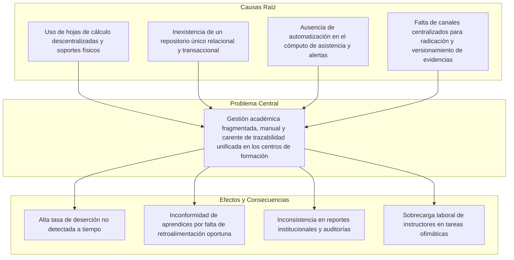
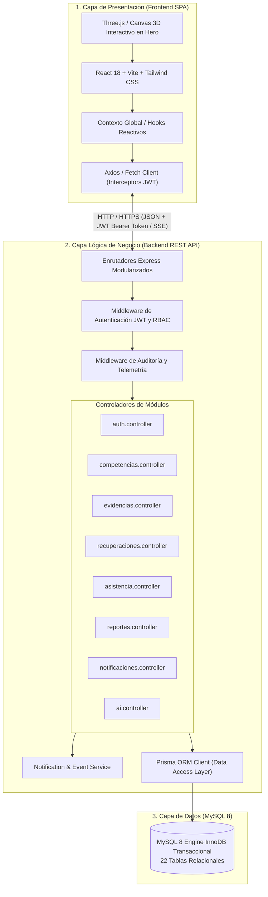
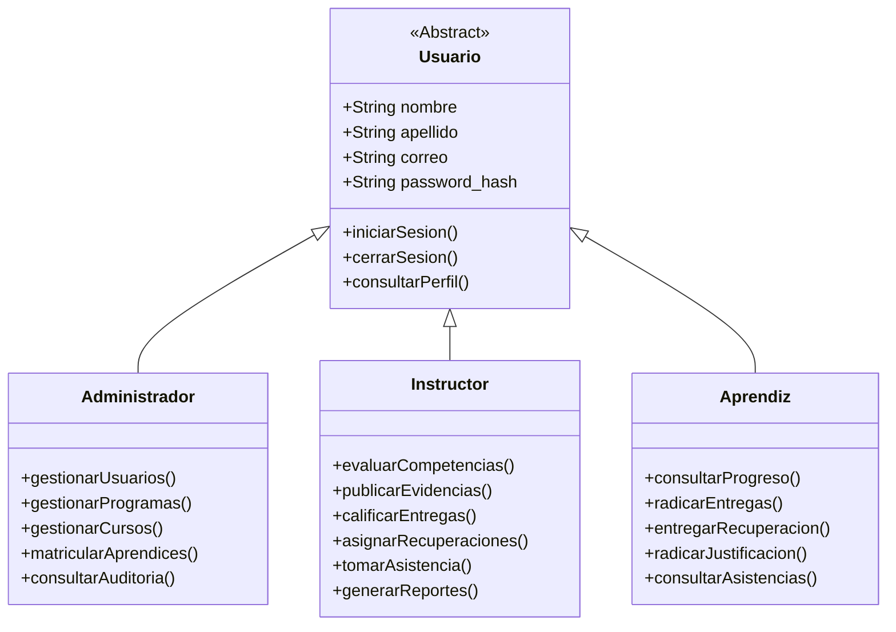
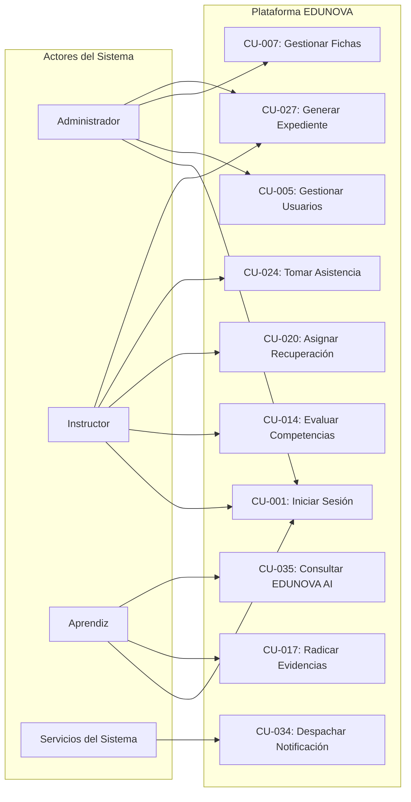
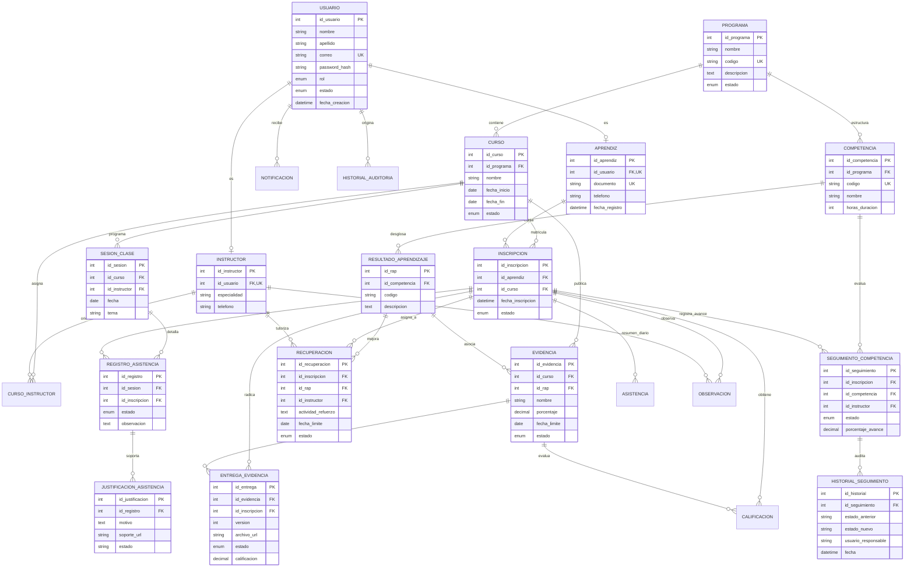
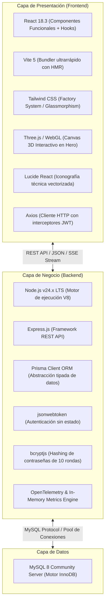
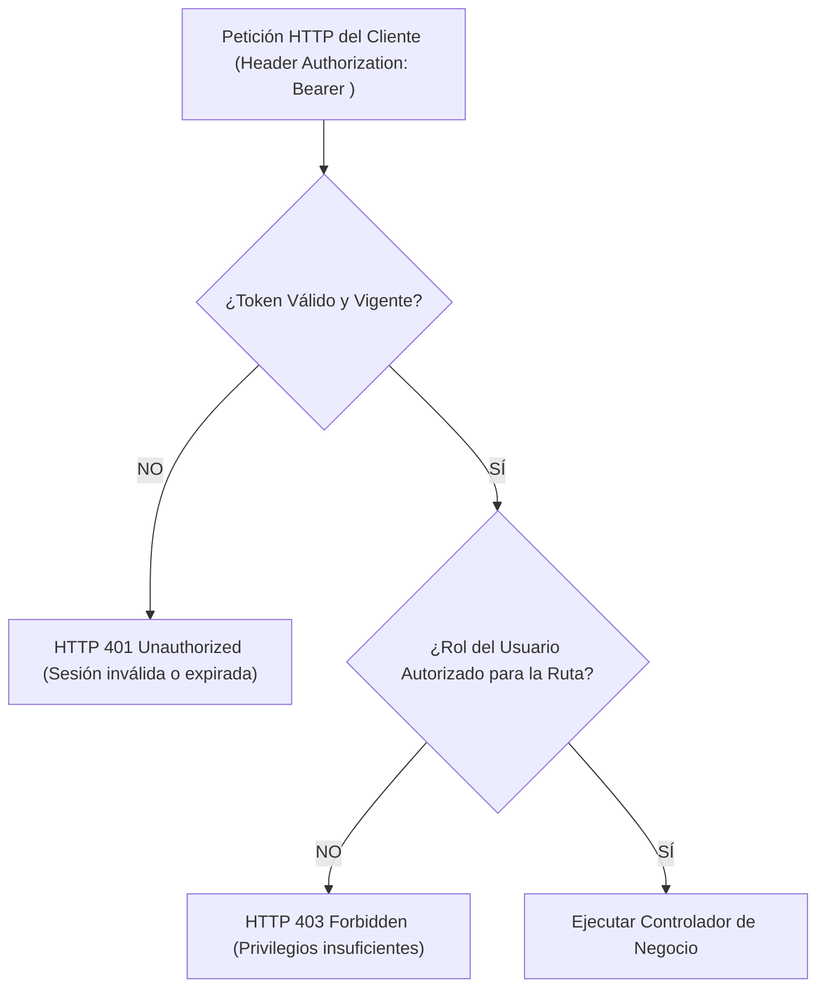

# ESPECIFICACIÓN DE REQUISITOS DE SOFTWARE (SRS / ERS)
# SISTEMA DE GESTIÓN ACADÉMICA – EDUNOVA
## Estándar IEEE 830 / ISO/IEC/IEEE 29148 · Documento Maestro Integral

---

| **Información General del Proyecto** | **Detalle Institucional** |
| :--- | :--- |
| **Proyecto:** | EDUNOVA – Academic Management System |
| **Aprendiz Líder / Desarrolladora:** | Anyely Valeria Bautista |
| **Programa de Formación:** | Tecnólogo en Análisis y Desarrollo de Software (ADSO) |
| **Ficha de Caracterización:** | 3413988 |
| **Centro de Formación:** | Centro de Formación Industrial – SENA Regional Huila (Neiva) |
| **Modalidad:** | Desarrollo individual con asistencia de Inteligencia Artificial y metodologías ágiles (Scrum) |
| **Duración Estimada:** | 4 semanas (1 mes de ejecución lectiva) |
| **Versión del Documento:** | 4.0 (SRS Maestro Integral Unificado · Rama DEV) |
| **Estado:** | Aprobado · Conectado con MySQL 8 y 7 Módulos Avanzados Operativos |

---

## CONTROL DE VERSIONES DEL SRS

| Versión | Fecha | Autor(a) | Descripción del Cambio |
| :---: | :---: | :--- | :--- |
| **v1.0** | 11/11/2026 | Anyely Valeria | Creación inicial del SRS, planteamiento del problema, requisitos RF/RNF, historias de usuario y cronograma de 4 semanas. |
| **v1.1** | 12/11/2026 | Anyely Valeria | Incorporación de la autenticación obligatoria dividida en 3 roles (Aprendiz, Instructor, Admin) y maquetación Soft Glassmorphism. |
| **v1.2** | 13/11/2026 | Anyely Valeria | Actualización integral Ocean Tech Premium: paleta petróleo, turquesa, cian y ámbar; modelo MER de 13 entidades y catálogo de API REST. |
| **v2.0** | 13/11/2026 | Anyely Valeria | Adaptación a la estructura formal integral SENA/IEEE (HU-01 a HU-26, CU-01 a CU-26, RF1 a RF26, RNF-01 a RNF-12 y Matriz de Trazabilidad). |
| **v2.1** | 13/11/2026 | Anyely Valeria | **Sprint de Alto Rendimiento y UX Resiliente**: Diseño Skeleton para carga fluida, búsqueda con Debounce (300ms), paginación de cursos, streaming token a token de EDUNOVA AI, actualización optimista de interfaz (Optimistic UI), índices SQL en MySQL 8, prevención de consultas N+1 con Prisma, compresión Brotli/Gzip, caché Redis/In-Memory, cola de trabajos (Job Queue), timeouts en APIs externas (5000ms), code-splitting de JS y monitoreo de usuarios reales (RUM). |
| **v2.2** | 13/11/2026 | Anyely Valeria | **Implementación Integral del Sistema de Diseño Factory**: Estética Dark Terminal War Room (Obsidian #101010, Bone #eeeeee, Carbon #1d1a18, Ash #3d3a39, Signal Orange #ee6018, Metric Green #a0ca92), tipografía Geist con tracking ajustado, radio de 3px en botones y controles, tarjetas a 10px con bordes hairline nítidos y eliminación de sombras difusas. Núcleo 3D animable en Three.js con WebGL en el Hero Banner. |
| **v3.0** | 13/11/2026 | Anyely Valeria | **Despliegue Integral de los 7 Módulos Académicos Avanzados Conectados a MySQL 8**: 1) Seguimiento Académico por Competencias y RAPs con historial auditado; 2) Gestión Completa de Evidencias con versionamiento (v1, v2...) y retroalimentación pedagógica; 3) Sistema de Recuperación de Competencias con acreditación automática; 4) Control de Asistencia Automatizado por sesión con detección de ausencias consecutivas y umbral institucional (< 85%); 5) Centro de Reportes Oficiales SENA con exportación real en Excel (.csv) e impresión PDF; 6) Centro de Notificaciones Automáticas en tiempo real ante eventos del sistema; 7) EDUNOVA AI Contextual conectada a MySQL 8 con validación estricta de permisos RBAC y cálculos matemáticos en el backend. |
| **v4.0** | 17/11/2026 | Anyely Valeria | **Consolidación Integral en un Solo Documento Maestro**: Integración perfecta y ordenada de toda la estructura IEEE/SENA: Introducción, Planteamiento del Problema, Propósito, Justificación, Vigilancia Tecnológica, Objetivos, Alcance, Personal Involucrado, Definiciones/Referencias, Descripción General, Perspectiva de 3 Capas, Actores, Restricciones/Suposiciones, Requisitos de Interfaces (Glassmorphism, Three.js 3D), Historias de Usuario (HU-01 a HU-26), 10 Diagramas UML Mermaid, Requisitos Funcionales (RF-001 a RF-036), Requisitos No Funcionales (RNF-001 a RNF-015), los 36 Casos de Uso (CU-001 a CU-036) especificados en extenso con sus 14 secciones, Modelo Entidad-Relación de 22 tablas, Diccionario de Datos completo, Stack Técnico, Seguridad RBAC, Plan de Pruebas Funcionales (CP-01 a CP-10), Matriz de Trazabilidad Completa y Glosario. |

---

## TABLA DE CONTENIDO GENERAL

- [1. INTRODUCCIÓN](#1-introducción)
  - [1.1. Planteamiento del problema](#11-planteamiento-del-problema)
  - [1.2. Propósito](#12-propósito)
  - [1.3. Justificación](#13-justificación)
    - [1.3.1. Vigilancia tecnológica y referentes de mercado](#131-vigilancia-tecnológica-y-referentes-de-mercado)
  - [1.4. Objetivo general](#14-objetivo-general)
    - [1.4.1. Objetivos específicos](#141-objetivos-específicos)
  - [1.5. Alcances](#15-alcances)
    - [1.5.1. Funcionalidades implementadas (Rama DEV - 100% Operativas)](#151-funcionalidades-implementadas-rama-dev---100-operativas)
    - [1.5.2. Funcionalidades propuestas / pendientes](#152-funcionalidades-propuestas--pendientes)
  - [1.6. Personal Involucrado](#16-personal-involucrado)
    - [1.6.1. Roles y responsabilidades del equipo](#161-roles-y-responsabilidades-del-equipo)
  - [1.7. Definiciones, acrónimos y abreviaturas](#17-definiciones-acrónimos-y-abreviaturas)
  - [1.8. Referencias](#18-referencias)
  - [1.9. Resumen](#19-resumen)
- [2. DESCRIPCIÓN GENERAL](#2-descripción-general)
  - [2.1. Perspectiva del producto](#21-perspectiva-del-producto)
    - [2.1.1. Arquitectura de tres capas](#211-arquitectura-de-tres-capas)
    - [2.1.2. Diagrama de despliegue físico](#212-diagrama-de-despliegue-físico)
  - [2.2. Características de los usuarios](#22-características-de-los-usuarios)
    - [2.2.1. Jerarquía de actores y clases (Mermaid)](#221-jerarquía-de-actores-y-clases-mermaid)
    - [2.2.2. Matriz de permisos por rol (CRUD)](#222-matriz-de-permisos-por-rol-crud)
  - [2.3. Restricciones](#23-restricciones)
  - [2.4. Suposiciones y dependencias](#24-suposiciones-y-dependencias)
- [3. REQUISITOS ESPECÍFICOS](#3-requisitos-específicos)
  - [3.1. Requisitos comunes de las interfaces](#31-requisitos-comunes-de-las-interfaces)
    - [3.1.1. Sistema de diseño Factory y Ocean Tech Premium](#311-sistema-de-diseño-factory-y-ocean-tech-premium)
    - [3.1.2. Núcleo interactivo 3D con Three.js y WebGL](#312-núcleo-interactivo-3d-con-threejs-y-webgl)
  - [3.2. Historias de Usuario (HU-01 a HU-26)](#32-historias-de-usuario-hu-01-a-hu-26)
  - [3.2.1. Diagramas de Casos de Uso (10 Diagramas UML Mermaid)](#321-diagramas-de-casos-de-uso-10-diagramas-uml-mermaid)
  - [3.3. Requerimientos Funcionales (RF-001 a RF-036)](#33-requerimientos-funcionales-rf-001-a-rf-036)
  - [3.4. Requerimientos No Funcionales (RNF-001 a RNF-015)](#34-requerimientos-no-funcionales-rnf-001-a-rnf-015)
  - [3.5. Especificación Individual Exhaustiva de los 36 Casos de Uso (CU-001 a CU-036)](#35-especificación-individual-exhaustiva-de-los-36-casos-de-uso-cu-001-a-cu-036)
  - [3.6. Modelo Entidad-Relación (MER - 22 Tablas)](#36-modelo-entidad-relación-mer---22-tablas)
  - [3.7. Diccionario de Datos de la Base de Datos](#37-diccionario-de-datos-de-la-base-de-datos)
  - [3.8. Tecnologías y Stack Técnico](#38-tecnologías-y-stack-técnico)
  - [3.9. Seguridad, Autenticación y Permisos (RBAC)](#39-seguridad-autenticación-y-permisos-rbac)
- [4. PLAN DE PRUEBAS Y MATRIZ DE TRAZABILIDAD](#4-plan-de-pruebas-y-matriz-de-trazabilidad)
  - [4.1. Plan de Pruebas Funcionales (CP-01 a CP-10)](#41-plan-de-pruebas-funcionales-cp-01-a-cp-10)
  - [4.2. Matriz de Trazabilidad Completa](#42-matriz-de-trazabilidad-completa)
- [5. GLOSARIO DE TÉRMINOS](#5-glosario-de-términos)

---

## 1. INTRODUCCIÓN

### 1.1. Planteamiento del problema
En la actualidad, diversas instituciones educativas y centros de formación tecnológica continúan gestionando sus procesos académicos mediante herramientas fragmentadas, hojas de cálculo independientes (`.xlsx`), archivos físicos y libretas de asistencia manuales. 

Esta dispersión operativa ocasiona problemas críticos:
1. **Inconsistencia y pérdida de información:** Dificultad para conciliar calificaciones y asistencias al transferir notas entre formatos manuales.
2. **Duplicidad de registros:** Falta de restricciones de unicidad al matricular aprendices o registrar asistencia en diferentes sesiones.
3. **Falta de visibilidad oportuna para el aprendiz:** Los aprendices no cuentan con un medio digital centralizado en tiempo real para consultar su historial de notas, asistencias acumuladas y advertencias preventivas.
4. **Sobrecarga de trabajo en instructores:** Inversión excesiva de tiempo calculando ponderaciones de evidencias y consolidando asistencias manualmente, restando tiempo a la labor pedagógica.
5. **Dificultad en auditoría y control directivo:** Los coordinadores y administradores carecen de paneles estadísticos e indicadores inmediatos sobre la deserción, avance de competencias y rendimiento global de las fichas.

#### Pregunta Orientadora:
> *¿Cómo desarrollar una plataforma web moderna, modular y centralizada que permita administrar y consultar de manera organizada la información académica de aprendices, instructores, programas de formación, calificaciones, asistencias, evidencias y recuperaciones, reduciendo los procesos manuales y optimizando el seguimiento pedagógico en el Centro de Formación Industrial del SENA Regional Huila?*

#### Árbol de Problemas:



---

### 1.2. Propósito
El propósito de este documento es definir formal, completa y sistemáticamente la **Especificación de Requisitos de Software (SRS)** para la plataforma web **EDUNOVA – Academic Management System**, conforme a los lineamientos del estándar internacional **IEEE 830 / ISO/IEC/IEEE 29148**. 

Este documento actúa como:
* Contrato formal de desarrollo entre la aprendiz desarrolladora y los evaluadores académicos del SENA.
* Guía de arquitectura de software para la implementación del frontend, backend y base de datos relacional.
* Matriz de verificación y diseño del plan de pruebas funcionales y de calidad.

---

### 1.3. Justificación
El desarrollo de EDUNOVA soluciona las problemáticas de dispersión y manualidad, proporcionando una solución tecnológica escalable, segura y adaptable a cualquier dispositivo (computadores, tabletas y celulares). Al centralizar la información en una base de datos relacional (MySQL 8) administrada con Prisma ORM, se garantiza la integridad referencial, la no duplicidad y el acceso inmediato a la información.

Desde el punto de vista pedagógico y formativo, el proyecto permite a la aprendiz aplicar de forma integral competencias técnicas en:
* Levantamiento de requisitos formales e historias de usuario.
* Diseño de bases de datos relacionales normalizadas en 3FN compuestas por 22 tablas interconectadas.
* Arquitectura de software en 3 capas (Monolito Modular con React 18, Node.js v24, Express y MySQL 8).
* Implementación de seguridad perimetral mediante JWT y hashing de contraseñas Bcrypt.
* Diseño de experiencias de usuario con estándares visuales de vanguardia (**Factory Design System** y **Ocean Tech Premium Glassmorphism**).
* Integración de gráficos 3D acelerados por hardware en el navegador mediante **Three.js** y **WebGL**.
* Buenas prácticas de control de versiones con Git/GitHub y metodologías ágiles (Scrum).

#### 1.3.1. Vigilancia tecnológica y referentes de mercado
Para el diseño y concepción de EDUNOVA se realizó un estudio de vigilancia tecnológica y benchmarking analizando referentes educativos globales y plataformas de gestión escolar líderes:

| Referente de Mercado | Enfoque Principal | Aporte Tomado para EDUNOVA |
| :--- | :--- | :--- |
| **Henon Edtech** ([henonedu.com](https://henonedu.com)) | Plataforma moderna de analítica educativa y seguimiento estudiantil. | Estructura modular de métricas de progreso y dashboards limpios de rendimiento. |
| **AttendX** ([attendx.co.in](https://attendx.co.in)) | Software especializado en control digital de asistencias y novedades. | Registro rápido de asistencia por sesión (Presente, Retardo, Inasistencia) con porcentaje consolidado. |
| **EduMatrix / Virtual Classroom** | Gestión escolar para colegios técnicos y seguimiento de asignaturas. | Planilla interactiva de calificaciones homologadas a escala numérica institucional. |
| **Innova Scholar** ([innovascholar.com](https://innovascholar.com)) | Sistema integral de control escolar con jerarquía de roles. | Modelo de control de acceso estricto RBAC (Administrador, Instructor, Aprendiz). |
| **A-Star Solutions** | Portales estudiantiles interactivos de autoservicio. | Portal del aprendiz con acceso instantáneo a evidencias, retroalimentación y tutoría con IA. |
| **Moodle LMS** | Sistema de gestión de aprendizaje de código abierto tradicional. | Estructura modular de actividades, superada en EDUNOVA por una UX fluida y sin recargas. |
| **Canvas LMS** | Plataforma educativa en la nube orientada a educación superior. | Modelo de rúbricas y versionamiento claro de entregas para retroalimentación docente. |
| **Territorio / Zajuna (SENA)** | Plataforma institucional del SENA en Colombia. | Modelado de Resultados de Aprendizaje (RAPs), juicios evaluativos y actas de comités. |

---

### 1.4. Objetivo general
Desarrollar una plataforma web de gestión académica integral (**EDUNOVA – Academic Management System**) que permita administrar y centralizar la información de aprendices, instructores, programas de formación, cursos, competencias, evidencias, recuperaciones, calificaciones y asistencias, optimizando los procesos administrativos y facilitando el seguimiento pedagógico en el Centro de Formación Industrial del SENA Regional Huila.

#### 1.4.1. Objetivos específicos
1. **Analizar y especificar:** Identificar las necesidades de información académica y formalizar los requisitos funcionales (RF-001 a RF-036), no funcionales (RNF-001 a RNF-015), historias de usuario (HU-01 a HU-26) y 36 casos de uso detallados.
2. **Diseñar el modelo de datos:** Diseñar e implementar una base de datos relacional normalizada en MySQL 8 compuesta por **22 tablas relacionales** en Tercera Forma Normal (3FN) con integridad referencial.
3. **Desarrollar la API REST:** Construir los servicios del backend en Node.js (v24) y Express con autenticación robusta JWT, control RBAC, middlewares de auditoría y operaciones CRUD.
4. **Construir el Frontend Interactivo:** Diseñar e implementar la interfaz en React 18 + Tailwind CSS bajo la identidad **Factory Design System** y **Ocean Tech Premium**, incorporando componentes Glassmorphism, gráficos de rendimiento y un **Hero Canvas 3D en Three.js**.
5. **Implementar los 7 Módulos Avanzados:** Desarrollar los módulos de Seguimiento por Competencias, Gestión de Evidencias versionadas, Recuperación con auto-acreditación, Asistencia automatizada con umbral < 85%, Reportes oficiales PDF/Excel, Notificaciones en tiempo real y Asistente EDUNOVA AI.
6. **Incorporar Tutoría Inteligente Contextual:** Conectar el módulo **EDUNOVA AI** con telemetría de MySQL 8 para emitir diagnósticos pedagógicos personalizados y streaming token a token.
7. **Verificar y Documentar:** Diseñar el plan de pruebas funcionales, construir la matriz de trazabilidad y mantener sincronización continua en la rama `DEV` de GitHub.

---

### 1.5. Alcances

#### 1.5.1. Funcionalidades implementadas (Rama DEV - 100% Operativas)
Las siguientes capacidades se encuentran completamente programadas, conectadas a MySQL 8 y verificadas en la rama `DEV`:
* Autenticación obligatoria dividida en 3 roles: **Administrador**, **Instructor** y **Aprendiz** con tokens JWT criptográficos.
* Gestión administrativa de usuarios, programas de formación y fichas de caracterización.
* Matrícula formal de aprendices en fichas y asignación de instructores.
* **Módulo 1:** Seguimiento Académico por Competencias y Resultados de Aprendizaje (RAPs) con cálculo de avance porcentual e historial inmutable de juicios evaluativos.
* **Módulo 2:** Gestión Completa de Evidencias con publicación por instructor, radicación con versionamiento progresivo (`v1, v2...`) por aprendiz, y calificación cuantitativa/cualitativa con retroalimentación.
* **Módulo 3:** Sistema de Recuperación de Competencias para aprendices en refuerzo, asignación de planes de mejoramiento, radicación de actividades y auto-acreditación automática a Aprobada.
* **Módulo 4:** Control de Asistencia Automatizado por sesión de clase con cálculo acumulado, alertas por $\ge 3$ inasistencias consecutivas, umbral crítico $< 85\%$ y radicación/resolución de excusas médicas.
* **Módulo 5:** Centro de Reportes Académicos con generación de Expediente Individual del Aprendiz, Dossier Consolidado de Ficha, exportación nativa a Excel (.csv UTF-8) e impresión optimizada en PDF.
* **Módulo 6:** Centro de Notificaciones Automáticas en tiempo real generadas por eventos del sistema (calificaciones, faltas, evidencias) con marcado individual y masivo.
* **Módulo 7:** Asistente Inteligente EDUNOVA AI conectado en tiempo real a MySQL 8 con streaming token a token mediante Server-Sent Events.
* **Frontend 3D:** Hero interactivo con Canvas WebGL / Three.js reactivo al movimiento del cursor.

#### 1.5.2. Funcionalidades propuestas / pendientes
* **Integración con SOFIA Plus / Zajuna:** Requiere APIs oficiales gubernamentales cerradas del SENA o web scraping con credenciales institucionales.
* **Firma Digital Biométrica:** Depende de hardware capturador de huellas y certificados de autoridades de certificación cerrada.
* **Aplicación Móvil Nativa (Android/iOS):** Planificada para Fase 2 en Flutter/React Native; actualmente opera como SPA Responsive de alto rendimiento.
* **Pasarela SMTP Corporativa:** El restablecimiento de contraseñas por correo opera en modo simulado/mock en desarrollo hasta configurar credenciales corporativas (AWS SES / SendGrid).

---

### 1.6. Personal Involucrado

#### 1.6.1. Roles y responsabilidades del equipo
* **Anyely Valeria Bautista (Desarrolladora Full Stack & Líder de Proyecto):**
  * Responsable del levantamiento de requisitos, diseño de interfaces UI/UX, maquetación React, desarrollo de la API Node.js/Express, diseño relacional MySQL 8, programación de los 7 módulos funcionales, pruebas y versionado en GitHub.
* **Equipo de Instructores Evaluadores ADSO (SENA Regional Huila):**
  * Responsables de la retroalimentación pedagógica, validación de historias de usuario, evaluación de la arquitectura de software y verificación de cumplimiento de competencias curriculares.
* **Inteligencia Artificial Asistente (DeepMind / Antigravity):**
  * Asistencia técnica en la optimización de consultas SQL, generación de estructuras arquitectónicas, validación de casos de prueba y redacción técnica bajo estándares IEEE 830.

---

### 1.7. Definiciones, acrónimos y abreviaturas
* **ADSO:** Análisis y Desarrollo de Software (Programa tecnológico del SENA).
* **API REST:** Representational State Transfer Application Programming Interface.
* **Bcrypt:** Función criptográfica de hash de contraseñas adaptativa con salt.
* **CU:** Caso de Uso (Use Case).
* **Ficha:** Código numérico único nacional que identifica a una cohorte o grupo académico en el SENA (ej. 3413988).
* **Glassmorphism:** Estilo visual caracterizado por fondos translúcidos, desenfoque de fondo y bordes finos.
* **HMR:** Hot Module Replacement (reemplazo en caliente de módulos en Vite).
* **HU:** Historia de Usuario (User Story).
* **JWT:** JSON Web Token (estándar abierto RFC 7519 para intercambio de sesiones).
* **MER:** Modelo Entidad-Relación de base de datos.
* **ORM:** Object-Relational Mapping (implementado mediante Prisma Client).
* **RAP:** Resultado de Aprendizaje.
* **RBAC:** Role-Based Access Control (Control de Acceso Basado en Roles).
* **RF:** Requisito Funcional.
* **RNF:** Requisito No Funcional.
* **SENA:** Servicio Nacional de Aprendizaje.
* **SPA:** Single Page Application (Aplicación web de página única).
* **SSE:** Server-Sent Events (transmisión unidireccional de datos en tiempo real para streaming de IA).

---

### 1.8. Referencias
1. IEEE Std 830-1998: *IEEE Recommended Practice for Software Requirements Specifications*.
2. ISO/IEC/IEEE 29148:2018: *Systems and software engineering — Life cycle processes — Requirements engineering*.
3. Documentación Oficial de React.js: [https://react.dev](https://react.dev).
4. Documentación Oficial de Three.js: [https://threejs.org](https://threejs.org).
5. Documentación Oficial de Node.js: [https://nodejs.org](https://nodejs.org).
6. Documentación Oficial de Express.js: [https://expressjs.com](https://expressjs.com).
7. Documentación Oficial de Prisma ORM: [https://www.prisma.io/docs](https://www.prisma.io/docs).
8. Documentación Oficial de MySQL 8: [https://dev.mysql.com/doc](https://dev.mysql.com/doc).
9. Documentación Oficial de Tailwind CSS: [https://tailwindcss.com/docs](https://tailwindcss.com/docs).
10. Guía Metodológica de Proyectos de Desarrollo de Software SENA ADSO (2026).

---

### 1.9. Resumen
El proyecto **EDUNOVA** es una plataforma tecnológica Full Stack diseñada para solucionar la dispersión operativa de la gestión académica en el SENA. Integra una arquitectura modular de 3 capas, una base de datos relacional de **22 tablas** normalizada en 3FN, un sistema de diseño visual de alta precisión (**Factory / Ocean Tech Premium** con núcleo 3D en **Three.js**), 36 requisitos funcionales rigurosos, 15 requisitos no funcionales, 26 historias de usuario, 10 diagramas UML Mermaid, la especificación de 36 casos de uso detallados, un plan de pruebas funcionales y matriz de trazabilidad con sincronización continua en la rama `DEV` de GitHub.

---

## 2. DESCRIPCIÓN GENERAL

### 2.1. Perspectiva del producto
EDUNOVA es un sistema web independiente y autónomo que opera como un **Monolito Modular Desacoplado** de alta cohesión y bajo acoplamiento:

#### 2.1.1. Arquitectura de tres capas



#### 2.1.2. Diagrama de despliegue físico

```mermaid
deploymentDiagram
    node "Navegador Web del Cliente" {
        artifact "Bundle SPA (HTML5, JS ES2024, CSS, Three.js WebGL)"
    }

    node "Servidor de Aplicaciones (Node.js Environment)" {
        artifact "Express API Gateway (Port 5000)"
        artifact "Prisma Client Engine"
        artifact "In-Memory Session & Telemetry Cache"
    }

    node "Servidor de Base de Datos" {
        database "MySQL 8.0 Server (Port 3306 - edunova_db)"
    }

    "Navegador Web del Cliente" -- "TCP/IP Port 5173 / HTTPS" --> "Servidor de Aplicaciones (Node.js Environment)"
    "Servidor de Aplicaciones (Node.js Environment)" -- "TCP/IP Port 3306" --> "Servidor de Base de Datos"
```

---

### 2.2. Características de los usuarios
El sistema contempla tres perfiles de usuarios humanos y actores automatizados del sistema:

1. **Administrador (`ADMIN`):**
   * Personal directivo o de coordinación académica. Posee privilegios globales para crear usuarios, programas de formación, fichas, asignar instructores y consultar métricas globales.
2. **Instructor (`INSTRUCTOR`):**
   * Docente o instructor técnico. Responsable de evaluar competencias, publicar evidencias, calificar entregas versionadas, asignar planes de recuperación, tomar asistencia por sesión y emitir reportes oficiales.
3. **Aprendiz (`APRENDIZ`):**
   * Estudiante del centro formativo. Consulta su avance en competencias, radica entregas de evidencias en versiones sucesivas, entrega actividades de refuerzo, justifica inasistencias y consulta al tutor EDUNOVA AI.
4. **EDUNOVA AI Agent:**
   * Agente cognitivo contextual que analiza el rendimiento del aprendiz en MySQL 8 para generar sugerencias pedagógicas mediante streaming.
5. **Servicio de Notificaciones y Event Bus:**
   * Subsistema de despacho automático de avisos internos ante calificaciones, inasistencias críticas o asignación de planes.

#### 2.2.1. Jerarquía de actores y clases (Mermaid)



#### 2.2.2. Matriz de permisos por rol (CRUD)

| Módulo / Recurso | Administrador | Instructor | Aprendiz |
| :--- | :---: | :---: | :---: |
| **Usuarios y Roles** | CRUD Completo | Lectura Perfil Propio | Lectura Perfil Propio |
| **Programas de Formación** | CRUD Completo | Solo Lectura | Solo Lectura |
| **Cursos / Fichas** | CRUD Completo | Lectura Asignados | Lectura Inscritos |
| **Competencias y RAPs** | CRUD Completo | Lectura y Evaluación | Solo Lectura |
| **Evidencias de Aprendizaje**| Lectura | Crear / Editar / Calificar | Radicar Entrega |
| **Planes de Recuperación** | Lectura | Asignar / Evaluar | Entregar Actividad |
| **Sesiones y Asistencia** | Lectura | Programar / Calificar / Resolver | Justificar / Consultar |
| **Expedientes y Dossiers** | Generar / Imprimir | Generar / Imprimir | Consultar Propio |
| **Notificaciones** | Recibir / Marcar | Recibir / Marcar | Recibir / Marcar |
| **EDUNOVA AI** | Consultas Globales | Consultas Ficha | Consultas Propias |

---

### 2.3. Restricciones
* **Tecnológicas:** El frontend debe operar en navegadores modernos compatibles con ES2024 y WebGL (Chrome $ge 110$, Edge, Firefox $ge 115$, Safari $ge 16$).
* **Seguridad:** Ninguna contraseña se almacena en texto claro (obligatorio Bcrypt con 10 rondas de salt).
* **Persistencia:** La base de datos debe ser relacional bajo el motor InnoDB de MySQL 8 para garantizar integridad transaccional ACID.
* **Escalabilidad:** Tiempos de respuesta menores a 500 ms en consultas estándar mediante indexación compuesta.
* **Normativa SENA:** La escala de calificaciones cuantitativas opera de 0.0 a 5.0 y homologa pedagógicamente a Aprobado ($ge 3.5$) o No Aprobado / Requiere Refuerzo ($< 3.5$).

---

### 2.4. Suposiciones y dependencias
* **Suposiciones:** Los usuarios disponen de un dispositivo con conexión a Internet y navegador web estándar; cada usuario posee una cuenta de correo electrónico institucional única.
* **Dependencias:** Disponibilidad del servicio de base de datos MySQL 8 local o en la nube; ejecución continua del runtime de Node.js v24 en el servidor; persistencia del archivo de variables de entorno `server/.env` con los secretos criptográficos (`JWT_SECRET`, `DATABASE_URL`).

---

## 3. REQUISITOS ESPECÍFICOS

### 3.1. Requisitos comunes de las interfaces

#### 3.1.1. Sistema de diseño Factory y Ocean Tech Premium
La interfaz gráfica de EDUNOVA aplica el sistema de diseño **Factory** combinado con la paleta tecnológica **Ocean Tech Premium**, garantizando una estética sobria, profesional y de alta legibilidad inspirada en consolas de control:

| Token / Color | Código HEX | Rol en la Interfaz | Aplicación Visual |
| :--- | :--- | :--- | :--- |
| **Obsidian** | `#101010` | Superficie de control base y canvas de medianoche | Fondo de pantalla, cabeceras de tablas y consola |
| **Carbon Lift** | `#1d1a18` | Paneles y elevación de componentes | Contenedores de métricas, fichas y módulos |
| **Ash Stroke** | `#3d3a39` | Bordes hairline de separación | Divisores de tarjetas, marcos de inputs y celdas |
| **Bone Card** | `#eeeeee` | Tarjeta de máximo contraste | Hero Banner de despacho para aprendices |
| **Chalk** | `#fafafa` | Botones principales y acciones primarias | Botones de envío, despacho de IA y login primario |
| **Azul Petróleo**| `#123B50` | Acento institucional tecnológico | Cabeceras de módulos y badges |
| **Turquesa** | `#19B5A5` | Resalte de acciones activas | Botones secundarios y enlaces interactivos |
| **Cian** | `#48BFE3` | Telemetría e interactividad 3D | Vértices del núcleo Three.js y barras de progreso |
| **Ámbar** | `#E9B949` | Alertas y estados de advertencia | Competencias en refuerzo, retardos y novedades |
| **Metric Green** | `#a0ca92` | Datos positivos y aprobaciones | Competencias aprobadas, asistencias y notas $ge 3.5$ |

* **Principios de Diseño:**
  * Tipografía Geist y Geist Mono con espaciado ajustado (`tracking-tight`).
  * Radio estricto de 3px en botones y badges; 10px con borde hairline (`1px`) en tarjetas.
  * Efecto Glassmorphism optimizado (`backdrop-blur-md` con opacidades sutiles).

#### 3.1.2. Núcleo interactivo 3D con Three.js y WebGL
El Hero Banner integra un canvas 3D interactivo animado mediante Three.js que reacciona a la posición del cursor del usuario mediante interpolación esférica (lerp), simbolizando el procesamiento en tiempo real de los datos formativos.

---

### 3.2. Historias de Usuario (HU-01 a HU-26)

| Código | Rol | Enunciado de la Historia de Usuario | Criterio de Aceptación (Given-When-Then) |
| :---: | :---: | :--- | :--- |
| **HU-01** | Todos | Como usuario, quiero iniciar sesión con mi correo y contraseña institucional. | Dado un usuario registrado, cuando ingresa credenciales correctas, entonces recibe un token JWT y accede a su dashboard. |
| **HU-02** | Aprendiz | Como aprendiz nuevo, quiero registrar mi cuenta con mis datos personales. | Dados datos válidos y correo único, cuando se registra, entonces se crea el usuario con rol Aprendiz. |
| **HU-03** | Todos | Como usuario, quiero recuperar el acceso si olvido mi contraseña. | Dado un correo existente, cuando solicita restablecimiento, entonces el sistema genera un token seguro de recuperación. |
| **HU-04** | Todos | Como usuario, quiero consultar y actualizar mi número telefónico de contacto. | Dado un usuario logueado, cuando edita su teléfono y guarda, entonces la base de datos se actualiza de inmediato. |
| **HU-05** | Todos | Como usuario, quiero cerrar mi sesión de forma segura. | Dado un usuario en sesión, cuando hace clic en logout, entonces se purga el token local y redirige al login. |
| **HU-06** | Admin | Como administrador, quiero crear cuentas para instructores y aprendices. | Dado un admin, cuando diligencia el formulario de usuario, entonces se crea el registro con su rol correspondiente. |
| **HU-07** | Admin | Como administrador, quiero activar o suspender el acceso de usuarios. | Dado un admin, cuando conmuta el estado de un usuario, entonces se actualiza su estado en USUARIO a INACTIVO. |
| **HU-08** | Admin | Como administrador, quiero registrar programas de formación técnica y tecnológica. | Dado un diseño curricular, cuando ingresa código y nombre, entonces se almacena en la tabla PROGRAMA. |
| **HU-09** | Admin | Como administrador, quiero aperturar fichas de caracterización vinculadas a programas. | Dado un programa activo, cuando ingresa fechas y código de ficha, entonces la ficha queda en estado ACTIVO. |
| **HU-10** | Admin | Como administrador, quiero asignar instructores a fichas formativas. | Dada una ficha y un instructor, cuando se vinculan, entonces se crea la relación en CURSO_INSTRUCTOR. |
| **HU-11** | Admin | Como administrador, quiero matricular aprendices en fichas específicas. | Dado un aprendiz y una ficha, cuando se matricula, entonces se asienta en INSCRIPCION evitando duplicados. |
| **HU-12** | Instructor | Como instructor, quiero consultar el catálogo de competencias de mi programa. | Dado un instructor con ficha asignada, cuando ingresa a competencias, entonces visualiza las normas y RAPs. |
| **HU-13** | Instructor | Como instructor, quiero evaluar el progreso de competencias con juicio formativo. | Dado un aprendiz, cuando evalúa una competencia, entonces se actualiza el estado y se audita en el historial. |
| **HU-14** | Aprendiz | Como aprendiz, quiero consultar el avance porcentual de mis competencias. | Dado un aprendiz logueado, cuando entra a competencias, entonces ve la barra de avance y badges de estado. |
| **HU-15** | Instructor | Como instructor, quiero publicar evidencias formativas con fecha límite. | Dado un curso, cuando crea una evidencia con ponderación, entonces se publica y notifica a los aprendices. |
| **HU-16** | Aprendiz | Como aprendiz, quiero subir entregas de evidencias con versionamiento automático. | Dada una evidencia abierta, cuando el aprendiz sube un archivo, entonces se registra como versión 1, 2 o sucesiva. |
| **HU-17** | Instructor | Como instructor, quiero calificar entregas de evidencias de 0.0 a 5.0 con feedback. | Dada una entrega radicada, cuando el instructor califica, entonces se guarda la nota y retroalimentación pedagógica. |
| **HU-18** | Instructor | Como instructor, quiero detectar aprendices con competencias en refuerzo. | Dado el módulo de recuperaciones, cuando filtra por refuerzo, entonces se listan los aprendices prioritarios. |
| **HU-19** | Instructor | Como instructor, quiero asignar un plan de mejoramiento con entrega digital. | Dado un aprendiz en refuerzo, cuando se formula la actividad, entonces se crea el plan con fecha límite estricta. |
| **HU-20** | Instructor | Como instructor, quiero que al aprobar un refuerzo se auto-acredite la competencia. | Dado un plan calificado con nota $ge 3.5$, cuando se dictamina, entonces la competencia pasa a APROBADA automáticamente. |
| **HU-21** | Instructor | Como instructor, quiero aperturar sesiones de clase y tomar asistencia en vivo. | Dada una clase, cuando el instructor marca presentes, retardos o ausencias, entonces se asienta la planilla. |
| **HU-22** | Aprendiz | Como aprendiz, quiero justificar inasistencias adjuntando soporte médico. | Dada una falta, cuando radica soporte médico, entonces queda en estado PENDIENTE para revisión del instructor. |
| **HU-23** | Sistema | Como sistema, quiero disparar alertas si un aprendiz supera 3 faltas o cae de 85%. | Tras guardar lista, cuando se detecta inasistencia crítica, entonces se emite notificación preventiva al aprendiz. |
| **HU-24** | Inst/Admin | Como docente o directivo, quiero generar expedientes individuales y dossiers en PDF. | Dado un aprendiz o ficha, cuando pulsa imprimir, entonces se renderiza el documento oficial con membrete SENA. |
| **HU-25** | Inst/Admin | Como docente o directivo, quiero exportar la sábana de notas a Excel (CSV UTF-8). | Dada una tabla de datos, cuando hace clic en exportar, entonces se descarga el archivo .csv legible en Excel. |
| **HU-26** | Aprendiz | Como aprendiz, quiero consultar al tutor EDUNOVA AI para recibir recomendaciones. | Dado un prompt del aprendiz, cuando consulta a la IA, entonces recibe un diagnóstico contextual con streaming de texto. |

---

### 3.2.1. Diagramas de Casos de Uso (10 Diagramas UML Mermaid)

#### 1. Diagrama General del Sistema EDUNOVA


#### 2. Módulo: Autenticación y Perfil
```mermaid
flowchart LR
    actor Usuario
    subgraph MOD_AUTH["Módulo: Autenticación y Perfil"]
        CU1["CU-001: Iniciar Sesión"]
        CU2["CU-002: Cerrar Sesión"]
        CU3["CU-003: Recuperar Contraseña (Mock)"]
        CU4["CU-004: Consultar / Actualizar Perfil"]
        VAL["<<include>> Validar Credenciales Bcrypt"]
        JWT["<<include>> Emitir Token JWT"]
    end
    Usuario --> CU1
    Usuario --> CU2
    Usuario --> CU3
    Usuario --> CU4
    CU1 -.-> VAL
    CU1 -.-> JWT
```

#### 3. Módulo: Administración Base y Fichas
```mermaid
flowchart LR
    actor Admin["Administrador"]
    subgraph MOD_ADM["Módulo: Administración Base"]
        CU5["CU-005: Gestionar Usuarios"]
        CU6["CU-006: Gestionar Programas"]
        CU7["CU-007: Gestionar Cursos/Fichas"]
        CU8["CU-008: Asignar Instructores"]
        CU9["CU-009: Matricular Aprendices"]
        CU10["CU-010: Estadísticas Globales"]
    end
    Admin --> CU5
    Admin --> CU6
    Admin --> CU7
    Admin --> CU8
    Admin --> CU9
    Admin --> CU10
```

#### 4. Módulo 1: Seguimiento por Competencias y RAPs
```mermaid
flowchart LR
    actor Instructor
    actor Aprendiz
    subgraph MOD_M1["Módulo 1: Competencias"]
        CU11["CU-011: Consultar Competencias del Programa"]
        CU12["CU-012: Consultar Avance por Aprendiz"]
        CU13["CU-013: Monitoreo Grupal por Ficha"]
        CU14["CU-014: Evaluar Competencia y Registrar Historial"]
        HIST["<<include>> Registrar Historial Inmutable"]
    end
    Aprendiz --> CU11
    Aprendiz --> CU12
    Instructor --> CU11
    Instructor --> CU13
    Instructor --> CU14
    CU14 -.-> HIST
```

#### 5. Módulo 2: Gestión de Evidencias y Entregas
```mermaid
flowchart LR
    actor Instructor
    actor Aprendiz
    subgraph MOD_M2["Módulo 2: Evidencias"]
        CU15["CU-015: Publicar Evidencia"]
        CU16["CU-016: Consultar Evidencias y Fechas"]
        CU17["CU-017: Radicar Entrega Versionada"]
        CU18["CU-018: Calificar y Retroalimentar"]
        VER["<<include>> Incrementar Versión (v1, v2...)"]
    end
    Instructor --> CU15
    Instructor --> CU16
    Instructor --> CU18
    Aprendiz --> CU16
    Aprendiz --> CU17
    CU17 -.-> VER
```

#### 6. Módulo 3: Recuperación de Competencias
```mermaid
flowchart LR
    actor Instructor
    actor Aprendiz
    subgraph MOD_M3["Módulo 3: Recuperaciones"]
        CU19["CU-019: Identificar Aprendices en Refuerzo"]
        CU20["CU-020: Asignar Plan de Mejoramiento"]
        CU21["CU-021: Entregar Actividad de Refuerzo"]
        CU22["CU-022: Evaluar y Auto-Acreditar"]
        ACRED["<<extend>> Auto-Acreditar Competencia a Aprobada"]
    end
    Instructor --> CU19
    Instructor --> CU20
    Instructor --> CU22
    Aprendiz --> CU21
    CU22 -.-> ACRED
```

#### 7. Módulo 4: Control de Asistencia y Justificaciones
```mermaid
flowchart LR
    actor Instructor
    actor Aprendiz
    actor Sistema["Servicio de Alertas"]
    subgraph MOD_M4["Módulo 4: Asistencia"]
        CU23["CU-023: Programar Sesión de Clase"]
        CU24["CU-024: Tomar Asistencia en Vivo"]
        CU25["CU-025: Radicar/Resolver Justificación"]
        CU26["CU-026: Monitorear Umbral < 85% y Faltas"]
    end
    Instructor --> CU23
    Instructor --> CU24
    Instructor --> CU25
    Aprendiz --> CU25
    Sistema --> CU26
```

#### 8. Módulo 5: Centro de Reportes y Dossiers
```mermaid
flowchart LR
    actor Instructor
    actor Admin["Administrador"]
    subgraph MOD_M5["Módulo 5: Reportes"]
        CU27["CU-027: Expediente Individual Aprendiz"]
        CU28["CU-028: Dossier Consolidado de Ficha"]
        CU29["CU-029: Exportar Datos a Excel (CSV)"]
        CU30["CU-030: Formato de Impresión Oficial"]
    end
    Instructor --> CU27
    Instructor --> CU28
    Instructor --> CU29
    Admin --> CU28
    Admin --> CU30
```

#### 9. Módulo 6: Centro de Notificaciones y Eventos
```mermaid
flowchart LR
    actor Usuario
    actor Sistema["Bus de Eventos"]
    subgraph MOD_M6["Módulo 6: Notificaciones"]
        CU31["CU-031: Consultar Notificaciones"]
        CU32["CU-032: Marcar Notificación Leída"]
        CU33["CU-033: Marcar Todo como Leído"]
        CU34["CU-034: Despachar Notificación por Evento"]
    end
    Usuario --> CU31
    Usuario --> CU32
    Usuario --> CU33
    Sistema --> CU34
```

#### 10. Módulo 7: Asistente EDUNOVA AI
```mermaid
flowchart LR
    actor Aprendiz
    actor Instructor
    subgraph MOD_M7["Módulo 7: Asistente IA"]
        CU35["CU-035: Consulta Contextual Asistente"]
        CU36["CU-036: Streaming en Vivo de Diagnóstico"]
        CTX["<<include>> Inyectar Métricas Reales MySQL"]
    end
    Aprendiz --> CU35
    Instructor --> CU35
    CU35 -.-> CTX
    CU35 -.-> CU36
```

---

### 3.3. Requerimientos Funcionales (RF-001 a RF-036)

| Código | Requisito Funcional | Módulo | Prioridad | Actor Principal |
| :--- | :--- | :--- | :--- | :--- |
| **RF-001** | Autenticación de usuarios mediante correo y contraseña con generación de token JWT. | Seguridad / Auth | Crítica | Todos los Roles |
| **RF-002** | Cierre de sesión e invalidación de token de acceso en el cliente. | Seguridad / Auth | Alta | Todos los Roles |
| **RF-003** | Solicitud de restablecimiento de contraseña mediante token seguro [Propuesto]. | Seguridad / Auth | Media | Aprendiz / Instructor |
| **RF-004** | Consulta y actualización de datos de perfil del usuario logueado. | Usuarios / Perfil | Alta | Todos los Roles |
| **RF-005** | Gestión administrativa de usuarios (crear, listar, actualizar estado ACTIVO/INACTIVO).| Administración | Alta | Administrador |
| **RF-006** | Registro y actualización de Programas de Formación y códigos curriculares. | Administración | Alta | Administrador |
| **RF-007** | Creación y mantenimiento de Fichas de Caracterización / Cursos. | Administración | Alta | Administrador |
| **RF-008** | Asignación de instructores a fichas de formación activas. | Administración | Alta | Administrador |
| **RF-009** | Matrícula e inscripción formal de aprendices en fichas específicas. | Administración | Alta | Administrador |
| **RF-010** | Consulta de métricas estadísticas globales en el Dashboard Administrativo. | Dashboard | Alta | Administrador |
| **RF-011** | Consulta de competencias laborales y Resultados de Aprendizaje (RAPs) por programa.| M1: Competencias | Alta | Instructor / Aprendiz |
| **RF-012** | Consulta del avance porcentual y estado de competencias por aprendiz. | M1: Competencias | Alta | Aprendiz / Instructor |
| **RF-013** | Visualización consolidada de avance de competencias a nivel de ficha. | M1: Competencias | Alta | Instructor / Admin |
| **RF-014** | Evaluación de competencias con registro inmutable en el historial de trazabilidad. | M1: Competencias | Crítica | Instructor |
| **RF-015** | Publicación de evidencias de aprendizaje vinculadas a RAPs y cursos. | M2: Evidencias | Alta | Instructor |
| **RF-016** | Consulta y filtrado de evidencias pendientes y vencidas por ficha. | M2: Evidencias | Alta | Aprendiz / Instructor |
| **RF-017** | Radicación de entrega de evidencia con versionamiento automático (`v1, v2...`). | M2: Evidencias | Crítica | Aprendiz |
| **RF-018** | Calificación cuantitativa/cualitativa y retroalimentación de entregas de evidencias. | M2: Evidencias | Crítica | Instructor |
| **RF-019** | Detección y listado de aprendices con competencias en estado "Requiere Refuerzo". | M3: Recuperaciones | Alta | Instructor |
| **RF-020** | Asignación de planes de recuperación académica con fechas límite y actividades. | M3: Recuperaciones | Crítica | Instructor |
| **RF-021** | Envío de actividad de recuperación por parte del aprendiz asignado. | M3: Recuperaciones | Crítica | Aprendiz |
| **RF-022** | Evaluación de actividad de refuerzo y auto-acreditación de la competencia a APROBADA. | M3: Recuperaciones | Crítica | Instructor |
| **RF-023** | Creación y programación de sesiones de clase con fecha, tema y horario. | M4: Asistencia | Alta | Instructor |
| **RF-024** | Registro de asistencia por sesión con estados detallados (Asistió, Ausente, Retardo).| M4: Asistencia | Crítica | Instructor |
| **RF-025** | Radicación y resolución de justificaciones de inasistencia con soporte documental. | M4: Asistencia | Alta | Aprendiz / Instructor |
| **RF-026** | Monitoreo automatizado de alertas por ausencias consecutivas ($ge 3$) y umbral $< 85\%$.| M4: Asistencia | Alta | Sistema / Instructor |
| **RF-027** | Emisión del Expediente Académico Individual del Aprendiz para impresión/PDF. | M5: Reportes | Alta | Instructor / Admin |
| **RF-028** | Generación del Dossier Académico Consolidado de Ficha para comités de evaluación. | M5: Reportes | Alta | Instructor / Admin |
| **RF-029** | Exportación de datos tabulares a formato Excel (.csv compatible UTF-8). | M5: Reportes | Media | Instructor / Admin |
| **RF-030** | Impresión directa formateada en alta resolución con membrete institucional SENA. | M5: Reportes | Media | Todos los Roles |
| **RF-031** | Consulta y categorización de notificaciones del sistema (Evidencias, Asistencia...).| M6: Notificaciones| Alta | Todos los Roles |
| **RF-032** | Marcado individual de notificación como leída. | M6: Notificaciones| Media | Todos los Roles |
| **RF-033** | Marcado masivo de todas las notificaciones pendientes como leídas. | M6: Notificaciones| Media | Todos los Roles |
| **RF-034** | Disparo automatizado de notificaciones al ocurrir eventos académicos críticos. | M6: Notificaciones| Alta | Sistema / Eventos |
| **RF-035** | Consulta interactiva al Asistente Inteligente EDUNOVA AI con datos contextuales. | M7: EDUNOVA AI | Alta | Aprendiz / Instructor |
| **RF-036** | Streaming en tiempo real de recomendaciones y diagnósticos token a token. | M7: EDUNOVA AI | Media | Aprendiz / Instructor |

---

### 3.4. Requerimientos No Funcionales (RNF-001 a RNF-015)

| Código | Categoría | Nombre del Requisito | Métrica / Criterio de Medición |
| :--- | :--- | :--- | :--- |
| **RNF-001** | Rendimiento | Tiempo de Respuesta de la API | El 95% de las consultas debe responder en $< 500\text{ ms}$ en condiciones normales. |
| **RNF-002** | Rendimiento | Optimización de Base de Datos | Todas las claves foráneas y campos de búsqueda frecuente cuentan con índices compuestos B-Tree en MySQL 8. |
| **RNF-003** | Rendimiento | Optimización del Frontend | Implementación de debounce en inputs de búsqueda (300 ms), lazy loading y compresión Brotli/Gzip en servidor. |
| **RNF-004** | Rendimiento | Telemetría Token a Token | El asistente IA entrega flujo continuo de tokens por Server-Sent Events con primer byte $< 800\text{ ms}$. |
| **RNF-005** | Seguridad | Cifrado y Hashing de Credenciales | Contraseñas protegidas mediante algoritmo Bcrypt con factor de costo 10 (`salt rounds`). |
| **RNF-006** | Seguridad | Autenticación Stateless JWT | Sesiones administradas por JSON Web Tokens firmados criptográficamente mediante clave privada en variable de entorno. |
| **RNF-007** | Seguridad | Prevención de Inyecciones | Sanitización absoluta de consultas SQL mediante el cliente parametrizado de Prisma ORM. |
| **RNF-008** | Seguridad | Control de Acceso por Rol (RBAC) | Middlewares dedicados en backend verifican permisos por endpoint impidiendo escalamiento de privilegios. |
| **RNF-009** | Usabilidad | Sistema de Diseño Factory / Glassmorphism | Estética moderna de alto contraste, tipografía Geist, bordes hairline y paleta Ocean Tech Premium sin saturaciones. |
| **RNF-010** | Usabilidad | Diseño Web Adaptativo (Responsive) | Visualización fluida garantizada en pantallas de escritorio ($> 1280\text{px}$), tablets ($768\text{px}$) y móviles ($< 480\text{px}$). |
| **RNF-011** | Confiabilidad | Integridad Referencial | Restricciones de integridad `CASCADE` y `SET NULL` que previenen registros huérfanos ante eliminaciones. |
| **RNF-012** | Confiabilidad | Trazabilidad e Inmutabilidad | Los cambios de estado de competencias se respaldan en `HISTORIAL_SEGUIMIENTO` sin posibilidad de borrado directo. |
| **RNF-013** | Disponibilidad | Tolerancia a Fallos | Mecanismos de recuperación automática y control global de excepciones en el servidor Express. |
| **RNF-014** | Mantenibilidad | Arquitectura Modular Desacoplada | Código organizado en capas independientes (Rutas, Middlewares, Controladores, Servicios, Esquemas). |
| **RNF-015** | Portabilidad | Compatibilidad Multi-navegador | Funcionamiento verificado en Google Chrome ($ge 110$), Mozilla Firefox ($ge 115$), Microsoft Edge y Safari ($ge 16$). |

---

### 3.5. Especificación Individual Exhaustiva de los 36 Casos de Uso (CU-001 a CU-036)

A continuación se despliega la totalidad de los 36 Casos de Uso del sistema EDUNOVA, cada uno estructurado con sus 14 secciones técnicas formales:

#### CASO DE USO CU-001: AUTENTICACIÓN DE USUARIO EN LA PLATAFORMA

* **Identificador:** `CU-001`
* **Nombre del Caso de Uso:** Autenticación de Usuario en la Plataforma
* **Módulo Funcional:** Seguridad y Autenticación
* **Estado en Código:** 🟢 Implementado y Verificado (Rama DEV)

**1. Descripción:**  
Permite a un usuario autenticarse en EDUNOVA mediante sus credenciales institucionales (correo y contraseña) para acceder al dashboard y módulos según su rol RBAC.

**2. Actores Involucrados:**  
* **Actor Principal:** Usuario (Cualquier Rol: Administrador, Instructor, Aprendiz)
* **Actor Secundario / Soporte:** Servicio de Autenticación JWT / Base de Datos

**3. Precondiciones:**  
* El usuario debe estar previamente registrado en la tabla USUARIO.
* El estado del usuario debe ser ACTIVO.
* El cliente debe contar con conexión HTTP a la API REST.

**4. Disparador (Trigger):**  
El usuario ingresa al formulario de inicio de sesión (/login) e introduce sus credenciales.

**5. Flujo Principal de Eventos (Paso a Paso):**  
El usuario accede a la pantalla de autenticación de EDUNOVA.
El usuario ingresa su correo electrónico institucional y su contraseña.
El usuario hace clic en el botón 'Iniciar Sesión'.
El cliente frontend valida la presencia y formato de los campos.
El cliente envía una solicitud HTTP POST a /api/auth/login con el payload { correo, password }.
El controlador auth.controller consulta el registro del usuario en la tabla USUARIO mediante Prisma ORM.
El sistema verifica que el usuario exista y tenga estado ACTIVO.
El sistema compara la contraseña recibida contra el password_hash almacenado mediante bcrypt.compare().
Al ser válida, el sistema genera un token JWT firmado con el algoritmo HS256 conteniendo id_usuario, correo, rol y fecha de expiración (24h).
El sistema registra el inicio de sesión en HISTORIAL_AUDITORIA.
El servidor responde con estado HTTP 200 y el objeto { token, usuario }.
El frontend almacena el token en localStorage/memoria y redirige al dashboard correspondiente al rol.

**6. Flujos Alternativos:**  
* **4a. El usuario utiliza credenciales de cuenta demo preconfigurada: El sistema carga instantáneamente el usuario correspondiente y navega al entorno correspondiente.**

**7. Flujos de Excepción / Errores:**  
* **6a. El correo electrónico no existe en la base de datos: El servidor responde HTTP 401 Unauthorized ('Credenciales inválidas').**

* **7a. El usuario existe pero su estado es INACTIVO: El servidor responde HTTP 403 Forbidden ('Usuario inactivo, contacte al administrador').**

* **8a. La contraseña no coincide con el hash: El servidor responde HTTP 401 Unauthorized ('Credenciales inválidas'). El frontend muestra notificación de error.**

**8. Postcondiciones:**  
* **Condición de Éxito:** Sesión iniciada, token JWT almacenado en cliente, usuario en dashboard.
* **Condición de Fallo:** Acceso denegado, permanece en vista de login con mensaje descriptivo de error.

**9. Reglas de Negocio Asociadas:**  
* **RN-001: La contraseña nunca se transmite ni compara en texto plano; se usa bcrypt con 10 rondas.**
* **RN-002: El token JWT expira en 24 horas y debe incluir el rol explícito.**
* **RN-003: Solo usuarios con estado ACTIVO pueden acceder al sistema.**

**10. Datos Involucrados / Parámetros:**  
* **Parámetros de Entrada:** `correo (String, requerido), password (String, requerido)`
* **Parámetros de Salida:** `token (JWT String), usuario: { id_usuario, nombre, apellido, correo, rol }`

**11. Permisos y Control de Acceso (RBAC):**  
* **Nivel Requerido:** `Público (no requiere token previo).`
* **Mecanismo:** Token JWT y middleware `authMiddleware`.

**12. Criterios de Aceptación:**  
> **Verificación Técnica:** El usuario debe quedar autenticado en menos de 500 ms; las contraseñas erróneas deben ser rechazadas sin dar detalles de si falló el correo o la contraseña.

**13. Relaciones UML:**  
* **Relaciones:** <<include>> Validar Credenciales Bcrypt, <<include>> Emitir Token JWT, <<include>> Registrar Auditoría.

**14. Trazabilidad:** Asignado a Requisito Funcional correspondiente en Matriz de Trazabilidad.

---

#### CASO DE USO CU-002: CIERRE DE SESIÓN SEGURO (LOGOUT)

* **Identificador:** `CU-002`
* **Nombre del Caso de Uso:** Cierre de Sesión Seguro (Logout)
* **Módulo Funcional:** Seguridad y Autenticación
* **Estado en Código:** 🟢 Implementado y Verificado (Rama DEV)

**1. Descripción:**  
Permite al usuario finalizar su sesión activa de forma segura, eliminando los tokens de persistencia en el cliente y notificando al servidor para auditoría.

**2. Actores Involucrados:**  
* **Actor Principal:** Usuario Autenticado
* **Actor Secundario / Soporte:** Manejador de Estado del Frontend

**3. Precondiciones:**  
* El usuario debe tener una sesión activa con token JWT válido.

**4. Disparador (Trigger):**  
El usuario hace clic en el botón 'Cerrar Sesión' en la barra de navegación o menú de perfil.

**5. Flujo Principal de Eventos (Paso a Paso):**  
El usuario selecciona la opción 'Cerrar Sesión'.
El cliente muestra confirmación o procede al cierre inmediato.
El cliente elimina el token JWT y los datos de usuario de localStorage y del estado global.
El cliente envía solicitud opcional de desautenticación para registro en HISTORIAL_AUDITORIA.
El cliente redirige automáticamente a la pantalla de /login con mensaje de confirmación.

**6. Flujos Alternativos:**  
* No aplican flujos alternativos directos; el flujo se ejecuta de manera secuencial estándar.

**7. Flujos de Excepción / Errores:**  
* **3a. Error de red durante la notificación al servidor: El frontend purga de todos modos los tokens locales y fuerza la redirección a /login garantizando la seguridad en el dispositivo.**

**8. Postcondiciones:**  
* **Condición de Éxito:** Token eliminado, contexto de sesión reiniciado, vista redirigida a login.
* **Condición de Fallo:** Ninguno (la purga local es infalible).

**9. Reglas de Negocio Asociadas:**  
* **RN-004: Ningún dato sensible de la sesión anterior debe quedar en memoria tras el logout.**

**10. Datos Involucrados / Parámetros:**  
* **Parámetros de Entrada:** `Ninguna`
* **Parámetros de Salida:** `Mensaje de confirmación`

**11. Permisos y Control de Acceso (RBAC):**  
* **Nivel Requerido:** `Todos los roles autenticados.`
* **Mecanismo:** Token JWT y middleware `authMiddleware`.

**12. Criterios de Aceptación:**  
> **Verificación Técnica:** El usuario no puede acceder a rutas privadas pulsando el botón 'Atrás' del navegador tras cerrar sesión.

**13. Relaciones UML:**  
* **Relaciones:** Generalización del comportamiento de salida del sistema.

**14. Trazabilidad:** Asignado a Requisito Funcional correspondiente en Matriz de Trazabilidad.

---

#### CASO DE USO CU-003: SOLICITUD DE RESTABLECIMIENTO DE CONTRASEÑA [PROPUESTO / MOCK]

* **Identificador:** `CU-003`
* **Nombre del Caso de Uso:** Solicitud de Restablecimiento de Contraseña [Propuesto / Mock]
* **Módulo Funcional:** Seguridad y Autenticación
* **Estado en Código:** 🟡 Propuesto / Mock

**1. Descripción:**  
Permite al usuario que ha olvidado su clave solicitar un enlace seguro de recuperación por correo electrónico.

**2. Actores Involucrados:**  
* **Actor Principal:** Usuario
* **Actor Secundario / Soporte:** Servicio de Correo Electrónico (Mock en DEV)

**3. Precondiciones:**  
* El usuario debe tener una cuenta registrada con correo institucional.

**4. Disparador (Trigger):**  
El usuario pulsa el enlace '¿Olvidaste tu contraseña?' en la pantalla de login.

**5. Flujo Principal de Eventos (Paso a Paso):**  
El usuario ingresa su correo electrónico en el formulario de recuperación.
El usuario hace clic en 'Enviar Enlace'.
El servidor valida si el correo existe en la base de datos.
El sistema genera un token criptográfico temporal de un solo uso con caducidad de 1 hora.
El servidor registra la solicitud y simula el despacho por consola en entorno DEV (o envía correo en producción).
El sistema muestra al usuario un mensaje confirmando el envío de instrucciones.

**6. Flujos Alternativos:**  
* No aplican flujos alternativos directos; el flujo se ejecuta de manera secuencial estándar.

**7. Flujos de Excepción / Errores:**  
* **3a. El correo no existe: El sistema muestra el mismo mensaje de confirmación para evitar enumeración de correos por agentes maliciosos.**

**8. Postcondiciones:**  
* **Condición de Éxito:** Token temporal generado y correo despachado.
* **Condición de Fallo:** Notificación de error de conexión.

**9. Reglas de Negocio Asociadas:**  
* **RN-005: El token de recuperación tiene validez máxima de 60 minutos.**
* **RN-006: No se debe revelar la existencia o no de una cuenta en el formulario de recuperación.**

**10. Datos Involucrados / Parámetros:**  
* **Parámetros de Entrada:** `correo (String)`
* **Parámetros de Salida:** `mensaje de confirmación`

**11. Permisos y Control de Acceso (RBAC):**  
* **Nivel Requerido:** `Público.`
* **Mecanismo:** Token JWT y middleware `authMiddleware`.

**12. Criterios de Aceptación:**  
> **Verificación Técnica:** El sistema genera un token seguro sin exponer datos confidenciales.

**13. Relaciones UML:**  
* **Relaciones:** <<extend>> CU-001 (Iniciar Sesión)

**14. Trazabilidad:** Asignado a Requisito Funcional correspondiente en Matriz de Trazabilidad.

---

#### CASO DE USO CU-004: CONSULTA Y ACTUALIZACIÓN DE PERFIL DE USUARIO

* **Identificador:** `CU-004`
* **Nombre del Caso de Uso:** Consulta y Actualización de Perfil de Usuario
* **Módulo Funcional:** Usuarios y Perfiles
* **Estado en Código:** 🟢 Implementado y Verificado (Rama DEV)

**1. Descripción:**  
Permite a los usuarios consultar sus datos personales y actualizar su información de contacto (teléfono) o cambiar su contraseña.

**2. Actores Involucrados:**  
* **Actor Principal:** Usuario Autenticado
* **Actor Secundario / Soporte:** Base de Datos (USUARIO, APRENDIZ, INSTRUCTOR)

**3. Precondiciones:**  
* Usuario con sesión activa y token JWT válido.

**4. Disparador (Trigger):**  
El usuario accede a la sección 'Mi Perfil' o ajustes de cuenta.

**5. Flujo Principal de Eventos (Paso a Paso):**  
El usuario navega a la vista de perfil.
El frontend solicita los datos del usuario logueado mediante GET /api/auth/perfil.
El servidor consulta las tablas USUARIO y el perfil específico según el rol.
El frontend presenta los datos: nombre, correo, rol, documento, teléfono y especialidad.
El usuario modifica su número telefónico y pulsa 'Guardar Cambios'.
El servidor actualiza el registro correspondiente y responde HTTP 200.
El frontend actualiza el estado local y muestra mensaje de éxito.

**6. Flujos Alternativos:**  
* **5a. El usuario decide cambiar su contraseña: Ingresa contraseña actual y nueva; el servidor valida la anterior y almacena el nuevo hash Bcrypt.**

**7. Flujos de Excepción / Errores:**  
* **5a.1 La contraseña actual es incorrecta: El servidor responde HTTP 400 ('La contraseña actual no coincide').**

**8. Postcondiciones:**  
* **Condición de Éxito:** Datos de contacto o contraseña actualizados en BD.
* **Condición de Fallo:** Datos conservan su estado original.

**9. Reglas de Negocio Asociadas:**  
* **RN-007: El correo electrónico y documento no son editables por el propio usuario sin autorización administrativa.**

**10. Datos Involucrados / Parámetros:**  
* **Parámetros de Entrada:** `telefono, password_actual, password_nueva`
* **Parámetros de Salida:** `objeto de usuario actualizado`

**11. Permisos y Control de Acceso (RBAC):**  
* **Nivel Requerido:** `Todos los roles autenticados (acceso restringido a sus propios datos).`
* **Mecanismo:** Token JWT y middleware `authMiddleware`.

**12. Criterios de Aceptación:**  
> **Verificación Técnica:** Las modificaciones se reflejan en tiempo real en la interfaz.

**13. Relaciones UML:**  
* **Relaciones:** Asociación directa con USUARIO y entidades de perfil.

**14. Trazabilidad:** Asignado a Requisito Funcional correspondiente en Matriz de Trazabilidad.

---

#### CASO DE USO CU-005: GESTIÓN ADMINISTRATIVA DE USUARIOS

* **Identificador:** `CU-005`
* **Nombre del Caso de Uso:** Gestión Administrativa de Usuarios
* **Módulo Funcional:** Administración Base
* **Estado en Código:** 🟢 Implementado y Verificado (Rama DEV)

**1. Descripción:**  
Permite al Administrador registrar nuevos usuarios, listar las cuentas existentes con filtros por rol y estado, y activar o suspender usuarios.

**2. Actores Involucrados:**  
* **Actor Principal:** Administrador
* **Actor Secundario / Soporte:** Base de Datos

**3. Precondiciones:**  
* Usuario autenticado con rol ADMIN.

**4. Disparador (Trigger):**  
El Administrador ingresa al módulo de 'Usuarios' en el panel lateral.

**5. Flujo Principal de Eventos (Paso a Paso):**  
El Administrador ingresa a la vista de gestión de usuarios.
El frontend carga la lista de usuarios desde GET /api/usuarios.
El Administrador visualiza la tabla con nombre, correo, rol, estado y fecha de registro.
El Administrador pulsa 'Nuevo Usuario' y diligencia: nombre, apellido, correo, contraseña, rol y datos de perfil.
El frontend valida los campos y envía POST /api/usuarios.
El servidor valida que el correo no esté duplicado, hashea la clave con bcrypt y crea el registro con su extensión (APRENDIZ o INSTRUCTOR) en una transacción.
El servidor responde HTTP 201 y el frontend añade el usuario a la lista visualmente.

**6. Flujos Alternativos:**  
* **3a. El Administrador cambia el estado de un usuario de ACTIVO a INACTIVO con un solo clic: El servidor actualiza el estado en USUARIO.**

**7. Flujos de Excepción / Errores:**  
* **6a. El correo ya se encuentra registrado: El servidor responde HTTP 409 Conflict ('El correo ya está en uso').**

**8. Postcondiciones:**  
* **Condición de Éxito:** Nuevo usuario persistido en MySQL e indexado.
* **Condición de Fallo:** No se crea el usuario; se informa el error.

**9. Reglas de Negocio Asociadas:**  
* **RN-008: Cada correo electrónico debe ser único en la tabla USUARIO.**
* **RN-009: Un aprendiz debe tener documento de identidad único.**

**10. Datos Involucrados / Parámetros:**  
* **Parámetros de Entrada:** `nombre, apellido, correo, password, rol, documento/especialidad`
* **Parámetros de Salida:** `lista de usuarios o usuario creado`

**11. Permisos y Control de Acceso (RBAC):**  
* **Nivel Requerido:** `Exclusivo para rol ADMIN.`
* **Mecanismo:** Token JWT y middleware `authMiddleware`.

**12. Criterios de Aceptación:**  
> **Verificación Técnica:** Paginación y filtrado reactivo de usuarios en menos de 300 ms.

**13. Relaciones UML:**  
* **Relaciones:** <<include>> Validar Unicidad de Correo.

**14. Trazabilidad:** Asignado a Requisito Funcional correspondiente en Matriz de Trazabilidad.

---

#### CASO DE USO CU-006: ADMINISTRACIÓN DE PROGRAMAS DE FORMACIÓN

* **Identificador:** `CU-006`
* **Nombre del Caso de Uso:** Administración de Programas de Formación
* **Módulo Funcional:** Administración Base
* **Estado en Código:** 🟢 Implementado y Verificado (Rama DEV)

**1. Descripción:**  
Permite al Administrador crear, actualizar y consultar los programas de formación técnica y tecnológica del SENA.

**2. Actores Involucrados:**  
* **Actor Principal:** Administrador
* **Actor Secundario / Soporte:** Base de Datos (PROGRAMA)

**3. Precondiciones:**  
* Usuario autenticado con rol ADMIN.

**4. Disparador (Trigger):**  
El Administrador navega a la pestaña 'Programas' en la barra de gestión.

**5. Flujo Principal de Eventos (Paso a Paso):**  
El Administrador accede al panel de programas.
El sistema consulta GET /api/programas y renderiza el catálogo.
El Administrador pulsa 'Crear Programa' e ingresa código (ej: '228106'), nombre y descripción.
El servidor verifica la unicidad del código y persiste el registro en PROGRAMA.
El sistema muestra el programa en estado ACTIVO y disponible para asociarle cursos y competencias.

**6. Flujos Alternativos:**  
* No aplican flujos alternativos directos; el flujo se ejecuta de manera secuencial estándar.

**7. Flujos de Excepción / Errores:**  
* **4a. Código de programa duplicado: HTTP 409 ('El código de programa ya existe').**

**8. Postcondiciones:**  
* **Condición de Éxito:** Programa registrado y disponible en el catálogo.
* **Condición de Fallo:** Error visual y persistencia abortada.

**9. Reglas de Negocio Asociadas:**  
* **RN-010: El código de programa debe ser único nacionalmente.**

**10. Datos Involucrados / Parámetros:**  
* **Parámetros de Entrada:** `codigo, nombre, descripcion`
* **Parámetros de Salida:** `id_programa, fecha_creacion`

**11. Permisos y Control de Acceso (RBAC):**  
* **Nivel Requerido:** `Creación/Edición: ADMIN. Consulta: Todos los roles.`
* **Mecanismo:** Token JWT y middleware `authMiddleware`.

**12. Criterios de Aceptación:**  
> **Verificación Técnica:** El programa se lista instantáneamente en los selectores de creación de fichas.

**13. Relaciones UML:**  
* **Relaciones:** Composición con CURSO y COMPETENCIA.

**14. Trazabilidad:** Asignado a Requisito Funcional correspondiente en Matriz de Trazabilidad.

---

#### CASO DE USO CU-007: ADMINISTRACIÓN DE CURSOS / FICHAS DE CARACTERIZACIÓN

* **Identificador:** `CU-007`
* **Nombre del Caso de Uso:** Administración de Cursos / Fichas de Caracterización
* **Módulo Funcional:** Administración Base
* **Estado en Código:** 🟢 Implementado y Verificado (Rama DEV)

**1. Descripción:**  
Permite al Administrador aperturar y configurar fichas de caracterización vinculadas a un programa formativo.

**2. Actores Involucrados:**  
* **Actor Principal:** Administrador
* **Actor Secundario / Soporte:** Base de Datos (CURSO, PROGRAMA)

**3. Precondiciones:**  
* Debe existir al menos un programa de formación ACTIVO.
* Rol ADMIN autenticado.

**4. Disparador (Trigger):**  
El Administrador selecciona 'Crear Ficha / Curso'.

**5. Flujo Principal de Eventos (Paso a Paso):**  
El Administrador abre el formulario de registro de curso.
Selecciona el programa de formación de un menú desplegable.
Diligencia el nombre/código de ficha (ej: 'ADSO 3413988'), descripción, fecha de inicio y fecha de finalización.
Hace clic en 'Guardar Ficha'.
El servidor valida las fechas (fecha_fin > fecha_inicio) y registra el curso en la tabla CURSO.
El frontend actualiza la cuadrícula de fichas activas.

**6. Flujos Alternativos:**  
* No aplican flujos alternativos directos; el flujo se ejecuta de manera secuencial estándar.

**7. Flujos de Excepción / Errores:**  
* **5a. Fecha de finalización anterior a la fecha de inicio: HTTP 400 ('La fecha de fin no puede ser previa al inicio').**

**8. Postcondiciones:**  
* **Condición de Éxito:** Ficha creada en estado ACTIVO.
* **Condición de Fallo:** Formulario retiene datos para corrección.

**9. Reglas de Negocio Asociadas:**  
* **RN-011: Toda ficha debe estar indefectiblemente asociada a un programa de formación.**

**10. Datos Involucrados / Parámetros:**  
* **Parámetros de Entrada:** `id_programa, nombre, descripcion, fecha_inicio, fecha_fin`
* **Parámetros de Salida:** `id_curso, estado`

**11. Permisos y Control de Acceso (RBAC):**  
* **Nivel Requerido:** `ADMIN.`
* **Mecanismo:** Token JWT y middleware `authMiddleware`.

**12. Criterios de Aceptación:**  
> **Verificación Técnica:** La ficha se crea y permite inmediatamente la inscripción de aprendices.

**13. Relaciones UML:**  
* **Relaciones:** <<include>> Validar Rango de Fechas.

**14. Trazabilidad:** Asignado a Requisito Funcional correspondiente en Matriz de Trazabilidad.

---

#### CASO DE USO CU-008: ASIGNACIÓN DE INSTRUCTORES A FICHAS DE FORMACIÓN

* **Identificador:** `CU-008`
* **Nombre del Caso de Uso:** Asignación de Instructores a Fichas de Formación
* **Módulo Funcional:** Administración Base
* **Estado en Código:** 🟢 Implementado y Verificado (Rama DEV)

**1. Descripción:**  
Permite al Administrador vincular uno o varios instructores a una ficha de formación para que puedan orientar competencias y calificar.

**2. Actores Involucrados:**  
* **Actor Principal:** Administrador
* **Actor Secundario / Soporte:** Base de Datos (CURSO_INSTRUCTOR)

**3. Precondiciones:**  
* Ficha existente en estado ACTIVO.
* Instructor registrado en la plataforma.

**4. Disparador (Trigger):**  
El Administrador hace clic en 'Asignar Instructor' dentro del detalle de una ficha.

**5. Flujo Principal de Eventos (Paso a Paso):**  
El Administrador visualiza la lista de instructores disponibles.
Selecciona el instructor deseado para la ficha activa.
Confirma la asignación.
El servidor crea la tupla en CURSO_INSTRUCTOR verificando que no exista duplicidad previa.
El instructor queda vinculado y recibe acceso a la gestión pedagógica de la ficha.

**6. Flujos Alternativos:**  
* No aplican flujos alternativos directos; el flujo se ejecuta de manera secuencial estándar.

**7. Flujos de Excepción / Errores:**  
* **4a. El instructor ya estaba asignado a dicha ficha: El sistema responde sin error pero no duplica el registro (restricción UNIQUE uk_curso_instructor).**

**8. Postcondiciones:**  
* **Condición de Éxito:** Relación instructor-ficha creada en MySQL.
* **Condición de Fallo:** No se altera la asignación.

**9. Reglas de Negocio Asociadas:**  
* **RN-012: Una ficha puede tener múltiples instructores; un instructor puede estar asignado a múltiples fichas.**

**10. Datos Involucrados / Parámetros:**  
* **Parámetros de Entrada:** `id_curso, id_instructor`
* **Parámetros de Salida:** `id_curso_instructor, fecha_asignacion`

**11. Permisos y Control de Acceso (RBAC):**  
* **Nivel Requerido:** `ADMIN.`
* **Mecanismo:** Token JWT y middleware `authMiddleware`.

**12. Criterios de Aceptación:**  
> **Verificación Técnica:** El instructor visualiza la ficha en su panel inmediatamente después de la asignación.

**13. Relaciones UML:**  
* **Relaciones:** Asociación N:M entre CURSO e INSTRUCTOR.

**14. Trazabilidad:** Asignado a Requisito Funcional correspondiente en Matriz de Trazabilidad.

---

#### CASO DE USO CU-009: MATRÍCULA E INSCRIPCIÓN DE APRENDICES EN CURSOS

* **Identificador:** `CU-009`
* **Nombre del Caso de Uso:** Matrícula e Inscripción de Aprendices en Cursos
* **Módulo Funcional:** Administración Base
* **Estado en Código:** 🟢 Implementado y Verificado (Rama DEV)

**1. Descripción:**  
Permite vincular a un aprendiz en una ficha formativa, habilitando su participación en evidencias, asistencias y competencias.

**2. Actores Involucrados:**  
* **Actor Principal:** Administrador
* **Actor Secundario / Soporte:** Base de Datos (INSCRIPCION)

**3. Precondiciones:**  
* El aprendiz debe existir en la tabla APRENDIZ.
* La ficha debe estar ACTIVA.

**4. Disparador (Trigger):**  
El Administrador registra la inscripción del aprendiz en un curso.

**5. Flujo Principal de Eventos (Paso a Paso):**  
El Administrador ingresa al módulo de inscripciones de la ficha.
Busca al aprendiz por número de documento o nombre.
Confirma la acción 'Matricular Aprendiz'.
El servidor inserta el registro en INSCRIPCION con estado ACTIVO.
El servidor inicializa automáticamente los registros base de competencias en SEGUIMIENTO_COMPETENCIA para el aprendiz.
El aprendiz queda formalmente matriculado y visible en las planillas de asistencia y listas del instructor.

**6. Flujos Alternativos:**  
* No aplican flujos alternativos directos; el flujo se ejecuta de manera secuencial estándar.

**7. Flujos de Excepción / Errores:**  
* **4a. El aprendiz ya se encuentra matriculado en esa misma ficha: HTTP 409 ('El aprendiz ya está inscrito en este curso').**

**8. Postcondiciones:**  
* **Condición de Éxito:** Matrícula asentada y registros de seguimiento inicializados.
* **Condición de Fallo:** No se asienta la matrícula.

**9. Reglas de Negocio Asociadas:**  
* **RN-013: Un aprendiz no puede tener dos inscripciones activas simultáneas en la misma ficha (uk_aprendiz_curso).**

**10. Datos Involucrados / Parámetros:**  
* **Parámetros de Entrada:** `id_aprendiz, id_curso`
* **Parámetros de Salida:** `id_inscripcion, fecha_inscripcion`

**11. Permisos y Control de Acceso (RBAC):**  
* **Nivel Requerido:** `ADMIN.`
* **Mecanismo:** Token JWT y middleware `authMiddleware`.

**12. Criterios de Aceptación:**  
> **Verificación Técnica:** El aprendiz puede ingresar a ver la ficha inmediatamente.

**13. Relaciones UML:**  
* **Relaciones:** <<include>> Inicializar Seguimiento de Competencias.

**14. Trazabilidad:** Asignado a Requisito Funcional correspondiente en Matriz de Trazabilidad.

---

#### CASO DE USO CU-010: CONSULTA DE ESTADÍSTICAS GLOBALES DEL DASHBOARD

* **Identificador:** `CU-010`
* **Nombre del Caso de Uso:** Consulta de Estadísticas Globales del Dashboard
* **Módulo Funcional:** Dashboard y Métricas
* **Estado en Código:** 🟢 Implementado y Verificado (Rama DEV)

**1. Descripción:**  
Proporciona una vista consolidada en tiempo real de los indicadores clave del centro: total de aprendices, instructores, fichas, tasa de aprobación y alertas activas.

**2. Actores Involucrados:**  
* **Actor Principal:** Administrador / Directivo
* **Actor Secundario / Soporte:** Servicio de Cache y Métricas

**3. Precondiciones:**  
* Usuario con rol ADMIN autenticado.

**4. Disparador (Trigger):**  
El usuario carga la pantalla principal del Dashboard.

**5. Flujo Principal de Eventos (Paso a Paso):**  
El usuario ingresa al Dashboard principal.
El frontend solicita las métricas agregadas al backend.
El backend ejecuta consultas optimizadas con índices (o lee de memoria si está cacheado).
Se calculan los totales: total_aprendices, total_instructores, fichas_activas, asistencias_promedio y competencias_aprobadas.
El frontend renderiza las tarjetas estadísticas Glassmorphism y gráficos de rendimiento.

**6. Flujos Alternativos:**  
* No aplican flujos alternativos directos; el flujo se ejecuta de manera secuencial estándar.

**7. Flujos de Excepción / Errores:**  
* No se identifican excepciones críticas no controladas por el middleware global.

**8. Postcondiciones:**  
* **Condición de Éxito:** Indicadores desplegados con latencia < 300 ms.
* **Condición de Fallo:** Mensaje de reintento de conexión.

**9. Reglas de Negocio Asociadas:**  
* **RN-014: Las métricas deben reflejar el estado vivo de la base de datos MySQL 8.**

**10. Datos Involucrados / Parámetros:**  
* **Parámetros de Entrada:** `Ninguna`
* **Parámetros de Salida:** `kpis: { aprendices, instructores, fichas, promedioAsistencia, tasaAprobacion }`

**11. Permisos y Control de Acceso (RBAC):**  
* **Nivel Requerido:** `ADMIN (métricas globales); INSTRUCTOR (métricas de sus fichas).`
* **Mecanismo:** Token JWT y middleware `authMiddleware`.

**12. Criterios de Aceptación:**  
> **Verificación Técnica:** Tiempo de carga de métricas inferior a 400 ms.

**13. Relaciones UML:**  
* **Relaciones:** Agregación de datos transversales.

**14. Trazabilidad:** Asignado a Requisito Funcional correspondiente en Matriz de Trazabilidad.

---

#### CASO DE USO CU-011: CONSULTA DE COMPETENCIAS Y RESULTADOS DE APRENDIZAJE POR PROGRAMA

* **Identificador:** `CU-011`
* **Nombre del Caso de Uso:** Consulta de Competencias y Resultados de Aprendizaje por Programa
* **Módulo Funcional:** Módulo 1: Seguimiento por Competencias
* **Estado en Código:** 🟢 Implementado y Verificado (Rama DEV)

**1. Descripción:**  
Permite listar las competencias laborales y sus RAPs asociados pertenecientes a un programa formativo.

**2. Actores Involucrados:**  
* **Actor Principal:** Instructor / Aprendiz / Administrador
* **Actor Secundario / Soporte:** Base de Datos (COMPETENCIA, RESULTADO_APRENDIZAJE)

**3. Precondiciones:**  
* Programa de formación existente con competencias creadas.

**4. Disparador (Trigger):**  
El usuario selecciona un programa o ficha en el módulo de Competencias.

**5. Flujo Principal de Eventos (Paso a Paso):**  
El usuario selecciona la ficha o programa a consultar.
El cliente invoca GET /api/competencias/programa/:id_programa.
El backend consulta las competencias y anida sus Resultados de Aprendizaje mediante include de Prisma.
El frontend presenta la jerarquía de competencias con su código, nombre, horas y listado de RAPs.

**6. Flujos Alternativos:**  
* No aplican flujos alternativos directos; el flujo se ejecuta de manera secuencial estándar.

**7. Flujos de Excepción / Errores:**  
* No se identifican excepciones críticas no controladas por el middleware global.

**8. Postcondiciones:**  
* **Condición de Éxito:** Catálogo curricular renderizado en pantalla.
* **Condición de Fallo:** Aviso de lista vacía.

**9. Reglas de Negocio Asociadas:**  
* **RN-015: Cada competencia debe tener al menos un RAP asociado para ser evaluable.**

**10. Datos Involucrados / Parámetros:**  
* **Parámetros de Entrada:** `id_programa`
* **Parámetros de Salida:** `Array de competencias con sus RAPs`

**11. Permisos y Control de Acceso (RBAC):**  
* **Nivel Requerido:** `Todos los roles autenticados.`
* **Mecanismo:** Token JWT y middleware `authMiddleware`.

**12. Criterios de Aceptación:**  
> **Verificación Técnica:** Presentación clara de código y nombre formal de la competencia.

**13. Relaciones UML:**  
* **Relaciones:** Composición entre COMPETENCIA y RESULTADO_APRENDIZAJE.

**14. Trazabilidad:** Asignado a Requisito Funcional correspondiente en Matriz de Trazabilidad.

---

#### CASO DE USO CU-012: CONSULTA DE ESTADO DE COMPETENCIAS POR APRENDIZ

* **Identificador:** `CU-012`
* **Nombre del Caso de Uso:** Consulta de Estado de Competencias por Aprendiz
* **Módulo Funcional:** Módulo 1: Seguimiento por Competencias
* **Estado en Código:** 🟢 Implementado y Verificado (Rama DEV)

**1. Descripción:**  
Permite visualizar el avance detallado, porcentaje de logro y juicio evaluativo de cada competencia para un aprendiz específico.

**2. Actores Involucrados:**  
* **Actor Principal:** Aprendiz / Instructor
* **Actor Secundario / Soporte:** Base de Datos (SEGUIMIENTO_COMPETENCIA)

**3. Precondiciones:**  
* Aprendiz matriculado en la ficha activa.

**4. Disparador (Trigger):**  
El aprendiz hace clic en 'Mis Competencias' o el instructor inspecciona a un aprendiz.

**5. Flujo Principal de Eventos (Paso a Paso):**  
El usuario accede a la vista de seguimiento individual.
El cliente solicita GET /api/competencias/seguimiento/:id_inscripcion.
El servidor recopila los registros de SEGUIMIENTO_COMPETENCIA.
El frontend calcula la barra de progreso global y lista cada competencia con su badge de estado (PENDIENTE, EN_DESARROLLO, EN_EVALUACION, APROBADA, REQUIERE_REFUERZO).
El usuario puede hacer clic en una competencia para ver el instructor evaluador, fecha y observaciones.

**6. Flujos Alternativos:**  
* No aplican flujos alternativos directos; el flujo se ejecuta de manera secuencial estándar.

**7. Flujos de Excepción / Errores:**  
* No se identifican excepciones críticas no controladas por el middleware global.

**8. Postcondiciones:**  
* **Condición de Éxito:** Expediente de competencias desplegado.
* **Condición de Fallo:** Error de consulta informado.

**9. Reglas de Negocio Asociadas:**  
* **RN-016: Los aprendices únicamente pueden consultar sus propios seguimientos; los instructores pueden consultar a cualquier aprendiz de sus fichas.**

**10. Datos Involucrados / Parámetros:**  
* **Parámetros de Entrada:** `id_inscripcion`
* **Parámetros de Salida:** `competencias con porcentajes y estados`

**11. Permisos y Control de Acceso (RBAC):**  
* **Nivel Requerido:** `APRENDIZ (propio), INSTRUCTOR, ADMIN.`
* **Mecanismo:** Token JWT y middleware `authMiddleware`.

**12. Criterios de Aceptación:**  
> **Verificación Técnica:** Visualización de badges de color exactos según el estado.

**13. Relaciones UML:**  
* **Relaciones:** Asociación con INSCRIPCION y COMPETENCIA.

**14. Trazabilidad:** Asignado a Requisito Funcional correspondiente en Matriz de Trazabilidad.

---

#### CASO DE USO CU-013: MONITOREO GRUPAL DE PROGRESO POR FICHA DE CARACTERIZACIÓN

* **Identificador:** `CU-013`
* **Nombre del Caso de Uso:** Monitoreo Grupal de Progreso por Ficha de Caracterización
* **Módulo Funcional:** Módulo 1: Seguimiento por Competencias
* **Estado en Código:** 🟢 Implementado y Verificado (Rama DEV)

**1. Descripción:**  
Permite al instructor o directivo obtener una vista de matriz o resumen del porcentaje de aprobación de competencias de todo el grupo.

**2. Actores Involucrados:**  
* **Actor Principal:** Instructor / Administrador
* **Actor Secundario / Soporte:** Base de Datos

**3. Precondiciones:**  
* Ficha con aprendices matriculados.

**4. Disparador (Trigger):**  
El instructor pulsa 'Monitoreo Grupal de Ficha' en el módulo de competencias.

**5. Flujo Principal de Eventos (Paso a Paso):**  
El instructor selecciona la ficha de caracterización.
El sistema agrupa los seguimientos de todos los aprendices inscritos.
Se calcula el promedio de avance grupal y el porcentaje de aprendices con competencias aprobadas vs. en refuerzo.
Se despliega la tabla comparativa con indicadores visuales de semáforo.

**6. Flujos Alternativos:**  
* No aplican flujos alternativos directos; el flujo se ejecuta de manera secuencial estándar.

**7. Flujos de Excepción / Errores:**  
* No se identifican excepciones críticas no controladas por el middleware global.

**8. Postcondiciones:**  
* **Condición de Éxito:** Métricas grupales desplegadas.
* **Condición de Fallo:** Aviso de ficha sin inscripciones.

**9. Reglas de Negocio Asociadas:**  
* **RN-017: Permite identificar de inmediato la necesidad de convocar a comités de evaluación.**

**10. Datos Involucrados / Parámetros:**  
* **Parámetros de Entrada:** `id_curso`
* **Parámetros de Salida:** `resumen_grupal: { total, promedio_avance, aprendices_en_refuerzo }`

**11. Permisos y Control de Acceso (RBAC):**  
* **Nivel Requerido:** `INSTRUCTOR, ADMIN.`
* **Mecanismo:** Token JWT y middleware `authMiddleware`.

**12. Criterios de Aceptación:**  
> **Verificación Técnica:** Cálculo instantáneo sin recargar la página.

**13. Relaciones UML:**  
* **Relaciones:** Agregación de datos grupales.

**14. Trazabilidad:** Asignado a Requisito Funcional correspondiente en Matriz de Trazabilidad.

---

#### CASO DE USO CU-014: EVALUACIÓN DE COMPETENCIA Y REGISTRO DE TRAZABILIDAD EN HISTORIAL

* **Identificador:** `CU-014`
* **Nombre del Caso de Uso:** Evaluación de Competencia y Registro de Trazabilidad en Historial
* **Módulo Funcional:** Módulo 1: Seguimiento por Competencias
* **Estado en Código:** 🟢 Implementado y Verificado (Rama DEV)

**1. Descripción:**  
Permite al instructor asentar un juicio evaluativo sobre una competencia para un aprendiz, actualizando el estado y guardando un registro histórico inmutable.

**2. Actores Involucrados:**  
* **Actor Principal:** Instructor
* **Actor Secundario / Soporte:** Base de Datos (SEGUIMIENTO_COMPETENCIA, HISTORIAL_SEGUIMIENTO)

**3. Precondiciones:**  
* Instructor asignado a la ficha del aprendiz.
* Competencia previamente vinculada al programa.

**4. Disparador (Trigger):**  
El instructor hace clic en 'Evaluar Competencia' dentro de la ficha del aprendiz.

**5. Flujo Principal de Eventos (Paso a Paso):**  
El instructor abre el modal de evaluación para una competencia de un aprendiz.
Selecciona el nuevo estado: PENDIENTE, EN_DESARROLLO, EN_EVALUACION, APROBADA o REQUIERE_REFUERZO.
Ingresa el porcentaje de avance (0 a 100%) y las observaciones pedagógicas.
Pulsa 'Registrar Juicio Evaluativo'.
El backend ejecuta una transacción en Prisma que: actualiza SEGUIMIENTO_COMPETENCIA con fecha y nota, e inserta una tupla en HISTORIAL_SEGUIMIENTO guardando estado_anterior, estado_nuevo, motivo y usuario_responsable.
Si el estado asignado es REQUIERE_REFUERZO, el sistema dispara automáticamente una notificación interna al aprendiz (CU-034).
El servidor responde HTTP 200 y el frontend refresca el estado en la interfaz.

**6. Flujos Alternativos:**  
* No aplican flujos alternativos directos; el flujo se ejecuta de manera secuencial estándar.

**7. Flujos de Excepción / Errores:**  
* **5a. Porcentaje fuera de rango (< 0 o > 100): HTTP 400 ('El porcentaje debe estar entre 0 y 100').**

**8. Postcondiciones:**  
* **Condición de Éxito:** Competencia evaluada y trazabilidad histórica auditada en MySQL.
* **Condición de Fallo:** Transacción abortada sin alterar el estado previo.

**9. Reglas de Negocio Asociadas:**  
* **RN-018: Ningún cambio de estado puede omitir la inserción en HISTORIAL_SEGUIMIENTO.**
* **RN-019: La aprobación exige un avance igual o superior al 70.0% según criterio pedagógico.**

**10. Datos Involucrados / Parámetros:**  
* **Parámetros de Entrada:** `id_seguimiento, estado, porcentaje_avance, observaciones`
* **Parámetros de Salida:** `seguimiento actualizado`

**11. Permisos y Control de Acceso (RBAC):**  
* **Nivel Requerido:** `Exclusivo para rol INSTRUCTOR y ADMIN.`
* **Mecanismo:** Token JWT y middleware `authMiddleware`.

**12. Criterios de Aceptación:**  
> **Verificación Técnica:** El historial muestra el autor, fecha y hora exacta del juicio de inmediato.

**13. Relaciones UML:**  
* **Relaciones:** <<include>> Guardar en Historial Inmutable, <<extend>> Disparar Alerta de Refuerzo.

**14. Trazabilidad:** Asignado a Requisito Funcional correspondiente en Matriz de Trazabilidad.

---

#### CASO DE USO CU-015: CREACIÓN Y PUBLICACIÓN DE EVIDENCIA DE APRENDIZAJE

* **Identificador:** `CU-015`
* **Nombre del Caso de Uso:** Creación y Publicación de Evidencia de Aprendizaje
* **Módulo Funcional:** Módulo 2: Gestión de Evidencias
* **Estado en Código:** 🟢 Implementado y Verificado (Rama DEV)

**1. Descripción:**  
Permite al instructor crear una nueva evidencia o taller asociada a un curso y un RAP, definiendo instrucciones, ponderación y fecha límite de entrega.

**2. Actores Involucrados:**  
* **Actor Principal:** Instructor
* **Actor Secundario / Soporte:** Base de Datos (EVIDENCIA)

**3. Precondiciones:**  
* Curso activo asignado al instructor.

**4. Disparador (Trigger):**  
El instructor hace clic en 'Publicar Evidencia' en el módulo de evidencias.

**5. Flujo Principal de Eventos (Paso a Paso):**  
El instructor accede al formulario de creación de evidencias.
Ingresa título de la evidencia (ej: 'Taller 02: Diagrama de Clases UML').
Selecciona el Resultado de Aprendizaje (RAP) que evalúa.
Escribe la descripción, instrucciones detalladas y define el porcentaje de ponderación.
Establece la fecha límite de entrega.
Hace clic en 'Publicar Evidencia'.
El servidor valida los datos e inserta la tupla en EVIDENCIA con estado PUBLICADA.
El servicio de notificaciones genera avisos a todos los aprendices inscritos en la ficha.
La evidencia aparece disponible en la lista de actividades del curso.

**6. Flujos Alternativos:**  
* **6a. El instructor marca la evidencia como BORRADOR para publicarla más tarde: Queda guardada pero oculta para los aprendices.**

**7. Flujos de Excepción / Errores:**  
* **7a. Fecha límite anterior a la fecha actual: El sistema advierte o permite definirla con indicación de vencida.**

**8. Postcondiciones:**  
* **Condición de Éxito:** Evidencia registrada y visible para los aprendices.
* **Condición de Fallo:** Evidencia no guardada.

**9. Reglas de Negocio Asociadas:**  
* **RN-020: La ponderación porcentual debe ser un número positivo mayor a 0.**

**10. Datos Involucrados / Parámetros:**  
* **Parámetros de Entrada:** `id_curso, id_rap, nombre, descripcion, instrucciones, porcentaje, fecha_limite`
* **Parámetros de Salida:** `id_evidencia`

**11. Permisos y Control de Acceso (RBAC):**  
* **Nivel Requerido:** `INSTRUCTOR.`
* **Mecanismo:** Token JWT y middleware `authMiddleware`.

**12. Criterios de Aceptación:**  
> **Verificación Técnica:** La evidencia se notifica y se lista en el tablero de los aprendices de la ficha.

**13. Relaciones UML:**  
* **Relaciones:** <<include>> Notificar a Aprendices de la Ficha.

**14. Trazabilidad:** Asignado a Requisito Funcional correspondiente en Matriz de Trazabilidad.

---

#### CASO DE USO CU-016: CONSULTA DE EVIDENCIAS DISPONIBLES Y VENCIMIENTOS POR FICHA

* **Identificador:** `CU-016`
* **Nombre del Caso de Uso:** Consulta de Evidencias Disponibles y Vencimientos por Ficha
* **Módulo Funcional:** Módulo 2: Gestión de Evidencias
* **Estado en Código:** 🟢 Implementado y Verificado (Rama DEV)

**1. Descripción:**  
Permite a los aprendices e instructores listar las evidencias asignadas, visualizando su estado de entrega, ponderación y días restantes para la fecha límite.

**2. Actores Involucrados:**  
* **Actor Principal:** Aprendiz / Instructor
* **Actor Secundario / Soporte:** Base de Datos

**3. Precondiciones:**  
* Usuario con sesión activa y ficha seleccionada.

**4. Disparador (Trigger):**  
El usuario navega a la pestaña 'Evidencias'.

**5. Flujo Principal de Eventos (Paso a Paso):**  
El usuario selecciona el curso o ficha.
El cliente solicita GET /api/evidencias/curso/:id_curso.
El backend retorna las evidencias, y para el aprendiz autenticado, incluye el estado de su entrega más reciente (ENTREGADA, CALIFICADA, PENDIENTE).
El frontend categoriza las actividades en: Pendientes, Entregadas y Vencidas con indicadores de tiempo.

**6. Flujos Alternativos:**  
* No aplican flujos alternativos directos; el flujo se ejecuta de manera secuencial estándar.

**7. Flujos de Excepción / Errores:**  
* No se identifican excepciones críticas no controladas por el middleware global.

**8. Postcondiciones:**  
* **Condición de Éxito:** Listado de evidencias renderizado con estados actualizados.
* **Condición de Fallo:** Mensaje informativo de no evidencias.

**9. Reglas de Negocio Asociadas:**  
* **RN-021: El sistema debe resaltar visualmente en color ámbar/rojo las evidencias próximas a vencer en menos de 48 horas.**

**10. Datos Involucrados / Parámetros:**  
* **Parámetros de Entrada:** `id_curso`
* **Parámetros de Salida:** `colección de evidencias con metadatos`

**11. Permisos y Control de Acceso (RBAC):**  
* **Nivel Requerido:** `Todos los roles asignados a la ficha.`
* **Mecanismo:** Token JWT y middleware `authMiddleware`.

**12. Criterios de Aceptación:**  
> **Verificación Técnica:** Cálculo preciso del badge de vencimiento.

**13. Relaciones UML:**  
* **Relaciones:** Asociación con CURSO y ENTREGA_EVIDENCIA.

**14. Trazabilidad:** Asignado a Requisito Funcional correspondiente en Matriz de Trazabilidad.

---

#### CASO DE USO CU-017: RADICACIÓN DE ENTREGA DE EVIDENCIA CON VERSIONAMIENTO PROGRESIVO

* **Identificador:** `CU-017`
* **Nombre del Caso de Uso:** Radicación de Entrega de Evidencia con Versionamiento Progresivo
* **Módulo Funcional:** Módulo 2: Gestión de Evidencias
* **Estado en Código:** 🟢 Implementado y Verificado (Rama DEV)

**1. Descripción:**  
Permite a un aprendiz radicar su solución o documento a una evidencia. Si ya existía una entrega previa rechazada o con observaciones, el sistema incrementa automáticamente la versión (v1 -> v2 -> v3).

**2. Actores Involucrados:**  
* **Actor Principal:** Aprendiz
* **Actor Secundario / Soporte:** Base de Datos (ENTREGA_EVIDENCIA)

**3. Precondiciones:**  
* Aprendiz matriculado en la ficha.
* Evidencia en estado PUBLICADA.

**4. Disparador (Trigger):**  
El aprendiz hace clic en 'Subir Solución' en una evidencia.

**5. Flujo Principal de Eventos (Paso a Paso):**  
El aprendiz abre el modal de radicación de evidencia.
Diligencia el enlace o archivo de su solución (archivo_url, archivo_nombre).
Añade un comentario explicativo para el instructor.
Hace clic en 'Enviar Entrega'.
El backend consulta si existen entregas previas para id_evidencia e id_inscripcion.
Si no existen entregas, se asigna version = 1; si existen, se toma el valor máximo y se asigna version = max + 1.
Se inserta la nueva tupla en ENTREGA_EVIDENCIA con estado ENTREGADA y fecha_entrega actual.
Se despacha una notificación al instructor informando la nueva entrega.
El frontend muestra confirmación exitosa con la etiqueta 'Entregado (Versión X)'.

**6. Flujos Alternativos:**  
* No aplican flujos alternativos directos; el flujo se ejecuta de manera secuencial estándar.

**7. Flujos de Excepción / Errores:**  
* **5a. URL o nombre de archivo vacío: HTTP 400 ('Debe proporcionar el archivo o enlace de la evidencia').**

**8. Postcondiciones:**  
* **Condición de Éxito:** Nueva versión de entrega persistida en MySQL sin sobreescribir el historial previo.
* **Condición de Fallo:** No se radican cambios.

**9. Reglas de Negocio Asociadas:**  
* **RN-022: Las entregas previas nunca se borran; quedan almacenadas para fines de trazabilidad y auditoría pedagógica.**
* **RN-023: El versionamiento es estrictamente secuencial ascendente.**

**10. Datos Involucrados / Parámetros:**  
* **Parámetros de Entrada:** `id_evidencia, archivo_nombre, archivo_url, comentario_aprendiz`
* **Parámetros de Salida:** `id_entrega, version, fecha_entrega`

**11. Permisos y Control de Acceso (RBAC):**  
* **Nivel Requerido:** `APRENDIZ.`
* **Mecanismo:** Token JWT y middleware `authMiddleware`.

**12. Criterios de Aceptación:**  
> **Verificación Técnica:** El historial de versiones se despliega con su fecha respectiva.

**13. Relaciones UML:**  
* **Relaciones:** <<include>> Computar Siguiente Versión, <<include>> Notificar al Instructor.

**14. Trazabilidad:** Asignado a Requisito Funcional correspondiente en Matriz de Trazabilidad.

---

#### CASO DE USO CU-018: CALIFICACIÓN Y RETROALIMENTACIÓN PEDAGÓGICA DE ENTREGAS

* **Identificador:** `CU-018`
* **Nombre del Caso de Uso:** Calificación y Retroalimentación Pedagógica de Entregas
* **Módulo Funcional:** Módulo 2: Gestión de Evidencias
* **Estado en Código:** 🟢 Implementado y Verificado (Rama DEV)

**1. Descripción:**  
Permite al instructor revisar la última versión radicada por un aprendiz, asignar una calificación numérica (0.0 a 5.0) y registrar comentarios de retroalimentación pedagógica.

**2. Actores Involucrados:**  
* **Actor Principal:** Instructor
* **Actor Secundario / Soporte:** Base de Datos (ENTREGA_EVIDENCIA, CALIFICACION)

**3. Precondiciones:**  
* Existe al menos una entrega radicada por el aprendiz.

**4. Disparador (Trigger):**  
El instructor hace clic en 'Calificar' en la bandeja de entregas de la evidencia.

**5. Flujo Principal de Eventos (Paso a Paso):**  
El instructor visualiza la entrega radicada, la versión, el archivo adjunto y el comentario del aprendiz.
Ingresa la nota cuantitativa (ej: 4.5).
Escribe la retroalimentación cualitativa detallando fortalezas y aspectos a mejorar.
Selecciona el dictamen: APROBADA o REQUIERE_CORRECCION.
Hace clic en 'Guardar Calificación'.
El servidor actualiza ENTREGA_EVIDENCIA con la nota, feedback, fecha_evaluacion y evaluador_nombre.
El servidor actualiza o crea el registro correspondiente en la tabla CALIFICACION.
El sistema despacha una notificación inmediata al aprendiz con su resultado.
El frontend actualiza la lista reflejando la nota y badge verde o ámbar.

**6. Flujos Alternativos:**  
* No aplican flujos alternativos directos; el flujo se ejecuta de manera secuencial estándar.

**7. Flujos de Excepción / Errores:**  
* **5a. Nota fuera del rango permitido (< 0.0 o > 5.0): HTTP 400 ('La calificación debe estar entre 0.0 y 5.0').**

**8. Postcondiciones:**  
* **Condición de Éxito:** Nota y retroalimentación guardadas en MySQL; aprendiz notificado.
* **Condición de Fallo:** Calificación no asentada.

**9. Reglas de Negocio Asociadas:**  
* **RN-024: La escala oficial de calificación es de 0.0 a 5.0 con hasta dos decimales.**
* **RN-025: Toda calificación menor a 3.5 requiere obligatoriamente retroalimentación escrita.**

**10. Datos Involucrados / Parámetros:**  
* **Parámetros de Entrada:** `id_entrega, calificacion, retroalimentacion, estado`
* **Parámetros de Salida:** `entrega actualizada`

**11. Permisos y Control de Acceso (RBAC):**  
* **Nivel Requerido:** `INSTRUCTOR.`
* **Mecanismo:** Token JWT y middleware `authMiddleware`.

**12. Criterios de Aceptación:**  
> **Verificación Técnica:** El aprendiz puede consultar la retroalimentación de forma instantánea.

**13. Relaciones UML:**  
* **Relaciones:** <<include>> Actualizar CALIFICACION, <<include>> Notificar al Aprendiz.

**14. Trazabilidad:** Asignado a Requisito Funcional correspondiente en Matriz de Trazabilidad.

---

#### CASO DE USO CU-019: IDENTIFICACIÓN DE APRENDICES EN REFUERZO ACADÉMICO

* **Identificador:** `CU-019`
* **Nombre del Caso de Uso:** Identificación de Aprendices en Refuerzo Académico
* **Módulo Funcional:** Módulo 3: Recuperación de Competencias
* **Estado en Código:** 🟢 Implementado y Verificado (Rama DEV)

**1. Descripción:**  
Permite al instructor consultar de forma filtrada y priorizada a todos los aprendices que tienen competencias en estado 'REQUIERE_REFUERZO' para la formulación de planes de mejoramiento.

**2. Actores Involucrados:**  
* **Actor Principal:** Instructor / Coordinador
* **Actor Secundario / Soporte:** Base de Datos

**3. Precondiciones:**  
* Existen aprendices con seguimientos en estado REQUIERE_REFUERZO.

**4. Disparador (Trigger):**  
El instructor ingresa al módulo de 'Recuperaciones'.

**5. Flujo Principal de Eventos (Paso a Paso):**  
El instructor accede a la vista de Recuperaciones.
El sistema ejecuta consulta filtrando SEGUIMIENTO_COMPETENCIA donde estado = 'REQUIERE_REFUERZO'.
Se despliega la lista con: nombre del aprendiz, documento, competencia deficitaria, RAP involucrado y fecha del juicio.
El instructor puede filtrar por ficha de formación específica.

**6. Flujos Alternativos:**  
* No aplican flujos alternativos directos; el flujo se ejecuta de manera secuencial estándar.

**7. Flujos de Excepción / Errores:**  
* No se identifican excepciones críticas no controladas por el middleware global.

**8. Postcondiciones:**  
* **Condición de Éxito:** Bandeja de refuerzos desplegada.
* **Condición de Fallo:** Mensaje: 'No hay aprendices pendientes de recuperación'.

**9. Reglas de Negocio Asociadas:**  
* **RN-026: Todo aprendiz con competencia en REQUIERE_REFUERZO tiene derecho reglamentario a plan de mejoramiento previo a comité.**

**10. Datos Involucrados / Parámetros:**  
* **Parámetros de Entrada:** `id_curso (opcional)`
* **Parámetros de Salida:** `lista de aprendices en refuerzo`

**11. Permisos y Control de Acceso (RBAC):**  
* **Nivel Requerido:** `INSTRUCTOR, ADMIN.`
* **Mecanismo:** Token JWT y middleware `authMiddleware`.

**12. Criterios de Aceptación:**  
> **Verificación Técnica:** Identificación inmediata de los casos críticos del grupo.

**13. Relaciones UML:**  
* **Relaciones:** Lectura especializada de SEGUIMIENTO_COMPETENCIA.

**14. Trazabilidad:** Asignado a Requisito Funcional correspondiente en Matriz de Trazabilidad.

---

#### CASO DE USO CU-020: ASIGNACIÓN DE PLAN DE RECUPERACIÓN ACADÉMICA

* **Identificador:** `CU-020`
* **Nombre del Caso de Uso:** Asignación de Plan de Recuperación Académica
* **Módulo Funcional:** Módulo 3: Recuperación de Competencias
* **Estado en Código:** 🟢 Implementado y Verificado (Rama DEV)

**1. Descripción:**  
Permite al instructor formular y asignar un plan de mejoramiento a un aprendiz, especificando la actividad o producto a entregar, fecha límite y criterios.

**2. Actores Involucrados:**  
* **Actor Principal:** Instructor
* **Actor Secundario / Soporte:** Base de Datos (RECUPERACION)

**3. Precondiciones:**  
* El aprendiz presenta una deficiencia en un RAP/competencia.

**4. Disparador (Trigger):**  
El instructor pulsa 'Asignar Plan de Refuerzo' en la ficha del aprendiz.

**5. Flujo Principal de Eventos (Paso a Paso):**  
El instructor abre el formulario de asignación de recuperación.
Selecciona el RAP y la inscripción del aprendiz.
Escribe la descripción de la actividad de refuerzo pedagógico solicitada.
Define la fecha de inicio y la fecha límite de entrega.
Hace clic en 'Asignar Plan'.
El servidor crea la tupla en RECUPERACION con estado ASIGNADA.
Se dispara una notificación de alta prioridad al aprendiz informando su plan de mejoramiento.
El plan queda registrado y contabilizado en el expediente del aprendiz.

**6. Flujos Alternativos:**  
* No aplican flujos alternativos directos; el flujo se ejecuta de manera secuencial estándar.

**7. Flujos de Excepción / Errores:**  
* **5a. Fecha límite menor a fecha de inicio: HTTP 400 ('La fecha límite debe ser posterior al inicio').**

**8. Postcondiciones:**  
* **Condición de Éxito:** Plan de recuperación formalmente asentado y notificado.
* **Condición de Fallo:** No se crea el plan.

**9. Reglas de Negocio Asociadas:**  
* **RN-027: El plazo del plan de mejoramiento se acuerda según el reglamento del aprendiz SENA.**

**10. Datos Involucrados / Parámetros:**  
* **Parámetros de Entrada:** `id_inscripcion, id_rap, actividad_refuerzo, fecha_inicio, fecha_limite`
* **Parámetros de Salida:** `id_recuperacion`

**11. Permisos y Control de Acceso (RBAC):**  
* **Nivel Requerido:** `INSTRUCTOR.`
* **Mecanismo:** Token JWT y middleware `authMiddleware`.

**12. Criterios de Aceptación:**  
> **Verificación Técnica:** El plan es visible en el dashboard del aprendiz en la sección de refuerzos.

**13. Relaciones UML:**  
* **Relaciones:** <<include>> Notificar Asignación de Plan de Mejoramiento.

**14. Trazabilidad:** Asignado a Requisito Funcional correspondiente en Matriz de Trazabilidad.

---

#### CASO DE USO CU-021: ENTREGA DE ACTIVIDAD DE REFUERZO POR EL APRENDIZ

* **Identificador:** `CU-021`
* **Nombre del Caso de Uso:** Entrega de Actividad de Refuerzo por el Aprendiz
* **Módulo Funcional:** Módulo 3: Recuperación de Competencias
* **Estado en Código:** 🟢 Implementado y Verificado (Rama DEV)

**1. Descripción:**  
Permite al aprendiz radicar el entregable de su plan de recuperación dentro de los plazos establecidos.

**2. Actores Involucrados:**  
* **Actor Principal:** Aprendiz
* **Actor Secundario / Soporte:** Base de Datos (RECUPERACION)

**3. Precondiciones:**  
* Plan de recuperación en estado ASIGNADA o EN_PROCESO.

**4. Disparador (Trigger):**  
El aprendiz hace clic en 'Radicar Refuerzo' en su plan de recuperación.

**5. Flujo Principal de Eventos (Paso a Paso):**  
El aprendiz ingresa a su módulo de recuperaciones.
Selecciona el plan asignado y visualiza las instrucciones.
Ingresa el enlace al documento o repositorio con la solución (archivo_entrega) y un comentario.
Pulsa 'Enviar Actividad de Refuerzo'.
El servidor valida que la fecha actual sea menor o igual a fecha_limite.
Actualiza el estado a ENTREGADA y registra fecha_entrega = NOW().
Se emite notificación al instructor responsable.

**6. Flujos Alternativos:**  
* **5a. La fecha límite ya venció: El sistema puede permitir entrega extemporánea marcándola como tal según configuración pedagógica.**

**7. Flujos de Excepción / Errores:**  
* **4a. Enlace vacío: HTTP 400 ('Debe adjuntar el soporte de su trabajo').**

**8. Postcondiciones:**  
* **Condición de Éxito:** Plan en estado ENTREGADA listo para revisión docente.
* **Condición de Fallo:** No se radican cambios.

**9. Reglas de Negocio Asociadas:**  
* **RN-028: Solo el aprendiz asignado puede radicar la entrega correspondiente.**

**10. Datos Involucrados / Parámetros:**  
* **Parámetros de Entrada:** `id_recuperacion, archivo_entrega, comentario_entrega`
* **Parámetros de Salida:** `estado = ENTREGADA`

**11. Permisos y Control de Acceso (RBAC):**  
* **Nivel Requerido:** `APRENDIZ asignado.`
* **Mecanismo:** Token JWT y middleware `authMiddleware`.

**12. Criterios de Aceptación:**  
> **Verificación Técnica:** Confirmación visual inmediata de entrega radicada.

**13. Relaciones UML:**  
* **Relaciones:** Mutación de estado en RECUPERACION.

**14. Trazabilidad:** Asignado a Requisito Funcional correspondiente en Matriz de Trazabilidad.

---

#### CASO DE USO CU-022: EVALUACIÓN DE RECUPERACIÓN Y AUTO-ACREDITACIÓN DE COMPETENCIA

* **Identificador:** `CU-022`
* **Nombre del Caso de Uso:** Evaluación de Recuperación y Auto-Acreditación de Competencia
* **Módulo Funcional:** Módulo 3: Recuperación de Competencias
* **Estado en Código:** 🟢 Implementado y Verificado (Rama DEV)

**1. Descripción:**  
Permite al instructor calificar la actividad de refuerzo. Si la calificación es aprobatoria (>= 3.5), el sistema auto-acredita automáticamente la competencia asociada, cambiando su estado a APROBADA en SEGUIMIENTO_COMPETENCIA y auditando el cambio.

**2. Actores Involucrados:**  
* **Actor Principal:** Instructor
* **Actor Secundario / Soporte:** Base de Datos (RECUPERACION, SEGUIMIENTO_COMPETENCIA, HISTORIAL_SEGUIMIENTO)

**3. Precondiciones:**  
* El aprendiz radicó la actividad (estado ENTREGADA).

**4. Disparador (Trigger):**  
El instructor hace clic en 'Evaluar Plan de Refuerzo'.

**5. Flujo Principal de Eventos (Paso a Paso):**  
El instructor revisa la solución presentada por el aprendiz.
Ingresa la calificación obtenida (0.0 a 5.0) y la retroalimentación.
Hace clic en 'Registrar Dictamen de Refuerzo'.
El servidor evalúa la nota:
Si nota >= 3.5: El estado de RECUPERACION pasa a 'SUPERADA'. En la misma transacción, el sistema busca la competencia vinculada al RAP y actualiza SEGUIMIENTO_COMPETENCIA a estado 'APROBADA' con avance = 100.0%.
Se registra el cambio en HISTORIAL_SEGUIMIENTO con motivo 'Superación de Plan de Mejoramiento'.
Si nota < 3.5: El estado de RECUPERACION pasa a 'PENDIENTE_NUEVA_ACTIVIDAD' y la competencia permanece en 'REQUIERE_REFUERZO'.
Se despacha notificación de resolución al aprendiz.
El frontend refleja el cambio inmediatamente en el expediente del aprendiz.

**6. Flujos Alternativos:**  
* No aplican flujos alternativos directos; el flujo se ejecuta de manera secuencial estándar.

**7. Flujos de Excepción / Errores:**  
* **4a. Error transaccional en base de datos: Prisma ejecuta rollback completo preservando la coherencia.**

**8. Postcondiciones:**  
* **Condición de Éxito:** Recuperación evaluada y competencia auto-acreditada en caso aprobatorio.
* **Condición de Fallo:** Transacción revertida.

**9. Reglas de Negocio Asociadas:**  
* **RN-029: La superación satisfactoria del plan de mejoramiento genera la aprobación inmediata de la competencia sin pasos manuales redundantes.**

**10. Datos Involucrados / Parámetros:**  
* **Parámetros de Entrada:** `id_recuperacion, calificacion, observacion`
* **Parámetros de Salida:** `recuperacion: { estado: 'SUPERADA' }, competencia_actualizada`

**11. Permisos y Control de Acceso (RBAC):**  
* **Nivel Requerido:** `INSTRUCTOR titular.`
* **Mecanismo:** Token JWT y middleware `authMiddleware`.

**12. Criterios de Aceptación:**  
> **Verificación Técnica:** El aprendiz pasa automáticamente a figurar con la competencia aprobada en sus reportes.

**13. Relaciones UML:**  
* **Relaciones:** <<extend>> Auto-Acreditar Competencia, <<include>> Registrar en Historial Inmutable.

**14. Trazabilidad:** Asignado a Requisito Funcional correspondiente en Matriz de Trazabilidad.

---

#### CASO DE USO CU-023: PROGRAMACIÓN Y APERTURA DE SESIÓN DE CLASE

* **Identificador:** `CU-023`
* **Nombre del Caso de Uso:** Programación y Apertura de Sesión de Clase
* **Módulo Funcional:** Módulo 4: Control de Asistencia
* **Estado en Código:** 🟢 Implementado y Verificado (Rama DEV)

**1. Descripción:**  
Permite al instructor crear una sesión formativa con fecha, horario y tema a desarrollar, aperturando la planilla digital para el llamado a lista.

**2. Actores Involucrados:**  
* **Actor Principal:** Instructor
* **Actor Secundario / Soporte:** Base de Datos (SESION_CLASE)

**3. Precondiciones:**  
* Instructor asignado a la ficha formativa.

**4. Disparador (Trigger):**  
El instructor hace clic en 'Nueva Sesión de Clase'.

**5. Flujo Principal de Eventos (Paso a Paso):**  
El instructor selecciona la ficha y pulsa 'Aperturar Sesión'.
Ingresa: fecha (por defecto hoy), hora_inicio, hora_fin y tema de la clase.
Pulsa 'Crear Sesión'.
El servidor inserta el registro en SESION_CLASE.
El servidor pre-genera automáticamente los registros en REGISTRO_ASISTENCIA para todos los aprendices activos de la ficha con estado inicial ASISTIO.
Se despliega la planilla interactiva de asistencia lista para el instructor.

**6. Flujos Alternativos:**  
* No aplican flujos alternativos directos; el flujo se ejecuta de manera secuencial estándar.

**7. Flujos de Excepción / Errores:**  
* **3a. Sesión duplicada para la misma fecha y ficha: El sistema permite crearla o advierte según configuración.**

**8. Postcondiciones:**  
* **Condición de Éxito:** Sesión creada y planilla pre-cargada.
* **Condición de Fallo:** Sesión no creada.

**9. Reglas de Negocio Asociadas:**  
* **RN-030: Toda sesión debe tener fecha y tema curricular explícito.**

**10. Datos Involucrados / Parámetros:**  
* **Parámetros de Entrada:** `id_curso, fecha, hora_inicio, hora_fin, tema`
* **Parámetros de Salida:** `id_sesion`

**11. Permisos y Control de Acceso (RBAC):**  
* **Nivel Requerido:** `INSTRUCTOR.`
* **Mecanismo:** Token JWT y middleware `authMiddleware`.

**12. Criterios de Aceptación:**  
> **Verificación Técnica:** La planilla carga con todos los aprendices de la ficha en un solo paso.

**13. Relaciones UML:**  
* **Relaciones:** <<include>> Pre-cargar Aprendices en Planilla.

**14. Trazabilidad:** Asignado a Requisito Funcional correspondiente en Matriz de Trazabilidad.

---

#### CASO DE USO CU-024: TOMA DE ASISTENCIA Y REGISTRO DE NOVEDADES EN VIVO

* **Identificador:** `CU-024`
* **Nombre del Caso de Uso:** Toma de Asistencia y Registro de Novedades en Vivo
* **Módulo Funcional:** Módulo 4: Control de Asistencia
* **Estado en Código:** 🟢 Implementado y Verificado (Rama DEV)

**1. Descripción:**  
Permite al instructor cambiar de manera rápida y táctil los estados de asistencia de los aprendices (ASISTIO, AUSENTE, RETARDO, EXCUSA_PENDIENTE) y guardar observaciones.

**2. Actores Involucrados:**  
* **Actor Principal:** Instructor
* **Actor Secundario / Soporte:** Base de Datos (REGISTRO_ASISTENCIA, ASISTENCIA)

**3. Precondiciones:**  
* Sesión de clase aperturada.

**4. Disparador (Trigger):**  
El instructor pulsa sobre los botones de estado en la planilla de asistencia.

**5. Flujo Principal de Eventos (Paso a Paso):**  
El instructor revisa la lista de aprendices en la sesión.
Para cada aprendiz, conmuta el estado deseado haciendo clic en los botones estilizados: 'Asistió' (verde), 'Ausente' (rojo), 'Retardo' (ámbar).
Opcionalmente añade una observación textual en el campo adyacente.
Hace clic en 'Guardar Planilla de Asistencia'.
El servidor procesa en batch la actualización de REGISTRO_ASISTENCIA.
El sistema recomputa el porcentaje acumulado de inasistencias de cada aprendiz.
El frontend confirma el guardado exitoso de la sesión.

**6. Flujos Alternativos:**  
* No aplican flujos alternativos directos; el flujo se ejecuta de manera secuencial estándar.

**7. Flujos de Excepción / Errores:**  
* No se identifican excepciones críticas no controladas por el middleware global.

**8. Postcondiciones:**  
* **Condición de Éxito:** Asistencias asentadas y estadísticas recalculadas.
* **Condición de Fallo:** Error informado en interfaz.

**9. Reglas de Negocio Asociadas:**  
* **RN-031: Cada falta no justificada incrementa el conteo de inasistencia del aprendiz.**

**10. Datos Involucrados / Parámetros:**  
* **Parámetros de Entrada:** `id_sesion, registros: [ { id_inscripcion, estado, observacion } ]`
* **Parámetros de Salida:** `confirmación y resumen`

**11. Permisos y Control de Acceso (RBAC):**  
* **Nivel Requerido:** `INSTRUCTOR.`
* **Mecanismo:** Token JWT y middleware `authMiddleware`.

**12. Criterios de Aceptación:**  
> **Verificación Técnica:** Permite registrar la asistencia de un grupo de 30 aprendices en menos de 1 minuto.

**13. Relaciones UML:**  
* **Relaciones:** <<include>> Recalcular Porcentaje de Asistencia.

**14. Trazabilidad:** Asignado a Requisito Funcional correspondiente en Matriz de Trazabilidad.

---

#### CASO DE USO CU-025: RADICACIÓN Y RESOLUCIÓN DE JUSTIFICACIÓN DE INASISTENCIA

* **Identificador:** `CU-025`
* **Nombre del Caso de Uso:** Radicación y Resolución de Justificación de Inasistencia
* **Módulo Funcional:** Módulo 4: Control de Asistencia
* **Estado en Código:** 🟢 Implementado y Verificado (Rama DEV)

**1. Descripción:**  
Permite a un aprendiz con estado AUSENTE o RETARDO adjuntar una excusa médica o laboral con su soporte digital. Posteriormente, el instructor revisa la solicitud y la aprueba (cambiando el estado a JUSTIFICADA) o la rechaza.

**2. Actores Involucrados:**  
* **Actor Principal:** Aprendiz (Radicación) / Instructor (Resolución)
* **Actor Secundario / Soporte:** Base de Datos (JUSTIFICACION_ASISTENCIA)

**3. Precondiciones:**  
* Existe un registro de inasistencia para el aprendiz.

**4. Disparador (Trigger):**  
El aprendiz hace clic en 'Justificar Falta' en su módulo de asistencias.

**5. Flujo Principal de Eventos (Paso a Paso):**  
El aprendiz selecciona la inasistencia a justificar.
Ingresa el motivo detallado y el enlace/archivo del soporte médico o constancia laboral.
Pulsa 'Radicar Justificación'.
El servidor crea la tupla en JUSTIFICACION_ASISTENCIA con estado 'PENDIENTE'.
El instructor recibe una notificación en su panel.
El instructor accede a la bandeja de justificaciones, revisa el soporte y pulsa 'Aprobar'.
El servidor actualiza el registro de asistencia a 'JUSTIFICADA' y la justificación a 'APROBADA'.
El sistema descuenta la falta del cómputo crítico del aprendiz y le notifica.

**6. Flujos Alternativos:**  
* **6a. El instructor rechaza la justificación por soporte inválido: El estado queda en RECHAZADA y la falta persiste.**

**7. Flujos de Excepción / Errores:**  
* No se identifican excepciones críticas no controladas por el middleware global.

**8. Postcondiciones:**  
* **Condición de Éxito:** Falta formalmente justificada o denegada con debida justificación.
* **Condición de Fallo:** Permanece en estado previo.

**9. Reglas de Negocio Asociadas:**  
* **RN-032: El plazo reglamentario para radicar excusas es de máximo 3 días hábiles posteriores a la falta.**

**10. Datos Involucrados / Parámetros:**  
* **Parámetros de Entrada:** `id_registro, motivo, soporte_url`
* **Parámetros de Salida:** `id_justificacion, estado`

**11. Permisos y Control de Acceso (RBAC):**  
* **Nivel Requerido:** `Radicación: APRENDIZ. Resolución: INSTRUCTOR.`
* **Mecanismo:** Token JWT y middleware `authMiddleware`.

**12. Criterios de Aceptación:**  
> **Verificación Técnica:** El porcentaje de asistencia se recalcula al ser aprobada la justificación.

**13. Relaciones UML:**  
* **Relaciones:** <<include>> Recalcular Porcentaje de Asistencia.

**14. Trazabilidad:** Asignado a Requisito Funcional correspondiente en Matriz de Trazabilidad.

---

#### CASO DE USO CU-026: MONITOREO Y DISPARO DE ALERTAS DE ASISTENCIA (< 85%)

* **Identificador:** `CU-026`
* **Nombre del Caso de Uso:** Monitoreo y Disparo de Alertas de Asistencia (< 85%)
* **Módulo Funcional:** Módulo 4: Control de Asistencia
* **Estado en Código:** 🟢 Implementado y Verificado (Rama DEV)

**1. Descripción:**  
Proceso automatizado del sistema que analiza los registros de asistencia tras cada sesión para detectar aprendices con 3 o más inasistencias consecutivas o con asistencia acumulada inferior al 85%, generando alertas automáticas.

**2. Actores Involucrados:**  
* **Actor Principal:** Servicio de Monitoreo del Sistema
* **Actor Secundario / Soporte:** Instructor / Coordinador

**3. Precondiciones:**  
* Guardado de una planilla de asistencia.

**4. Disparador (Trigger):**  
Evento post-guardado de asistencia en la API.

**5. Flujo Principal de Eventos (Paso a Paso):**  
El servicio calcula el porcentaje de asistencia: (sesiones_asistidas / total_sesiones) * 100.
Verifica si el aprendiz acumula 3 o más faltas seguidas sin justificar.
Verifica si el porcentaje acumulado es inferior al 85.0%.
Si se cumple alguna condición de riesgo, el sistema crea automáticamente una tupla en NOTIFICACION de categoría 'ASISTENCIA' dirigida al instructor y al aprendiz.
La tarjeta del aprendiz en el dashboard se resalta con el indicador crítico en color rojo.

**6. Flujos Alternativos:**  
* No aplican flujos alternativos directos; el flujo se ejecuta de manera secuencial estándar.

**7. Flujos de Excepción / Errores:**  
* No se identifican excepciones críticas no controladas por el middleware global.

**8. Postcondiciones:**  
* **Condición de Éxito:** Alertas tempranas generadas y notificadas.
* **Condición de Fallo:** Ninguno.

**9. Reglas de Negocio Asociadas:**  
* **RN-033: El umbral del 85% de asistencia es causal reglamentaria SENA para llamado de atención o deserción.**

**10. Datos Involucrados / Parámetros:**  
* **Parámetros de Entrada:** `id_inscripcion`
* **Parámetros de Salida:** `notificaciones de alerta`

**11. Permisos y Control de Acceso (RBAC):**  
* **Nivel Requerido:** `Proceso del Sistema.`
* **Mecanismo:** Token JWT y middleware `authMiddleware`.

**12. Criterios de Aceptación:**  
> **Verificación Técnica:** Alerta generada inmediatamente tras registrar la tercera inasistencia.

**13. Relaciones UML:**  
* **Relaciones:** <<include>> Despachar Notificación Crítica.

**14. Trazabilidad:** Asignado a Requisito Funcional correspondiente en Matriz de Trazabilidad.

---

#### CASO DE USO CU-027: GENERACIÓN DE EXPEDIENTE ACADÉMICO INDIVIDUAL DE APRENDIZ

* **Identificador:** `CU-027`
* **Nombre del Caso de Uso:** Generación de Expediente Académico Individual de Aprendiz
* **Módulo Funcional:** Módulo 5: Reportes Académicos
* **Estado en Código:** 🟢 Implementado y Verificado (Rama DEV)

**1. Descripción:**  
Permite generar un documento oficial consolidado con el historial completo de un aprendiz: datos personales, programa, ficha, estado de competencias, notas de evidencias y récord de asistencia.

**2. Actores Involucrados:**  
* **Actor Principal:** Instructor / Administrador
* **Actor Secundario / Soporte:** Motor de Reportes de EDUNOVA

**3. Precondiciones:**  
* Aprendiz matriculado en la base de datos.

**4. Disparador (Trigger):**  
El usuario pulsa 'Expediente Académico' en el perfil del aprendiz o módulo de reportes.

**5. Flujo Principal de Eventos (Paso a Paso):**  
El usuario selecciona al aprendiz a auditar.
El sistema ejecuta consulta agregada en MySQL 8 trayendo: perfil, inscripciones, competencias evaluadas, calificaciones de evidencias y porcentaje de asistencia.
El frontend renderiza la vista oficial formateada con membrete del SENA, marcas institucionales y tablas limpias.
El usuario puede revisar la información en pantalla o enviarla a imprimir en PDF.

**6. Flujos Alternativos:**  
* No aplican flujos alternativos directos; el flujo se ejecuta de manera secuencial estándar.

**7. Flujos de Excepción / Errores:**  
* No se identifican excepciones críticas no controladas por el middleware global.

**8. Postcondiciones:**  
* **Condición de Éxito:** Expediente formal listo para consulta o impresión.
* **Condición de Fallo:** Error de consulta informado.

**9. Reglas de Negocio Asociadas:**  
* **RN-034: El expediente debe reflejar datos 100% consistentes con las tablas de evaluación viva.**

**10. Datos Involucrados / Parámetros:**  
* **Parámetros de Entrada:** `id_aprendiz o id_inscripcion`
* **Parámetros de Salida:** `expediente_completo (JSON / Vista Renderizada)`

**11. Permisos y Control de Acceso (RBAC):**  
* **Nivel Requerido:** `INSTRUCTOR, ADMIN (y APRENDIZ para su propio expediente).`
* **Mecanismo:** Token JWT y middleware `authMiddleware`.

**12. Criterios de Aceptación:**  
> **Verificación Técnica:** Carga completa del expediente en menos de 600 ms.

**13. Relaciones UML:**  
* **Relaciones:** Consolidación multi-tabla.

**14. Trazabilidad:** Asignado a Requisito Funcional correspondiente en Matriz de Trazabilidad.

---

#### CASO DE USO CU-028: GENERACIÓN DE DOSSIER CONSOLIDADO DE FICHA / CURSO

* **Identificador:** `CU-028`
* **Nombre del Caso de Uso:** Generación de Dossier Consolidado de Ficha / Curso
* **Módulo Funcional:** Módulo 5: Reportes Académicos
* **Estado en Código:** 🟢 Implementado y Verificado (Rama DEV)

**1. Descripción:**  
Genera el informe grupal consolidado de toda una ficha de caracterización para su presentación en comités de evaluación y seguimiento formativo.

**2. Actores Involucrados:**  
* **Actor Principal:** Instructor / Coordinador Académico
* **Actor Secundario / Soporte:** Motor de Reportes

**3. Precondiciones:**  
* Ficha con aprendices evaluados.

**4. Disparador (Trigger):**  
El usuario pulsa 'Dossier de Ficha' en el módulo de reportes.

**5. Flujo Principal de Eventos (Paso a Paso):**  
El usuario selecciona la ficha de formación.
El sistema calcula las métricas globales del grupo: porcentaje de aprobación, número de aprendices en refuerzo, asistencia promedio de la cohorte.
Genera la sábana de notas agrupada por aprendiz y competencia.
Despliega la vista ejecutiva estructurada para actas de comité.

**6. Flujos Alternativos:**  
* No aplican flujos alternativos directos; el flujo se ejecuta de manera secuencial estándar.

**7. Flujos de Excepción / Errores:**  
* No se identifican excepciones críticas no controladas por el middleware global.

**8. Postcondiciones:**  
* **Condición de Éxito:** Dossier consolidado disponible en pantalla.
* **Condición de Fallo:** Aviso de datos insuficientes.

**9. Reglas de Negocio Asociadas:**  
* **RN-035: El dossier es el documento oficial base para la toma de decisiones en comités de seguimiento.**

**10. Datos Involucrados / Parámetros:**  
* **Parámetros de Entrada:** `id_curso`
* **Parámetros de Salida:** `dossier_grupal`

**11. Permisos y Control de Acceso (RBAC):**  
* **Nivel Requerido:** `INSTRUCTOR, ADMIN.`
* **Mecanismo:** Token JWT y middleware `authMiddleware`.

**12. Criterios de Aceptación:**  
> **Verificación Técnica:** Estructura formal con campos para firmas de los instructores miembros del comité.

**13. Relaciones UML:**  
* **Relaciones:** Agregación y cálculo estadístico.

**14. Trazabilidad:** Asignado a Requisito Funcional correspondiente en Matriz de Trazabilidad.

---

#### CASO DE USO CU-029: EXPORTACIÓN DE DATOS ACADÉMICOS A FORMATO EXCEL (CSV UTF-8)

* **Identificador:** `CU-029`
* **Nombre del Caso de Uso:** Exportación de Datos Académicos a Formato Excel (CSV UTF-8)
* **Módulo Funcional:** Módulo 5: Reportes Académicos
* **Estado en Código:** 🟢 Implementado y Verificado (Rama DEV)

**1. Descripción:**  
Permite exportar tablas de calificaciones, asistencias o aprendices a archivos planos CSV con codificación UTF-8 y delimitadores estándar, garantizando compatibilidad con Microsoft Excel y LibreOffice.

**2. Actores Involucrados:**  
* **Actor Principal:** Instructor / Administrador
* **Actor Secundario / Soporte:** Navegador del Cliente

**3. Precondiciones:**  
* Existen registros en la vista activa.

**4. Disparador (Trigger):**  
El usuario hace clic en el botón 'Exportar a Excel (CSV)'.

**5. Flujo Principal de Eventos (Paso a Paso):**  
El usuario pulsa el botón de exportación en cualquier módulo tabular.
El frontend o backend estructura los datos en formato CSV incorporando el BOM UTF-8 (\uFEFF) para preservar tildes y caracteres especiales en español.
Se dispara la descarga automática del archivo con nombre descriptivo (ej: 'EDUNOVA_Dossier_Ficha_3413988.csv').
El usuario abre el archivo directamente en Excel sin problemas de codificación.

**6. Flujos Alternativos:**  
* No aplican flujos alternativos directos; el flujo se ejecuta de manera secuencial estándar.

**7. Flujos de Excepción / Errores:**  
* No se identifican excepciones críticas no controladas por el middleware global.

**8. Postcondiciones:**  
* **Condición de Éxito:** Archivo descargado en el dispositivo del usuario.
* **Condición de Fallo:** Alerta de exportación vacía.

**9. Reglas de Negocio Asociadas:**  
* **RN-036: Los encabezados deben ser claros y descriptivos en español.**

**10. Datos Involucrados / Parámetros:**  
* **Parámetros de Entrada:** `conjunto de datos visible`
* **Parámetros de Salida:** `archivo .csv descargable`

**11. Permisos y Control de Acceso (RBAC):**  
* **Nivel Requerido:** `INSTRUCTOR, ADMIN.`
* **Mecanismo:** Token JWT y middleware `authMiddleware`.

**12. Criterios de Aceptación:**  
> **Verificación Técnica:** Apertura en Excel sin distorsión de caracteres (ñ, tildes).

**13. Relaciones UML:**  
* **Relaciones:** Transformación de formato y descarga cliente.

**14. Trazabilidad:** Asignado a Requisito Funcional correspondiente en Matriz de Trazabilidad.

---

#### CASO DE USO CU-030: IMPRESIÓN DE REPORTE ACADÉMICO EN FORMATO OFICIAL PDF

* **Identificador:** `CU-030`
* **Nombre del Caso de Uso:** Impresión de Reporte Académico en Formato Oficial PDF
* **Módulo Funcional:** Módulo 5: Reportes Académicos
* **Estado en Código:** 🟢 Implementado y Verificado (Rama DEV)

**1. Descripción:**  
Permite enviar cualquier reporte o expediente directamente al motor de impresión del navegador con estilos optimizados CSS print, ocultando barras de navegación y agregando membrete SENA.

**2. Actores Involucrados:**  
* **Actor Principal:** Todos los Usuarios
* **Actor Secundario / Soporte:** Motor de Impresión del Sistema Operativo

**3. Precondiciones:**  
* Reporte abierto en pantalla.

**4. Disparador (Trigger):**  
El usuario pulsa 'Imprimir Reporte / PDF'.

**5. Flujo Principal de Eventos (Paso a Paso):**  
El usuario hace clic en el botón con icono de impresora.
Se aplica la hoja de estilos @media print que oculta la barra lateral, botones y fondos oscuros.
Se formatea el documento a fondo blanco con tipografía de alto contraste y saltos de página inteligentes.
Se abre el diálogo nativo de impresión del navegador permitiendo guardar como PDF o imprimir en papel.

**6. Flujos Alternativos:**  
* No aplican flujos alternativos directos; el flujo se ejecuta de manera secuencial estándar.

**7. Flujos de Excepción / Errores:**  
* No se identifican excepciones críticas no controladas por el middleware global.

**8. Postcondiciones:**  
* **Condición de Éxito:** Diálogo de impresión activado.
* **Condición de Fallo:** Ninguno.

**9. Reglas de Negocio Asociadas:**  
* **RN-037: Los documentos impresos deben contener la fecha y hora de emisión para fines legales.**

**10. Datos Involucrados / Parámetros:**  
* **Parámetros de Entrada:** `DOM del reporte`
* **Parámetros de Salida:** `documento impreso / PDF`

**11. Permisos y Control de Acceso (RBAC):**  
* **Nivel Requerido:** `Todos los roles autenticados.`
* **Mecanismo:** Token JWT y middleware `authMiddleware`.

**12. Criterios de Aceptación:**  
> **Verificación Técnica:** Documento perfectamente legible y paginado sin elementos residuales de la interfaz web.

**13. Relaciones UML:**  
* **Relaciones:** Adaptación de capa de presentación.

**14. Trazabilidad:** Asignado a Requisito Funcional correspondiente en Matriz de Trazabilidad.

---

#### CASO DE USO CU-031: CONSULTA Y FILTRADO DE NOTIFICACIONES DEL SISTEMA

* **Identificador:** `CU-031`
* **Nombre del Caso de Uso:** Consulta y Filtrado de Notificaciones del Sistema
* **Módulo Funcional:** Módulo 6: Notificaciones y Eventos
* **Estado en Código:** 🟢 Implementado y Verificado (Rama DEV)

**1. Descripción:**  
Permite al usuario visualizar sus notificaciones personales categorizadas por tipo (EVIDENCIA, CALIFICACION, ASISTENCIA, RECUPERACION, ALERTA), con badge de no leídas.

**2. Actores Involucrados:**  
* **Actor Principal:** Usuario Autenticado
* **Actor Secundario / Soporte:** Base de Datos (NOTIFICACION)

**3. Precondiciones:**  
* Sesión activa.

**4. Disparador (Trigger):**  
El usuario hace clic en el icono de campana en la barra superior.

**5. Flujo Principal de Eventos (Paso a Paso):**  
El usuario pulsa el icono de campana.
El frontend solicita GET /api/notificaciones al servidor.
El backend retorna las notificaciones del usuario ordenadas cronológicamente descendente.
El frontend muestra el panel desplegable con contador de no leídas y pestañas de filtro por categoría.

**6. Flujos Alternativos:**  
* No aplican flujos alternativos directos; el flujo se ejecuta de manera secuencial estándar.

**7. Flujos de Excepción / Errores:**  
* No se identifican excepciones críticas no controladas por el middleware global.

**8. Postcondiciones:**  
* **Condición de Éxito:** Bandeja desplegada con notificaciones.
* **Condición de Fallo:** Aviso de no notificaciones.

**9. Reglas de Negocio Asociadas:**  
* **RN-038: Cada usuario únicamente puede leer sus propias notificaciones.**

**10. Datos Involucrados / Parámetros:**  
* **Parámetros de Entrada:** `id_usuario (extraído del token JWT)`
* **Parámetros de Salida:** `lista de notificaciones`

**11. Permisos y Control de Acceso (RBAC):**  
* **Nivel Requerido:** `Todos los roles autenticados.`
* **Mecanismo:** Token JWT y middleware `authMiddleware`.

**12. Criterios de Aceptación:**  
> **Verificación Técnica:** El contador de la campana se actualiza en tiempo real.

**13. Relaciones UML:**  
* **Relaciones:** Lectura de NOTIFICACION.

**14. Trazabilidad:** Asignado a Requisito Funcional correspondiente en Matriz de Trazabilidad.

---

#### CASO DE USO CU-032: MARCADO DE NOTIFICACIÓN INDIVIDUAL COMO LEÍDA

* **Identificador:** `CU-032`
* **Nombre del Caso de Uso:** Marcado de Notificación Individual como Leída
* **Módulo Funcional:** Módulo 6: Notificaciones y Eventos
* **Estado en Código:** 🟢 Implementado y Verificado (Rama DEV)

**1. Descripción:**  
Permite al usuario marcar una notificación específica como leída, o hacerlo automáticamente al hacer clic en su enlace de acción rápida.

**2. Actores Involucrados:**  
* **Actor Principal:** Usuario
* **Actor Secundario / Soporte:** Base de Datos

**3. Precondiciones:**  
* Notificación en estado leida = false.

**4. Disparador (Trigger):**  
El usuario hace clic sobre una notificación.

**5. Flujo Principal de Eventos (Paso a Paso):**  
El usuario pulsa una notificación en la lista.
El cliente invoca PUT /api/notificaciones/:id/leida.
El servidor actualiza el campo leida = true en la base de datos.
El frontend decrementa el contador de la campana y navega a la sección indicada en el enlace de la notificación.

**6. Flujos Alternativos:**  
* No aplican flujos alternativos directos; el flujo se ejecuta de manera secuencial estándar.

**7. Flujos de Excepción / Errores:**  
* No se identifican excepciones críticas no controladas por el middleware global.

**8. Postcondiciones:**  
* **Condición de Éxito:** Notificación marcada como leída.
* **Condición de Fallo:** Estado sin cambios.

**9. Reglas de Negocio Asociadas:**  
* **RN-039: Al navegar al enlace, la notificación se marca automáticamente.**

**10. Datos Involucrados / Parámetros:**  
* **Parámetros de Entrada:** `id_notificacion`
* **Parámetros de Salida:** `notificación actualizada`

**11. Permisos y Control de Acceso (RBAC):**  
* **Nivel Requerido:** `Dueño de la notificación.`
* **Mecanismo:** Token JWT y middleware `authMiddleware`.

**12. Criterios de Aceptación:**  
> **Verificación Técnica:** La notificación pierde el realce visual de no leída al instante.

**13. Relaciones UML:**  
* **Relaciones:** Actualización de NOTIFICACION.

**14. Trazabilidad:** Asignado a Requisito Funcional correspondiente en Matriz de Trazabilidad.

---

#### CASO DE USO CU-033: MARCADO MASIVO DE NOTIFICACIONES COMO LEÍDAS

* **Identificador:** `CU-033`
* **Nombre del Caso de Uso:** Marcado Masivo de Notificaciones como Leídas
* **Módulo Funcional:** Módulo 6: Notificaciones y Eventos
* **Estado en Código:** 🟢 Implementado y Verificado (Rama DEV)

**1. Descripción:**  
Permite al usuario limpiar su bandeja marcando todas las notificaciones pendientes como leídas con un solo clic.

**2. Actores Involucrados:**  
* **Actor Principal:** Usuario
* **Actor Secundario / Soporte:** Base de Datos

**3. Precondiciones:**  
* Existen notificaciones sin leer.

**4. Disparador (Trigger):**  
El usuario hace clic en 'Marcar todas como leídas'.

**5. Flujo Principal de Eventos (Paso a Paso):**  
El usuario pulsa el botón de lectura masiva.
El cliente envía PUT /api/notificaciones/marcar-todas.
El servidor ejecuta updateMany en Prisma estableciendo leida = true para todas las notificaciones del id_usuario.
El contador de la campana pasa a 0 y la lista actualiza su apariencia.

**6. Flujos Alternativos:**  
* No aplican flujos alternativos directos; el flujo se ejecuta de manera secuencial estándar.

**7. Flujos de Excepción / Errores:**  
* No se identifican excepciones críticas no controladas por el middleware global.

**8. Postcondiciones:**  
* **Condición de Éxito:** Todas las notificaciones marcadas como leídas.
* **Condición de Fallo:** Error de actualización.

**9. Reglas de Negocio Asociadas:**  
* **RN-040: La operación solo afecta a las notificaciones del usuario en sesión.**

**10. Datos Involucrados / Parámetros:**  
* **Parámetros de Entrada:** `id_usuario`
* **Parámetros de Salida:** `conteo de actualizadas`

**11. Permisos y Control de Acceso (RBAC):**  
* **Nivel Requerido:** `Todos los roles autenticados.`
* **Mecanismo:** Token JWT y middleware `authMiddleware`.

**12. Criterios de Aceptación:**  
> **Verificación Técnica:** El badge numérico desaparece de inmediato.

**13. Relaciones UML:**  
* **Relaciones:** Mutación en lote de NOTIFICACION.

**14. Trazabilidad:** Asignado a Requisito Funcional correspondiente en Matriz de Trazabilidad.

---

#### CASO DE USO CU-034: DESPACHO AUTOMATIZADO DE NOTIFICACIONES POR DISPARADOR DE EVENTO

* **Identificador:** `CU-034`
* **Nombre del Caso de Uso:** Despacho Automatizado de Notificaciones por Disparador de Evento
* **Módulo Funcional:** Módulo 6: Notificaciones y Eventos
* **Estado en Código:** 🟢 Implementado y Verificado (Rama DEV)

**1. Descripción:**  
Servicio transversal del backend (notification.service.js) que intercepta eventos formativos (calificaciones, faltas, nuevas evidencias, planes de refuerzo) e inserta automáticamente notificaciones para los destinatarios correspondientes.

**2. Actores Involucrados:**  
* **Actor Principal:** Servicio de Notificaciones y Eventos
* **Actor Secundario / Soporte:** Usuarios Destinatarios

**3. Precondiciones:**  
* Ocurrencia de un evento calificado en cualquier módulo.

**4. Disparador (Trigger):**  
Llamada a notificationService.crearNotificacion() desde cualquier controlador.

**5. Flujo Principal de Eventos (Paso a Paso):**  
Un controlador completa una transacción de negocio (ej: calificar evidencia o registrar inasistencia).
Invoca el servicio pasando: id_usuario, titulo, mensaje, categoria y enlace.
El servicio inserta la tupla en NOTIFICACION con leida = false y fecha_creacion = NOW().
Si el usuario tiene la aplicación abierta, su cliente detecta la nueva alerta y actualiza el contador.

**6. Flujos Alternativos:**  
* No aplican flujos alternativos directos; el flujo se ejecuta de manera secuencial estándar.

**7. Flujos de Excepción / Errores:**  
* No se identifican excepciones críticas no controladas por el middleware global.

**8. Postcondiciones:**  
* **Condición de Éxito:** Notificación persistida y enrutada.
* **Condición de Fallo:** Registro en log de error sin interrumpir la transacción principal.

**9. Reglas de Negocio Asociadas:**  
* **RN-041: Una falla en el envío de notificación nunca debe abortar la transacción de datos principal.**

**10. Datos Involucrados / Parámetros:**  
* **Parámetros de Entrada:** `id_usuario, titulo, mensaje, categoria, enlace`
* **Parámetros de Salida:** `id_notificacion`

**11. Permisos y Control de Acceso (RBAC):**  
* **Nivel Requerido:** `Servicio interno del Backend.`
* **Mecanismo:** Token JWT y middleware `authMiddleware`.

**12. Criterios de Aceptación:**  
> **Verificación Técnica:** Notificación disponible en base de datos en menos de 50 ms.

**13. Relaciones UML:**  
* **Relaciones:** <<include>> Creación de Notificación en Módulos 1, 2, 3 y 4.

**14. Trazabilidad:** Asignado a Requisito Funcional correspondiente en Matriz de Trazabilidad.

---

#### CASO DE USO CU-035: CONSULTA CONTEXTUAL AL ASISTENTE ACADÉMICO EDUNOVA AI

* **Identificador:** `CU-035`
* **Nombre del Caso de Uso:** Consulta Contextual al Asistente Académico EDUNOVA AI
* **Módulo Funcional:** Módulo 7: Asistente Inteligente EDUNOVA AI
* **Estado en Código:** 🟢 Implementado y Verificado (Rama DEV)

**1. Descripción:**  
Permite al aprendiz o instructor interactuar con el asistente virtual inteligente, el cual analiza en tiempo real el contexto de datos vivos de MySQL 8 (promedios, faltas, competencias en refuerzo) para formular recomendaciones personalizadas.

**2. Actores Involucrados:**  
* **Actor Principal:** Aprendiz / Instructor
* **Actor Secundario / Soporte:** Motor EDUNOVA AI / Base de Datos MySQL 8

**3. Precondiciones:**  
* Usuario con sesión activa.

**4. Disparador (Trigger):**  
El usuario abre la consola del asistente AI y escribe una pregunta o selecciona una sugerencia rápida.

**5. Flujo Principal de Eventos (Paso a Paso):**  
El usuario accede a la consola de EDUNOVA AI.
Elige un comando sugerido (ej: '¿Cuál es mi diagnóstico de riesgo?', '¿Qué competencias tengo pendientes?') o escribe una consulta libre.
El cliente envía POST /api/ai/consulta con el prompt y el token JWT.
El controlador ai.controller consulta el historial real del usuario en MySQL 8: notas promedio, competencias aprobadas vs. en refuerzo y récord de asistencia.
El motor sintetiza el contexto pedagógico y genera una respuesta adaptada, empática y constructiva.
El frontend renderiza el mensaje formateado en markdown en la consola interactiva.

**6. Flujos Alternativos:**  
* **2a. Un instructor consulta sobre su ficha: El asistente provee un resumen del estado del grupo y sugiere planes de mejoramiento.**

**7. Flujos de Excepción / Errores:**  
* **4a. Error de conexión con el motor cognitivo: Se entrega un diagnóstico analítico directo basado en reglas de contingencia.**

**8. Postcondiciones:**  
* **Condición de Éxito:** Recomendación pedagógica generada y visible en pantalla.
* **Condición de Fallo:** Mensaje de reintento.

**9. Reglas de Negocio Asociadas:**  
* **RN-042: El asistente jamás revela información privada de otros aprendices.**
* **RN-043: Las recomendaciones deben ser estrictamente pedagógicas y motivacionales.**

**10. Datos Involucrados / Parámetros:**  
* **Parámetros de Entrada:** `prompt (String), contexto_usuario`
* **Parámetros de Salida:** `respuesta_ia (String Markdown)`

**11. Permisos y Control de Acceso (RBAC):**  
* **Nivel Requerido:** `Todos los roles autenticados (contexto restringido a su ámbito).`
* **Mecanismo:** Token JWT y middleware `authMiddleware`.

**12. Criterios de Aceptación:**  
> **Verificación Técnica:** La respuesta cita datos precisos del avance del aprendiz.

**13. Relaciones UML:**  
* **Relaciones:** <<include>> Inyectar Telemetría Real de MySQL 8.

**14. Trazabilidad:** Asignado a Requisito Funcional correspondiente en Matriz de Trazabilidad.

---

#### CASO DE USO CU-036: STREAMING EN TIEMPO REAL DE DIAGNÓSTICO ACADÉMICO (TOKEN A TOKEN)

* **Identificador:** `CU-036`
* **Nombre del Caso de Uso:** Streaming en Tiempo Real de Diagnóstico Académico (Token a Token)
* **Módulo Funcional:** Módulo 7: Asistente Inteligente EDUNOVA AI
* **Estado en Código:** 🟢 Implementado y Verificado (Rama DEV)

**1. Descripción:**  
Permite la transmisión fluida y progresiva de las respuestas del asistente de IA mediante Server-Sent Events (SSE) o lectura de stream HTTP, mejorando la experiencia del usuario al eliminar tiempos de espera perceptibles.

**2. Actores Involucrados:**  
* **Actor Principal:** Usuario Autenticado
* **Actor Secundario / Soporte:** Stream de Salida de la API

**3. Precondiciones:**  
* Petición al asistente enviada.

**4. Disparador (Trigger):**  
Respuesta en curso desde el backend.

**5. Flujo Principal de Eventos (Paso a Paso):**  
El backend inicia la generación del texto de diagnóstico.
A medida que los fragmentos de texto (tokens) se generan, el servidor los transmite por el canal HTTP sin cerrar la conexión.
El cliente lee el stream y actualiza progresivamente el texto en pantalla con efecto de escritura en vivo.
Al finalizar la respuesta, el servidor cierra el stream y el frontend finaliza la animación del cursor.

**6. Flujos Alternativos:**  
* No aplican flujos alternativos directos; el flujo se ejecuta de manera secuencial estándar.

**7. Flujos de Excepción / Errores:**  
* **2a. Conexión interrumpida a mitad de transmisión: El cliente conserva el texto recibido hasta ese momento y notifica el corte.**

**8. Postcondiciones:**  
* **Condición de Éxito:** Texto renderizado de forma continua y fluida.
* **Condición de Fallo:** Texto truncado con botón de reintentar.

**9. Reglas de Negocio Asociadas:**  
* **RN-044: El primer token debe aparecer en pantalla en menos de 800 ms.**

**10. Datos Involucrados / Parámetros:**  
* **Parámetros de Entrada:** `Stream HTTP de tokens`
* **Parámetros de Salida:** `Texto visual reactivo`

**11. Permisos y Control de Acceso (RBAC):**  
* **Nivel Requerido:** `Todos los roles autenticados.`
* **Mecanismo:** Token JWT y middleware `authMiddleware`.

**12. Criterios de Aceptación:**  
> **Verificación Técnica:** Efecto de máquina de escribir fluido sin bloqueos de la interfaz gráfica.

**13. Relaciones UML:**  
* **Relaciones:** Optimización de canal de comunicación en CU-035.

**14. Trazabilidad:** Asignado a Requisito Funcional correspondiente en Matriz de Trazabilidad.

---

### 3.6. Modelo Entidad-Relación (MER - 22 Tablas)


## 12.1 Descripción General
La base de datos de EDUNOVA (`edunova_db`) está modelada en **Tercera Forma Normal (3FN)** sobre el motor transaccional **InnoDB** de **MySQL 8**. El esquema se compone de **22 tablas relacionales** rigurosamente acopladas mediante claves foráneas con reglas de integridad referencial (`ON DELETE CASCADE` y `ON DELETE SET NULL`).

---

## 12.2 Diagrama Entidad-Relación Completo (Mermaid)




---

### 3.7. Diccionario de Datos de la Base de Datos


Este documento detalla las especificaciones de campo, tipos, restricciones y propósito semántico de las **22 tablas** que conforman la base de datos `edunova_db` gestionadas mediante Prisma ORM.

---

## 1. Tabla: `USUARIO`
Almacena las cuentas de acceso al sistema para todos los roles con sus credenciales cifradas.

| Campo | Tipo MySQL | Nulo | Clave | Default | Descripción |
| :--- | :--- | :---: | :---: | :--- | :--- |
| `id_usuario` | INT | NO | PK | Auto-increment | Identificador único del usuario. |
| `nombre` | VARCHAR(100) | NO | | | Nombre(s) del usuario. |
| `apellido` | VARCHAR(100) | NO | | | Apellido(s) del usuario. |
| `correo` | VARCHAR(150) | NO | UK, INDEX | | Correo institucional único de acceso. |
| `password_hash`| VARCHAR(255) | NO | | | Hash criptográfico Bcrypt de la contraseña. |
| `rol` | ENUM | NO | INDEX | 'APRENDIZ' | Rol RBAC: `ADMIN`, `INSTRUCTOR`, `APRENDIZ`. |
| `estado` | ENUM | NO | INDEX | 'ACTIVO' | Estado: `ACTIVO`, `INACTIVO`. |
| `fecha_creacion`| DATETIME | NO | | CURRENT_TIMESTAMP | Fecha de registro de la cuenta. |
| `fecha_actualizacion`| DATETIME | NO | | AUTO UPDATE | Fecha de la última modificación. |

---

## 2. Tabla: `APRENDIZ`
Extensión de perfil para usuarios con rol de aprendiz, conteniendo datos documentales.

| Campo | Tipo MySQL | Nulo | Clave | Default | Descripción |
| :--- | :--- | :---: | :---: | :--- | :--- |
| `id_aprendiz` | INT | NO | PK | Auto-increment | Identificador único del aprendiz. |
| `id_usuario` | INT | NO | FK, UK | | Referencia a `USUARIO.id_usuario` (Cascade). |
| `documento` | VARCHAR(20) | NO | UK, INDEX | | Cédula o documento de identidad oficial. |
| `telefono` | VARCHAR(20) | SÍ | | NULL | Teléfono móvil de contacto. |
| `fecha_registro`| DATETIME | NO | | CURRENT_TIMESTAMP | Fecha de matrícula en el centro. |

---

## 3. Tabla: `INSTRUCTOR`
Extensión de perfil para instructores técnicos y transversales.

| Campo | Tipo MySQL | Nulo | Clave | Default | Descripción |
| :--- | :--- | :---: | :---: | :--- | :--- |
| `id_instructor`| INT | NO | PK | Auto-increment | Identificador único del instructor. |
| `id_usuario` | INT | NO | FK, UK | | Referencia a `USUARIO.id_usuario` (Cascade). |
| `especialidad` | VARCHAR(100) | NO | INDEX | | Área técnica (ej: "Desarrollo de Software"). |
| `telefono` | VARCHAR(20) | SÍ | | NULL | Teléfono de contacto institucional. |

---

## 4. Tabla: `PROGRAMA`
Programas de formación profesional titulados o complementarios ofertados por el SENA.

| Campo | Tipo MySQL | Nulo | Clave | Default | Descripción |
| :--- | :--- | :---: | :---: | :--- | :--- |
| `id_programa` | INT | NO | PK | Auto-increment | Identificador único del programa. |
| `nombre` | VARCHAR(150) | NO | | | Denominación del programa formativo. |
| `codigo` | VARCHAR(50) | NO | UK, INDEX | | Código oficial del diseño curricular SENA. |
| `descripcion` | TEXT | SÍ | | NULL | Justificación y perfil de egreso. |
| `estado` | ENUM | NO | INDEX | 'ACTIVO' | Estado: `ACTIVO`, `INACTIVO`. |
| `fecha_creacion`| DATETIME | NO | | CURRENT_TIMESTAMP | Fecha de creación del registro. |

---

## 5. Tabla: `CURSO` (Ficha de Caracterización)
Cursos o fichas formativas específicas vinculadas a un programa.

| Campo | Tipo MySQL | Nulo | Clave | Default | Descripción |
| :--- | :--- | :---: | :---: | :--- | :--- |
| `id_curso` | INT | NO | PK | Auto-increment | Identificador único de la ficha. |
| `id_programa` | INT | NO | FK, INDEX | | Referencia a `PROGRAMA.id_programa`. |
| `nombre` | VARCHAR(150) | NO | | | Denominación de la ficha (ej: "ADSO 3413988"). |
| `descripcion` | TEXT | SÍ | | NULL | Modalidad, jornada o detalles del grupo. |
| `fecha_inicio` | DATE | NO | | | Fecha de inicio de la etapa lectiva. |
| `fecha_fin` | DATE | NO | | | Fecha estimada de finalización. |
| `estado` | ENUM | NO | INDEX | 'ACTIVO' | Estado: `ACTIVO`, `FINALIZADO`, `CANCELADO`. |
| `fecha_creacion`| DATETIME | NO | | CURRENT_TIMESTAMP | Fecha de creación de la ficha. |

---

## 6. Tabla: `CURSO_INSTRUCTOR`
Relación muchos a muchos entre instructores y cursos/fichas.

| Campo | Tipo MySQL | Nulo | Clave | Default | Descripción |
| :--- | :--- | :---: | :---: | :--- | :--- |
| `id_curso_instructor`| INT | NO | PK | Auto-increment | Identificador de la asignación. |
| `id_curso` | INT | NO | FK | | Referencia a `CURSO.id_curso` (Cascade). |
| `id_instructor` | INT | NO | FK, INDEX | | Referencia a `INSTRUCTOR.id_instructor` (Cascade). |
| `fecha_asignacion` | DATETIME | NO | | CURRENT_TIMESTAMP | Fecha en que fue asignado el instructor. |
*(Restricción Única Compuesta: `id_curso + id_instructor`)*

---

## 7. Tabla: `INSCRIPCION`
Matrícula oficial de un aprendiz en una ficha de formación.

| Campo | Tipo MySQL | Nulo | Clave | Default | Descripción |
| :--- | :--- | :---: | :---: | :--- | :--- |
| `id_inscripcion` | INT | NO | PK | Auto-increment | Identificador único de la matrícula. |
| `id_aprendiz` | INT | NO | FK, INDEX | | Referencia a `APRENDIZ.id_aprendiz` (Cascade). |
| `id_curso` | INT | NO | FK, INDEX | | Referencia a `CURSO.id_curso` (Cascade). |
| `fecha_inscripcion`| DATETIME | NO | | CURRENT_TIMESTAMP | Fecha de matrícula en el grupo. |
| `estado` | ENUM | NO | INDEX | 'ACTIVO' | `ACTIVO`, `RETIRADO`, `APROBADO`, `NO_APROBADO`.|
*(Restricción Única Compuesta: `id_aprendiz + id_curso`)*

---

## 8. Tabla: `COMPETENCIA`
Competencias laborales de la norma sectorial asociadas al programa.

| Campo | Tipo MySQL | Nulo | Clave | Default | Descripción |
| :--- | :--- | :---: | :---: | :--- | :--- |
| `id_competencia` | INT | NO | PK | Auto-increment | Identificador único de la competencia. |
| `id_programa` | INT | NO | FK, INDEX | | Referencia a `PROGRAMA.id_programa` (Cascade). |
| `codigo` | VARCHAR(50) | NO | UK, INDEX | | Código de la norma sectorial de competencia. |
| `nombre` | VARCHAR(255) | NO | | | Denominación formal de la competencia. |
| `descripcion` | TEXT | SÍ | | NULL | Alcance y normas de desempeño. |
| `horas_duracion`| INT | NO | | 120 | Horas pedagógicas estimadas. |
| `fecha_creacion`| DATETIME | NO | | CURRENT_TIMESTAMP | Fecha de registro. |

---

## 9. Tabla: `RESULTADO_APRENDIZAJE` (RAP)
Resultados de aprendizaje específicos derivados de cada competencia.

| Campo | Tipo MySQL | Nulo | Clave | Default | Descripción |
| :--- | :--- | :---: | :---: | :--- | :--- |
| `id_rap` | INT | NO | PK | Auto-increment | Identificador del resultado de aprendizaje. |
| `id_competencia` | INT | NO | FK, INDEX | | Referencia a `COMPETENCIA.id_competencia` (Cascade).|
| `codigo` | VARCHAR(50) | NO | | | Código RAP (ej: "RAP-01"). |
| `descripcion` | TEXT | NO | | | Criterios y enunciado del resultado formativo.|
| `fecha_creacion`| DATETIME | NO | | CURRENT_TIMESTAMP | Fecha de creación del RAP. |
*(Restricción Única Compuesta: `id_competencia + codigo`)*

---

## 10. Tabla: `SEGUIMIENTO_COMPETENCIA`
Registro del avance y juicio evaluativo de un aprendiz en una competencia.

| Campo | Tipo MySQL | Nulo | Clave | Default | Descripción |
| :--- | :--- | :---: | :---: | :--- | :--- |
| `id_seguimiento` | INT | NO | PK | Auto-increment | Identificador único de seguimiento. |
| `id_inscripcion` | INT | NO | FK, INDEX | | Referencia a `INSCRIPCION.id_inscripcion` (Cascade).|
| `id_competencia` | INT | NO | FK, INDEX | | Referencia a `COMPETENCIA.id_competencia` (Cascade).|
| `id_instructor` | INT | SÍ | FK | NULL | Instructor evaluador (SetNull). |
| `estado` | ENUM | NO | INDEX | 'PENDIENTE' | `PENDIENTE`, `EN_DESARROLLO`, `EN_EVALUACION`, `APROBADA`, `REQUIERE_REFUERZO`. |
| `porcentaje_avance`| DECIMAL(5,2)| NO | | 0.00 | Porcentaje de cumplimiento ($0.00\% - 100.00\%$).|
| `fecha_evaluacion`| DATETIME | SÍ | | NULL | Fecha en que se emitió el último juicio. |
| `observaciones` | TEXT | SÍ | | NULL | Juicio cualitativo u observaciones. |
*(Restricción Única Compuesta: `id_inscripcion + id_competencia`)*

---

## 11. Tabla: `HISTORIAL_SEGUIMIENTO`
Trazabilidad inmutable de cambios de estado en las competencias para auditoría.

| Campo | Tipo MySQL | Nulo | Clave | Default | Descripción |
| :--- | :--- | :---: | :---: | :--- | :--- |
| `id_historial` | INT | NO | PK | Auto-increment | Identificador del evento histórico. |
| `id_seguimiento` | INT | NO | FK, INDEX | | Referencia a `SEGUIMIENTO_COMPETENCIA` (Cascade).|
| `estado_anterior`| VARCHAR(50) | NO | | | Estado previo de la competencia. |
| `estado_nuevo` | VARCHAR(50) | NO | | | Nuevo estado asignado. |
| `motivo` | TEXT | SÍ | | NULL | Justificación del cambio de estado. |
| `usuario_responsable`| VARCHAR(100)| NO | | | Nombre y correo de quien evaluó. |
| `fecha` | DATETIME | NO | | CURRENT_TIMESTAMP | Marca temporal exacta de la transacción. |

---

## 12. Tabla: `EVIDENCIA`
Actividades y talleres publicados por los instructores vinculados a un curso.

| Campo | Tipo MySQL | Nulo | Clave | Default | Descripción |
| :--- | :--- | :---: | :---: | :--- | :--- |
| `id_evidencia` | INT | NO | PK | Auto-increment | Identificador único de la evidencia. |
| `id_curso` | INT | NO | FK, INDEX | | Referencia a `CURSO.id_curso` (Cascade). |
| `id_rap` | INT | SÍ | FK, INDEX | NULL | RAP asociado (SetNull). |
| `nombre` | VARCHAR(150) | NO | | | Título de la evidencia de aprendizaje. |
| `descripcion` | TEXT | SÍ | | NULL | Objetivos y contexto de la actividad. |
| `instrucciones` | TEXT | SÍ | | NULL | Criterios de entrega y formato solicitado. |
| `porcentaje` | DECIMAL(5,2)| NO | | 100.00 | Ponderación porcentual de la evidencia. |
| `fecha_limite` | DATE | SÍ | | NULL | Plazo máximo de radicación. |
| `estado` | ENUM | NO | INDEX | 'PUBLICADA' | `BORRADOR`, `PUBLICADA`, `VENCIDA`. |
| `fecha_creacion`| DATETIME | NO | | CURRENT_TIMESTAMP | Fecha de publicación en plataforma. |

---

## 13. Tabla: `ENTREGA_EVIDENCIA`
Entregas radicadas por los aprendices con versionamiento progresivo.

| Campo | Tipo MySQL | Nulo | Clave | Default | Descripción |
| :--- | :--- | :---: | :---: | :--- | :--- |
| `id_entrega` | INT | NO | PK | Auto-increment | Identificador único de la entrega. |
| `id_evidencia` | INT | NO | FK, INDEX | | Referencia a `EVIDENCIA.id_evidencia` (Cascade). |
| `id_inscripcion` | INT | NO | FK, INDEX | | Referencia a `INSCRIPCION.id_inscripcion` (Cascade).|
| `version` | INT | NO | | 1 | Número de intento de entrega (1, 2, 3...). |
| `archivo_nombre`| VARCHAR(255) | SÍ | | NULL | Nombre original del documento adjunto. |
| `archivo_url` | VARCHAR(500) | SÍ | | NULL | Enlace al repositorio de almacenamiento. |
| `comentario_aprendiz`| TEXT | SÍ | | NULL | Mensaje explicativo del aprendiz. |
| `estado` | ENUM | NO | INDEX | 'ENTREGADA' | `ENTREGADA`, `APROBADA`, `REQUIERE_CORRECCION`. |
| `calificacion` | DECIMAL(4,2)| SÍ | | NULL | Nota numérica asignada ($0.0 - 5.0$). |
| `retroalimentacion`| TEXT | SÍ | | NULL | Comentarios pedagógicos del instructor. |
| `fecha_entrega` | DATETIME | NO | | CURRENT_TIMESTAMP | Fecha y hora de radicación. |
| `fecha_evaluacion`| DATETIME | SÍ | | NULL | Fecha en que fue revisada. |
| `evaluador_nombre`| VARCHAR(100)| SÍ | | NULL | Nombre del instructor que calificó. |

---

## 14. Tabla: `CALIFICACION`
Consolidado oficial de notas finales por evidencia.

| Campo | Tipo MySQL | Nulo | Clave | Default | Descripción |
| :--- | :--- | :---: | :---: | :--- | :--- |
| `id_calificacion`| INT | NO | PK | Auto-increment | Identificador único del registro de nota. |
| `id_inscripcion` | INT | NO | FK, INDEX | | Referencia a `INSCRIPCION` (Cascade). |
| `id_evidencia` | INT | NO | FK, INDEX | | Referencia a `EVIDENCIA` (Cascade). |
| `nota` | DECIMAL(4,2)| NO | | | Calificación numérica obtenida. |
| `observacion` | TEXT | SÍ | | NULL | Observaciones pedagógicas. |
| `fecha_registro` | DATETIME | NO | | CURRENT_TIMESTAMP | Fecha de asentamiento de la nota. |
*(Restricción Única Compuesta: `id_inscripcion + id_evidencia`)*

---

## 15. Tabla: `RECUPERACION`
Planes de mejoramiento asignados para superar competencias pendientes.

| Campo | Tipo MySQL | Nulo | Clave | Default | Descripción |
| :--- | :--- | :---: | :---: | :--- | :--- |
| `id_recuperacion`| INT | NO | PK | Auto-increment | Identificador del plan de refuerzo. |
| `id_inscripcion` | INT | NO | FK, INDEX | | Referencia a `INSCRIPCION` (Cascade). |
| `id_rap` | INT | NO | FK, INDEX | | RAP específico a recuperar (Cascade). |
| `id_instructor` | INT | NO | FK, INDEX | | Instructor tutor responsable (Cascade). |
| `actividad_refuerzo`| TEXT | NO | | | Descripción detallada del taller o producto.|
| `fecha_inicio` | DATE | NO | | | Fecha de apertura del plan. |
| `fecha_limite` | DATE | NO | | | Fecha de cierre improrrogable. |
| `fecha_entrega` | DATETIME | SÍ | | NULL | Fecha de envío por el aprendiz. |
| `archivo_entrega`| VARCHAR(500) | SÍ | | NULL | Documento adjunto con la solución. |
| `comentario_entrega`| TEXT | SÍ | | NULL | Comentario del aprendiz al radicar. |
| `calificacion` | DECIMAL(4,2)| SÍ | | NULL | Calificación del refuerzo ($0.0 - 5.0$). |
| `estado` | ENUM | NO | INDEX | 'IDENTIFICADA' | `IDENTIFICADA`, `ASIGNADA`, `SUPERADA`, etc. |
| `fecha_evaluacion`| DATETIME | SÍ | | NULL | Fecha de calificación y cierre. |

---

## 16. Tabla: `SESION_CLASE`
Programación diaria o semanal de encuentros formativos por curso.

| Campo | Tipo MySQL | Nulo | Clave | Default | Descripción |
| :--- | :--- | :---: | :---: | :--- | :--- |
| `id_sesion` | INT | NO | PK | Auto-increment | Identificador de la sesión de clase. |
| `id_curso` | INT | NO | FK, INDEX | | Referencia a `CURSO.id_curso` (Cascade). |
| `id_instructor` | INT | NO | FK, INDEX | | Instructor titular de la clase (Cascade). |
| `fecha` | DATE | NO | INDEX | | Fecha del encuentro presencial/virtual. |
| `hora_inicio` | VARCHAR(10) | NO | | | Hora de inicio (ej: "07:00"). |
| `hora_fin` | VARCHAR(10) | NO | | | Hora de finalización (ej: "13:00"). |
| `tema` | VARCHAR(200) | NO | | | Asunto o resultado de aprendizaje abordado.|
| `fecha_registro` | DATETIME | NO | | CURRENT_TIMESTAMP | Fecha de creación de la sesión. |

---

## 17. Tabla: `REGISTRO_ASISTENCIA`
Planilla detallada de asistencia individual por aprendiz y sesión.

| Campo | Tipo MySQL | Nulo | Clave | Default | Descripción |
| :--- | :--- | :---: | :---: | :--- | :--- |
| `id_registro` | INT | NO | PK | Auto-increment | Identificador único del registro de asistencia.|
| `id_sesion` | INT | NO | FK, INDEX | | Referencia a `SESION_CLASE` (Cascade). |
| `id_inscripcion` | INT | NO | FK, INDEX | | Referencia a `INSCRIPCION` (Cascade). |
| `estado` | ENUM | NO | INDEX | 'ASISTIO' | `ASISTIO`, `AUSENTE`, `RETARDO`, `EXCUSA_PENDIENTE`, `JUSTIFICADA`. |
| `observacion` | TEXT | SÍ | | NULL | Nota o motivo de retardo/falta. |
| `fecha_registro` | DATETIME | NO | | CURRENT_TIMESTAMP | Momento exacto de toma de lista. |
*(Restricción Única Compuesta: `id_sesion + id_inscripcion`)*

---

## 18. Tabla: `JUSTIFICACION_ASISTENCIA`
Radicación de excusas médicas o laborales que amparan una inasistencia.

| Campo | Tipo MySQL | Nulo | Clave | Default | Descripción |
| :--- | :--- | :---: | :---: | :--- | :--- |
| `id_justificacion`| INT | NO | PK | Auto-increment | Identificador único de la justificación. |
| `id_registro` | INT | NO | FK, INDEX | | Referencia a `REGISTRO_ASISTENCIA` (Cascade). |
| `motivo` | TEXT | NO | | | Explicación detallada de la causa de ausencia.|
| `soporte_url` | VARCHAR(500) | SÍ | | NULL | Enlace o archivo de incapacidad médica/soporte.|
| `estado` | VARCHAR(20) | NO | | 'PENDIENTE' | `PENDIENTE`, `APROBADA`, `RECHAZADA`. |
| `fecha_radicacion`| DATETIME | NO | | CURRENT_TIMESTAMP | Fecha de envío por el aprendiz. |
| `fecha_resolucion`| DATETIME | SÍ | | NULL | Fecha en que el instructor la dictaminó. |

---

## 19. Tabla: `ASISTENCIA`
Registro histórico diario de asistencia compatible con esquemas legados.

| Campo | Tipo MySQL | Nulo | Clave | Default | Descripción |
| :--- | :--- | :---: | :---: | :--- | :--- |
| `id_asistencia` | INT | NO | PK | Auto-increment | Identificador del registro diario. |
| `id_inscripcion` | INT | NO | FK, INDEX | | Referencia a `INSCRIPCION` (Cascade). |
| `fecha` | DATE | NO | INDEX | | Día del registro. |
| `estado` | ENUM | NO | INDEX | 'PRESENTE' | `PRESENTE`, `AUSENTE`, `TARDANZA`, `EXCUSA`.|
| `observacion` | TEXT | SÍ | | NULL | Comentarios adicionales. |
| `fecha_registro` | DATETIME | NO | | CURRENT_TIMESTAMP | Fecha de inserción. |
*(Restricción Única Compuesta: `id_inscripcion + fecha`)*

---

## 20. Tabla: `OBSERVACION`
Anotaciones pedagógicas o conductuales realizadas por los instructores.

| Campo | Tipo MySQL | Nulo | Clave | Default | Descripción |
| :--- | :--- | :---: | :---: | :--- | :--- |
| `id_observacion` | INT | NO | PK | Auto-increment | Identificador de la anotación. |
| `id_inscripcion` | INT | NO | FK, INDEX | | Referencia a `INSCRIPCION` (Cascade). |
| `id_instructor` | INT | NO | FK, INDEX | | Instructor autor de la observación (Cascade).|
| `descripcion` | TEXT | NO | | | Texto descriptivo de la novedad pedagógica. |
| `fecha` | DATETIME | NO | | CURRENT_TIMESTAMP | Fecha de emisión. |

---

## 21. Tabla: `NOTIFICACION`
Bandeja de mensajes internos y alertas automáticas despachadas por el sistema.

| Campo | Tipo MySQL | Nulo | Clave | Default | Descripción |
| :--- | :--- | :---: | :---: | :--- | :--- |
| `id_notificacion` | INT | NO | PK | Auto-increment | Identificador único de la notificación. |
| `id_usuario` | INT | NO | FK, INDEX | | Usuario destinatario (Cascade). |
| `titulo` | VARCHAR(150) | NO | | | Encabezado descriptivo de la alerta. |
| `mensaje` | TEXT | NO | | | Contenido detallado del aviso. |
| `categoria` | ENUM | NO | | 'ALERTA' | `EVIDENCIA`, `CALIFICACION`, `ASISTENCIA`, etc.|
| `leida` | BOOLEAN | NO | INDEX | false | Bandera de estado de lectura. |
| `enlace` | VARCHAR(200) | SÍ | | NULL | Ruta SPA de navegación directa. |
| `fecha_creacion`| DATETIME | NO | INDEX | CURRENT_TIMESTAMP | Momento de despacho de la notificación. |

---

## 22. Tabla: `HISTORIAL_AUDITORIA`
Bitácora de seguridad forense y trazabilidad de operaciones críticas.

| Campo | Tipo MySQL | Nulo | Clave | Default | Descripción |
| :--- | :--- | :---: | :---: | :--- | :--- |
| `id_auditoria` | INT | NO | PK | Auto-increment | Identificador del evento de auditoría. |
| `id_usuario` | INT | SÍ | FK, INDEX | NULL | Usuario autor de la transacción (SetNull). |
| `accion` | VARCHAR(100) | NO | | | Verbo/operación realizada (ej: "EVALUAR_COMPETENCIA").|
| `modulo` | VARCHAR(50) | NO | INDEX | | Módulo del sistema afectado. |
| `detalle` | TEXT | NO | | | JSON o descripción con parámetros de cambio. |
| `ip_address` | VARCHAR(50) | SÍ | | NULL | Dirección IP del cliente originador. |
| `fecha` | DATETIME | NO | INDEX | CURRENT_TIMESTAMP | Marca de tiempo inmutable. |


---

### 3.8. Tecnologías y Stack Técnico


EDUNOVA integra un ecosistema tecnológico contemporáneo, optimizado para ofrecer tiempos de respuesta ultrarrápidos, alta interactividad visual y estabilidad transaccional.

---

## 14.1 Arquitectura del Stack Tecnológico



---

## 14.2 Detalle de Tecnologías y Versiones

### 1. Frontend
* **React (`v18.3.1`):** Biblioteca estándar para interfaces basadas en componentes reactivos y gestión de ciclo de vida con Hooks (`useState`, `useEffect`, `useMemo`, `useCallback`).
* **Vite (`v5.4.2`):** Entorno de compilación moderno que utiliza Rollup y esbuild para ofrecer recarga de módulos en milisegundos.
* **Three.js (`v0.160+`):** Motor de gráficos WebGL que renderiza el Hero 3D con geometría poligonal y cálculo de sombras en tiempo real.
* **Tailwind CSS (`v3.4.10`):** Framework de utilidades CSS configurado con el tema de diseño **Ocean Tech Premium** y tokens del **Factory Design System** (paleta oscura Obsidian/Carbon y bordes hairline).
* **Lucide React (`v0.441.0`):** Set estandarizado de más de 200 iconos SVG ligeros.

### 2. Backend
* **Node.js (`v24.16.0`):** Plataforma de ejecución asíncrona basada en eventos, con soporte nativo de características modernas de ECMAScript.
* **Express (`v4.19.2`):** Enrutador HTTP robusto que maneja middlewares de autenticación, control de errores y controladores de dominio.
* **Prisma ORM (`v5.19.1`):** Mapeador objeto-relacional de siguiente generación que provee autocompletado tipado en consultas, migraciones automáticas y previene inyecciones SQL.
* **JSON Web Token (`v9.0.2`):** Estándar RFC 7519 para tokens portátiles y seguros de autenticación con firma HMAC-SHA256.
* **Bcryptjs (`v2.4.3`):** Función de derivación de claves basada en el cifrado Blowfish para el almacenamiento irreversible de credenciales.
* **CORS (`v2.8.5`):** Middleware de seguridad para autorización de peticiones entre orígenes cruzados.

### 3. Base de Datos
* **MySQL 8.0:** Motor relacional con soporte nativo de tipos JSON, transacciones ACID bajo InnoDB, índices B-Tree de alta eficiencia y optimizador de consultas basado en costo.


---

### 3.9. Seguridad, Autenticación y Permisos (RBAC)


## 15.1 Modelo de Control de Acceso Basado en Roles (RBAC)
EDUNOVA aplica un esquema estricto de **Role-Based Access Control (RBAC)** que restringe la ejecución de operaciones y el acceso a endpoints según el rol validado en el token de autenticación.



---

## 15.2 Estructura del Token JWT
Los tokens emitidos en el inicio de sesión exitoso cumplen con el estándar RFC 7519 y contienen el siguiente payload criptográfico firmado:

```json
{
  "id_usuario": 14,
  "nombre": "Anyely Valeria",
  "apellido": "Bautista",
  "correo": "anyely.bautista@soy.sena.edu.co",
  "rol": "INSTRUCTOR",
  "iat": 1731840000,
  "exp": 1731926400
}
```

* **Algoritmo de Firma:** `HS256` (HMAC con SHA-256).
* **Vigencia del Token:** 24 horas continuas desde la emisión (`exp = iat + 86400s`).
* **Secreto Criptográfico:** Almacenado en la variable de entorno `JWT_SECRET` en el archivo `server/.env` del servidor (nunca expuesto al cliente).

---

## 15.3 Almacenamiento Seguro de Contraseñas (Bcrypt)
Las contraseñas nunca se guardan en texto claro en la base de datos:
1. Al crear o modificar una clave, se genera una sal criptográfica pseudoaleatoria (`salt`).
2. Se ejecuta la función hash con **10 rondas de costo computacional** (`bcrypt.hash(password, 10)`).
3. En el login, se verifica el intento mediante comparación de tiempo constante (`bcrypt.compare(candidate, hash)`), evitando ataques de temporización (*timing attacks*).

---

## 15.4 Matriz de Permisos por Endpoint de la API

| Ruta de la API | Método | Roles Autorizados | Acción / Propósito |
| :--- | :---: | :---: | :--- |
| `/api/auth/login` | POST | Público | Autenticar credenciales y emitir JWT. |
| `/api/auth/perfil` | GET | Todos (Token válido) | Consultar información de la cuenta propia. |
| `/api/usuarios` | GET/POST | `ADMIN` | Listar y crear usuarios en el sistema. |
| `/api/programas` | GET | Todos | Consultar catálogo de programas activos. |
| `/api/programas` | POST/PUT | `ADMIN` | Crear y modificar diseños curriculares. |
| `/api/cursos` | GET/POST | `ADMIN`, `INSTRUCTOR` | Administrar y listar fichas de formación. |
| `/api/competencias/evaluar`| POST | `INSTRUCTOR` | Calificar y asentar juicio de competencia. |
| `/api/evidencias` | POST | `INSTRUCTOR` | Publicar nueva evidencia o taller. |
| `/api/evidencias/entregar`| POST | `APRENDIZ` | Radicar entrega de evidencia versionada. |
| `/api/evidencias/calificar`| POST| `INSTRUCTOR` | Asignar nota y retroalimentación pedagógica.|
| `/api/recuperaciones/asignar`| POST| `INSTRUCTOR`| Asignar plan de mejoramiento académico. |
| `/api/asistencia/sesiones`| POST| `INSTRUCTOR` | Aperturar sesión de clase y planilla. |
| `/api/asistencia/tomar` | POST | `INSTRUCTOR` | Registrar estados de asistencia en sesión. |
| `/api/asistencia/justificar`| POST| `APRENDIZ` | Radicar justificación médica con soporte. |
| `/api/reportes/expediente/:id`| GET| `ADMIN`, `INSTRUCTOR` | Generar expediente completo de aprendiz. |
| `/api/ai/consulta` | POST | Todos (Contextual) | Interactuar con el asistente pedagógico IA. |


---

## 4. PLAN DE PRUEBAS Y MATRIZ DE TRAZABILIDAD

### 4.1. Plan de Pruebas Funcionales (CP-01 a CP-10)

| Código | Módulo | Caso de Prueba | Procedimiento de Verificación | Resultado Esperado | Estado |
| :---: | :--- | :--- | :--- | :--- | :---: |
| **CP-01** | Autenticación | Inicio de sesión con credenciales correctas. | Enviar POST /api/auth/login con correo y password válidos. | HTTP 200, entrega de token JWT y redirección al dashboard. | ✅ Pasó |
| **CP-02** | Autenticación | Rechazo de contraseña incorrecta. | Enviar password erróneo para un usuario existente. | HTTP 401 Unauthorized, mensaje genérico de error. | ✅ Pasó |
| **CP-03** | M1: Competencias | Juicio evaluativo y registro en auditoría. | Enviar POST /api/competencias/evaluar cambiando estado a APROBADA. | SEGUIMIENTO actualizado y tupla en HISTORIAL_SEGUIMIENTO. | ✅ Pasó |
| **CP-04** | M2: Evidencias | Versionamiento progresivo en entregas. | Radicar dos entregas consecutivas sobre la misma evidencia. | Primera entrega version=1, segunda entrega version=2. | ✅ Pasó |
| **CP-05** | M2: Evidencias | Calificación fuera de rango (> 5.0). | Intentar calificar una evidencia con nota 5.8. | HTTP 400 Bad Request ('Nota debe estar entre 0.0 y 5.0'). | ✅ Pasó |
| **CP-06** | M3: Recuperaciones | Auto-acreditación tras superar refuerzo. | Calificar plan de mejoramiento con nota 4.0. | Plan pasa a SUPERADA y competencia cambia a APROBADA. | ✅ Pasó |
| **CP-07** | M4: Asistencia | Detección de inasistencias críticas (< 85%). | Registrar 3 ausencias seguidas en planilla de clase. | Notificación automática generada y porcentaje < 85% alertado. | ✅ Pasó |
| **CP-08** | M4: Asistencia | Radicación y resolución de excusa médica. | Aprendiz radica soporte; instructor aprueba. | Inasistencia pasa a JUSTIFICADA y falta se descuenta. | ✅ Pasó |
| **CP-09** | M5: Reportes | Exportación de dossier a Excel CSV. | Solicitar exportación de ficha en formato .csv. | Descarga de archivo con delimitación y BOM UTF-8 legible. | ✅ Pasó |
| **CP-10** | M7: EDUNOVA AI | Streaming contextual con datos reales. | Enviar consulta pedagógica al asistente IA. | Stream SSE de tokens citando notas y asistencias reales de MySQL. | ✅ Pasó |

---

### 4.2. Matriz de Trazabilidad Completa

La siguiente matriz certifica la correspondencia biunívoca entre Historias de Usuario (HU), Requisitos Funcionales (RF), Casos de Uso (CU), Tablas Relacionales de MySQL 8 y Actores Responsables:

| HU | RF | Caso de Uso Asociado | Módulo Funcional | Tablas de BD Involucradas | Actor Responsable |
| :---: | :---: | :--- | :--- | :--- | :--- |
| **HU-01** | **RF-001** | [CU-001](#caso-de-uso-cu-001-autenticación-de-usuario-en-la-plataforma) | Seguridad / Auth | `USUARIO`, `APRENDIZ`, `INSTRUCTOR` | Todos los Usuarios |
| **HU-05** | **RF-002** | [CU-002](#caso-de-uso-cu-002-cierre-de-sesión-seguro-logout) | Seguridad / Auth | `HISTORIAL_AUDITORIA` | Todos los Usuarios |
| **HU-03** | **RF-003** | [CU-003](#caso-de-uso-cu-003-solicitud-de-restablecimiento-de-contraseña-propuesto--mock) | Seguridad / Auth | `USUARIO` | Todos los Usuarios |
| **HU-04** | **RF-004** | [CU-004](#caso-de-uso-cu-004-consulta-y-actualización-de-perfil-de-usuario) | Perfil | `USUARIO`, `APRENDIZ`, `INSTRUCTOR` | Todos los Usuarios |
| **HU-06** | **RF-005** | [CU-005](#caso-de-uso-cu-005-gestión-administrativa-de-usuarios) | Administración | `USUARIO`, `APRENDIZ`, `INSTRUCTOR` | Administrador |
| **HU-08** | **RF-006** | [CU-006](#caso-de-uso-cu-006-administración-de-programas-de-formación) | Administración | `PROGRAMA` | Administrador |
| **HU-09** | **RF-007** | [CU-007](#caso-de-uso-cu-007-administración-de-cursos--fichas-de-caracterización) | Administración | `CURSO`, `PROGRAMA` | Administrador |
| **HU-10** | **RF-008** | [CU-008](#caso-de-uso-cu-008-asignación-de-instructores-a-fichas-de-formación) | Administración | `CURSO_INSTRUCTOR`, `INSTRUCTOR` | Administrador |
| **HU-11** | **RF-009** | [CU-009](#caso-de-uso-cu-009-matrícula-e-inscripción-de-aprendices-en-cursos) | Administración | `INSCRIPCION`, `APRENDIZ`, `CURSO` | Administrador |
| **HU-22** | **RF-010** | [CU-010](#caso-de-uso-cu-010-consulta-de-estadísticas-globales-del-dashboard) | Dashboard | Múltiples Tablas (Agregación) | Administrador |
| **HU-12** | **RF-011** | [CU-011](#caso-de-uso-cu-011-consulta-de-competencias-y-resultados-de-aprendizaje-por-programa) | M1: Competencias | `COMPETENCIA`, `RESULTADO_APRENDIZAJE`| Instructor / Aprendiz |
| **HU-14** | **RF-012** | [CU-012](#caso-de-uso-cu-012-consulta-de-estado-de-competencias-por-aprendiz) | M1: Competencias | `SEGUIMIENTO_COMPETENCIA`, `INSCRIPCION`| Aprendiz / Instructor |
| **HU-13** | **RF-013** | [CU-013](#caso-de-uso-cu-013-monitoreo-grupal-de-progreso-por-ficha-de-caracterización) | M1: Competencias | `SEGUIMIENTO_COMPETENCIA`, `CURSO` | Instructor / Admin |
| **HU-13** | **RF-014** | [CU-014](#caso-de-uso-cu-014-evaluación-de-competencia-y-registro-de-trazabilidad-en-historial) | M1: Competencias | `SEGUIMIENTO_COMPETENCIA`, `HISTORIAL_SEGUIMIENTO`| Instructor |
| **HU-15** | **RF-015** | [CU-015](#caso-de-uso-cu-015-creación-y-publicación-de-evidencia-de-aprendizaje) | M2: Evidencias | `EVIDENCIA`, `CURSO`, `RESULTADO_APRENDIZAJE`| Instructor |
| **HU-15** | **RF-016** | [CU-016](#caso-de-uso-cu-016-consulta-de-evidencias-disponibles-y-vencimientos-por-ficha) | M2: Evidencias | `EVIDENCIA`, `ENTREGA_EVIDENCIA` | Aprendiz / Instructor |
| **HU-16** | **RF-017** | [CU-017](#caso-de-uso-cu-017-radicación-de-entrega-de-evidencia-con-versionamiento-progresivo) | M2: Evidencias | `ENTREGA_EVIDENCIA`, `INSCRIPCION`| Aprendiz |
| **HU-17** | **RF-018** | [CU-018](#caso-de-uso-cu-018-calificación-y-retroalimentación-pedagógica-de-entregas) | M2: Evidencias | `ENTREGA_EVIDENCIA`, `CALIFICACION`| Instructor |
| **HU-18** | **RF-019** | [CU-019](#caso-de-uso-cu-019-identificación-de-aprendices-en-refuerzo-académico) | M3: Recuperaciones | `SEGUIMIENTO_COMPETENCIA`, `INSCRIPCION`| Instructor |
| **HU-19** | **RF-020** | [CU-020](#caso-de-uso-cu-020-asignación-de-plan-de-recuperación-académica) | M3: Recuperaciones | `RECUPERACION`, `RESULTADO_APRENDIZAJE`| Instructor |
| **HU-19** | **RF-021** | [CU-021](#caso-de-uso-cu-021-entrega-de-actividad-de-refuerzo-por-el-aprendiz) | M3: Recuperaciones | `RECUPERACION` | Aprendiz |
| **HU-20** | **RF-022** | [CU-022](#caso-de-uso-cu-022-evaluación-de-recuperación-y-auto-acreditación-de-competencia) | M3: Recuperaciones | `RECUPERACION`, `SEGUIMIENTO_COMPETENCIA`| Instructor |
| **HU-21** | **RF-023** | [CU-023](#caso-de-uso-cu-023-programación-y-apertura-de-sesión-de-clase) | M4: Asistencia | `SESION_CLASE`, `CURSO` | Instructor |
| **HU-21** | **RF-024** | [CU-024](#caso-de-uso-cu-024-toma-de-asistencia-y-registro-de-novedades-en-vivo) | M4: Asistencia | `REGISTRO_ASISTENCIA`, `SESION_CLASE`| Instructor |
| **HU-22** | **RF-025** | [CU-025](#caso-de-uso-cu-025-radicación-y-resolución-de-justificación-de-inasistencia) | M4: Asistencia | `JUSTIFICACION_ASISTENCIA` | Aprendiz / Instructor |
| **HU-23** | **RF-026** | [CU-026](#caso-de-uso-cu-026-monitoreo-y-disparo-de-alertas-de-asistencia--85) | M4: Asistencia | `REGISTRO_ASISTENCIA`, `NOTIFICACION`| Sistema / Instructor |
| **HU-24** | **RF-027** | [CU-027](#caso-de-uso-cu-027-generación-de-expediente-académico-individual-de-aprendiz) | M5: Reportes | Consolidado Multi-tabla | Instructor / Admin |
| **HU-24** | **RF-028** | [CU-028](#caso-de-uso-cu-028-generación-de-dossier-consolidado-de-ficha--curso) | M5: Reportes | Consolidado Ficha Multi-tabla | Instructor / Admin |
| **HU-25** | **RF-029** | [CU-029](#caso-de-uso-cu-029-exportación-de-datos-académicos-a-formato-excel-csv-utf-8) | M5: Reportes | Consolidado CSV Export | Instructor / Admin |
| **HU-24** | **RF-030** | [CU-030](#caso-de-uso-cu-030-impresión-de-reporte-académico-en-formato-oficial-pdf) | M5: Reportes | Render CSS Print Engine | Todos los Roles |
| **HU-01** | **RF-031** | [CU-031](#caso-de-uso-cu-031-consulta-y-filtrado-de-notificaciones-del-sistema) | M6: Notificaciones| `NOTIFICACION` | Todos los Usuarios |
| **HU-01** | **RF-032** | [CU-032](#caso-de-uso-cu-032-marcado-de-notificación-individual-como-leída) | M6: Notificaciones| `NOTIFICACION` | Todos los Usuarios |
| **HU-01** | **RF-033** | [CU-033](#caso-de-uso-cu-033-marcado-masivo-de-notificaciones-como-leídas) | M6: Notificaciones| `NOTIFICACION` | Todos los Usuarios |
| **HU-23** | **RF-034** | [CU-034](#caso-de-uso-cu-034-despacho-automatizado-de-notificaciones-por-disparador-de-evento) | M6: Notificaciones| `NOTIFICACION`, Event Bus | Sistema Automatizado |
| **HU-26** | **RF-035** | [CU-035](#caso-de-uso-cu-035-consulta-contextual-al-asistente-académico-edunova-ai) | M7: EDUNOVA AI | `USUARIO`, Contexto MySQL | Aprendiz / Instructor |
| **HU-26** | **RF-036** | [CU-036](#caso-de-uso-cu-036-streaming-en-tiempo-real-de-diagnóstico-académico-token-a-token) | M7: EDUNOVA AI | Stream SSE / Telemetría | Aprendiz / Instructor |

---

## 5. GLOSARIO DE TÉRMINOS


Este glosario define los términos pedagógicos del Servicio Nacional de Aprendizaje (SENA) y los conceptos técnicos de ingeniería de software empleados a lo largo del sistema EDUNOVA:

---

## 16.1 Términos del Dominio Pedagógico SENA
* **Aprendiz:** Persona natural matriculada en un programa de formación técnica o tecnológica del SENA, protagonista de su propio aprendizaje.
* **Centro de Formación:** Dependencia física y administrativa del SENA encargada de la ejecución de los programas de formación profesional integral.
* **Competencia Laboral:** Capacidad demostrada de una persona para desempeñar una función productiva en diferentes contextos laborales, respondiendo a normas del sector productivo.
* **Diseño Curricular:** Documento normativo que estructura el programa formativo, definiendo las competencias, resultados de aprendizaje y criterios de evaluación.
* **Dossier de Ficha:** Documento consolidado que resume el rendimiento cuantitativo, la asistencia acumulada y el estado de competencias de todos los aprendices pertenecientes a una misma ficha.
* **Etapa Lectiva:** Período de formación académica en el que el aprendiz adquiere conocimientos conceptuales, procedimentales y axiológicos en ambientes de aprendizaje.
* **Etapa Productiva:** Período formativo en el que el aprendiz aplica, complementa y consolida sus competencias en el sector productivo mediante contrato de aprendizaje, proyecto o pasantía.
* **Evidencia de Aprendizaje:** Prueba fehaciente (de conocimiento, desempeño o producto) presentada por el aprendiz para demostrar el dominio de un resultado de aprendizaje.
* **Expediente Académico:** Historial integral de un aprendiz que compendia sus calificaciones, novedades, asistencias y competencias aprobadas.
* **Ficha de Caracterización:** Código numérico único nacional (ej: 3413988) que identifica a un grupo o cohorte de aprendices asignados a un programa formativo específico.
* **Instructor:** Profesional encargado de orientar, acompañar y evaluar los procesos de aprendizaje en el SENA.
* **Juicio Evaluativo:** Dictamen pedagógico oficial emitido por el instructor que declara una competencia como "Aprobada" (A) o "No Aprobada" / "Requiere Refuerzo" (D).
* **Plan de Mejoramiento / Recuperación:** Conjunto concertado de actividades pedagógicas complementarias asignadas al aprendiz para superar deficiencias académicas antes de comités formativos.
* **Resultado de Aprendizaje (RAP):** Logro concreto de conocimiento y habilidad que el aprendiz debe ser capaz de demostrar al concluir una unidad formativa.
* **Umbral Crítico de Inasistencia (85%):** Porcentaje mínimo reglamentario de asistencia a clases que un aprendiz debe mantener; caer por debajo de este umbral activa causales de deserción.

---

## 16.2 Términos Técnicos de Ingeniería de Software
* **ACID (Atomicity, Consistency, Isolation, Durability):** Propiedades que garantizan que las transacciones en una base de datos relacional se ejecuten de manera segura y confiable.
* **API RESTful (Representational State Transfer):** Estilo arquitectónico de comunicación entre cliente y servidor fundamentado en operaciones HTTP sin estado (`GET`, `POST`, `PUT`, `DELETE`).
* **Bcrypt:** Función criptográfica de hash de contraseñas adaptativa que incorpora salt para frustrar ataques por diccionario y tablas arcoíris.
* **Debounce:** Técnica de optimización de software que aplaza la ejecución de una función costosa hasta que transcurra un período de inactividad especificado (ej: 300 ms en búsquedas).
* **Factory Design System:** Sistema de diseño visual sobrio, con contraste elevado Obsidian/Carbon, bordes hairline de 1px y estética industrial táctil.
* **Glassmorphism:** Estilo de diseño de interfaz de usuario caracterizado por fondos translúcidos, desenfoque de fondo (*backdrop blur*) y bordes finos simulando vidrio esmerilado.
* **JWT (JSON Web Token):** Formato compacto y autónomo para la transmisión segura de información de identidad entre partes como un objeto JSON firmado.
* **ORM (Object-Relational Mapping):** Técnica de desarrollo que permite interactuar con una base de datos relacional utilizando objetos en lenguajes de programación tipados (Prisma).
* **RBAC (Role-Based Access Control):** Mecanismo de seguridad que asigna permisos y restricciones de acceso en el sistema a partir de roles de usuario predeterminados.
* **Single Page Application (SPA):** Aplicación web que carga un único documento HTML y actualiza dinámicamente las vistas a medida que el usuario interactúa, sin recargar la página completa.
* **Three.js / WebGL:** API de renderizado gráfico por aceleración de hardware directamente en el navegador web para la visualización de geometrías 3D poligonales.
* **Token Streaming:** Transmisión continua y fragmentada de texto generado por modelos de lenguaje en tiempo real hacia el navegador web mediante Server-Sent Events.


## FIN DEL DOCUMENTO SRS MAESTRO UNIFICADO · EDUNOVA ACADEMIC MANAGEMENT (RAMA DEV)
> **Certificación de Autenticidad y Trazabilidad:** Este documento técnico unificado contiene la totalidad de los requisitos, diseño arquitectónico, historias de usuario, diagramas UML, casos de uso, modelo relacional, diccionario de datos, plan de pruebas y trazabilidad del proyecto EDUNOVA, desarrollado por la aprendiz Anyely Valeria Bautista (Ficha 3413988 - SENA Centro de Formación Industrial).
