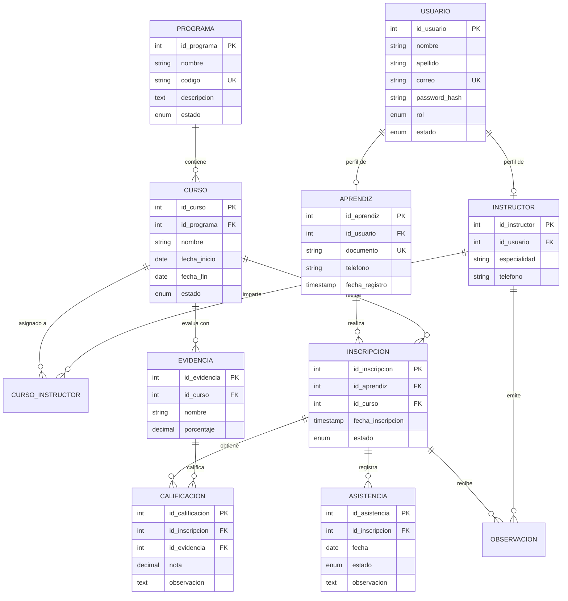

# ESPECIFICACIONES TÉCNICAS DEL SOFTWARE
## DOCUMENTO DE REQUISITOS Y DISEÑO · VERSIÓN 1.0

# EDUNOVA: Plataforma Inteligente de Gestión Académica
**Transformando la gestión académica en una experiencia inteligente.**

- **Desarrolladora:** Anyely Valeria
- **Programa de Formación:** Análisis y Desarrollo de Software (ADSO)
- **Institución:** SENA – Centro de Formación Industrial
- **Ubicación:** Neiva, Huila, Colombia
- **Duración estimada:** 4 semanas
- **Tipo de software:** Aplicación web
- **Versión:** 1.0.0

---

## 1. PLANTEAMIENTO DEL PROBLEMA
Actualmente, muchas instituciones educativas y centros de formación presentan dificultades para administrar y organizar la información académica de sus estudiantes. En algunos casos, los registros de aprendices, calificaciones, cursos, asistencia y actividades se realizan mediante hojas de cálculo, documentos independientes o procesos manuales.

Esta situación puede ocasionar pérdida de información, duplicidad de registros, dificultades para consultar el rendimiento académico y retrasos en la elaboración de informes.

Además, los instructores necesitan herramientas que les permitan registrar las calificaciones de manera organizada, consultar el progreso de los aprendices y detectar oportunamente las actividades pendientes.

Por otra parte, los aprendices requieren un espacio donde puedan consultar sus calificaciones, conocer sus cursos, revisar sus actividades y realizar seguimiento a su propio proceso de formación.

Ante esta problemática, surge **EDUNOVA**, una plataforma web de gestión académica que busca centralizar la información, automatizar procesos administrativos y facilitar el seguimiento del rendimiento académico mediante herramientas digitales y apoyo de inteligencia artificial.

### 1.1 Pregunta Problema
> ¿Cómo desarrollar una plataforma web que permita centralizar y optimizar la gestión de aprendices, instructores, cursos, calificaciones y asistencia, facilitando el seguimiento académico y reduciendo los procesos manuales?

---

## 2. OBJETIVOS

### 2.1 Objetivo General
Desarrollar **EDUNOVA**, una plataforma web de gestión académica que permita administrar de manera centralizada la información de aprendices, instructores, programas de formación, cursos, calificaciones y asistencia, facilitando el seguimiento del rendimiento académico mediante herramientas tecnológicas y apoyo de inteligencia artificial.

### 2.2 Objetivos Específicos
1. Diseñar una interfaz web intuitiva, moderna y adaptable a diferentes dispositivos.
2. Implementar un módulo de autenticación y gestión de usuarios con diferentes roles y permisos.
3. Desarrollar funcionalidades para registrar, consultar, actualizar y eliminar información de aprendices e instructores.
4. Implementar la administración de programas de formación y cursos.
5. Crear un módulo para registrar y consultar calificaciones de los aprendices.
6. Desarrollar un sistema de control y seguimiento de asistencia.
7. Generar reportes estadísticos sobre el rendimiento académico.
8. Incorporar herramientas de inteligencia artificial para generar observaciones y recomendaciones generales sobre el progreso académico.
9. Garantizar la integridad, disponibilidad y seguridad de la información almacenada.

---

## 3. JUSTIFICACIÓN
EDUNOVA nace de la necesidad de mejorar la administración de los procesos académicos mediante una herramienta tecnológica que centralice la información y facilite su consulta. Su implementación permitirá reducir el manejo de documentos independientes, agilizar el registro de calificaciones, organizar la asistencia y generar reportes de manera más eficiente.

La plataforma también busca mejorar la comunicación entre administradores, instructores y aprendices, proporcionando información organizada y accesible según los permisos de cada usuario.

Desde el punto de vista tecnológico, este proyecto permitirá aplicar conocimientos de análisis, diseño, programación, bases de datos, desarrollo web, metodologías ágiles e inteligencia artificial adquiridos durante el proceso de formación ADSO.

---

## 4. ALCANCE DEL PROYECTO

### 4.1 Alcance Funcional
EDUNOVA permitirá:
- Registrar y administrar usuarios.
- Iniciar y cerrar sesión.
- Gestionar aprendices e instructores.
- Registrar programas de formación.
- Crear y administrar cursos.
- Asignar instructores a cursos.
- Inscribir aprendices en cursos.
- Registrar y consultar calificaciones.
- Registrar asistencia.
- Consultar el rendimiento académico.
- Generar reportes estadísticos.
- Consultar actividades y novedades académicas.
- Generar recomendaciones académicas con asistencia de IA.

### 4.2 Roles del Sistema
- **Administrador:**
  - Gestionar usuarios.
  - Registrar aprendices e instructores.
  - Crear programas y cursos.
  - Asignar instructores.
  - Consultar reportes generales.
  - Administrar la plataforma.
- **Instructor:**
  - Consultar sus cursos asignados.
  - Consultar los aprendices inscritos.
  - Registrar calificaciones.
  - Registrar asistencia.
  - Consultar estadísticas de rendimiento.
  - Generar observaciones académicas.
- **Aprendiz:**
  - Consultar su perfil.
  - Consultar cursos inscritos.
  - Visualizar calificaciones.
  - Consultar asistencia.
  - Revisar su progreso académico.
  - Consultar recomendaciones de estudio.

### 4.3 Limitaciones y Restricciones
- Aplicación web responsive (no app móvil nativa en fase 1).
- Sin integración a sistemas oficiales SENA (SofiaPlus / Zajuna).
- No realiza matrículas formales ni emisión de certificados oficiales.
- No procesa pagos bancarios.
- La IA es de apoyo pedagógico; no toma decisiones definitivas ni automáticas sobre aprobación.

---

## 5. IDENTIDAD VISUAL Y COLORES

| Color | Código HEX | Uso en el Sistema |
| :--- | :--- | :--- |
| **Azul oscuro** | `#102A43` | Barra lateral (Sidebar), barra superior de navegación y títulos principales |
| **Azul principal** | `#2563EB` | Botones de acción, enlaces, estados activos y guardado |
| **Turquesa** | `#14B8A6` | Gráficos, métricas clave, badges del módulo EDUNOVA AI |
| **Blanco** | `#FFFFFF` | Fondo de tarjetas (cards), modales, tablas y formularios |
| **Gris claro** | `#F1F5F9` | Fondo general de la plataforma (`bg-slate-100`) |
| **Gris oscuro** | `#334155` | Textos de contenido, párrafos y etiquetas secundarias |
| **Verde** | `#22C55E` | Calificaciones aprobadas, estado "PRESENTE", estados activos |
| **Naranja** | `#F59E0B` | Evidencias pendientes, alertas preventivas, tardanzas |
| **Rojo** | `#EF4444` | Ausencias, calificaciones reprobadas, estados críticos |

---

## 6. REQUISITOS FUNCIONALES (RF)

| Código | Requisito | Descripción |
| :--- | :--- | :--- |
| **RF01** | Inicio de sesión | Permitir el acceso seguro mediante correo y contraseña encriptada. |
| **RF02** | Gestión de usuarios | Registrar, consultar, actualizar y desactivar cuentas de usuario. |
| **RF03** | Gestión de aprendices | Administrar información personal, documento, teléfono y perfil formativo. |
| **RF04** | Gestión de instructores | Registrar instructores y administrar sus especialidades de enseñanza. |
| **RF05** | Programas de formación | Crear y administrar programas académicos del SENA. |
| **RF06** | Gestión de cursos | Registrar fichas/cursos y asociarlos a los programas correspondientes. |
| **RF07** | Asignación de instructores | Relacionar uno o varios instructores con cada curso. |
| **RF08** | Inscripción de aprendices | Asociar aprendices a los cursos activos evitando duplicados. |
| **RF09** | Registro de calificaciones | Registrar notas numéricas (0.00 a 5.00) por evidencia y aprendiz. |
| **RF10** | Consulta de calificaciones | Visualizar notas y promedios según los permisos del rol. |
| **RF11** | Control de asistencia | Registrar sesiones con estado: Presente, Ausente, Tardanza o Excusa. |
| **RF12** | Reportes académicos | Generar métricas visuales y consolidados de asistencia y rendimiento. |
| **RF13** | Panel administrativo | Dashboard con contadores en tiempo real (aprendices, cursos, instructores). |
| **RF14** | Seguimiento académico | Consulta del historial de progreso individual por aprendiz. |
| **RF15** | Observaciones académicas | Registro de comentarios pedagógicos de instructores a aprendices. |
| **RF16** | Asistencia de IA | Generar recomendaciones de estudio personalizadas a partir del rendimiento. |

---

## 7. REQUISITOS NO FUNCIONALES (RNF)

| Código | Requisito | Descripción |
| :--- | :--- | :--- |
| **RNF01** | Rendimiento | Tiempos de respuesta inferiores a 2 segundos en condiciones normales. |
| **RNF02** | Seguridad | Encriptación de contraseñas con bcrypt (salt rounds >= 10) y tokens JWT. |
| **RNF03** | Usabilidad | Diseño intuitivo basado en buenas prácticas UX/UI con Inter/Poppins. |
| **RNF04** | Compatibilidad | Soporte cross-browser en Chrome, Edge, Firefox y Safari. |
| **RNF05** | Adaptabilidad | Diseño responsive optimizado para Desktop, Tablet y Smartphone. |
| **RNF06** | Disponibilidad | Operatividad continua en plataformas cloud (Vercel / Render). |
| **RNF07** | Integridad | Claves primarias, foráneas, índices y restricciones en base de datos MySQL. |
| **RNF08** | Mantenibilidad | Arquitectura de tres capas limpia, modular y documentada. |
| **RNF09** | Privacidad | Control de acceso basado en roles (RBAC) validado en backend y frontend. |
| **RNF10** | Escalabilidad | Estructura preparada para incorporar nuevos módulos en versiones futuras. |

---

## 8. HISTORIAS DE USUARIO (HU)

- **HU01: Inicio de sesión** — Validación de credenciales y redirección por rol (Admin, Instructor, Aprendiz).
- **HU02: Registrar aprendices** — Registro con documento único, nombres y correo institucional.
- **HU03: Registrar instructores** — Registro de perfil docente con especialidad técnica.
- **HU04: Crear programas de formación** — Alta de programas con código único y descripción.
- **HU05: Crear cursos** — Creación de cursos con rango de fechas y asignación docente.
- **HU06: Inscribir aprendices** — Matrícula en cursos evitando inscripciones duplicadas.
- **HU07: Registrar calificaciones** — Calificación de evidencias en escala de 0.00 a 5.00 con retroalimentación.
- **HU08: Registrar asistencia** — Toma diaria de asistencia por ficha/curso con registro de novedades.
- **HU09: Consultar calificaciones** — Visualización de evidencias evaluadas y promedio acumulado.
- **HU10: Consultar asistencia** — Visualización de porcentaje de asistencia y detalle de ausencias.
- **HU11: Generar reportes** — Consolidado de métricas académicas y filtros por curso.
- **HU12: Recomendaciones con IA** — Análisis inteligente no punitivo de oportunidades de mejora.

---

## 9. MODELO ENTIDAD-RELACIÓN

---

## 10. MATRIZ DE ENDPOINTS REST

| Método | Endpoint | Descripción | Roles Autorizados |
| :--- | :--- | :--- | :--- |
| `POST` | `/api/auth/login` | Iniciar sesión y emitir token JWT | Público |
| `GET` | `/api/auth/me` | Obtener información del usuario autenticado | Todos (con JWT) |
| `GET` | `/api/usuarios` | Listar todos los usuarios | ADMIN |
| `POST` | `/api/usuarios` | Crear usuario | ADMIN |
| `GET` | `/api/aprendices` | Listar aprendices con sus datos personales | ADMIN, INSTRUCTOR |
| `POST` | `/api/aprendices` | Registrar nuevo aprendiz | ADMIN |
| `GET` | `/api/instructores` | Listar instructores registrados | ADMIN |
| `POST` | `/api/instructores` | Registrar nuevo instructor | ADMIN |
| `GET` | `/api/programas` | Listar programas de formación | ADMIN, INSTRUCTOR, APRENDIZ |
| `POST` | `/api/programas` | Crear nuevo programa | ADMIN |
| `GET` | `/api/cursos` | Listar cursos activos | ADMIN, INSTRUCTOR, APRENDIZ |
| `POST` | `/api/cursos` | Crear curso y asignar fechas | ADMIN |
| `POST` | `/api/inscripciones` | Inscribir aprendiz en un curso | ADMIN |
| `GET` | `/api/calificaciones` | Consultar calificaciones | ADMIN, INSTRUCTOR, APRENDIZ |
| `POST` | `/api/calificaciones` | Registrar o actualizar calificación | INSTRUCTOR |
| `POST` | `/api/asistencias` | Registrar toma de asistencia | INSTRUCTOR |
| `GET` | `/api/reportes/dashboard` | Indicadores de rendimiento y asistencia | ADMIN, INSTRUCTOR |
| `POST` | `/api/ai/recommendations` | Generar recomendaciones con EDUNOVA AI | APRENDIZ, INSTRUCTOR |

