# ESPECIFICACIÓN DE REQUISITOS DE SOFTWARE (SRS / ERS)
## SISTEMA DE GESTIÓN ACADÉMICA – EDUNOVA
### Estándar IEEE 830 / ISO/IEC/IEEE 29148

---

| **Información General del Proyecto** | **Detalle Institucional** |
| :--- | :--- |
| **Proyecto:** | EDUNOVA – Academic Management System |
| **Aprendiz Líder / Desarrolladora:** | Anyely Valeria Bautista |
| **Programa de Formación:** | Tecnólogo en Análisis y Desarrollo de Software (ADSO) |
| **Ficha de Caracterización:** | 2874102 |
| **Centro de Formación:** | Centro de Formación Industrial – SENA Regional Huila (Neiva) |
| **Modalidad:** | Desarrollo individual con asistencia de Inteligencia Artificial |
| **Duración Estimada:** | 4 semanas (1 mes) |
| **Versión del Documento:** | 2.1 (Optimizada para Alto Rendimiento, Streaming IA, Skeleton UI y Caché) |
| **Estado:** | Aprobado / En Ejecución Técnica |

---

## CONTROL DE VERSIONES DEL SRS

| Versión | Fecha | Autor(a) | Descripción del Cambio |
| :---: | :---: | :--- | :--- |
| **v1.0** | 11/11/2026 | Anyely Valeria | Creación inicial del SRS, planteamiento del problema, requisitos RF/RNF, historias de usuario y cronograma de 4 semanas. |
| **v1.1** | 12/11/2026 | Anyely Valeria | Incorporación de la autenticación obligatoria dividida en 3 roles (Aprendiz, Instructor, Admin) y maquetación Soft Glassmorphism. |
| **v1.2** | 13/11/2026 | Anyely Valeria | Actualización integral Ocean Tech Premium: paleta petróleo, turquesa, cian y ámbar; modelo MER de 13 entidades y catálogo de API REST. |
| **v2.0** | 13/11/2026 | Anyely Valeria | Adaptación a la estructura formal integral SENA/IEEE (HU-01 a HU-26, CU-01 a CU-26, RF1 a RF26, RNF-01 a RNF-12 y Matriz de Trazabilidad). |
| **v2.1** | 13/11/2026 | Anyely Valeria | **Sprint de Alto Rendimiento y UX Resiliente**: Diseño Skeleton para carga fluida, búsqueda con Debounce (300ms), paginación de cursos, streaming token a token de EDUNOVA AI, actualización optimista de interfaz (Optimistic UI), índices SQL en MySQL 8, prevención de consultas N+1 con Prisma, compresión Brotli/Gzip, caché Redis/In-Memory, cola de trabajos (Job Queue), timeouts en APIs externas (5000ms), code-splitting de JS (`manualChunks`) y monitoreo de usuarios reales (RUM). |

---

## 1. INTRODUCCIÓN

### 1.1. Planteamiento del problema
En la actualidad, diversas instituciones educativas y centros de formación tecnológica continúan gestionando sus procesos académicos mediante herramientas fragmentadas, hojas de cálculo independientes (`.xlsx`), archivos físicos y libretas de asistencia manuales. 

Esta dispersión operativa ocasiona problemas críticos:
1. **Inconsistencia y pérdida de información:** Dificultad para conciliar calificaciones y asistencias al transferir notas entre formatos manuales.
2. **Duplicidad de registros:** Falta de restricciones de unicidad al matricular aprendices o registrar asistencia en diferentes sesiones.
3. **Falta de visibilidad oportuna para el aprendiz:** Los aprendices no cuentan con un medio digital centralizado en tiempo real para consultar su historial de notas, asistencias acumuladas y advertencias preventivas.
4. **Sobrecarga de trabajo en instructores:** Inversión excesiva de tiempo calculando ponderaciones de evidencias y consolidando asistencias manualmente, restando tiempo a la labor pedagógica.
5. **Dificultad en auditoría y control directivo:** Los coordinadores y administradores carecen de paneles estadísticos e indicadores inmediatos sobre la deserción, avance de competencias y rendimiento global de las fichas.

**Pregunta Orientadora:**  
*¿Cómo desarrollar una plataforma web moderna, modular y centralizada que permita administrar y consultar de manera organizada la información académica de aprendices, instructores, programas de formación, calificaciones y asistencias, reduciendo los procesos manuales y optimizando el seguimiento pedagógico en el Centro de Formación Industrial del SENA Regional Huila?*

---

### 1.2. Propósito
El propósito de este documento es definir formal, completa y sistemáticamente la **Especificación de Requisitos de Software (SRS)** para la plataforma web **EDUNOVA – Academic Management System**, conforme a los lineamientos del estándar **IEEE 830 / ISO/IEC/IEEE 29148**. 

Este documento actúa como:
* Contrato formal de desarrollo entre la aprendiz desarrolladora y los evaluadores académicos del SENA.
* Guía de arquitectura de software para la implementación del frontend, backend y base de datos relacional.
* Matriz de verificación y diseño del plan de pruebas funcionales y de calidad.

---

### 1.3. Justificación
El desarrollo de EDUNOVA soluciona las problemáticas de dispersión y manualidad, proporcionando una solución tecnológica escalable, segura y adaptable a cualquier dispositivo (computadores, tabletas y celulares). Al centralizar la información en una base de datos relacional (MySQL 8) administrada con Prisma ORM, se garantiza la integridad referencial, la no duplicidad y el acceso inmediato a la información.

Desde el punto de vista pedagógico y formativo, el proyecto permite a la aprendiz aplicar de forma integral competencias técnicas en:
* Levantamiento de requisitos formales e historias de usuario.
* Diseño de bases de datos relacionales normalizadas en 3FN.
* Arquitectura de software en 3 capas (Monolito Modular con React 18, Node.js, Express y MySQL).
* Implementación de seguridad perimetral mediante JWT y hashing de contraseñas.
* Diseño de experiencias de usuario con estándares visuales SaaS modernos (**Ocean Tech Premium Glassmorphism**).
* Buenas prácticas de control de versiones con Git/GitHub y metodologías ágiles (Scrum).

#### 1.3.1. Vigilancia tecnológica y referentes de mercado
Para el diseño y concepción de EDUNOVA se realizó un estudio de vigilancia tecnológica y benchmarking analizando referentes educativos globales y plataformas de gestión escolar líderes:

| Referente de Mercado | Enfoque Principal | Aporte Tomado para EDUNOVA |
| :--- | :--- | :--- |
| **Henon Edtech** ([henonedu.com](https://henonedu.com)) | Plataforma moderna de analítica educativa y seguimiento estudiantil. | Estructura modular de métricas de progreso y dashboards limpios de rendimiento. |
| **AttendX** ([attendx.co.in](https://attendx.co.in)) | Software especializado en control digital de asistencias y novedades. | Registro rápido de asistencia por sesión (Presente, Retardo, Inasistencia) con porcentaje consolidado. |
| **EduMatrix / Virtual Classroom** | Gestión escolar para colegios técnicos y seguimiento de asignaturas. | Planilla interactiva de calificaciones homologadas a escala numérica institucional. |
| **Innova Scholar** ([innovascholar.com](https://innovascholar.com)) | Sistema integral de control escolar con jerarquía de roles. | Modelo de control de acceso estricto RBAC (Administrador, Instructor, Aprendiz). |
| **A-Star Solutions** | Portales estudiantiles interactivos de autoservicio. | Portal del aprendiz con acceso instantáneo a evidencias, retroalimentación y tutoría con IA. |
| **EDUMASR** ([edumasr.com](https://edumasr.com)) | Sistemas de gestión académica basados en arquitecturas web modernas. | Concepto de panel centralizado de administración y reportes imprimibles oficiales. |

---

### 1.4. Objetivo general
Desarrollar una plataforma web de gestión académica integral (EDUNOVA) que permita administrar y centralizar la información de aprendices, instructores, programas de formación, cursos, calificaciones y asistencias, optimizando los procesos administrativos y facilitando el seguimiento pedagógico en el Centro de Formación Industrial del SENA Regional Huila.

#### 1.4.1. Objetivos específicos
1. **Analizar y especificar:** Identificar las necesidades de información académica y formalizar los requisitos funcionales (RF1 a RF26), no funcionales (RNF-01 a RNF-12) e historias de usuario (HU-01 a HU-26).
2. **Diseñar el modelo de datos:** Diseñar e implementar una base de datos relacional normalizada en MySQL 8 compuesta por 13 entidades interconectadas.
3. **Desarrollar la API REST:** Construir los servicios del backend en Node.js y Express con autenticación robusta JWT, control RBAC y operaciones CRUD.
4. **Construir el Frontend Interactivo:** Diseñar e implementar la interfaz en React 18 + Tailwind CSS bajo la identidad **Ocean Tech Premium**, incorporando componentes Glassmorphism y gráficos Recharts.
5. **Incorporar Tutoría Inteligente:** Implementar el módulo **EDUNOVA AI** para emitir diagnósticos y sugerencias pedagógicas adaptadas al rendimiento del aprendiz.
6. **Verificar y Documentar:** Diseñar el plan de pruebas funcionales, construir la matriz de trazabilidad y mantener la sincronización continua en GitHub.

---

### 1.5. Alcances

#### 1.5.1. Funcionalidades Incluidas (Versión 1.0 - MVP)
* Inicio de sesión obligatorio dividido en 3 portales: **Administrador**, **Instructor** y **Aprendiz**.
* Registro de nuevos usuarios con validación de roles, documentos y correos únicos.
* Gestión completa de perfiles (aprendices, instructores y directivos).
* Gestión de programas de formación (ej. ADSO), asignaturas y creación de fichas formativas.
* Matrícula formal de aprendices a fichas evitando inscripciones duplicadas.
* Planilla digital de registro de calificaciones con escala institucional (0.0 a 5.0) y homologación a Aprobado (A) / Deficiente (D).
* Control de asistencia por sesión formativa con cálculo porcentual acumulativo.
* Dashboard del Aprendiz con Recharts Donut Chart (80% Aprobado vs 20% Pendiente).
* Módulo interactivo **EDUNOVA AI** con 3 modos de consulta rápida (`⚡ Mi Estado`, `⏳ Pendientes`, `🎯 Plan Guía`).
* Generación de reportes académicos consolidados en pantalla y listos para exportación.

#### 1.5.2. Funcionalidades Excluidas (Versiones Futuras)
* Pasarela de pagos o cobro de aranceles educativos (el SENA es educación pública gratuita).
* Clases virtuales sincrónicas o servidor de videoconferencias integrado.
* Aplicación móvil nativa en tiendas App Store / Play Store.
* Reconocimiento facial o biométrico para toma de asistencia.
* Toma de decisiones autónoma por parte de la IA para aprobar o reprobar aprendices.

---

### 1.6. Personal Involucrado

#### 1.6.1. Roles y responsabilidades del equipo
* **Anyely Valeria Bautista (Desarrolladora Full Stack & Líder de Proyecto):**
  * Responsable del levantamiento de requisitos, diseño de interfaces UI/UX, maquetación React, desarrollo de la API Node.js/Express, diseño relacional MySQL, pruebas funcionales y versionado en GitHub.
* **Equipo de Instructores Evaluadores ADSO (SENA Regional Huila):**
  * Responsables de la retroalimentación técnica, validación de historias de usuario, evaluación de la arquitectura de software y verificación de cumplimiento de competencias.
* **Inteligencia Artificial Asistente (ChatGPT / Gemini / GitHub Copilot):**
  * Soporte técnico en optimización de consultas SQL, generación de estructuras base, sugerencias de casos de prueba y redacción técnica del SRS.

---

### 1.7. Definiciones, acrónimos y abreviaturas
* **ADSO:** Análisis y Desarrollo de Software (Programa tecnológico SENA).
* **API REST:** Representational State Transfer Application Programming Interface.
* **Bcrypt:** Función de derivación de claves para hashing seguro de contraseñas.
* **CU:** Caso de Uso (Use Case).
* **Ficha:** Código numérico único asignado a un grupo académico en el SENA.
* **Glassmorphism:** Técnica de diseño de interfaz de usuario caracterizada por translucidez, desenfoque de fondo y sombras suaves.
* **HMR:** Hot Module Replacement (reemplazo en caliente de módulos en Vite).
* **HU:** Historia de Usuario (User Story).
* **JWT:** JSON Web Token (estándar abierto RFC 7519 para intercambio de tokens de sesión).
* **MER:** Modelo Entidad-Relación de base de datos.
* **MVP:** Minimum Viable Product (Producto Mínimo Viable).
* **Ocean Tech:** Identidad visual premium basada en tonos petróleo, azul profundo, turquesa, cian y ámbar.
* **ORM:** Object-Relational Mapping (Mapeo Objeto-Relacional implementado con Prisma).
* **RBAC:** Role-Based Access Control (Control de Acceso Basado en Roles).
* **RF:** Requisito Funcional.
* **RNF:** Requisito No Funcional.
* **SENA:** Servicio Nacional de Aprendizaje.
* **SPA:** Single Page Application (Aplicación web de página única construida con React).

---

### 1.8. Referencias
1. IEEE Std 830-1998: *IEEE Recommended Practice for Software Requirements Specifications*.
2. ISO/IEC/IEEE 29148:2018: *Systems and software engineering — Life cycle processes — Requirements engineering*.
3. Documentación Oficial de React.js: [https://react.dev](https://react.dev).
4. Documentación Oficial de Node.js: [https://nodejs.org](https://nodejs.org).
5. Documentación Oficial de Express.js: [https://expressjs.com](https://expressjs.com).
6. Documentación Oficial de Prisma ORM: [https://www.prisma.io/docs](https://www.prisma.io/docs).
7. Documentación Oficial de MySQL 8: [https://dev.mysql.com/doc](https://dev.mysql.com/doc).
8. Documentación Oficial de Tailwind CSS: [https://tailwindcss.com/docs](https://tailwindcss.com/docs).
9. Guía Metodológica de Proyectos de Desarrollo de Software SENA ADSO (2026).

---

### 1.9. Resumen
El proyecto **EDUNOVA** es una solución tecnológica Full Stack creada para resolver la fragmentación del registro académico en el SENA. El sistema cuenta con una arquitectura de 3 capas, una base de datos relacional de 13 entidades, un diseño de interfaz **Ocean Tech Premium Glassmorphism**, 26 requisitos funcionales rigurosos, 12 requisitos no funcionales, 26 historias de usuario con sus casos de uso y un protocolo de sincronización continua documentado en GitHub.

---

## 2. DESCRIPCIÓN GENERAL

### 2.1. Perspectiva del producto
EDUNOVA es un sistema web independiente y autónomo que opera como un **Monolito Modular** de alta cohesión y bajo acoplamiento:

```
┌─────────────────────────────────────────────────────────────┐
│             1. CAPA DE PRESENTACIÓN (FRONTEND)              │
│       React 18 + Vite + Tailwind CSS + Lucide Icons         │
│     Ocean Tech Premium Glassmorphism · SPA Responsive       │
└──────────────────────────────┬──────────────────────────────┘
                               │ Solicitudes HTTP (JSON / JWT)
┌──────────────────────────────▼──────────────────────────────┐
│          2. CAPA DE LÓGICA DE NEGOCIO (BACKEND)             │
│            Node.js + Express.js + Middlewares               │
│   Autenticación · RBAC · CRUD Académico · Validador Zod/Joi │
└──────────────────────────────┬──────────────────────────────┘
                               │ Consultas SQL seguras
┌──────────────────────────────▼──────────────────────────────┐
│                 3. CAPA DE DATOS (DATABASE)                 │
│                 MySQL 8.0 + Prisma ORM                      │
│     13 Entidades Relacionales · Integridad Referencial      │
└─────────────────────────────────────────────────────────────┘
```

El software no depende de plataformas propietarias externas para su funcionamiento esencial. Se conecta directamente al servidor local o en la nube para procesar peticiones en milisegundos.

---

### 2.2. Características de los usuarios

| Rol de Usuario | Nivel Formativo / Técnico | Responsabilidad Principal en el Sistema |
| :--- | :--- | :--- |
| **Administrador** | Personal administrativo o de coordinación académica con conocimientos en gestión educativa. | Parametriza programas, asigna instructores a fichas, matricula aprendices, supervisa el sistema y emite reportes. |
| **Instructor** | Docentes y expertos técnicos con manejo de herramientas web. | Consulta aprendices a su cargo, programa actividades evaluativas, califica notas y toma asistencia por sesión. |
| **Aprendiz** | Estudiantes de programas técnicos y tecnológicos del SENA. | Consulta de notas personales, seguimiento de asistencias, visualización de fichas y orientación con EDUNOVA AI. |

---

### 2.3. Restricciones
1. **Plazo de Desarrollo:** 4 semanas calendario (1 mes) implementado en sprints semanales.
2. **Entorno de Ejecución:** Servidores compatibles con Node.js v18+ y motor MySQL v8.0+.
3. **Escala de Calificación:** Rango numérico estricto de 0.0 a 5.0 (nota aprobatoria $\ge 3.5$).
4. **Seguridad Obligatoria:** Cifrado unidireccional de contraseñas con bcrypt (no contraseñas en texto plano).
5. **Idioma:** Interfaz de usuario y mensajes del sistema en idioma español.
6. **Presupuesto:** Desarrollo individual sin costo de licenciamiento de software comercial (stack Open Source).

---

### 2.4. Suposiciones y dependencias
* Los usuarios disponen de un dispositivo con conexión a red local o Internet y un navegador moderno (Chrome, Edge, Firefox).
* Las credenciales de acceso a la base de datos MySQL local se encuentran configuradas en el archivo `.env`.
* Los aprendices matriculados poseen una cuenta de correo electrónico institucional válida.
* La institución provee la información inicial de programas de formación y fichas académicas.

---

## 3. REQUISITOS ESPECÍFICOS

### 3.1. Requisitos comunes de las interfaces
* **Identidad Visual Unificada:** Todos los módulos aplican la paleta **Ocean Tech Premium** (`#123B50`, `#17365D`, `#19B5A5`, `#48BFE3`, `#E9B949`, `#F4F7FA`).
* **Efecto Glassmorphism:** Paneles de cristal con `backdrop-filter: blur(20px)`, bordes blancos translúcidos y sombras difuminadas.
* **Diseño Skeleton para Carga Inicial:** Implementación de esqueletos de carga (`BannerSkeleton`, `StatCardSkeleton`, `ChartSkeleton`, `TableSkeleton`) con animación de onda Shimmer para evitar pantallas en blanco y saltos visuales durante la carga de datos.
* **Búsqueda y Autocompletado con Debounce (300ms):** Búsqueda reactiva optimizada en Header y tablas que retrasa la ejecución 300ms mientras el usuario escribe, evitando llamadas duplicadas y re-renders innecesarios.
* **Imágenes en Formato Moderno (WebP/AVIF):** Uso de gráficos vectoriales e imágenes en formatos de alta compresión con atributos `loading="lazy"` y `decoding="async"` para elementos fuera de pantalla.
* **Transmisión de IA Token a Token:** Respuestas del tutor inteligente EDUNOVA AI transmitidas en streaming progresivo con cursor activo (`▍`), simulando procesamiento en tiempo real.
* **Actualización Optimista de la Interfaz (Optimistic UI):** La interfaz refleja de inmediato las acciones del usuario (ej. entregas rápidas de evidencias o toma de asistencia) antes de recibir la confirmación del servidor, garantizando sensación de velocidad instantánea.
* **Paginación y Virtualización:** División de listas y tablas en páginas controladas (`pageSize`) evitando la sobrecarga del DOM en conjuntos extensos de aprendices o notas.
* **Navegación Consistente:** Menú lateral (Sidebar) retráctil con iconos temáticos Lucide, buscador global con atajo (`Ctrl+K`) y barra superior con identificación de institución y usuario.
* **Retroalimentación Visual Inmediata:** Notificaciones tipo toast y modales con validaciones en verde menta (éxito), ámbar (alerta) o rojo (error).
* **Adaptabilidad Responsive y Redes Lentas:** Reorganización automática de cuadrículas (`grid-cols-1` en móviles a `grid-cols-4` en pantallas amplias) y monitor de velocidad de red (RUM) para conexiones lentas (3G/2G).

---

### 3.2. Historias de Usuario (HU-01 a HU-26)

| Código | Rol | Historia de Usuario | Criterio de Aceptación |
| :---: | :--- | :--- | :--- |
| **HU-01** | Todos | Como usuario, quiero iniciar sesión seleccionando mi rol para ingresar a mi portal autorizado. | Valida credenciales contra la BD y carga el panel correspondiente al rol. |
| **HU-02** | Todos | Como usuario, quiero registrar una nueva cuenta para acceder a los servicios formativos. | Exige campos obligatorios, valida contraseña $\ge 6$ caracteres y correo único. |
| **HU-03** | Todos | Como usuario, quiero solicitar el restablecimiento de mi contraseña si la olvido. | Envía token o permite recuperación controlada por credenciales de seguridad. |
| **HU-04** | Todos | Como usuario, quiero actualizar mis datos de perfil para mantener mi información vigente. | Permite editar teléfono y especialidad, actualizando la BD de inmediato. |
| **HU-05** | Todos | Como usuario, quiero cerrar sesión de manera segura para proteger mi privacidad. | Destruye el token JWT y redirecciona a la pantalla de Auth. |
| **HU-06** | Admin | Como administrador, quiero gestionar usuarios (CRUD) para mantener el directorio actualizado. | Lista, filtra, edita y desactiva lógicamente cuentas de usuario. |
| **HU-07** | Admin | Como administrador, quiero registrar y administrar aprendices para gestionar sus expedientes. | Registra datos biográficos, documento único y asocia perfil de aprendiz. |
| **HU-08** | Admin | Como administrador, quiero registrar instructores con su especialidad técnica. | Crea el perfil docente para habilitar su asignación a fichas académicas. |
| **HU-09** | Admin | Como administrador, quiero crear y modificar programas de formación (ej. ADSO). | Programa queda activo en el catálogo institucional para abrir fichas. |
| **HU-10** | Admin | Como administrador, quiero crear cursos o asignaturas formativas asociadas a programas. | Asignatura creada con código y competencias técnicas específicas. |
| **HU-11** | Admin | Como administrador, quiero crear grupos/fichas académicas definiendo jornada y fechas. | Genera el código de ficha (ej. ADSO-2874102) con calendario académico. |
| **HU-12** | Admin | Como administrador, quiero asignar instructores a fichas académicas. | Vincula al docente titular a la ficha mediante la tabla pivote `GRUPO_INSTRUCTOR`. |
| **HU-13** | Admin | Como administrador, quiero matricular aprendices en fichas formativas. | Asocia aprendiz a ficha evitando dobles matrículas activas. |
| **HU-14** | Admin | Como administrador, quiero cambiar el estado de matrícula de un aprendiz (Activo/Retirado). | Actualiza el estado sin borrar datos históricos de calificaciones previas. |
| **HU-15** | Instructor | Como instructor, quiero crear actividades y evidencias formativas con porcentaje. | Define nombre de evidencia, ponderación y fecha máxima de entrega. |
| **HU-16** | Instructor | Como instructor, quiero calificar evidencias numéricamente de 0.0 a 5.0 con observaciones. | Guarda la nota, valida el rango y calcula el estado Aprobado / Deficiente. |
| **HU-17** | Instructor | Como instructor, quiero visualizar el consolidado de notas de mi grupo en una planilla. | Muestra tabla interactiva de aprendices con promedio ponderado general. |
| **HU-18** | Aprendiz | Como aprendiz, quiero consultar mis calificaciones y comentarios de retroalimentación. | Muestra únicamente las calificaciones personales de las materias inscritas. |
| **HU-19** | Instructor | Como instructor, quiero programar sesiones de clase indicando fecha y tema. | Sesión queda registrada en el calendario del grupo. |
| **HU-20** | Instructor | Como instructor, quiero tomar lista marcando Presente, Retardo o Inasistencia. | Registra la asistencia de cada aprendiz por sesión de forma ágil. |
| **HU-21** | Aprendiz | Como aprendiz, quiero consultar mi porcentaje de asistencia acumulada por curso. | Despliega gráfico e indicador de sesiones asistidas vs. inasistencias. |
| **HU-22** | Admin | Como administrador, quiero ver estadísticas generales en un panel de mando. | Tarjetas con total de aprendices, fichas activas, instructores y asistencia. |
| **HU-23** | Aprendiz | Como aprendiz, quiero ver un Hero Banner y un Donut Chart con mi rendimiento formativo. | Gráfico Recharts Donut (80% Aprobado vs 20% Pendiente) con datos en vivo. |
| **HU-24** | Admin/Inst | Como usuario administrativo, quiero generar reportes académicos imprimibles. | Genera vista oficial consolidada de notas y asistencia lista para PDF. |
| **HU-25** | Aprendiz | Como aprendiz, quiero interactuar con el tutor EDUNOVA AI para recibir consejos de estudio. | Despliega diagnósticos automáticos según las calificaciones obtenidas. |
| **HU-26** | Admin | Como administrador, quiero auditoría de cambios para rastrear modificaciones críticas. | Bitácora de creación y actualización de notas y matrículas con timestamp. |

---

### 3.2.1. Diagramas de Casos de Uso (CU-01 a CU-26)

A continuación se presenta el diagrama general de casos de uso que modela las interacciones entre los tres actores del sistema y los 26 casos de uso especificados:

```mermaid
flowchart LR
    subgraph Actores
        Admin(["👤 Administrador"])
        Inst(["👨‍🏫 Instructor"])
        Apren(["👩‍🎓 Aprendiz"])
    end

    subgraph Modulo_Seguridad_Usuarios ["Módulo 1: Seguridad y Usuarios"]
        CU01["CU-01: Iniciar Sesión Multi-Rol"]
        CU02["CU-02: Registrarse"]
        CU03["CU-03: Recuperar Contraseña"]
        CU04["CU-04: Gestionar Perfil"]
        CU05["CU-05: Cerrar Sesión"]
        CU06["CU-06: Administrar Usuarios"]
        CU07["CU-07: Administrar Aprendices"]
        CU08["CU-08: Administrar Instructores"]
    end

    subgraph Modulo_Academico_Matriculas ["Módulo 2: Oferta y Matrículas"]
        CU09["CU-09: Gestionar Programas"]
        CU10["CU-10: Gestionar Cursos"]
        CU11["CU-11: Gestionar Grupos/Fichas"]
        CU12["CU-12: Asignar Docentes"]
        CU13["CU-13: Matricular Aprendices"]
        CU14["CU-14: Controlar Estado Matrícula"]
    end

    subgraph Modulo_Calificaciones ["Módulo 3: Calificaciones"]
        CU15["CU-15: Programar Evidencias"]
        CU16["CU-16: Calificar Notas (0.0 - 5.0)"]
        CU17["CU-17: Planilla de Calificaciones"]
        CU18["CU-18: Consultar Notas Personales"]
    end

    subgraph Modulo_Asistencia ["Módulo 4: Asistencia"]
        CU19["CU-19: Programar Sesiones"]
        CU20["CU-20: Tomar Lista Asistencia"]
        CU21["CU-21: Consultar Asistencia"]
    end

    subgraph Modulo_Analitica_IA ["Módulo 5: Analítica y Tutoría IA"]
        CU22["CU-22: Panel Administrativo"]
        CU23["CU-23: Dashboard Aprendiz Donut"]
        CU24["CU-24: Generar Reportes PDF"]
        CU25["CU-25: Consultar EDUNOVA AI"]
        CU26["CU-26: Auditoría de Cambios"]
    end

    Admin --> CU01
    Admin --> CU04
    Admin --> CU05
    Admin --> CU06
    Admin --> CU07
    Admin --> CU08
    Admin --> CU09
    Admin --> CU10
    Admin --> CU11
    Admin --> CU12
    Admin --> CU13
    Admin --> CU14
    Admin --> CU22
    Admin --> CU24
    Admin --> CU26

    Inst --> CU01
    Inst --> CU04
    Inst --> CU05
    Inst --> CU15
    Inst --> CU16
    Inst --> CU17
    Inst --> CU19
    Inst --> CU20
    Inst --> CU24

    Apren --> CU01
    Apren --> CU02
    Apren --> CU03
    Apren --> CU04
    Apren --> CU05
    Apren --> CU18
    Apren --> CU21
    Apren --> CU23
    Apren --> CU25
```



---

### 3.3. Requerimientos Funcionales (RF1 a RF26)

| Código | Requisito Funcional | Entradas | Procesamiento | Salidas | Prioridad |
| :---: | :--- | :--- | :--- | :--- | :---: |
| **RF1** | **Autenticación por roles:** Permitir inicio de sesión con correo, contraseña y selección de rol (`ADMIN`, `INSTRUCTOR`, `APRENDIZ`). | Correo, contraseña, rol. | Valida hash bcrypt en BD y genera token JWT firmado. | Token JWT de sesión y redirección. | **Alta** |
| **RF2** | **Registro de usuarios:** Registro de cuentas obligatorias para aprendices e instructores con datos de identificación. | Nombre, apellido, documento, correo, pass. | Valida unicidad de correo y documento, cifra contraseña con salt rounds $\ge 10$. | Registro en tabla `USUARIO` y confirmación. | **Alta** |
| **RF3** | **Recuperación de contraseña:** Flujo para restablecimiento seguro de credenciales olvidadas. | Correo electrónico registrado. | Genera token de reseteo temporal con vigencia de 30 minutos. | Enlace de recuperación y formulario nuevo. | **Media** |
| **RF4** | **Gestión de perfil:** Actualización de datos de contacto (teléfono, especialidad, foto de perfil). | Datos actualizados del usuario. | Valida formato y actualiza registros en tablas hijas (`APRENDIZ`/`INSTRUCTOR`). | Notificación de perfil actualizado. | **Media** |
| **RF5** | **Cierre de sesión:** Finalización segura de sesión y revocación del token en el cliente. | Solicitud de cierre. | Elimina token del almacenamiento local y destruye estado en memoria. | Redirección inmediata a pantalla de Login. | **Alta** |
| **RF6** | **CRUD de usuarios:** Mantenimiento del catálogo de usuarios con activación y desactivación lógica. | ID usuario, datos modificados. | Aplica cambios; en eliminación aplica `activo = false`. | Directorio de usuarios actualizado. | **Alta** |
| **RF7** | **Gestión de aprendices:** Registro, edición y consulta de aprendices con documento de identidad. | Documento, nombres, ficha. | Persiste información en tabla `APRENDIZ` asociada a `USUARIO`. | Registro de aprendiz confirmado. | **Alta** |
| **RF8** | **Gestión de instructores:** Registro y administración de datos y especialidad técnica docente. | Nombres, especialidad, documento. | Persiste en tabla `INSTRUCTOR` habilitando perfil docente. | Instructor listo para asignaciones. | **Alta** |
| **RF9** | **Gestión de programas:** Crear, listar y editar programas de formación técnica y tecnológica. | Nombre programa, código, nivel. | Almacena programa en tabla `PROGRAMA`. | Programa disponible en catálogo. | **Alta** |
| **RF10** | **Gestión de cursos:** Crear materias o asignaturas de formación vinculadas a programas. | Nombre asignatura, horas, programa ID. | Crea curso en tabla `CURSO` con llave foránea. | Curso activo para mallas curriculares. | **Alta** |
| **RF11** | **Gestión de grupos/fichas:** Creación de grupos académicos con fechas de inicio, fin y jornada. | Número de ficha, jornada, fechas. | Genera registro en tabla `GRUPO` vinculado al programa. | Ficha creada y abierta a matrícula. | **Alta** |
| **RF12** | **Asignación docente:** Vincular instructores titulares a grupos formativos específicos. | ID Grupo, ID Instructor. | Inserta registro en tabla pivote `GRUPO_INSTRUCTOR`. | Docente con permisos en la ficha. | **Alta** |
| **RF13** | **Matrícula de aprendices:** Inscripción formal de aprendices en una ficha académica. | ID Aprendiz, ID Grupo, fecha. | Verifica que no exista matrícula previa y crea registro en `MATRICULA`. | Matrícula activa registrada. | **Alta** |
| **RF14** | **Control de estado de matrícula:** Modificar estado formativo (`ACTIVO`, `APLAZADO`, `CANCELADO`). | ID Matrícula, nuevo estado. | Actualiza campo `estado` preservando el historial. | Estado de formación actualizado. | **Media** |
| **RF15** | **Programación de evidencias:** Crear actividades evaluativas con porcentaje de ponderación. | Nombre evidencia, porcentaje, fecha. | Valida que la suma de porcentajes del curso no exceda el 100%. | Evidencia programada en `ACTIVIDAD`. | **Alta** |
| **RF16** | **Registro de notas:** Asignación de notas numéricas de 0.0 a 5.0 y comentarios formativos. | ID Matrícula, ID Actividad, nota. | Valida rango $0.0 \le \text{nota} \le 5.0$ y guarda en `CALIFICACION`. | Nota registrada y asociada al aprendiz. | **Alta** |
| **RF17** | **Homologación institucional:** Asignación automática de estado Aprobado (A) o Deficiente (D). | Nota registrada en el sistema. | Si $\text{nota} \ge 3.5 \rightarrow \text{"APROBADO"}$, caso contrario $\rightarrow \text{"DEFICIENTE"}$. | Badge visual y estado académico. | **Alta** |
| **RF18** | **Consulta de notas de aprendiz:** Visualización privada de calificaciones para el estudiante. | Petición autenticada de aprendiz. | Filtra calificaciones exclusivamente por el `id_aprendiz` en sesión. | Tabla de notas y promedio ponderado. | **Alta** |
| **RF19** | **Programación de sesiones:** Crear fechas de clase formativa asociadas a un grupo. | ID Grupo, fecha, tema de clase. | Almacena sesión en tabla `SESION`. | Sesión disponible en planilla. | **Alta** |
| **RF20** | **Toma de asistencia digital:** Registro de presencia por aprendiz (`PRESENTE`, `RETARDO`, `FALTA`). | ID Matrícula, ID Sesión, estado. | Inserta registro en tabla `ASISTENCIA` impidiendo duplicados por sesión. | Asistencia confirmada. | **Alta** |
| **RF21** | **Historial y porcentaje de asistencia:** Cálculo en tiempo real del porcentaje de cumplimiento. | ID Aprendiz / ID Matrícula. | Calcula: $(\text{Sesiones Presentes} / \text{Total Sesiones}) \times 100\%$. | Porcentaje visible en dashboard (ej. 92%). | **Alta** |
| **RF22** | **Panel de mando administrativo:** Métricas e indicadores clave de rendimiento institucional. | Consulta agregada a la BD. | Ejecuta conteos agrupados (`COUNT`, `AVG`) de usuarios, fichas y asistencias. | 4 Tarjetas de métricas consolidadas. | **Media** |
| **RF23** | **Dashboard visual del aprendiz:** Presentación de estadísticas con gráfico Recharts Donut. | Datos del aprendiz en sesión. | Modela datos de evidencias (80% Aprobado vs 20% Pendiente). | Gráfico Donut y 4 Stat Cards cromáticas. | **Alta** |
| **RF24** | **Reportes académicos consolidados:** Generación de planillas de calificaciones y asistencias. | ID Ficha o ID Aprendiz. | Estructura reporte formal con membrete SENA listo para imprimir/PDF. | Documento académico descargable. | **Media** |
| **RF25** | **Tutor pedagógico EDUNOVA AI:** Recomendaciones adaptativas de estudio basadas en notas y asistencia. | Promedio actual y materias cursadas. | Analiza fortalezas y debilidades formativas emitiendo consejos. | Cuadro de sugerencias y rutas de estudio. | **Media** |
| **RF26** | **Bitácora de auditoría:** Registro de eventos críticos (calificaciones modificadas, cancelaciones). | Evento, usuario, timestamp. | Inserta traza en tabla de auditoría del sistema. | Registro inmutable de trazabilidad. | **Baja** |

---

### 3.4. Requerimientos No Funcionales (RNF-01 a RNF-12)

| Código | Requisito No Funcional | Categoría | Especificación Técnica y Métrica de Aceptación |
| :---: | :--- | :--- | :--- |
| **RNF-01** | **Rendimiento y Optimización de Entrega** | Desempeño | Tiempo de respuesta del servidor $\le 2.0$ segundos. Compresión transparente **Brotli / Gzip**, división del bundle JavaScript por páginas (`manualChunks: vendor, recharts, icons`) y soporte para distribución de activos estáticos desde CDN. |
| **RNF-02** | **Seguridad Criptográfica** | Seguridad | Encriptación unidireccional de contraseñas utilizando algoritmo robusto **bcrypt** con salt rounds $\ge 10$. Prohibido almacenar contraseñas en texto claro. |
| **RNF-03** | **Seguridad en Comunicaciones y Timeouts** | Seguridad | Tokens **JWT** firmados con expiración de 8 horas. Aplicación de timeouts estrictos ($\le 5000\text{ ms}$) con `AbortController` en todas las llamadas a APIs externas para evitar cuelgues del hilo principal. |
| **RNF-04** | **Usabilidad, Skeleton UI y Fuentes Optimizadas** | Usabilidad | Diseño **Ocean Tech Premium Glassmorphism** con esqueletos de carga animados (**Skeleton Loaders**) para evitar CLS. Fuentes Plus Jakarta Sans autoalojadas con grosores limitados a 400, 600, 700 y 800 para minimizar la carga de red. |
| **RNF-05** | **Compatibilidad y Carga Diferida** | Compatibilidad | Soporte idéntico en Google Chrome, Microsoft Edge, Mozilla Firefox, Brave y Safari. Carga diferida (`defer` / `async`) de scripts no críticos para no bloquear el renderizado inicial. |
| **RNF-06** | **Diseño Adaptable a Móviles y Redes Lentas** | Portabilidad | Responsive para Desktop, Tablet y Smartphone. Detección proactiva de red mediante API `navigator.connection` con adaptación a redes lentas (2G/3G/4G). |
| **RNF-07** | **Optimización de Consultas e Índices SQL** | Confiabilidad | Base de datos MySQL 8 con índices dedicados (`correo`, `documento`, `id_grupo`, `fecha`). **Eliminación estricta de consultas N+1** mediante JOINs únicos con Prisma `include` y selección explícita de columnas (`select`). |
| **RNF-08** | **Disponibilidad, Pool y Tráfico Multi-instancia** | Disponibilidad | Disponibilidad continua $\ge 99.0\%$. Configuración de **Pool de conexiones** (`connection_limit=10, timeout=20s`) y soporte para reparto de tráfico entre múltiples instancias concurrentes. |
| **RNF-09** | **Mantenibilidad y Cola de Trabajos** | Mantenibilidad | Arquitectura desacoplada en tres capas (Monolito Modular). Despacho de tareas lentas (generación de PDFs, reportes masivos) a una **Cola de Trabajos en Segundo Plano (`JobQueue`)** sin bloquear el event loop. |
| **RNF-10** | **Privacidad Estricta y Prevención de Re-renders** | Privacidad / Eficiencia | Aislamiento de datos RBAC. En el frontend, optimización de ciclo de vida con `useMemo`, `useCallback` y `useDebounce` para evitar re-renderizados innecesarios del DOM. |
| **RNF-11** | **Escalabilidad, Caché Redis y OpenTelemetry** | Escalabilidad | Capacidad para $\ge 250$ usuarios simultáneos. Capa de **caché con Redis / In-Memory (`cacheService`)** con TTL para datos frecuentes y trazabilidad de peticiones lentas ($>500\text{ ms}$) con **OpenTelemetry APM**. |
| **RNF-12** | **Respaldo y Caché de Navegador** | Recuperabilidad | Script reproducible DDL y DML en `/docs/database/edunova_db.sql`. Cabeceras de caché de navegador inmutable (`Cache-Control: public, max-age=31536000, immutable`) para activos estáticos versionados. |

---

## 4. PLAN DE PRUEBAS Y MATRIZ DE TRAZABILIDAD

### 4.1. Matriz de Trazabilidad (HU $\leftrightarrow$ RF $\leftrightarrow$ CU $\leftrightarrow$ CP)

La siguiente matriz garantiza que cada historia de usuario cuente con su requisito funcional asociado, su caso de uso correspondiente y su respectivo caso de prueba verificado:

| Historia de Usuario | Requisito Funcional | Caso de Uso | Caso de Prueba (CP) | Procedimiento de Verificación | Estado |
| :---: | :---: | :---: | :---: | :--- | :---: |
| **HU-01** | **RF1** | **CU-01** | **CP-01** | Login con credenciales válidas en rol Aprendiz, Instructor y Admin. | **PASÓ** |
| **HU-02** | **RF2** | **CU-02** | **CP-02** | Registro de nuevo usuario validando datos obligatorios y correo único. | **PASÓ** |
| **HU-03** | **RF3** | **CU-03** | **CP-03** | Solicitud de cambio de contraseña con credenciales inválidas (rechazo). | **PASÓ** |
| **HU-04** | **RF4** | **CU-04** | **CP-04** | Modificación de teléfono y especialidad desde el menú de perfil. | **PASÓ** |
| **HU-05** | **RF5** | **CU-05** | **CP-05** | Cierre de sesión y verificación de destrucción de sesión local. | **PASÓ** |
| **HU-06** | **RF6** | **CU-06** | **CP-06** | Desactivación lógica de usuario (`activo = false`) sin borrado físico. | **PASÓ** |
| **HU-07** | **RF7** | **CU-07** | **CP-07** | Registro de aprendiz con documento de identidad y validación en tabla. | **PASÓ** |
| **HU-08** | **RF8** | **CU-08** | **CP-08** | Creación de instructor con especialidad técnica docente. | **PASÓ** |
| **HU-09** | **RF9** | **CU-09** | **CP-09** | Creación de programa ADSO y comprobación en catálogo. | **PASÓ** |
| **HU-10** | **RF10** | **CU-10** | **CP-10** | Creación de asignatura técnica asociada a programa. | **PASÓ** |
| **HU-11** | **RF11** | **CU-11** | **CP-11** | Apertura de ficha formativa 2874102 con fecha inicio/fin. | **PASÓ** |
| **HU-12** | **RF12** | **CU-12** | **CP-12** | Asignación de docente titular a la ficha en `GRUPO_INSTRUCTOR`. | **PASÓ** |
| **HU-13** | **RF13** | **CU-13** | **CP-13** | Matrícula de aprendiz en ficha 2874102. | **PASÓ** |
| **HU-14** | **RF14** | **CU-14** | **CP-14** | Intento de doble matrícula del mismo aprendiz en la misma ficha (bloqueo). | **PASÓ** |
| **HU-15** | **RF15** | **CU-15** | **CP-15** | Programación de evidencia con ponderación porcentual del 30%. | **PASÓ** |
| **HU-16** | **RF16** | **CU-16** | **CP-16** | Calificación numérica válida (4.8 / 5.0) con retroalimentación. | **PASÓ** |
| **HU-17** | **RF17** | **CU-17** | **CP-17** | Intento de ingresar nota fuera de rango (5.8 o negativa - rechazo). | **PASÓ** |
| **HU-18** | **RF18** | **CU-18** | **CP-18** | Consulta de notas desde sesión del aprendiz Anyely (solo sus notas). | **PASÓ** |
| **HU-19** | **RF19** | **CU-19** | **CP-19** | Creación de sesión de formación presencial por fecha y tema. | **PASÓ** |
| **HU-20** | **RF20** | **CU-20** | **CP-20** | Toma de lista marcando Presente y verificación en tabla `ASISTENCIA`. | **PASÓ** |
| **HU-21** | **RF21** | **CU-21** | **CP-21** | Cálculo automático del porcentaje de asistencia (92%). | **PASÓ** |
| **HU-22** | **RF22** | **CU-22** | **CP-22** | Visualización de 4 stat cards en panel directivo del administrador. | **PASÓ** |
| **HU-23** | **RF23** | **CU-23** | **CP-23** | Renderizado del gráfico Donut Recharts (80% aprobado vs 20% pendiente). | **PASÓ** |
| **HU-24** | **RF24** | **CU-24** | **CP-24** | Generación de vista de reporte consolidado oficial. | **PASÓ** |
| **HU-25** | **RF25** | **CU-25** | **CP-25** | Interacción con disparadores de EDUNOVA AI (`⚡ Mi Estado`, `⏳ Pendientes`). | **PASÓ** |
| **HU-26** | **RF26** | **CU-26** | **CP-26** | Verificación de acceso denegado a panel admin desde sesión aprendiz. | **PASÓ** |

---

### 4.2. Protocolo de Trazabilidad y Sincronización Continua en Git
Para garantizar que el presente documento SRS conserve absoluta vigencia técnica:
1. **Política de Commit Conjunto:** Cualquier refactorización o adición de código (nuevas pantallas, ajustes en endpoints o cambios en tablas de base de datos) debe incluir en el mismo commit la actualización del apartado correspondiente en `documentos/SRS_EDUNOVA.md`.
2. **Historial de Versiones en Git:** La rama principal de desarrollo `DEV` mantendrá la versión vigente del SRS en el repositorio de GitHub:  
   👉 [https://github.com/bautistanyely809-creator/PLATAFORMA-DE-GESTI-N-ACAD-MICA](https://github.com/bautistanyely809-creator/PLATAFORMA-DE-GESTI-N-ACAD-MICA)
3. **Criterio de Entrega:** El proyecto se considera académicamente terminado cuando el 100% de los casos de prueba (CP-01 a CP-26) figuren en estado **PASÓ** y la documentación concuerde punto por punto con la plataforma en ejecución.

---
*Documento estructurado y aprobado conforme a las pautas de evaluación técnica del programa ADSO – Centro de Formación Industrial, SENA Regional Huila (Neiva, 2026).*
