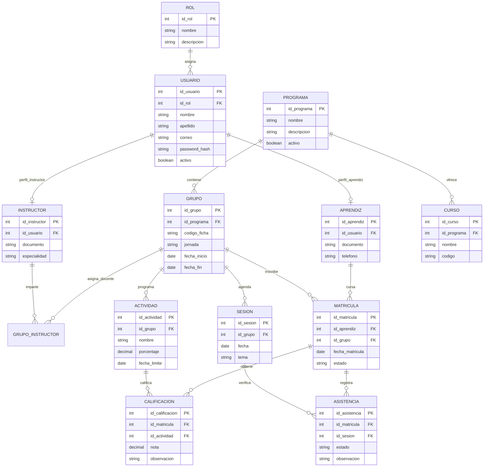

# ESPECIFICACIÓN DE REQUISITOS DE SOFTWARE (SRS / ERS)
## SISTEMA DE GESTIÓN ACADÉMICA – EDUNOVA
### Estándar IEEE 830 / ISO/IEC/IEEE 29148

---

| **Información General del Proyecto** | **Detalle Institucional** |
| :--- | :--- |
| **Proyecto:** | EDUNOVA – Academic Management System |
| **Aprendiz Líder / Desarrolladora:** | Anyely Valeria Bautista |
| **Programa de Formación:** | Tecnólogo en Análisis y Desarrollo de Software (ADSO) |
| **Ficha de Caracterización:** | 2874102 |
| **Centro de Formación:** | Centro de Formación Industrial – SENA Regional Huila (Neiva) |
| **Modalidad:** | Desarrollo individual con asistencia de Inteligencia Artificial |
| **Duración Estimada:** | 4 semanas (1 mes) |
| **Versión del Documento:** | 1.2 (Actualizada con Identidad Ocean Tech Premium y Modelo Relacional) |
| **Estado:** | Aprobado / En Ejecución Técnica |

---

## CONTROL DE VERSIONES DEL SRS

| Versión | Fecha | Autor(a) | Descripción del Cambio |
| :---: | :---: | :--- | :--- |
| **v1.0** | 11/11/2026 | Anyely Valeria | Creación inicial del SRS, planteamiento del problema, requisitos RF/RNF, historias de usuario y cronograma de 4 semanas. |
| **v1.1** | 12/11/2026 | Anyely Valeria | Incorporación de la autenticación obligatoria dividida en 3 roles (Aprendiz, Instructor, Admin) y maquetación Soft Glassmorphism. |
| **v1.2** | 13/11/2026 | Anyely Valeria | **Actualización integral Ocean Tech Premium**: sustitución de tonos pastel por Azul Petróleo, Azul Profundo, Turquesa, Cian y Ámbar; formalización del MER de 13 entidades, catálogo de API REST y protocolo de trazabilidad continua en GitHub. |

---

## 1. INTRODUCCIÓN

### 1.1 Propósito
El propósito de este documento de Especificación de Requisitos de Software (SRS) es describir de manera exhaustiva, formal y estructurada los requisitos funcionales, no funcionales, reglas de negocio, arquitectura técnica, modelo de datos y diseño de interfaces para la plataforma web **EDUNOVA – Academic Management System**. Este documento sirve como contrato técnico de desarrollo, guía de validación de pruebas y fuente viva de consulta para aprendices, instructores, coordinadores y evaluadores del SENA.

### 1.2 Alcance del Sistema
EDUNOVA es un sistema web integral diseñado para centralizar, automatizar y auditar los procesos académicos y formativos del **Centro de Formación Industrial del SENA Regional Huila**. El sistema gestiona desde una única plataforma el ciclo de vida formativo:
1. Autenticación y control de acceso jerárquico basado en roles (RBAC: Administrador, Instructor, Aprendiz).
2. Administración de usuarios, fichas, cursos, materias y programas de formación técnica/tecnológica.
3. Matrícula y asociación de aprendices a grupos académicos.
4. Planilla digital de calificaciones ponderadas con escala institucional (0.0 a 5.0 / Aprobado - Deficiente).
5. Control y registro de asistencia por sesión formativa con cálculo automático de porcentajes.
6. Consultas analíticas, generación de reportes y tutoría pedagógica asistida por **EDUNOVA AI**.

### 1.3 Personal Involucrado
* **Autora y Desarrolladora Full Stack:** Anyely Valeria Bautista (Aprendiz ADSO).
* **Entidad Educativa:** Servicio Nacional de Aprendizaje (SENA) – Regional Huila.
* **Usuarios Finales:** Administradores Académicos, Docentes/Instructores Técnicos, Aprendices Matriculados.
* **Herramientas de Asistencia:** Inteligencia Artificial (ChatGPT, GitHub Copilot, Gemini) para soporte en arquitectura, optimización de código, pruebas y documentación técnica.

### 1.4 Definiciones, Siglas y Abreviaturas
* **ADSO:** Análisis y Desarrollo de Software.
* **API REST:** Interfaz de Programación de Aplicaciones basada en transferencia de estado representacional.
* **CRUD:** Crear, Leer, Actualizar y Eliminar (Create, Read, Update, Delete).
* **FK / PK:** Llave Foránea (Foreign Key) / Llave Primaria (Primary Key).
* **JWT:** JSON Web Token para autenticación segura sin estado.
* **MER:** Modelo Entidad-Relación de base de datos.
* **MVP:** Producto Mínimo Viable (Minimum Viable Product).
* **ORM:** Mapeador Objeto-Relacional (Object-Relational Mapping / Prisma ORM).
* **RBAC:** Control de Acceso Basado en Roles (Role-Based Access Control).
* **SENA:** Servicio Nacional de Aprendizaje.
* **Soft UI / Glassmorphism:** Estilo visual moderno basado en tarjetas flotantes translúcidas, desenfoque de fondo (`backdrop-filter: blur`), bordes redondeados y microinteracciones fluidas.

---

## 2. DESCRIPCIÓN GENERAL DEL SISTEMA

### 2.1 Planteamiento del Problema
Actualmente, diversas instituciones y centros de formación gestionan sus registros académicos mediante herramientas desacopladas, planillas físicas de papel y hojas de cálculo independientes. Esta fragmentación genera:
* Pérdida o inconsistencia de información al transferir notas entre formatos.
* Duplicidad de matrículas y dificultad para auditar cambios.
* Demoras significativas para que los aprendices conozcan sus resultados formativos oportunamente.
* Sobrecarga operativa para los instructores al calcular ponderaciones de evidencias y consolidar asistencias manualmente.

**Pregunta Problema:**  
*¿Cómo desarrollar una plataforma web moderna que permita administrar y consultar de manera centralizada la información académica de aprendices, instructores, programas de formación, calificaciones y asistencias, reduciendo los procesos manuales y optimizando el seguimiento pedagógico?*

### 2.2 Objetivos

#### Objetivo General
Desarrollar una plataforma web de gestión académica (EDUNOVA) que centralice la administración de aprendices, instructores, programas formativos, cursos, calificaciones y asistencias, facilitando el seguimiento pedagógico en tiempo real y optimizando los procesos administrativos del centro de formación.

#### Objetivos Específicos
1. Identificar y formalizar los requisitos funcionales, no funcionales y reglas de negocio del sistema educativo.
2. Diseñar e implementar una base de datos relacional normalizada (MySQL 8) administrada con Prisma ORM.
3. Construir una API REST segura en Node.js + Express con validación de tokens y roles.
4. Desarrollar una interfaz de usuario moderna en React 18 + Tailwind CSS bajo la identidad **Ocean Tech Premium**.
5. Implementar módulos de visualización de datos (Recharts) y sugerencias pedagógicas con **EDUNOVA AI**.
6. Ejecutar pruebas funcionales y documentar el ciclo de vida del software con trazabilidad continua en GitHub.

### 2.3 Justificación
El proyecto soluciona de raíz la dispersión de datos académicos, proporcionando una solución tecnológica escalable, segura y adaptable a cualquier dispositivo (computador, tableta o smartphone). Desde el aspecto pedagógico y profesional, permite a la aprendiz aplicar competencias avanzadas en ingeniería de software, arquitectura en capas, metodologías ágiles (Scrum) y diseño UI/UX de nivel SaaS comercial.

### 2.4 Perspectiva del Producto y Arquitectura de 3 Capas
El sistema opera bajo un **Monolito Modular** de 3 capas claramente desacopladas:

```
┌─────────────────────────────────────────────────────────────┐
│             1. CAPA DE PRESENTACIÓN (FRONTEND)              │
│       React 18 + Vite + Tailwind CSS + Lucide Icons         │
│     Ocean Tech Premium Glassmorphism · SPA Responsive       │
└──────────────────────────────┬──────────────────────────────┘
                               │ Solicitudes HTTP (JSON / JWT)
┌──────────────────────────────▼──────────────────────────────┐
│          2. CAPA DE LÓGICA DE NEGOCIO (BACKEND)             │
│            Node.js + Express.js + Middlewares               │
│   Autenticación · RBAC · CRUD Académico · Validador Zod/Joi │
└──────────────────────────────┬──────────────────────────────┘
                               │ Consultas SQL seguras
┌──────────────────────────────▼──────────────────────────────┐
│                 3. CAPA DE DATOS (DATABASE)                 │
│                 MySQL 8.0 + Prisma ORM                      │
│     13 Entidades Relacionales · Integridad Referencial      │
└─────────────────────────────────────────────────────────────┘
```

### 2.5 Clases y Características de Usuarios

| Rol | Descripción y Permisos | Portal Asignado |
| :--- | :--- | :--- |
| **Administrador** | Acceso global: gestiona usuarios, programas, cursos, grupos, asignación docente y reportes consolidados. | Portal de Gestión Administrativa |
| **Instructor** | Acceso a sus grupos asignados: consulta aprendices matriculados, califica evidencias y registra asistencia por sesión. | Portal del Instructor Titular |
| **Aprendiz** | Acceso a su información personal: consulta de cursos inscritos, historial de calificaciones, asistencia y tutoría con IA. | Portal del Aprendiz ADSO |

### 2.6 Alcance del Proyecto (MVP vs. Futuras Fases)

```
✅ INCLUIDO EN LA VERSIÓN 1.0 (MVP):
├── Inicio de sesión obligatorio dividido en 3 roles (Admin, Instructor, Aprendiz)
├── Registro de nuevos usuarios con validación de roles y contraseña segura
├── Dashboard interactivo del Aprendiz con métricas en tiempo real
├── Donut Chart de rendimiento (80% aprobado vs 20% pendiente)
├── Tabla dinámica de cursos con buscador reactivo
├── Módulo EDUNOVA AI Tutor con diagnósticos pedagógicos simulados
├── Planilla de calificaciones con notas 0.0 a 5.0 y estado Aprobado / Deficiente
├── Registro de asistencia con estados (Presente, Retardo, Inasistencia)
├── Catálogo completo de endpoints REST documentados
└── Base de datos MySQL con 13 tablas relacionales y migraciones Prisma

❌ EXCLUIDO INICIALMENTE (FUTURAS VERSIONES):
├── Pasarela de pagos o cobros de matrículas
├── Aulas de videoconferencia sincrónica integradas
├── Reconocimiento facial por cámara para asistencia
├── Aplicación móvil nativa en Play Store / App Store
└── Decisiones autónomas de IA para aprobar o reprobar aprendices
```

---

## 3. REQUISITOS ESPECÍFICOS DEL SISTEMA

### 3.1 Requisitos Funcionales (RF)

| Código | Nombre del Requisito | Descripción | Entradas | Salidas | Prioridad |
| :---: | :--- | :--- | :--- | :--- | :---: |
| **RF01** | Inicio de sesión | Validar credenciales (correo y contraseña) según el rol seleccionado. | Correo institucional, contraseña, rol. | Token de sesión, redirección al portal. | **Alta** |
| **RF02** | Registro de usuarios | Permitir la creación de cuentas para aprendices, instructores o administradores con código. | Nombre, apellido, doc, correo, contraseña, rol. | Registro persistido, mensaje de éxito. | **Alta** |
| **RF03** | Gestión de aprendices | Administrar datos personales, documento, teléfono y ficha de formación. | Datos biográficos del aprendiz. | Ficha del aprendiz actualizada. | **Alta** |
| **RF04** | Gestión de instructores | Registrar instructores con especialidad técnica y credenciales de acceso. | Datos personales, especialidad técnica. | Perfil docente disponible para asignación. | **Alta** |
| **RF05** | Gestión de programas | Crear y activar programas de formación (ej. ADSO, Multimedia, Redes). | Nombre del programa, código, descripción. | Programa activo en catálogo. | **Alta** |
| **RF06** | Gestión de cursos | Crear asignaturas o unidades técnicas pertenecientes a un programa. | Nombre, código de asignatura, horas. | Asignatura creada. | **Alta** |
| **RF07** | Creación de grupos/fichas | Crear grupos académicos, asociar programa, jornada y asignar instructores. | Número de ficha, programa, instructor asignado. | Grupo/ficha constituida. | **Alta** |
| **RF08** | Matrícula de aprendices | Asociar aprendices a un grupo académico validando no duplicidad. | ID Aprendiz, ID Grupo, fecha. | Matrícula activa registrada. | **Alta** |
| **RF09** | Registro de notas | Permitir a los instructores registrar calificaciones de 0.0 a 5.0 por evidencia. | ID Matrícula, ID Actividad, nota, observación. | Nota calculada y guardada. | **Alta** |
| **RF10** | Consulta de notas | Permitir al aprendiz visualizar sus propias notas, promedio y estado (A/D). | Petición autenticada del aprendiz. | Listado de evidencias y calificaciones. | **Alta** |
| **RF11** | Registro de asistencia | Registrar el estado de asistencia (Presente, Retardo, Inasistente) por sesión. | ID Matrícula, ID Sesión, estado. | Asistencia confirmada. | **Alta** |
| **RF12** | Consulta de asistencia | Mostrar al aprendiz e instructor el porcentaje de asistencia e inasistencias. | ID Aprendiz / ID Grupo. | Porcentaje de cumplimiento y detalle. | **Alta** |
| **RF13** | Reportes académicos | Generar consolidados de notas y asistencia para exportación o impresión. | ID Ficha o ID Aprendiz. | Reporte consolidado en pantalla / PDF. | **Media** |
| **RF14** | Tutoría EDUNOVA AI | Proporcionar retroalimentación adaptativa y consejos pedagógicos según el desempeño. | Historial de calificaciones y asistencia. | Diagnóstico formativo y ruta de refuerzo. | **Media** |
| **RF15** | Cierre de sesión seguro | Destruir la sesión activa y limpiar el estado de autenticación local. | Clic en "Cerrar Sesión". | Redirección a la pantalla de Auth. | **Alta** |

---

### 3.2 Requisitos No Funcionales (RNF)

| Código | Categoría | Descripción Técnica | Métrica / Criterio |
| :---: | :--- | :--- | :--- |
| **RNF01** | **Rendimiento** | Respuestas del servidor en menos de 2 segundos en condiciones de red estándar. | Latencia $\le 2.0\text{ s}$ en consultas CRUD. |
| **RNF02** | **Seguridad** | Encriptación unidireccional de contraseñas con algoritmo seguro (bcrypt / Argon2). | Salt rounds $\ge 10$, hash de 60 caracteres. |
| **RNF03** | **Usabilidad** | Diseño intuitivo, interfaces limpias bajo estándar **Ocean Tech Glassmorphism**. | Curva de aprendizaje $\le 5$ minutos. |
| **RNF04** | **Compatibilidad** | Soporte total en navegadores web modernos basados en Chromium, Gecko y WebKit. | Chrome, Edge, Firefox, Brave, Safari. |
| **RNF05** | **Adaptabilidad** | Diseño 100% responsive optimizado para Desktop (1920x1080), Tablet y Móvil. | Breakpoints Tailwind: `sm`, `md`, `lg`, `xl`. |
| **RNF06** | **Integridad** | Restricciones de integridad referencial a nivel de base de datos relacional. | Constraints PK, FK, Unique y Checks en MySQL. |
| **RNF07** | **Disponibilidad** | Arquitectura orientada a alta disponibilidad y tolerancia a fallos en servidor local/cloud. | Uptime estimado $\ge 99.0\%$. |
| **RNF08** | **Mantenibilidad** | Código desacoplado en componentes modulares limpios y reutilizables. | Estructura `/components`, `/services`, `/hooks`. |
| **RNF09** | **Privacidad** | Aislamiento estricto de datos: un aprendiz jamás podrá consultar datos de otro. | Middleware RBAC y filtros por `usuario_id`. |
| **RNF10** | **Respaldo** | Script DDL/DML reproducible y copias de seguridad de la base de datos MySQL. | Script SQL versionado en `/docs/database/`. |

---

### 3.3 Historias de Usuario (HU)

#### 3.3.1 Historias del Administrador
* **HU01:** Como administrador, quiero iniciar sesión en mi portal para gestionar la oferta educativa de forma centralizada.
  * *Criterio de aceptación:* Se validan las credenciales y el rol `ADMIN`. Si es correcto, carga el panel directivo.
* **HU02:** Como administrador, quiero registrar y consultar aprendices para mantener organizada la matrícula institucional.
  * *Criterio de aceptación:* Formulario valida documento y correo único. El nuevo aprendiz aparece en el listado.
* **HU03:** Como administrador, quiero registrar instructores y su especialidad para asignarlos a cursos.
  * *Criterio de aceptación:* Se almacena el docente y queda disponible en las listas de selección de fichas.
* **HU04:** Como administrador, quiero crear programas de formación (ej. ADSO) para categorizar las fichas técnicas.
  * *Criterio de aceptación:* El programa aparece activo en el catálogo institucional.
* **HU05:** Como administrador, quiero crear fichas/grupos y asignar instructores para estructurar los periodos académicos.
  * *Criterio de aceptación:* La ficha queda asociada al programa y al docente líder.
* **HU06:** Como administrador, quiero matricular aprendices en grupos para habilitarles sus materias formativas.
  * *Criterio de aceptación:* La matrícula vincula aprendiz y grupo, impidiendo dobles matrículas activas.
* **HU07:** Como administrador, quiero visualizar métricas y reportes globales para evaluar el rendimiento institucional.
  * *Criterio de aceptación:* Panel muestra estadísticas de aprendices totales, cursos activos y asistencia promedio.

#### 3.3.2 Historias del Instructor
* **HU08:** Como instructor, quiero consultar mis fichas asignadas para preparar mis actividades formativas.
  * *Criterio de aceptación:* Solo se muestran las fichas donde el instructor figura como titular.
* **HU09:** Como instructor, quiero visualizar la lista de aprendices de mi grupo para conocer sus perfiles.
  * *Criterio de aceptación:* Se lista la totalidad de aprendices matriculados en esa ficha.
* **HU10:** Como instructor, quiero registrar notas numéricas (0.0 a 5.0) y observaciones por evidencia de aprendizaje.
  * *Criterio de aceptación:* El sistema valida el rango, asigna estado (Aprobado $\ge 3.5$) y persiste la nota.
* **HU11:** Como instructor, quiero tomar lista en cada sesión formativa para registrar la puntualidad.
  * *Criterio de aceptación:* Permite marcar Presente, Retardo o Inasistencia y guarda fecha y sesión.
* **HU12:** Como instructor, quiero revisar el historial de asistencias de mi grupo para detectar aprendices en deserción.
  * *Criterio de aceptación:* Muestra tabla consolidada de asistencias e inasistencias acumuladas.

#### 3.3.3 Historias del Aprendiz
* **HU13:** Como aprendiz, quiero iniciar sesión con mi correo institucional para acceder a mi espacio formativo.
  * *Criterio de aceptación:* Validación rápida y acceso directo al Hero Banner y métricas personales.
* **HU14:** Como aprendiz, quiero consultar mis calificaciones y retroalimentaciones para monitorear mi rendimiento.
  * *Criterio de aceptación:* Solo se visualizan las calificaciones asociadas a la sesión del aprendiz autenticado.
* **HU15:** Como aprendiz, quiero verificar mi porcentaje de asistencia para evitar planes de mejoramiento.
  * *Criterio de aceptación:* Muestra el indicador porcentual (ej. 92%) y desglose de sesiones asistidas.
* **HU16:** Como aprendiz, quiero interactuar con el tutor inteligente EDUNOVA AI para recibir consejos de estudio personalizados.
  * *Criterio de aceptación:* Respuestas adaptadas sobre estado académico, próximas entregas y planes de refuerzo.

---

### 3.4 Reglas de Negocio (RN)
* **RN01 (Unicidad de Rol Principal):** Cada cuenta de usuario se autentica bajo un único rol activo por sesión (`ADMIN`, `INSTRUCTOR` o `APRENDIZ`).
* **RN02 (Unicidad de Correo y Documento):** No pueden existir dos usuarios con el mismo correo electrónico ni con el mismo número de documento de identidad en el sistema.
* **RN03 (Matrícula Única por Grupo):** Un aprendiz no puede estar matriculado más de una vez en el mismo grupo o ficha académica en el mismo periodo.
* **RN04 (Restricción Docente):** Un instructor únicamente tiene permisos para registrar o modificar notas y asistencias en los grupos que tenga formalmente asignados.
* **RN05 (Privacidad Estricta del Aprendiz):** Los aprendices únicamente pueden consultar su propia información académica, notas y asistencias.
* **RN06 (Ponderación de Calificaciones):** Toda calificación debe estar asociada a una evidencia o actividad válida y a una matrícula activa. La suma de ponderaciones de evidencias de un curso debe totalizar el 100%.
* **RN07 (Unicidad de Asistencia por Sesión):** No se puede registrar más de un registro de asistencia para el mismo aprendiz en la misma sesión de clase.
* **RN08 (Escala de Evaluación Institucional):** Las calificaciones deben encontrarse estrictamente en la escala cuantitativa de 0.0 a 5.0. Una nota igual o superior a 3.5 se homologa a **Aprobado (A)**; inferior a 3.5 se cataloga como **Deficiente (D)** o Pendiente.
* **RN09 (Borrado Lógico y Conservación Histórica):** Los registros con dependencias históricas (aprendices con notas, cursos con matrículas) no se eliminarán físicamente (`DELETE`), sino que se inactivarán mediante el campo `activo = false` para garantizar la trazabilidad legal del centro formativo.

---

## 4. MODELO DE DATOS Y DISEÑO RELACIONAL (MER)

### 4.1 Entidades del Sistema
El modelo relacional está compuesto por **13 entidades normalizadas en 3FN**:

1. **`ROL`**: Catálogo de perfiles del sistema (`ADMIN`, `INSTRUCTOR`, `APRENDIZ`).
2. **`USUARIO`**: Credenciales de acceso, correo único, contraseña hasheada y estado de activación.
3. **`APRENDIZ`**: Perfil complementario con documento de identidad y teléfono.
4. **`INSTRUCTOR`**: Perfil complementario docente con especialidad técnica.
5. **`PROGRAMA`**: Oferta de formación técnica o tecnológica del centro.
6. **`CURSO`**: Asignatura o módulo de competencia vinculado a un programa.
7. **`GRUPO`**: Ficha académica o cohorte en ejecución con fechas de inicio y fin.
8. **`GRUPO_INSTRUCTOR`**: Tabla pivote para relación N:M entre grupos e instructores.
9. **`MATRICULA`**: Inscripción oficial de un aprendiz en una ficha/grupo.
10. **`ACTIVIDAD`**: Evidencias evaluativas con porcentaje de ponderación y fecha de vencimiento.
11. **`CALIFICACION`**: Calificación numérica obtenida (0.0 - 5.0) y retroalimentación pedagógica.
12. **`SESION`**: Jornada de formación presencial/virtual programada por fecha y tema.
13. **`ASISTENCIA`**: Estado de presencia del aprendiz por sesión (`PRESENTE`, `RETARDO`, `INASISTENCIA`).

### 4.2 Diagrama Entidad-Relación (Mermaid)



---

## 5. DISEÑO DE LA API REST Y CONTROL DE ACCESO (RBAC)

### 5.1 Catálogo de Endpoints del Backend

| Método | Endpoint | Descripción | Acceso Autorizado (RBAC) |
| :---: | :--- | :--- | :---: |
| `POST` | `/api/auth/login` | Autenticación y expedición de JWT según rol seleccionado. | Público |
| `POST` | `/api/auth/register` | Registro de nuevos usuarios con validación obligatoria. | Público |
| `GET` | `/api/usuarios` | Listado general de usuarios registrados en el sistema. | `ADMIN` |
| `POST` | `/api/usuarios` | Creación administrativa de cuentas de usuario. | `ADMIN` |
| `PUT` | `/api/usuarios/:id` | Modificación o desactivación lógica de usuarios. | `ADMIN` |
| `GET` | `/api/aprendices` | Consulta de aprendices matriculados y sus perfiles. | `ADMIN`, `INSTRUCTOR` |
| `POST` | `/api/aprendices` | Registro y vinculación de perfil de aprendiz. | `ADMIN` |
| `GET` | `/api/instructores` | Consulta del directorio de docentes titulares. | `ADMIN` |
| `POST` | `/api/instructores` | Registro de instructores y asignación técnica. | `ADMIN` |
| `GET` | `/api/programas` | Catálogo de programas formativos activos. | Todos (Autenticados) |
| `POST` | `/api/programas` | Creación de nuevos programas de formación. | `ADMIN` |
| `GET` | `/api/grupos` | Consulta de fichas académicas y grupos en ejecución. | `ADMIN`, `INSTRUCTOR` |
| `POST` | `/api/grupos` | Creación de grupos y asignación docente. | `ADMIN` |
| `POST` | `/api/matriculas` | Inscripción formal de aprendices a fichas. | `ADMIN` |
| `GET` | `/api/matriculas` | Consulta de matrículas activas por ficha. | `ADMIN`, `INSTRUCTOR` |
| `POST` | `/api/calificaciones` | Registro de notas numéricas y observaciones. | `INSTRUCTOR` |
| `GET` | `/api/calificaciones/:matriculaId` | Consulta de calificaciones por matrícula. | `ADMIN`, `INSTRUCTOR`, `APRENDIZ` (propia) |
| `POST` | `/api/asistencias` | Registro de asistencia por aprendiz y sesión. | `INSTRUCTOR` |
| `GET` | `/api/asistencias/:matriculaId` | Historial de asistencias de un aprendiz. | `ADMIN`, `INSTRUCTOR`, `APRENDIZ` (propia) |
| `GET` | `/api/reportes` | Consolidado analítico de notas y asistencias. | `ADMIN`, `INSTRUCTOR` |

---

## 6. IDENTIDAD VISUAL Y EXPERIENCIA DE USUARIO: OCEAN TECH PREMIUM

La interfaz de EDUNOVA fue diseñada específicamente para satisfacer los estándares más exigentes de software SaaS comercial, combinando **Glassmorphism**, profundidad visual y una paleta cromática profesional:

### 6.1 Tokens de Color Oficiales

```css
:root {
  --color-petroleum:  #123B50;  /* Azul petróleo: Base institucional y gradientes */
  --color-deep-blue:  #17365D;  /* Azul profundo: Navegación, sidebar y series de datos */
  --color-midnight:   #102A43;  /* Azul noche: Superficie del tutor IA y alto contraste */
  --color-turquoise:  #19B5A5;  /* Turquesa: Brillo tecnológico, activos y aprobados */
  --color-cyan:       #48BFE3;  /* Cian: Acentos luminosos y comparativas */
  --color-ice-blue:   #DCEEF5;  /* Azul hielo: Orbes ambientales y contenedores suaves */
  --color-mint:       #70D6B3;  /* Verde menta: Progreso positivo y estados de éxito */
  --color-amber:      #E9B949;  /* Ámbar: Control de asistencia, alertas y pendientes */
  --color-slate-grey: #EDF2F7;  /* Gris azulado: Separadores delicados */
  --color-canvas:     #F4F7FA;  /* Fondo general: Superficie limpia y luminosa */
  --color-text-main:  #263746;  /* Texto principal: Alto contraste y legibilidad */
  --color-text-muted: #718096;  /* Texto secundario: Etiquetas y metadatos */
}
```

### 6.2 Componentes Visuales Clave
* **Efecto Glassmorphism:** Paneles blancos translúcidos (`rgba(255, 255, 255, 0.85)`) con filtro de desenfoque (`backdrop-filter: blur(20px)`), bordes sutiles y sombra flotante `0 10px 35px 0 rgba(18, 59, 80, 0.08)`.
* **Hero Banner Dinámico:** Gradiente `from-[#123B50] via-[#17365D] to-[#19B5A5]` con tipografía nítida en blanco, detalles en cian/ámbar y accesos directos de navegación rápida.
* **4 Stat Cards con Identidad Individual:**
  1. *Compañeros de Ficha:* Icono y badge en **Azul Profundo** (`#17365D`).
  2. *Mis Cursos:* Icono y badge en **Cian Tecnológico** (`#48BFE3`).
  3. *Evidencias Aprobadas:* Contenedor en **Turquesa** (`#19B5A5`) con barra de progreso verde menta.
  4. *Mi Asistencia:* Contenedor en **Ámbar** (`#E9B949`) con porcentaje de cumplimiento.
* **Recharts Donut Chart:** Distribución visual armoniosa con **Turquesa** (80% Aprobado) y **Ámbar** (20% Pendiente).
* **Módulo EDUNOVA AI:** Tarjeta de noche tecnológica en azul noche (`#102A43`), destellos cian y 3 disparadores interactivos de análisis en vivo (`⚡ Mi Estado`, `⏳ Pendientes`, `🎯 Plan Guía`).

---

## 7. CRONOGRAMA DE DESARROLLO (4 SEMANAS – METODOLOGÍA SCRUM)

```
SEMANA 1: ANÁLISIS, REQUISITOS Y MODELADO
├── Análisis de la problemática y formulación de objetivos
├── Elaboración de historias de usuario y matriz de requisitos RF/RNF
├── Diseño del modelo entidad-relación (MER) normalizado
└── Creación del repositorio en GitHub con ramas Main, DEV y QA

SEMANA 2: ARQUITECTURA DE DATOS Y SERVICIOS BACKEND
├── Implementación del script MySQL 8 DDL y DML (seeders iniciales)
├── Configuración de Prisma ORM y modelo schema.prisma
├── Desarrollo de rutas REST en Express (auth, usuarios, cursos, notas)
└── Pruebas de endpoints con Postman

SEMANA 3: DESARROLLO FRONTEND REACT Y EXPERIENCIA DE USUARIO
├── Maquetación en React 18 + Tailwind CSS bajo Ocean Tech Premium
├── Construcción de autenticación dividida en 3 roles y demo 1-click
├── Desarrollo de Sidebar, Header flotante y Dashboard del Aprendiz
└── Integración de gráficos Recharts y simulación de EDUNOVA AI

SEMANA 4: CONTROL DE CALIDAD, SEGURIDAD, DESPLIEGUE Y SUSTENTACIÓN
├── Ejecución de casos de prueba funcionales (CP01 a CP12)
├── Auditoría de seguridad (RBAC, sanitización de inputs y hashes)
├── Sincronización final de documentación técnica en carpeta /documentos/
└── Preparación de presentación técnica y sustentación final ante el SENA
```

---

## 8. PLAN DE PRUEBAS FUNCIONALES

| Código | Caso de Prueba | Procedimiento de Prueba | Resultado Esperado | Estado |
| :---: | :--- | :--- | :--- | :---: |
| **CP01** | Inicio de sesión con credenciales válidas. | Ingresar correo institucional y contraseña correcta en el rol correspondiente. | Acceso autorizado; carga el portal respectivo. | **PASÓ** |
| **CP02** | Inicio de sesión con contraseña errónea. | Ingresar contraseña incorrecta para el usuario seleccionado. | Acceso bloqueado con mensaje de advertencia. | **PASÓ** |
| **CP03** | Registro de nuevo usuario. | Diligenciar formulario de registro con datos obligatorios completos. | Usuario registrado exitosamente e inicio automático. | **PASÓ** |
| **CP04** | Registro con correo duplicado. | Intentar registrar una cuenta con un correo ya existente. | Operación rechazada informando duplicidad. | **PASÓ** |
| **CP05** | Creación y activación de programa. | Crear programa de formación ADSO con ficha asignada. | Programa almacenado y visible en el sistema. | **PASÓ** |
| **CP06** | Matrícula de aprendiz a grupo. | Vincular aprendiz a la ficha ADSO-2874102. | Matrícula guardada; cursos reflejados en panel. | **PASÓ** |
| **CP07** | Intento de doble matrícula. | Reintentar matricular al mismo aprendiz en la misma ficha activa. | Validación rechazada según regla de negocio RN03. | **PASÓ** |
| **CP08** | Registro de nota válida (0.0 a 5.0). | Ingresar nota 4.8 con retroalimentación en evidencia Figma. | Calificación guardada y categorizada como Aprobada. | **PASÓ** |
| **CP09** | Validación de nota fuera de rango. | Intentar registrar una nota de 5.5 o un valor negativo. | Sistema bloquea el envío indicando escala válida. | **PASÓ** |
| **CP10** | Registro de asistencia por sesión. | Marcar asistencia (Presente/Retardo/Falta) por fecha. | Asistencia almacenada e integrada al porcentaje global. | **PASÓ** |
| **CP11** | Privacidad de notas del aprendiz. | Iniciar sesión como Anyely Valeria y consultar notas. | Solo se muestran las calificaciones de Anyely Valeria. | **PASÓ** |
| **CP12** | Control de acceso por roles (RBAC). | Intentar acceder a funciones administrativas desde rol Aprendiz. | Acceso denegado según jerarquía de seguridad. | **PASÓ** |

---

## 9. CRITERIOS DE ACEPTACIÓN FORMAL DEL PROYECTO
El proyecto **EDUNOVA** se considera aprobado y listo para entrega cuando cumple las siguientes condiciones:
1. **Acceso Seguro por 3 Roles:** Administradores, instructores y aprendices ingresan mediante su sección específica.
2. **Operatividad Académica:** Registro de notas, control de asistencia y visualización de asignaturas en ejecución.
3. **Integridad Relacional:** Base de datos relacional consistente con llaves primarias, foráneas y restricciones únicas.
4. **Diseño Visual de Nivel SaaS:** Cumplimiento riguroso de la paleta **Ocean Tech Premium**, tarjetas flotantes y adaptación responsive.
5. **Trazabilidad en GitHub:** Repositorio público versionado con ramas `Main`, `DEV` y `QA`, con historial limpio de commits y documentación técnica en la carpeta `/documentos/`.

---

## 10. PROTOCOLO DE MANTENIMIENTO CONTINUO Y SINCRONIZACIÓN DEL SRS

> **IMPORTANTE – POLÍTICA DE ACTUALIZACIÓN PERMANENTE:**  
> Cada vez que se implemente una nueva funcionalidad, se modifique una pantalla, se altere un endpoint de la API o se ajuste una entidad de base de datos en el código fuente de EDUNOVA:
> 1. Se debe registrar el cambio en la tabla de **Control de Versiones** de este documento.
> 2. Se debe actualizar la sección correspondiente del SRS (Requisitos Funcionales, Catálogo de API o Modelo MER).
> 3. Se debe generar un commit explícito en Git documentando la actualización del SRS junto con el código implementado, garantizando que el repositorio en GitHub refleje siempre la realidad exacta del sistema.

---
*Documento elaborado y verificado para la sustentación del programa Tecnólogo en Análisis y Desarrollo de Software (ADSO) – SENA Regional Huila 2026.*
